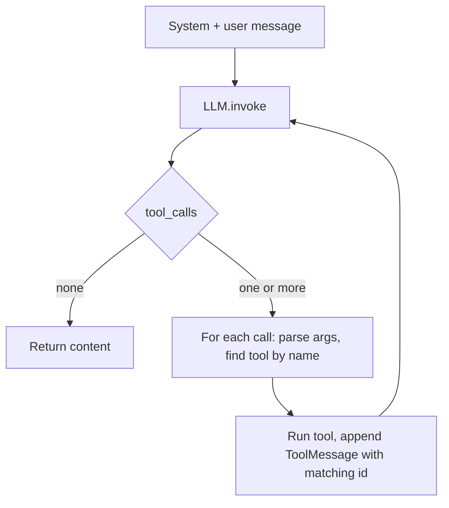

# Building an AI Agent with Tools – Exercise

> [!abstract] TL;DR
> The exercise wraps the tool-calling loop from [[Building Agents with Tools in Python]] in a reusable `Agent` class. Three agents are built on it: a plain chat agent, a calculator agent and a game-stats "data analyst". The loop itself works, including parallel tool calls. The data analyst exposes the real lesson: ==an agent can only reason about what its tools tell it==. `get_games` returns the "top N" games but never says how many games exist, so the model can't answer questions about the whole dataset unless the human supplies the size ("top 10"). ==Tool outputs and descriptions are the agent's entire view of the world. Design them to include the context the agent needs, such as counts, totals and limits.==

**Prerequisites:** [[Building Agents with Tools in Python]] · [[Tool Use]]
**Related:** [[Tool Descriptions in Agentic Systems]] · [[Agent Components and Agent Types]] · [[AI Agents#3. The Agent Loop]] · [[Runtime or Orchestration Layer]] · [[Prompt Injection]]

**Sources:** `python notebooks/Building Agents with tools in python/M01_starter_exercise.ipynb`, plus the course helper library in `lib/` (`llm.py`, `messages.py`, `tooling.py`). The outputs quoted here come from the saved notebook run (`gpt-4o-mini`, temperature 0). The diagnosis of the data-analyst problem, the fixes, the code review and the critical analysis are *beyond the exercise*. The fixed tools were tested locally against `lib/tooling.py`, but not end-to-end against the API.

> [!todo]- Contents
> - [[#1. Core Concepts]]
> - [[#2. The Helper Library – What lib Does for You]]
> - [[#3. The Agent Class]]
> - [[#4. Test Runs and What They Show]]
> - [[#5. The Data Analyst Problem – Hidden Dataset Size]]
> - [[#6. Fixing It – Four Options]]
> - [[#7. Code Review of the Exercise]]
> - [[#8. Pitfalls and Failure Modes]]
> - [[#9. Key Takeaways]]
> - [[#10. Critical Analysis]]
> - [[#11. Self-Test]]
> - [[#12. Glossary]]

---

## 1. Core Concepts

> [!info]+ Definition – Agent class
> A class that bundles an agent's **configuration** (role, instructions, model, temperature, tools) with an `invoke(user_message)` method. The method runs the full tool-calling loop and returns the final text. It applies the "agent definition vs. instantiation" split from [[Implementing Agentic Workflows in Python#4. The Three Code Concerns]] to a tool-using agent.

^def-agent-class

> [!info]+ Definition – Observation boundary
> Everything the model knows about the environment comes from the system and user messages, the **tool schemas**, and the **tool results**. Facts outside that boundary, like the length of a Python list inside a tool, ==don't exist for the model==.

^observation-boundary

The exercise frames the goal as a coding assistant that "intelligently decides when and how to use its available tools" instead of hard-coding when each one runs. The test cases are simpler: chat, arithmetic, and a small game dataset.

---

## 2. The Helper Library – What lib Does for You

| Module | Class / function | What it actually does |
|---|---|---|
| `messages.py` | `SystemMessage`, `UserMessage`, `AIMessage`, `ToolMessage` | Pydantic models with a fixed `role`. `.dict()` turns them into the OpenAI message dicts |
| `tooling.py` | `@tool` → `Tool` | Reads the function **name**, **docstring** (→ `description`) and **type hints** (→ JSON Schema types). Parameters with defaults are **not required**. `Tool.__call__` runs the original function |
| `llm.py` | `LLM` | Wraps `client.chat.completions.create`. Sends every tool's schema with `tool_choice="auto"` and returns an `AIMessage(content, tool_calls)` |

> [!success] This answers an open question from the earlier note
> [[Building Agents with Tools in Python#4. Fixing the Course Snippets]] wasn't sure whether a function decorated with the course's `@tool` could be called directly. It can: `@tool` returns a `Tool` instance whose `__call__` forwards to the function, so `get_weather(**args)` and `tool(**function_args)` both work.

**The schema the model actually sees for `get_games`** (printed from `get_games.dict()`):

```json
{
  "name": "get_games",
  "description": "Returns the top or bottom N games with highest or lowest scores.\nargs:\n    num_games (int): Number of games to return (default is 1)\n    top (bool): If True, return top games, otherwise return bottom (default is True)",
  "parameters": {
    "type": "object",
    "properties": { "num_games": {"type": "integer"}, "top": {"type": "boolean"} },
    "required": [],
    "additionalProperties": false
  }
}
```

Nothing in it mentions how many games there are. That matters in [[#5. The Data Analyst Problem – Hidden Dataset Size]].

---

## 3. The Agent Class

The completed `invoke` (condensed from the notebook):

```python
def invoke(self, user_message: str) -> str:
    messages = [
        SystemMessage(content=f"You're an AI Agent and your role is {self.role}. "
                              f"Your instructoins: {self.instructions}"),   # sic – typo in prompt
        UserMessage(content=user_message),
    ]
    ai_message = self.llm.invoke(messages)
    messages.append(ai_message)

    while ai_message.tool_calls:                       # loop until a plain-text answer
        for call in ai_message.tool_calls:             # handles parallel calls
            function_args = json.loads(call.function.arguments)
            tool = next((t for t in self.tools if t.name == call.function.name), None)
            if tool:
                tool_result = tool(**function_args)
                messages.append(ToolMessage(content=json.dumps(tool_result),
                                            tool_call_id=call.id,
                                            name=call.function.name))
        ai_message = self.llm.invoke(messages)
        messages.append(ai_message)
    return ai_message.content or ""
```



It follows the tool-call invariant from [[Building Agents with Tools in Python#^tool-call-invariant]] and generalizes the one-shot flow into the loop from [[Building Agents with Tools in Python#^agent-loop]]. It has no step limit and no error handling, though (see [[#7. Code Review of the Exercise]]).

> [!note] No memory between calls
> `messages` is rebuilt inside every `invoke`, so each question starts from scratch. "What about the worst one?" after "What's the best game?" would fail. This is by design here. See [[AI Memory]] for adding conversation state.

---

## 4. Test Runs and What They Show

| # | Agent / prompt | Trajectory | Result | Lesson |
|---|---|---|---|---|
| 1 | Coding Assistant, no tools: "What is Python? Be concise" | 1 LLM call | Direct answer | Without tools, the class is just a chat wrapper |
| 2 | Math Assistant: "What is 23 * 45?" | `calculate("23 * 45")` → `1035` → answer | Correct | Basic single tool call |
| 3 | Math Assistant: "multiply 3 by 5 … then later add 7" | **Two parallel calls in one turn**: `"3 * 5"` and `"(3 * 5) + 7"` | 15, then 22 | The model didn't wait for the first result. It re-did the arithmetic inside the second expression. Parallel calls must be independent, so the model folded the dependency into one expression |
| 4 | Game Stats: "best game" | `get_games(num_games=1, top=true)` | Zelda: BotW, 98 | The default argument matches the question |
| 5 | Game Stats: "worst game" | `get_games(num_games=1, top=false)` | Pikmin 3, 85 | Good use of the `top` flag |
| 6 | Game Stats: "average score of the **top 10** games" | `get_games(10)` → `calculate("(98+…+85)/10")` | 91.5 | Two tools chained across loop iterations. **Only worked because the prompt said "10"** |
| 7 | Game Stats: "distribution of platforms for the **top 10** games" | `get_games(10)` → model counts by itself | Switch 4, Wii 2, 3DS 2, GameCube 1, Wii U 1 | Correct, but the counting happened **in the model's head**, not in a tool |

Checks: the 10 scores sum to 915, so 915 / 10 = 91.5 ✓. The platform counts match the data ✓.

---

## 5. The Data Analyst Problem – Hidden Dataset Size

> [!warning] What tripped me up
> To get correct dataset-wide answers I had to phrase the questions as "the **top 10** games". The dataset has exactly 10 games, but ==nothing the agent can observe says so==. The list lives inside `get_games` and its length is never exposed.

^hidden-count

**Why it happens** (see [[#^observation-boundary]]):

| What the model can see | What it says about the dataset size |
|---|---|
| Tool description | "top or bottom N games". N is unbounded and no total is given |
| Parameter schema | `num_games: integer`, default 1. No maximum, no "all" option |
| Tool result | A bare list of length `num_games`. No `total` field |
| System prompt | "bring insights about a game dataset". No size or scope |

So a question like "What's the average score of **all** games?" leaves the model with only bad options:

1. **Guess N.** It might pick 10, 5 or 100. Python slicing (`sorted_games[:100]`) happens to return all 10 safely, but the model has no way to know that.
2. **Use the default (1)** and then average a single game, which is confidently wrong.
3. **Ask the user**, which is the honest choice, but the system prompt doesn't encourage it.
4. **Make up an answer** without calling a tool.

Even when it guesses right, the model can't **verify** completeness. A result of 10 games looks the same whether the dataset has 10 games or 10,000.

> [!important] General principle
> ==A tool that returns a slice must also report the size of the whole.== This is the same reason paginated APIs return `total_count` / `has_more`. Without it, aggregates (average, distribution, "how many") are silently wrong. This is a tool-design problem, not a model problem. Compare [[Tool Descriptions in Agentic Systems#3. Design Principles]].

---

## 6. Fixing It – Four Options

*Beyond the exercise.* Ordered from best to weakest:

### 6.1 Return metadata with every result (recommended)

```python
from typing import Optional

GAMES = [ ... ]   # move the data out of the function so other tools can share it

@tool
def get_games(num_games: Optional[int] = None, top: bool = True) -> dict:
    """Return games from the dataset ranked by score.

    Use for any question about the games dataset. Omit num_games to get
    EVERY game (use this for averages, distributions, counts over the whole dataset).
    The response includes total_games, the size of the full dataset.

    args:
        num_games (int): How many games to return. Omit for all games.
        top (bool): True = highest scores first, False = lowest first.
    """
    ranked = sorted(GAMES, key=lambda g: g["Score"], reverse=top)
    selected = ranked if num_games is None else ranked[:num_games]
    return {"total_games": len(GAMES), "returned": len(selected), "games": selected}
```

- `Optional[int] = None` → `lib/tooling.py` still emits `"type": "integer"`, not required, so the model can **omit** it to get everything. Tested locally: `get_games()` returns all games with `total_games` set.
- `total_games` + `returned` let the model **check completeness** and phrase answers honestly ("top 5 of 10 games").

### 6.2 Add a dataset-info tool

```python
@tool
def get_dataset_info() -> dict:
    """Describe the games dataset: number of games, platforms, score range. Call first if unsure of scope."""
    return {
        "total_games": len(GAMES),
        "platforms": sorted({g["Platform"] for g in GAMES}),
        "score_range": [min(g["Score"] for g in GAMES), max(g["Score"] for g in GAMES)],
    }
```

This is a zero-parameter tool (the schema has empty `properties`, which `lib` handles fine). It gives the agent a discovery step, much like a SQL agent running `SELECT COUNT(*)` or listing tables before querying.

### 6.3 Do the aggregation in a tool

Add `average_score(top_n: Optional[int] = None)` and `platform_counts(top_n: Optional[int] = None)`. Then **the code computes** and the model only explains. This fixes the count problem and the "counting in the model's head" problem from run #7 together. LLMs are unreliable counters over long lists, and that gets worse as the list grows.

### 6.4 Put the size in the prompt (weakest)

Adding "The dataset contains 10 games" to `instructions` or the docstring works today, but it's a **hard-coded fact that will drift** when the data changes. Only use this when the data is truly static.

| Option | Fixes count | Verifiable by model | Survives data changes | Extra LLM calls |
|---|---|---|---|---|
| 6.1 Metadata in result | ✅ | ✅ | ✅ | 0 |
| 6.2 Info tool | ✅ | ✅ | ✅ | +1 (discovery) |
| 6.3 Aggregate tools | ✅ | ✅ | ✅ | 0 to −1 (fewer calculator calls) |
| 6.4 Prompt fact | ✅ | ❌ | ❌ | 0 |

---

## 7. Code Review of the Exercise

*Beyond the exercise.*

| Issue | Where | Risk | Fix |
|---|---|---|---|
| `eval(expression)` in `calculate` | Cell 11 | **Arbitrary code execution.** The model (or [[Prompt Injection|injected text]] it read) can pass `__import__('os').system(...)` | Parse with `ast` and allow only number literals and arithmetic operators (see below) |
| Unknown tool name is silently skipped | `if tool:` with no `else` | The `tool_call.id` gets no `ToolMessage`, so the next API call is rejected (breaks the invariant) | `else:` append a `ToolMessage` with `{"error": "unknown tool"}` |
| No `try` around `json.loads` / `tool(**args)` | Loop body | Malformed arguments or a tool exception crashes the whole agent | Catch and return `{"error": ...}` as the tool result so the model can retry |
| `while ai_message.tool_calls:` without a limit | Loop | Runaway loop and cost | `for _ in range(max_steps)` |
| `for m in messages: print(m)` | End of `invoke` | Debug noise mixed with output | Use a `verbose` flag or `logging` |
| "instructoins" typo | System prompt | Cosmetic. Models tolerate it | Fix the spelling |
| `-> str` annotation, but returns a `list` | `get_games` | Misleading (the return type isn't in the schema) | `-> dict` / `-> list[dict]` |
| Linear `next(...)` tool lookup | Loop | Fine for 2 tools | `{t.name: t for t in tools}` dict, as `LLM` already does |
| `api_key` argument is only a flag | `lib/llm.py` | If you pass a key it's ignored. Both branches read env vars | `OpenAI(api_key=api_key or os.getenv(...))` |
| `load_dotenv` imported but never called | Cell 3 | Works only if `OPENAI_API_KEY` is already set in the environment | Call `load_dotenv()` |

**A safe calculator** (tested locally: returns `91.5` for the average expression and rejects `__import__(...)`):

```python
import ast, operator as op

_OPS = {ast.Add: op.add, ast.Sub: op.sub, ast.Mult: op.mul, ast.Div: op.truediv,
        ast.Mod: op.mod, ast.USub: op.neg, ast.UAdd: op.pos}

def _eval(node):
    if isinstance(node, ast.Constant) and type(node.value) in (int, float):
        return node.value
    if isinstance(node, ast.BinOp) and type(node.op) in _OPS:
        return _OPS[type(node.op)](_eval(node.left), _eval(node.right))
    if isinstance(node, ast.UnaryOp) and type(node.op) in _OPS:
        return _OPS[type(node.op)](_eval(node.operand))
    raise ValueError("Only numbers and + - * / % are allowed")

@tool
def calculate(expression: str) -> float:
    """Evaluate an arithmetic expression using numbers and + - * / % and parentheses."""
    return _eval(ast.parse(expression, mode="eval").body)
```

`**` is left out on purpose, because `9**9**9` would hang the process.

**A hardened loop body:**

```python
tools_by_name = {t.name: t for t in self.tools}
for _ in range(self.max_steps):
    ai_message = self.llm.invoke(messages)
    messages.append(ai_message)
    if not ai_message.tool_calls:
        return ai_message.content or ""
    for call in ai_message.tool_calls:
        tool = tools_by_name.get(call.function.name)
        try:
            args = json.loads(call.function.arguments)
            result = tool(**args) if tool else {"error": f"Unknown tool '{call.function.name}'"}
        except Exception as e:
            result = {"error": f"{type(e).__name__}: {e}"}
        messages.append(ToolMessage(content=json.dumps(result),       # always answer every id
                                    tool_call_id=call.id, name=call.function.name))
return "Stopped: step limit reached."
```

---

## 8. Pitfalls and Failure Modes

| Failure | Symptom | Mitigation |
|---|---|---|
| Hidden dataset size ([[#^hidden-count]]) | Wrong averages or counts, or the user must supply N | Return `total_games`, add an info tool, allow "all" |
| Aggregation done by the model | Miscounts on longer lists | Aggregate in code (6.3); let the model explain |
| Default arguments steer answers | `num_games=1` silently used for "all games" questions | Default to *all* (`None`), or describe the default's meaning |
| Parallel calls with hidden dependencies | Second call can't use the first call's result | Fine when the model folds the dependency into one call (run #3). Otherwise expect sequential turns |
| `eval` tool | Remote code execution | AST allow-list |
| Skipped unknown tool | API error on the next call | Always answer every `tool_call.id` |
| No memory across `invoke` | Follow-up questions lose context | Keep `messages` on `self` if you want a conversation |

---

## 9. Key Takeaways

- [ ] I can wrap the tool loop in an `Agent` class with a role, instructions, model, temperature and tools.
- [ ] I know `@tool` builds the schema from the name, docstring and type hints, and that parameters with defaults become optional.
- [ ] I can read a trajectory and see parallel calls versus calls chained across loop iterations.
- [ ] I understand that the agent only knows what the schemas and tool results tell it ([[#^observation-boundary]]).
- [ ] I design slice-returning tools to also return totals, so aggregates can be checked.
- [ ] I prefer doing aggregation in code over having the model count.
- [ ] I never ship `eval` as a tool, and I always answer every `tool_call.id`, even on errors.

---

## 10. Critical Analysis

- **The tests pass because the questions leak the answer.** Runs #6–7 succeed only because "top 10" hands the agent the one fact it couldn't discover. An eval set needs questions that *don't* contain the scope ("average of all games", "how many Switch games?") to show the gap. That is the general lesson: ==test what the agent must discover, not what you tell it== ([[LLM Evaluation]]).
- **Tool design is interface design.** [[Tool Descriptions in Agentic Systems]] treats tools as an agent-computer interface. This exercise shows the *output* side of that interface matters as much as the description. A human analyst would see the spreadsheet's row count, and the agent needs an equivalent.
- **At scale.** With 10 rows, "return everything and let the model count" is merely risky. With 10,000 rows it overflows the context and costs real money. Real data agents push filtering and aggregation into the tool (SQL, pandas), return small summaries plus totals, and paginate.
- **Reliability.** Run #7's count is a model computation with no tool backing it. If per-item counting accuracy is $p$, a correct distribution over $n$ items needs roughly $p^n$, and at $p = 0.99$ and $n = 100$ that's about $0.37$. Moving the computation into code makes it deterministic.
- **Security.** `calculate` with `eval` plus any tool that reads untrusted text (web, email, user files) is a direct path to code execution through [[Prompt Injection]]. The demo is harmless only because the data is hard-coded.
- **Open questions:** Should agents be prompted to *ask* when scope is ambiguous, or to discover it with tools? How do you write a system prompt that makes "I don't know how many games exist" an acceptable intermediate thought rather than something to guess past?

---

## 11. Self-Test

> [!question]- Q1. Why did the data analyst agent need "top 10" in the question?
> Neither the tool description, the schema nor the tool result reveals how many games the dataset holds. The model can only get N games by asking for N, and it can't tell whether a result is the whole dataset.

> [!question]- Q2. In run #3 the model sent `"3 * 5"` and `"(3 * 5) + 7"` in one turn. Why not `"15 + 7"`?
> Both calls were issued in parallel in the same assistant turn, before any result came back. The model didn't have 15 yet, so it folded the dependency into the second expression.

> [!question]- Q3. What happens if the model calls a tool name that isn't registered in this Agent class?
> The `if tool:` check skips it, so that `tool_call.id` never gets a `ToolMessage`. The next `llm.invoke` sends an assistant tool call with no matching tool result, and the API rejects the request.

> [!question]- Q4. Design – redesign `get_games` so "What's the average score of all games?" works with no hints.
> Make `num_games: Optional[int] = None` mean "all", say so in the docstring, and return `{"total_games", "returned", "games"}`. Optionally add an `average_score()` tool so the code computes the mean.

> [!question]- Q5. Why is `eval(expression)` dangerous as a tool even though only the model calls it?
> The model's arguments can be steered by injected content, so `eval` runs arbitrary Python with the process's permissions. Use an AST allow-list instead.

> [!question]- Q6. Quantitative – the top-10 scores are 98, 97, 97, 93, 92, 92, 88, 87, 86, 85. Verify the agent's 91.5 and give the average of the top 5.
> Sum = 915, so 915/10 = **91.5** ✓. Top 5: 98+97+97+93+92 = 477, so 477/5 = **95.4**.

> [!question]- Q7. Which parameters of `get_games` are required in the generated schema, and why?
> Neither of them (`"required": []`). `lib/tooling.py` marks a parameter required only when it has no default, and both have defaults.

---

## 12. Glossary

| Term | Meaning |
|---|---|
| Agent class | Reusable wrapper of configuration plus a tool loop behind `invoke` |
| Observation boundary | Everything the model can see: messages, tool schemas, tool results |
| Parallel tool calls | Several tool calls emitted in one assistant turn, all before any result returns |
| Chained tool calls | Calls across loop iterations, where later calls use earlier results |
| Metadata in results | Extra fields like `total_games` that describe the whole dataset, not just the slice |
| Discovery tool | A tool (e.g. `get_dataset_info`) that reports scope before querying |
| AST allow-list | Safe expression evaluation that permits only whitelisted syntax nodes |

%%
Study hint: the one-sentence lesson is "a tool that returns a slice must report the size of the whole". When building any data agent, ask: could the agent answer "how many are there?" from what it can observe?
%%
