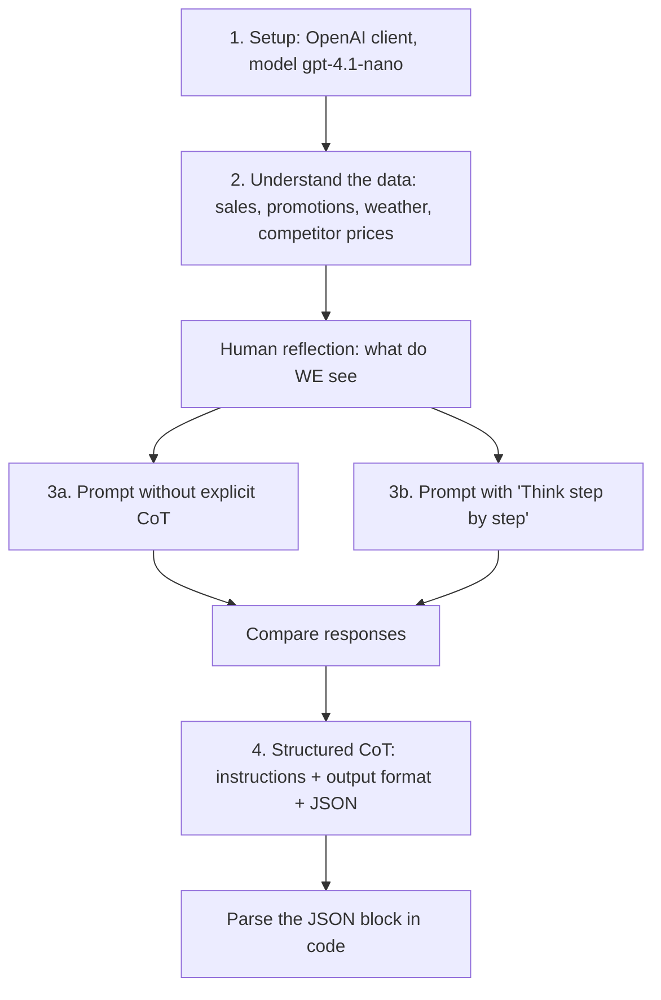

# Chain-of-Thought and ReAct Prompting – Lesson 2 Lab

> [!abstract] TL;DR
> **Demand-Spike Detective, Part I.** An LLM is given four datasets: sales, promotions, weather and competitor pricing. It has to find and explain an unexpected sales spike. The lab moves through three prompts. The first uses **no CoT**. The second adds a simple **"Think step by step"**. The third is a **structured CoT prompt** with an instructions section, a fixed output format and a JSON block that code can parse. The lesson: ==listing the reasoning steps and the output format explicitly matters more than the magic phrase==. Many modern models already reason step by step without being asked.

**Theory:** [[Chain-of-Thought and ReAct]] · **ReAct examples:** [[ReAct prompt Samples]]
**Related:** [[Prompt Instruction Refinement]] · [[Pydantic for Structured LLM Output - Study Guide]] · [[Gate Checks]]

> [!note] Source scope
> These notes are cleaned up from the Lesson 2 notebook you pasted in (Part I, CoT only). The setup, data loading and plotting code are summarized, not reproduced. The prompts and your reflection are kept verbatim. **Part II (ReAct) isn't in this notebook.** For ReAct, see [[Chain-of-Thought and ReAct#The ReAct Loop]] and [[ReAct prompt Samples]]. Section 6 (improvements) and the critical analysis are *beyond the lab*.

> [!todo]- Contents
> - [[#1. The Exercise]]
> - [[#2. The Data]]
> - [[#3. Human Reflection – The Answer Key]]
> - [[#4. Prompt 1 vs 2 – Implicit vs Explicit CoT]]
> - [[#5. Prompt 3 – Structured CoT with Output Format]]
> - [[#6. Making It Production-Grade]]
> - [[#7. Where ReAct Comes In]]
> - [[#8. Pitfalls and Failure Modes]]
> - [[#9. Key Takeaways]]
> - [[#10. Critical Analysis]]
> - [[#11. Self-Test]]
> - [[#12. Glossary]]

---

## 1. The Exercise

**Goal:** guide an LLM to find a sales spike and explain what caused it.



> [!important] "Working with AI agents is still a data problem at its core" (from the lab)
> The first step is always to understand the **business goal** (explain the spike) and the **underlying data**, before writing any prompt. You can't judge the model's answer unless you know what the right answer looks like.

---

## 2. The Data

The notebook loads four synthetic datasets from `lesson_2_lib` into pandas DataFrames and plots three of them.

| Dataset | Loader | Key fields | Plot |
|---|---|---|---|
| **Sales** | `get_sales_data()` | `product_id`, `date`, `quantity` | Quantity over time per product |
| **Promotions** | `get_promotions_data()` | Promotion name, product, dates | (table) |
| **Weather** | `get_weather_data()` | `date`, `temperature.celsius`, `conditions.main` | Temperature with condition labels |
| **Competitor pricing** | `get_competitor_pricing_data()` | `product`, `date`, `competitor_{a,b,c}_price` | Prices per product per competitor |

> [!example]- Setup and plotting code (summary)
> - Client: `OpenAI(base_url="https://openai.vocareum.com/v1", api_key=...)`. Model: `OpenAIModels.GPT_41_NANO`.
> - Helpers: `get_completion(system_prompt, user_prompt, model, client)` and `display_responses(...)` for side-by-side comparison.
> - Sales are sorted by `product_id` and `date`, then plotted with one line per product.
> - Weather: `temperature_c` is extracted from the nested `temperature` dict, and each point is labelled with `conditions["main"]`.
> - Competitor pricing: one line per product per competitor, with the legend outside the plot.

---

## 3. Human Reflection – The Answer Key

Your reflection from the lab (kept verbatim). Use it as the **answer key** to grade the model's responses:

> [!quote] Reflection
> - Sales spike for Product 5 on January 12th
> - The "Weekend Special" promotion which started on January 12th, but that was for Product 2. Still, it may have had an indirect effect on Product 5.
> - Weather was fluctuating between below freezing and above freezing. On the 12th in particular, there was heavy rain.
> - As for Competitor pricing, we see that Product 5's price for one competitor dropped on January 12th, which may have led to more overall consumer interest in that product or may have coincided with an ad campaign.
>
> In practice, a human would look at all these factors and more to determine the cause of the sales spike by digging deeper.

^answer-key

**Grading checklist for any response:**

| Check | Expected |
|---|---|
| Finds the right spike | Product 5, January 12 |
| Mentions the promotion (and that it was for a *different* product) | "Weekend Special", Product 2, possible indirect effect |
| Mentions weather | Heavy rain on the 12th; temperatures around freezing |
| Mentions competitor pricing | One competitor's Product 5 price dropped on the 12th |
| Calls causes hypotheses | "may have", not "caused". Correlation isn't causation |

---

## 4. Prompt 1 vs 2 – Implicit vs Explicit CoT

Both prompts share the same user prompt. The only difference is one line in the system prompt.

```text
SYSTEM (explicit CoT):
You are a meticulous Retail Demand Analyst.
Your task is to analyze provided sales data and promotion schedules to identify
and explain significant sales spikes for specific SKUs.

Think step by step.
```

```text
SYSTEM (no explicit CoT): identical, minus "Think step by step."
```

```text
USER:
Analyze the data provided below and hypothesize causes for any observed sales spikes.

Sales Data:
{sales_data}

Promotions Calendar:
{promotions_data}

Weather Data:
{weather_data}

Competitor Pricing Data:
{competitor_pricing_data}
```

> [!warning] The lab's own caveat
> Many modern LLMs don't need an explicit "think in steps" phrase, because step-by-step reasoning can be built in during training. Run your prompts **with and without** asking for CoT, and **more than once**: separate runs can give different results.

**What to compare** (the lab's observation question: *what changed when CoT was included?*):

| Look at | Why |
|---|---|
| Did both find Product 5 on Jan 12? | Accuracy against the [[#^answer-key\|answer key]] |
| Is the reasoning visible and ordered? | Explicit CoT tends to produce an explicit walk through each dataset |
| Length and structure | CoT answers are usually longer; that isn't always better |
| Consistency across reruns | If the conclusion changes between runs, the prompt is under-specified |

^cot-comparison

See the "CoT: Prompted vs. Built-In Reasoning" section of [[Chain-of-Thought and ReAct]] for why the magic phrase matters less than it used to.

---

## 5. Prompt 3 – Structured CoT with Output Format

The lab's upgrade adds **explicit steps** in an instructions section and a **fixed output format** that ends in a parseable JSON block. Prompt layout: `INSTRUCTIONS → OUTPUT FORMAT → CONTEXT`.

```text
SYSTEM:
You are a meticulous Retail Demand Analyst.
Your task is to analyze provided sales data and promotion schedules to identify
and explain significant sales spikes for specific SKUs.

Think in steps.
```

````text
USER:
## INSTRUCTIONS:

Analyze the data provided below and hypothesize causes for any observed sales spikes.

Instructions:
* Find all sales spikes for each product
* For each product, identify the following:
    * Date of the sales spike
    * Amount of the sales spike and percentage increase
    * Possible causes of the sales spike according to the provided
        * sales data
        * promotion schedule
        * weather conditions
        * competitor pricing data
* Start with your analysis
* Conclude with the single largest spike according to the percentage increase
  with a short explanation for it.

--

## OUTPUT FORMAT:

STRUCTURED ANALYSIS:
[Structured Analysis]

LARGEST SPIKE:
```json
{
    "date": "YYYY-MM-DD",
    "amount_before_increase": "X.XX",
    "amount_after_increase": "X.XX",
    "percentage_increase": "X.XX%",
    "causes": ["Cause 1", "Cause 2", "Cause 3"]
}
```

---

## CONTEXT

Sales Data:
{sales_data}

Promotions Calendar:
{promotions_data}

Weather Data:
{weather_data}

Competitor Pricing Data:
{competitor_pricing_data}
````

^structured-cot-prompt

> [!tip] Why `{{ }}` appears in the notebook
> The prompt is a Python **f-string**, so literal braces in the JSON template have to be doubled (`{{` `}}`). Otherwise Python tries to substitute them as variables.

**Why this prompt is better:**

| Element | Effect |
|---|---|
| Instructions as a checklist | The model's reasoning follows *your* steps (every dataset gets checked) instead of whatever it picks |
| "Start with analysis, conclude with…" | Reasoning comes before the answer, which is the point of CoT |
| Output format | Predictable structure for readers |
| JSON block | **Code can parse the conclusion**, the first step toward chaining |

**Parsing the result** (from the notebook):

```python
def parse_analysis_and_largest_spike(response):
    import json
    if "```json" not in response:
        raise RuntimeError("No LARGEST SPIKE found in response. Looking for: ```json")
    analysis = response.split("```json")[0].strip()
    json_str = response.split("```json")[1].split("```")[0].strip()
    return analysis, json.loads(json_str)
```

The lab's observation questions: *Did the model follow your instructions? How good was its description of the largest spike by percentage?* Grade the answer against the [[#^answer-key|answer key]].

---

## 6. Making It Production-Grade

*(Beyond the lab.)* Three weaknesses in Prompt 3, and how to fix each:

**1. The LLM does arithmetic it shouldn't.** "Amount before/after" and "percentage increase" come from the model, and small models often get arithmetic wrong. Compute the spike in pandas and have the LLM **explain** it:

```python
sales_df["date"] = pd.to_datetime(sales_df["date"])
sales_df = sales_df.sort_values(["product_id", "date"])
sales_df["prev_qty"] = sales_df.groupby("product_id")["quantity"].shift(1)
sales_df["pct_change"] = (sales_df["quantity"] - sales_df["prev_qty"]) / sales_df["prev_qty"] * 100
spike = sales_df.loc[sales_df["pct_change"].idxmax()]   # computed, not guessed
```

Then prompt: *"The largest spike is {spike}. Using the promotions, weather and pricing data, hypothesize causes."* This follows [[Sonar Ticket and Outage Classification - How-To#^compute-dont-ask|compute, don't ask]].

**2. The JSON is parsed but never validated.** Add a gate that checks the numbers against the data:

```python
from pydantic import BaseModel, Field, ValidationInfo, model_validator

class LargestSpike(BaseModel):
    date: str
    amount_before_increase: float
    amount_after_increase: float
    percentage_increase: float            # a number, not "X.XX%"
    causes: list[str] = Field(min_length=1, max_length=5)

    @model_validator(mode="after")
    def matches_data(self, info: ValidationInfo):
        truth = info.context["spike"]      # the pandas row from above
        if self.date != truth["date"].strftime("%Y-%m-%d"):
            raise ValueError(f"largest spike is on {truth['date']:%Y-%m-%d}, not {self.date}")
        if abs(self.percentage_increase - truth["pct_change"]) > 0.5:
            raise ValueError(f"percentage_increase should be {truth['pct_change']:.2f}")
        return self
```

See [[Pydantic for Structured LLM Output - Study Guide]] and [[Gate Checks]].

**3. Causes aren't tied to evidence.** Require each cause to cite the row it relies on, e.g. `{"cause": "...", "evidence": "promotions: Weekend Special, 2024-01-12, product 2"}`. Then check in code that the cited row exists. That separates **grounded hypotheses** from invented ones ([[LLM Hallucinations]]).

---

## 7. Where ReAct Comes In

In this lab all the data is **pasted into the prompt**. That works for four small tables, but it doesn't scale and it assumes you know in advance which data matters. ReAct lets the model **fetch data as it reasons**:

```text
THINK: Sales for P5 jumped on Jan 12. I should check promotions around that date.
ACT:   get_promotions(start="2024-01-10", end="2024-01-13")
OBS:   [{"name": "Weekend Special", "product": "P2", "start": "2024-01-12"}]
THINK: The promotion was for P2, not P5. Check competitor prices for P5.
ACT:   get_competitor_prices(product="P5", date="2024-01-12")
...
```

The trace above is my illustration; the tool names are hypothetical. For the full loop and prompt templates see [[Chain-of-Thought and ReAct#The ReAct Loop]] and the THINK/ACT system prompts in [[ReAct prompt Samples]].

| | This lab (CoT) | ReAct version |
|---|---|---|
| Data access | Everything pasted in up front | Pulled on demand through tools |
| Scales to large data | No, context limits | Yes |
| Reasoning grounded in | Whatever was pasted | Actual observations |
| Risk | Missing context → hallucinated causes | Tool misuse, loops. Cap the steps |

---

## 8. Pitfalls and Failure Modes

| Failure | Symptom | Mitigation |
|---|---|---|
| Relying on the magic phrase | "Think step by step" adds little with modern models | Specify the steps (instructions checklist) |
| Single run treated as the result | Conclusions change between reruns | Run several times; compare; use temperature 0 for analysis |
| LLM arithmetic | Wrong percentage or amounts | Compute in code; the LLM explains |
| Correlation stated as causation | "The rain caused the spike" | Ask for *hypotheses* with evidence and confidence |
| Missing JSON block | `RuntimeError` from the parser | Validate + retry with feedback ([[LLM Feedback Loops]]) |
| Format-only check | JSON parses, numbers wrong | Validate values against the data (§6) |
| Context overload | Large tables pasted in; the model misses rows | Pre-aggregate, or move to ReAct / tools |

---

## 9. Key Takeaways

- [ ] Understand the business goal and the data **before** prompting. Write your own answer key.
- [ ] Explicit "think step by step" matters less with modern models. Test with and without, over several runs.
- [ ] Structured CoT = role + **instructions checklist** + **output format** + context. The steps you list shape the reasoning.
- [ ] End with a **machine-parseable block** (JSON) so code can use the conclusion.
- [ ] Compute numbers in code; use the LLM to explain and hypothesize.
- [ ] Validate the JSON against the data, not only its format.
- [ ] Causes are hypotheses. Require evidence and avoid causal overclaiming.
- [ ] When the data is too large to paste, or unknown in advance, move from CoT to ReAct with tools.

---

## 10. Critical Analysis

- **Evaluation is thin.** The lab compares outputs by eye on one dataset. A proper comparison would run each prompt many times against the answer key and report how often it finds the right spike, how many correct causes it lists, and how consistent it is across runs.
- **CoT text isn't a faithful record of the model's reasoning.** The written reasoning can look plausible while the conclusion came from somewhere else. Treat CoT as a formatting and steering tool, and verify conclusions independently (see [[Chain-of-Thought and ReAct#Limitations of Chain-of-Thought]]).
- **Synthetic data flatters the method.** The spike is planted and the candidate causes line up on the same date. Real retail data has seasonality, stockouts and reporting lag, where "the day something else happened" is a much weaker signal.
- **Security.** Data pasted into prompts is untrusted input. A promotions table containing instruction-like text could steer the analysis ([[Prompt Injection]]).

> [!question] Discussion questions
> 1. Which of the four candidate causes would you trust most, and what extra data would confirm it?
> 2. How would you measure whether explicit CoT helps *your* model on *this* task?

---

## 11. Self-Test

> [!question]- Q1. What is the only difference between the two prompts in step 3?
> The explicit-CoT system prompt adds "Think step by step." The role, task and user prompt are identical, so any difference in the output comes from that phrase and from run-to-run variation.

> [!question]- Q2. Why does the lab suggest running each prompt more than once?
> LLM outputs are stochastic. One run can't tell a real effect of the prompt apart from random variation.

> [!question]- Q3. What does the structured CoT prompt add, and why does each part help?
> An **instructions checklist** (steers the reasoning through every dataset), **"start with analysis, conclude with…"** (reasoning before the answer), and an **output format with a JSON block** (predictable, and parseable by code).

> [!question]- Q4. (Quantitative) Product 5 sold 20 units on Jan 11 and 50 on Jan 12. What should `percentage_increase` be? Why compute it in code?
> $(50-20)/20 \times 100 = 150\%$. Small models often get arithmetic wrong. Computing it in pandas makes it exact, and the gate can then check the LLM's figure against it.

> [!question]- Q5. (Design) Turn this lab into a gated prompt chain.
> > [!example] Answer sketch
> > (1) **Code:** detect spikes per product with pandas (percentage change above a threshold). (2) **LLM:** for the top spike, list candidate causes, each citing a row from promotions, weather or pricing, as JSON. (3) **Gate:** Pydantic checks the date and figures against the computed spike, and that each cited row exists. (4) **LLM:** write a short business explanation using only the validated causes, labelled as hypotheses. (5) **Human** review before anything goes into a report.

### Flashcards

> [!tip] Flashcards
> Review this lab in [[Chain-of-Thought and ReACT Prompting - Flashcards]] using the Spaced Repetition plugin.

---

## 12. Glossary

| Term | Meaning |
|---|---|
| Chain-of-Thought (CoT) | Prompting the model to reason in explicit intermediate steps before answering |
| Explicit vs implicit CoT | Asking for step-by-step reasoning vs relying on the model's built-in reasoning |
| Structured CoT | CoT with a checklist of instructions and a fixed output format |
| Answer key | Your own analysis of the data, used to grade model outputs |
| ReAct | A Reason + Act loop: THINK → ACT (tool) → OBSERVATION → repeat |
| SKU | Stock-keeping unit: an individual product |
