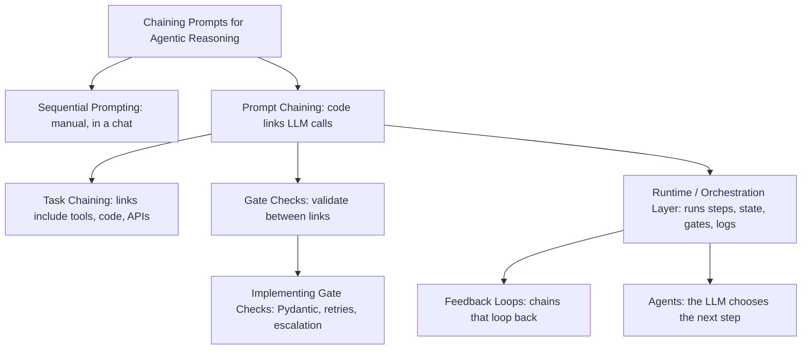
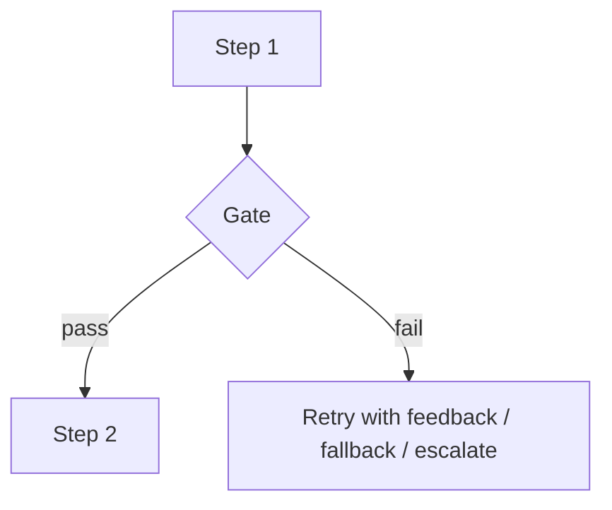

# Chaining Prompts for Agentic Reasoning

> [!abstract] TL;DR
> Chaining splits one big, unreliable prompt into a sequence of small, focused steps. ==Each step's output becomes the next step's input, and a gate check validates it on the way==. The pieces fit together like this:
> - [[Sequential Prompting]] is the manual form: you walk a chat through the steps yourself.
> - **Prompt chaining** is the programmatic form, and [[Task Chaining]] extends it to links that are tools, code or humans.
> - [[Gate Checks]] are the quality control between steps, and [[Implementing Gate Checks]] shows how to build them.
> - The [[Runtime or Orchestration Layer]] is the code that runs it all.
>
> This note is the **hub**. Each section is a short summary that points to a detailed note. The patterns and trade-offs are in [[Prompt Chaining for Agentic Reasoning - Study Guide]].

> [!note] Source scope
> Your original note was a row of five related links. They are all kept, and each one now has a section explaining it and how it relates to the others. The definitions of sequential prompting, prompt chaining and gate checks follow the lecture as captured in [[Sequential Prompting]] and [[Gate Checks]]. The distinction between task chaining and prompt chaining, and the description of the orchestration layer, are *my framing*; course materials use these terms loosely.

> [!todo]- Contents
> - [[#1. Concept Map]]
> - [[#2. Sequential Prompting – The Manual Form]]
> - [[#3. Prompt Chaining – The Programmatic Form]]
> - [[#4. Task Chaining – Steps That Are Not All Prompts]]
> - [[#5. Gate Checks – Quality Control Between Steps]]
> - [[#6. Implementing Gate Checks]]
> - [[#7. Runtime or Orchestration Layer – What Runs the Chain]]
> - [[#8. Why Chaining Enables Agentic Reasoning]]
> - [[#9. Worked Example – Lesson 4 Claim Triage]]
> - [[#10. Pitfalls and Failure Modes]]
> - [[#11. Key Takeaways]]
> - [[#12. Critical Analysis]]
> - [[#13. Self-Test]]
> - [[#14. Glossary]]
> - [[#Further Reading]]

---

## 1. Concept Map



^concept-map

| Concept                       | One-liner                                                 | Note                                                                                |
| ----------------------------- | --------------------------------------------------------- | ----------------------------------------------------------------------------------- |
| Sequential prompting          | You feed each step's result into the next prompt by hand  | [[Sequential Prompting]]                                                            |
| Prompt chaining               | Code passes one LLM call's output to the next             | [[Prompt Chaining for Agentic Reasoning - Study Guide]]                             |
| Task chaining                 | A chain of *tasks*, some LLM calls and some tools or code | [[Task Chaining]]                                                                   |
| Gate checks                   | Programmatic validation between steps                     | [[Gate Checks]]                                                                     |
| Implementing gate checks      | How gates are built in practice                           | [[Implementing Gate Checks]] · [[Pydantic for Structured LLM Output - Study Guide]] |
| Runtime / orchestration layer | The code that executes the chain                          | [[Runtime or Orchestration Layer]]                                                  |

---

## 2. Sequential Prompting – The Manual Form

> [!info]+ Definition – Sequential prompting
> Guiding an LLM through a task **one step at a time**, where each prompt uses the previous step's output. Often done by hand in a single chat session.

^def-sequential

- **Lecture example:** (1) research key concepts of AI agents → (2) summarize that research → (3) draft a LinkedIn post from the summary.
- **Why it works:** it mirrors how people solve problems, one goal at a time. Each step is simpler, so accuracy improves, and each prompt can be refined on its own.
- **Limitation:** a human is the "glue". It doesn't scale, isn't repeatable, and has no automated checks.

More in [[Sequential Prompting]].

---

## 3. Prompt Chaining – The Programmatic Form

> [!info]+ Definition – Prompt chaining
> Linking LLM calls **in code**, so the output of one prompt is automatically passed as input to the next. The same decomposition as sequential prompting, but repeatable, testable and automatable.

^def-prompt-chaining

```python
facts   = llm(EXTRACT_PROMPT, document)          # step 1
summary = llm(SUMMARIZE_PROMPT, facts)           # step 2 uses step 1
post    = llm(DRAFT_PROMPT, summary, goal=task)  # step 3 uses step 2 (+ the original goal)
```

**Why chain instead of one big prompt:**

| One big prompt | Chain |
|---|---|
| Many instructions compete for attention | One job per step |
| Hard to tell which part failed | Each step can be inspected and tested |
| Must use the same model for everything | Right-size the model per step |
| No place to check intermediate results | Gates between steps |

The cost: more calls, more latency, and errors that can spread from step to step. Reliability compounds ($0.95^5 \approx 0.77$), which is why gates matter. The full set of patterns (sequential, routing, parallel, map-reduce, orchestrator-workers, evaluator-optimizer, plan-and-execute) is in [[Prompt Chaining for Agentic Reasoning - Study Guide#4. Chaining Patterns|the study guide]].

---

## 4. Task Chaining – Steps That Are Not All Prompts

> [!info]+ Definition – Task chaining
> Chaining at the level of **tasks** rather than prompts. Each link is a subtask that may be an LLM call, a tool call, a database query, a code function, or a human step. The chain is defined by the task decomposition, not by the prompts.

^def-task-chaining

| | Prompt chaining | Task chaining |
|---|---|---|
| Unit | An LLM call | A subtask (LLM, tool, code, human) |
| Example link | "Summarize these facts" | "Look up the account in Sonar" |
| Focus | Prompt design per step | Task decomposition and data handoffs |

**Example:** ticket triage in [[Sonar Ticket and Outage Classification - How-To]] is a task chain. LLM extraction → **code rule** on account data → LLM classification → **API write-back**. Only two of the four links are prompts.

> [!tip] Design principle
> When you decompose, ask of each subtask: *does this need an LLM at all?* Lookups, arithmetic, and fixed routing rules belong in code. Use the LLM for reading free text, judgment and writing. See [[Sonar Ticket and Outage Classification - How-To#^compute-dont-ask|compute, don't ask]].

> [!info] Go deeper
> [[Task Chaining]] covers the executor decision tree, typed state objects, idempotency and resume, and a six-link activation example. [[Task Decomposition]] covers how to find the links in the first place.

---

## 5. Gate Checks – Quality Control Between Steps

> [!info]+ Definition – Gate check
> ![[Gate Checks#^def-gate-check]]

Three core types from the lecture:
- **Format:** structure, JSON/XML, required fields, lengths.
- **Content:** keywords, topic, relevance.
- **Logic:** numerical and logical sense, whether code compiles.

Common additions are grounding, safety/policy, confidence, budget, action preconditions, and human approval. The full breakdown, failure strategies and gate ordering are in [[Gate Checks]].



---

## 6. Implementing Gate Checks

The main note is [[Implementing Gate Checks]]. It defines a gate as a function returning PASS, RETRY(feedback), REROUTE or STOP; shows how to compose gates cheapest-first inside a bounded validate–retry loop; and covers the metrics for tuning gates. Supporting notes:

| Need | Where it's covered |
|---|---|
| Gate interface, composition, metrics | [[Implementing Gate Checks]] |
| Pydantic models as gates; validators that check against the source | [[Pydantic for Structured LLM Output - Study Guide]] |
| Retry with error feedback, stop conditions, monitoring | [[LLM Feedback Loops]] · [[Pydantic for Structured LLM Output - Study Guide#4. The Validate–Retry Loop\|validate–retry loop]] |
| Full worked implementation on a real workflow | [[Sonar Ticket and Outage Classification - How-To]] |
| Gate types and ordering | [[Gate Checks#5. Designing a Gate Stack]] |

The minimal pattern:

```python
for attempt in range(3):
    raw = llm(prompt)
    try:
        result = Schema.model_validate_json(raw, context={"source": source})  # the gate
        break
    except ValidationError as e:
        prompt = add_feedback(prompt, raw, e.errors())                      # retry with feedback
else:
    result = escalate(source)                                               # never fail silently
```

The fuller version, `gated_step`, adds content and logic gates, REROUTE and logging: [[Implementing Gate Checks#3. Composing Gates in a Chain]].

---

## 7. Runtime or Orchestration Layer – What Runs the Chain

> [!info]+ Definition – Orchestration layer
> The **code (or framework) that executes a chain**. It decides which step runs next, passes data between steps, runs the gates, handles retries and failures, enforces budgets, and logs everything. The prompts say *what* each step does. The orchestration layer controls *when and how* the steps run.

^def-orchestration

| Responsibility | Example |
|---|---|
| **Control flow** | Step order, branching (routing), parallel fan-out, loops |
| **State / data passing** | Carry extracted facts forward; re-inject the original goal |
| **Gate execution** | Run validators; choose retry, fallback or escalation |
| **Error handling** | Timeouts, API failures, retry caps |
| **Budgets** | Token, cost, time and iteration limits |
| **Observability** | Trace log of every prompt, output, gate result |
| **Security boundaries** | Tool permissions, human-approval steps, secrets |

^orchestration-duties

> [!important] Where control lives
> In a **chain**, the orchestration layer (your code) decides the next step. In an **agent**, the LLM decides and the orchestration layer only enforces limits. Moving along that spectrum is the central design choice in agentic systems ([[Runtime or Orchestration Layer#3. Where Control Lives – Chain to Agent|control spectrum]]).

> [!info] Go deeper
> [[Runtime or Orchestration Layer]] covers the runtime loop, a minimal runtime in Python, durable state and resume, budget math, tracing, framework options, and how the Lesson 4 notebook would look in production.

---

## 8. Why Chaining Enables Agentic Reasoning

- **Decomposition** makes reasoning explicit: each step is a visible, checkable intermediate result, like a [[Chain-of-Thought and ReAct|chain of thought]] made into structure.
- **Gates** add self-checking. A chain with gates and retries is a system that notices its own errors ([[LLM Feedback Loops]]).
- **Tool links** (task chaining) connect reasoning to the real world.
- **Giving the LLM control of the next step** turns the chain into an agent: routing, then orchestrator-workers, then ReAct. Every agent pattern is a chain in which the model has more control over the flow.

---

## 9. Worked Example – Lesson 4 Claim Triage

How the Lesson 4 notebook maps onto each concept:

| Concept | In the notebook |
|---|---|
| Decomposition / task chain | Stage I extract → Stage II severity → Stage III route |
| Prompt chaining | `ClaimInformation` → JSON → severity prompt → routing prompt |
| Gate checks | `gate1_validate_claim_info`, `gate2_cost_range_ok`, `gate3_validate_routing` |
| Implementing gates | Pydantic models with `Literal` fields and `Field` constraints |
| Orchestration layer | The Python functions and list comprehensions that call each stage and skip `None` results |

What the notebook leaves out, and how the other notes add it: grounding checks, two-sided range checks, retry with feedback, and a visible failure destination instead of `None`. See [[Sonar Ticket and Outage Classification - How-To#^notebook-gaps|notebook gaps]].

---

## 10. Pitfalls and Failure Modes

| Failure | Symptom | Mitigation |
|---|---|---|
| Error propagation | Bad output in step 1 becomes confident nonsense at the end | Gates at every high-risk handoff |
| Goal drift | Later steps optimize for the previous step, not the user's goal | Re-inject the original request |
| Over-chaining | Latency and cost with no quality gain | Merge steps that don't need separate checks; measure against a single prompt |
| LLM doing code's job | Wrong arithmetic or routing | Move deterministic links to code (task chaining) |
| No orchestration observability | Can't tell which step failed | Trace log per step and per gate |
| Silent failures | Items disappear | Every failure goes to retry, a queue, or an alert |

---

## 11. Key Takeaways

- [ ] Sequential prompting is manual, prompt chaining is programmatic, and task chaining mixes LLM calls with tools and code.
- [ ] Each step does one job, and its output is the next step's input.
- [ ] Gate checks (format, content, logic, plus others) validate between steps and stop errors from spreading.
- [ ] Implement gates with Pydantic plus retry-with-feedback and escalation. Never fail silently.
- [ ] The orchestration layer runs the chain: control flow, state, gates, errors, budgets, logs.
- [ ] Chains become agents as control of the next step moves from your code to the LLM.

---

## 12. Critical Analysis

- **Chaining isn't free.** Each link adds latency, cost and a point where errors can compound. The honest benchmark is a single well-crafted prompt, or best-of-*k*, at equal cost. A chain should beat it on quality, debuggability, or both.
- **Terms are loose.** "Sequential prompting", "prompt chaining" and "task chaining" overlap across sources. The useful distinction is **who glues the steps together** (a human or code) and **what the links are** (prompts only, or mixed tasks).
- **The orchestration layer is where reliability and security actually live.** Prompts suggest; code enforces. Permissions, budgets and approval steps belong there, not in prompt text (see [[Prompt Injection]]).

> [!question] Discussion questions
> 1. For a workflow you know, which links truly need an LLM, and which could be plain code?
> 2. At what point would you move from plain Python orchestration to a framework?

---

## 13. Self-Test

> [!question]- Q1. What's the difference between sequential prompting and prompt chaining?
> The same decomposition, but different glue. In sequential prompting a **human** passes each output to the next prompt, usually in a chat. In prompt chaining, **code** does it automatically, which makes it repeatable, testable and able to have gates.

> [!question]- Q2. How does task chaining differ from prompt chaining?
> Task chaining links **subtasks**, which can be LLM calls, tools, code, API calls or human steps. Prompt chaining links LLM calls. Most real systems are task chains.

> [!question]- Q3. List five responsibilities of the orchestration layer.
> Any five of: control flow, state/data passing, gate execution, error handling and retries, budgets, observability/logging, security boundaries.

> [!question]- Q4. (Quantitative) A 4-step chain has 90% reliability per step and no gates. What is end-to-end reliability, and how many steps at 90% can you have before it drops below 50%?
> $0.9^4 \approx 0.656$. Solve $0.9^n < 0.5$: $n > \ln 0.5 / \ln 0.9 \approx 6.58$, so **7 steps**. Gates and retries are what keep longer chains usable.

> [!question]- Q5. (Design) Turn "research AI agents → summarize → write a LinkedIn post" into a gated task chain.
> > [!example] Answer sketch
> > (1) **Tool:** web search for 5 sources → gate: at least 3 distinct, reachable sources. (2) **LLM:** extract key points, each with a source quote → gate: quotes appear in the fetched pages (grounding). (3) **LLM:** summarize → gate: every summary claim maps to an extracted point. (4) **LLM:** draft the post, with the original goal re-injected → gates: ≤ 1,300 characters, required hashtags, tone rubric (LLM judge). (5) **Human approval** before posting. The orchestration layer logs each step and caps retries at 2.

### Flashcards

> [!tip] Flashcards
> Chaining concepts are covered in [[Prompt Chaining for Agentic Reasoning - Flashcards]] and [[Task Chaining - Flashcards]]; gate checks in [[Gate Checks - Flashcards]] and [[Implementing Gate Checks - Flashcards]]; orchestration in [[Runtime or Orchestration Layer - Flashcards]].

---

## 14. Glossary

| Term | Meaning |
|---|---|
| Sequential prompting | Manual, step-by-step prompting where a human carries outputs forward |
| Prompt chaining | Code links LLM calls output-to-input |
| Task chaining | Chain of subtasks mixing LLM calls, tools, code and humans |
| Gate check | Programmatic validation between chain steps |
| Orchestration layer | Code or framework that runs the chain: flow, state, gates, errors, logs |
| Handoff | The data passed from one link to the next |
| Goal re-injection | Including the original request in later steps to prevent drift |

---

## Further Reading

- [Anthropic – Building effective agents (prompt chaining and workflow patterns)](https://www.anthropic.com/engineering/building-effective-agents)
- Deeper notes in this vault: [[Prompt Chaining for Agentic Reasoning - Study Guide]] · [[Gate Checks]] · [[LLM Feedback Loops]] · [[Pydantic for Structured LLM Output - Study Guide]] · [[Sonar Ticket and Outage Classification - How-To]]
