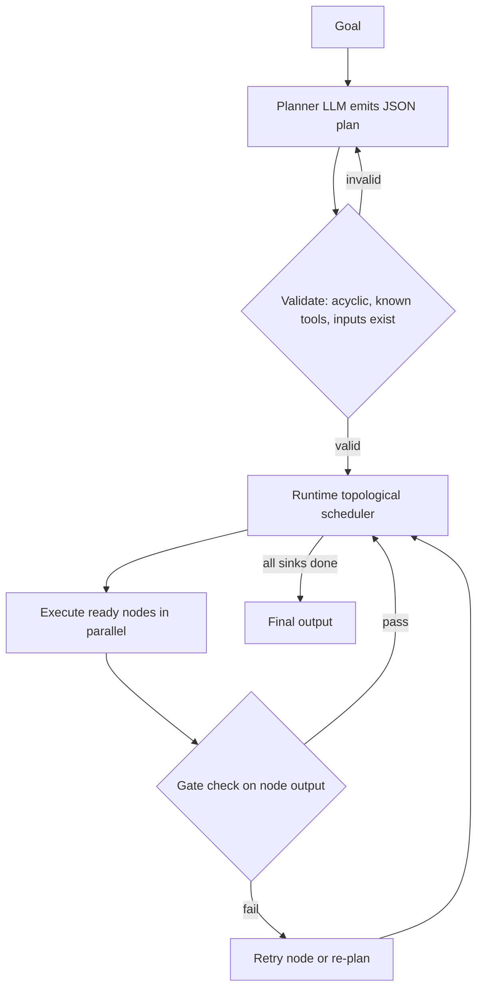
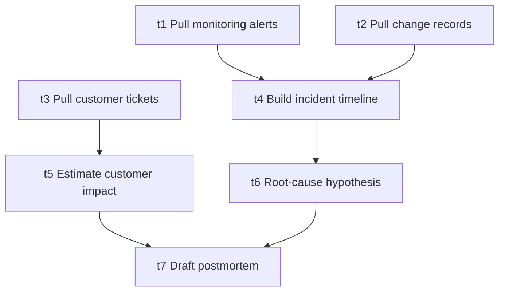

# Directed Acyclic Graph (DAG)

> [!abstract] TL;DR
> A DAG is a set of nodes joined by one-way edges with ==no path that returns to its starting node==. In agentic systems the nodes are subtasks (LLM calls, tool calls, code) and the edges are data or ordering dependencies. Because a DAG has no cycles it always has a **topological order**. That order lets a runtime schedule steps, run independent branches in parallel, and prove the workflow terminates. Loops such as retries and re-planning have to live *outside* the graph, in the runtime.

**Prerequisites:** [[Task Decomposition]] · [[Task Chaining]]
**Related:** [[Planning Agents]] · [[Runtime or Orchestration Layer]] · [[Sequential Prompting]] · [[Multi-Agent Systems]] · [[Tree-of-Thought]] · [[AI Reliability]]

> [!note] Source scope
> Concept hub, written to resolve links from [[Task Decomposition]] and [[Planning Agents]]. The material is *beyond the lecture*. It uses standard graph theory and the papers in [[#Further Reading]].

> [!todo]- Contents
> - [[#1. Core Concepts]]
> - [[#2. Topological Order and Scheduling]]
> - [[#3. DAGs in Agentic Systems]]
> - [[#4. Worked Example – Outage Postmortem DAG]]
> - [[#5. Pitfalls and Failure Modes]]
> - [[#6. Key Takeaways]]
> - [[#7. Critical Analysis]]
> - [[#8. Self-Test]]
> - [[#9. Glossary]]
> - [[#Further Reading]]

## 1. Core Concepts

> [!info]+ Definition – Directed Acyclic Graph
> A graph $G = (V, E)$ where every edge $(u, v) \in E$ has a direction ($u \to v$) and no directed cycle exists. You can never follow edges from a node and arrive back at it.

^def-dag

| Term | Meaning |
|---|---|
| Node / vertex | One unit of work, e.g. "extract timeline" |
| Edge $u \to v$ | $v$ depends on $u$ (needs its output, or must run after it) |
| Source / root | Node with in-degree 0; it can start immediately |
| Sink | Node with out-degree 0; usually the final output |
| Topological order | A linear ordering where every edge points forward |
| Critical path | The longest weighted path from a source to a sink. It sets the minimum possible latency |
| Fan-out / fan-in | One node feeding many, or many feeding one (map / reduce) |

Sequences and trees are special cases of a DAG:

| Structure | Shape | Typical vault example |
|---|---|---|
| Chain | Every node has ≤1 parent and ≤1 child | [[Sequential Prompting]], [[Task Chaining]] |
| Tree | Every node has ≤1 parent | [[Tree-of-Thought]] search tree, hierarchical decomposition |
| DAG | Nodes may have several parents | Parallel research → merge → report |
| Cyclic graph | Contains loops | ReAct loop, [[LLM Feedback Loops]] (not a DAG) |

## 2. Topological Order and Scheduling

> [!info]+ Theorem – A directed graph has a topological order if and only if it is acyclic

^topo-order

**Kahn's algorithm** repeatedly removes nodes whose in-degree is 0. It runs in $O(|V| + |E|)$ time. If nodes are left over at the end, the graph has a cycle, which makes it a cheap validator for LLM-generated plans.

```python
from collections import deque

def topo_sort(nodes, edges):          # edges: list of (u, v)
    indeg = {n: 0 for n in nodes}
    children = {n: [] for n in nodes}
    for u, v in edges:
        children[u].append(v); indeg[v] += 1
    ready = deque(n for n in nodes if indeg[n] == 0)
    order = []
    while ready:
        n = ready.popleft(); order.append(n)
        for c in children[n]:
            indeg[c] -= 1
            if indeg[c] == 0: ready.append(c)
    if len(order) != len(nodes):
        raise ValueError("cycle detected – plan is not a DAG")
    return order
```

**Parallel scheduling.** At any moment, every node in `ready` can run at the same time. With unlimited workers:

$$
T_{\text{DAG}} = \max_{\text{paths } P} \sum_{v \in P} t_v \quad(\text{critical path}) \qquad\text{vs.}\qquad T_{\text{chain}} = \sum_{v \in V} t_v
$$

**Reliability.** The run succeeds only if every node succeeds. With independent failures, that means $P = \prod_{v \in V} p_v$, the same $p^n$ compounding as in a chain (see [[Task Decomposition]]). ==Parallelism lowers latency, not error compounding==.

^dag-reliability

## 3. DAGs in Agentic Systems



Here the plan itself is acyclic. The loops (validate→re-plan, gate→retry) live in the [[Runtime or Orchestration Layer]]. That split keeps each *plan* analysable while letting the *system* still adapt.

| Where DAGs appear | Role |
|---|---|
| [[Planning Agents]] (e.g. LLMCompiler-style planners) | The LLM outputs a task graph and the executor runs independent calls in parallel |
| Workflow engines (Airflow, Prefect, Dagster) | Data/ML pipelines declared as DAGs |
| LangGraph / agent frameworks | Graphs of nodes. Note that these *allow* cycles, so they are general state machines, not strictly DAGs |
| [[Multi-Agent Systems]] | Agent A and agent B work in parallel, then agent C merges |
| Build systems, spreadsheets | Classic dependency DAGs. They recompute only downstream nodes when an input changes |

A plan node usually looks like this (compare [[Pydantic for Structured LLM Output - Study Guide|Pydantic]] schemas):

```json
{"id": "t3", "tool": "summarize", "inputs": {"logs": "$t1.output", "tickets": "$t2.output"}, "depends_on": ["t1", "t2"]}
```

## 4. Worked Example – Outage Postmortem DAG

This builds on [[Task Decomposition#4. Worked Example – Outage Postmortem]].



| Node | Time (s) | Success $p$ |
|---|---|---|
| t1, t2, t3 (tool calls) | 2 each | 0.99 |
| t4 timeline (LLM) | 6 | 0.95 |
| t5 impact (LLM) | 5 | 0.95 |
| t6 root cause (LLM) | 8 | 0.90 |
| t7 draft (LLM) | 10 | 0.95 |

- **Chain latency:** $3 \cdot 2 + 6 + 5 + 8 + 10 = 35$ s.
- **DAG critical path:** t1→t4→t6→t7 = $2 + 6 + 8 + 10 = 26$ s, a ≈26% saving. The t3→t5 branch (7 s) runs hidden in parallel with it.
- **Reliability** is the same in both: $0.99^3 \cdot 0.95^3 \cdot 0.90 \approx 0.970 \cdot 0.857 \cdot 0.90 \approx 0.75$. To raise it, add [[Gate Checks]] and retries on t6, the weakest node. Topology alone won't help.

## 5. Pitfalls and Failure Modes

| Failure | Symptom | Mitigation |
|---|---|---|
| LLM emits a cyclic plan | Scheduler hangs or deadlocks | Validate with Kahn's algorithm before execution, then re-plan |
| Hidden dependency (missing edge) | Parallel nodes conflict or read stale data | Make shared state explicit; nodes only read declared inputs |
| Spurious edges | Serialised work, no parallel speed-up | Review the critical path; drop edges with no data flow |
| Dangling references (`$t9.output` does not exist) | Runtime KeyError | Schema-validate the plan: every `depends_on` must name a real node |
| Fan-in context overflow | Merge node truncates inputs | Summarise branches before merge; set token budgets per edge |
| Forcing a DAG on inherently iterative work | Brittle plans, many re-plans | Use a bounded loop in the runtime ([[LLM Feedback Loops]], ReAct) |
| Side-effecting nodes re-run on retry | Duplicate tickets or emails | Idempotency keys; checkpoint completed nodes |

## 6. Key Takeaways

- [ ] A DAG means directed edges and ==no cycles==, which guarantees a topological order and termination.
- [ ] Chains and trees are special cases of DAGs.
- [ ] Parallel latency is set by the **critical path**, not the sum of all steps.
- [ ] Reliability still compounds multiplicatively across all nodes ([[#^dag-reliability]]).
- [ ] Always validate LLM-generated plans (acyclic, real tools, declared inputs) before running them.
- [ ] Keep loops (retry, re-plan, feedback) in the runtime and keep the plan acyclic.

## 7. Critical Analysis

- **Limits of the abstraction.** Many agent tasks are exploratory: you don't know step 3 until step 2 returns. A static DAG plan fits these tasks badly. Research such as ReWOO and LLMCompiler shows latency and cost gains *when dependencies can be predicted up front*. The gains shrink as observation-dependent branching increases.
- **Evidence quality.** Reported speed-ups come from benchmark suites (multi-hop QA, tool-use tasks) using specific models. They are not guarantees for enterprise workflows. Treat them as upper bounds and measure your own critical path.
- **At scale.** Wide fan-out hits API rate limits and cost ceilings, so a real scheduler needs concurrency caps. Also, when failures correlate (the same model and prompt style everywhere), the product-of-probabilities model is *optimistic*.
- **Evaluation.** Score plan validity (acyclic, executable), plan optimality (edges vs. a gold dependency set), end-to-end task success, wall-clock latency vs. a sequential baseline, and cost per task.
- **Security.** An LLM-authored graph is untrusted code. A [[Prompt Injection|prompt-injected]] planner can add nodes that call dangerous tools or send data outside the organisation. Mitigations: an allow-list of tools per node, a human-approval gate on side-effecting sinks, and least-privilege credentials per node.

> [!question] Discussion
> 1. When is a bounded cyclic graph (LangGraph-style) preferable to a DAG plus an external re-plan loop?
> 2. How would you detect a *missing* edge automatically, before it causes a race condition?
> 3. Should a planner model be rewarded for shorter critical paths, and could that encourage it to drop real dependencies?

## 8. Self-Test

> [!question]- Q1. Why is acyclicity necessary for a topological order to exist
> If there were a cycle $a \to b \to \dots \to a$, then $a$ would have to come before itself. Conversely, every DAG has at least one source, and removing it repeatedly (Kahn) produces an ordering.

> [!question]- Q2. Five nodes each with p = 0.96. Compare reliability as a chain vs. a DAG with two parallel branches
> They are identical: $0.96^5 \approx 0.815$. Every node must still succeed. Parallelism changes latency only.

> [!question]- Q3. Nodes A(3s) and B(5s) are sources, C(4s) needs both, D(2s) needs A. Critical path and chain latency
> Paths: B→C = 9 s, A→C = 7 s, A→D = 5 s. The critical path is **9 s**. The chain would take $3+5+4+2 = 14$ s.

> [!question]- Q4. Design – how would you make an LLM planner's DAG output safe to execute
> Constrain the output with a schema (Pydantic). Check that every `depends_on` exists and that Kahn's algorithm finds no cycle. Check tools against a per-task allow-list. Cap node count and fan-out. Put human approval before side-effecting sinks. Checkpoint node outputs so retries are idempotent.

> [!question]- Q5. Is a ReAct agent's execution trace a DAG
> The *trace* of one run is a chain, which is a DAG. The *control structure* is a loop, so it is not a DAG. The loop decides the next node at runtime.

> [!tip] Flashcards
> Review this topic with [[Directed Acyclic Graph (DAG) - Flashcards]].

## 9. Glossary

| Term | Definition |
|---|---|
| DAG | Directed graph with no directed cycles |
| In-degree | Number of incoming edges |
| Topological sort | An ordering where every edge points forward |
| Kahn's algorithm | $O(V+E)$ topological sort that also detects cycles |
| Critical path | Longest weighted source-to-sink path; minimum latency |
| Fan-out / fan-in | Branching out to parallel work / merging it back |
| Idempotent | Safe to run more than once with the same effect |

## Further Reading

- [Kahn (1962), "Topological sorting of large networks", CACM](https://dl.acm.org/doi/10.1145/368996.369025)
- [Kim et al. (2023), "An LLM Compiler for Parallel Function Calling"](https://arxiv.org/abs/2312.04511)
- [Xu et al. (2023), "ReWOO: Decoupling Reasoning from Observations"](https://arxiv.org/abs/2305.18323)
- [Apache Airflow – DAGs concept docs](https://airflow.apache.org/docs/apache-airflow/stable/core-concepts/dags.html)

%% Study hint: connect the critical-path idea to the p^n compounding in Task Decomposition – topology fixes latency, gates fix reliability. %%
