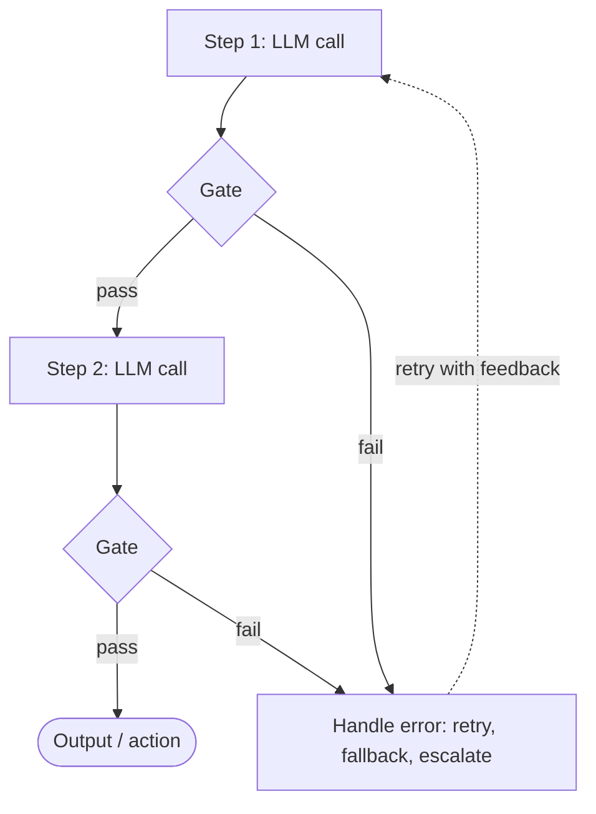
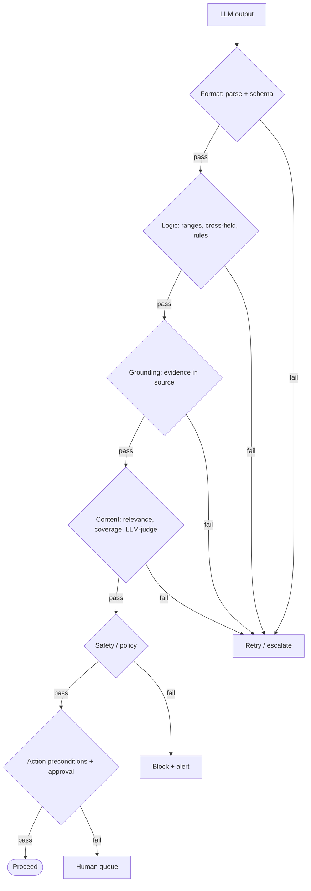

# Gate Checks

> [!info]+ Definition – Gate check
> Gate checks are programmatic validations placed between steps in a prompt chain. These are quality control points, ensuring an output meets criteria before being passed on.

^def-gate-check

> [!abstract] TL;DR
> A gate sits between two steps of a chain and decides **pass, retry, reroute, or stop**. The lecture defines three core types: **format**, **content** and **logic**. Production systems usually add a few more: grounding, safety/policy, confidence, budget, action preconditions, and human approval. ==Order gates from cheapest to most expensive, and give every failure a destination== (retry with feedback, fallback, or a human). A gate that only checks shape lets through output that is well-formed and wrong.

**Prerequisites:** [[Sequential Prompting]] · [[Prompt Chaining for Agentic Reasoning - Study Guide]]
**Related:** [[Pydantic for Structured LLM Output - Study Guide]] · [[LLM Feedback Loops]] · [[Sonar Ticket and Outage Classification - How-To]] · [[Implementing Gate Checks]]

> [!note] Source scope
> The definition, the three core types (format, content, logic), the pseudocode and the recap are from the lecture. The recap and your original wording are kept below. The additional gate types (§3), the failure-handling options, the ordering guidance and the critical analysis are *beyond the lecture*: common practice, pulled together from the other notes in this vault.

> [!todo]- Contents
> - [[#1. Where Gates Sit]]
> - [[#2. The Three Core Gate Types]]
> - [[#3. Other Common Gate Types]]
> - [[#4. What Happens When a Gate Fails]]
> - [[#5. Designing a Gate Stack]]
> - [[#6. Worked Example – Claim Triage Gates]]
> - [[#7. Pitfalls and Failure Modes]]
> - [[#8. Key Takeaways]]
> - [[#9. Critical Analysis]]
> - [[#10. Self-Test]]
> - [[#11. Glossary]]
> - [[#Further Reading]]
> - [[#Lecture Recap]]

---

## 1. Where Gates Sit



**Lecture pseudocode:**

```python
output = call_llm(prompt_step1)
if validate_output(output):
    next_input = process(output)
    call_llm(prompt_step2, next_input)
else:
    handle_error(output)
```

Gates matter because errors **compound**. Five steps that are each 95% reliable give a system that is about 77% reliable ($0.95^5$). A gate stops a bad output at the step where it happened, instead of letting it spread through every later step. See [[Prompt Chaining for Agentic Reasoning - Study Guide#^error-compounding|error compounding]].

---

## 2. The Three Core Gate Types

These are the three types from the lecture. Your original description of each is quoted first, then expanded.

### 2.1 Format checks
> [!quote] Original
> **format**: checks the structure, things like json, xml, length, required fields, libraries like pydantic or llm offerings with structured outputs can help

| Checks | Tools | Example failure |
|---|---|---|
| Parses as JSON / XML | `json.loads`, XML parser | Model wrapped the JSON in prose |
| Required fields present, correct types | **Pydantic**, JSON Schema | `claim_id` missing; `priority` is `"high"`, not an int |
| Closed vocabularies | `Literal` / `Enum` | `queue = "urgent"`, not in the allowed list |
| Length / size bounds | `min_length`, `max_length`, token count | Summary 900 words when the limit is 200 |
| Patterns | Regex | `policy_number` doesn't match `^POL-\d{6}$` |

**Structured-output modes** (provider JSON schema modes, tool calling) can guarantee the format at generation time. They don't guarantee the content is right. See [[Pydantic for Structured LLM Output - Study Guide#2. Information-Bound Gates – The Design Rule|information-bound gates]].

^gate-format

### 2.2 Content checks
> [!quote] Original
> **content**: keywords, phrases topics and relevancy are checked. Regex, semantic embeddings or other llms can be used

| Checks | Tools | Example failure |
|---|---|---|
| Required keywords / phrases present | String match, regex | Legal disclaimer missing |
| Forbidden terms absent | Blocklist, regex | Competitor name in marketing copy |
| On-topic / relevant | Embedding similarity to the query or topic | Answer about billing to a question about outages |
| Covers all requirements | Checklist, LLM-as-judge | Outline covers 4 of 5 requested sections |
| Tone / style | LLM-as-judge with a rubric | Customer reply is curt |

^gate-content

### 2.3 Logic checks
> [!quote] Original
> **logic checks**: numerical/logical sense. If generating code: does it compile, does it import restricted libraries, are extracted numeric values reasonable etc

| Checks | Tools | Example failure |
|---|---|---|
| Numbers in plausible ranges | Range checks | Repair cost −$50 or $5,000,000 for a windshield chip |
| Cross-field consistency | Pydantic `model_validator` | Line items don't sum to the total; severity "Minor" with cost $40k |
| Dates and order make sense | Date comparisons | Incident date after the claim was filed |
| Code compiles / runs | Compiler, `ast.parse`, test run | `SyntaxError`, failing unit tests |
| Restricted imports / calls | AST scan, allow-list | `import os; os.system(...)` in generated code |
| Agrees with domain rules | Rule engine / code | `queue = "glass"` but `severity = "Major"` |

^gate-logic

---

## 3. Other Common Gate Types

*(Beyond the lecture.)* These come up in almost every production agent. Several are specializations of the three core types, but they are worth naming separately because they are designed and owned differently.

| # | Gate type | Question it answers | Typical tools | Example |
|---|---|---|---|---|
| 4 | **Grounding / faithfulness** | Does the source actually support this? | Verbatim evidence quotes, ID lookups, NLI models | Extracted amount must appear in a quoted span of the email |
| 5 | **Safety / policy / compliance** | Is this allowed to leave the system? | PII detectors, moderation APIs, policy rules, injection classifiers | Block output containing an SSN; block "ignore previous instructions" text in tool results |
| 6 | **Consistency (cross-step)** | Does this agree with earlier steps and the original goal? | Compare to prior outputs; re-inject the goal; self-consistency voting | Step 3 summary contradicts the facts extracted in step 1 |
| 7 | **Confidence / uncertainty** | Is the model sure enough to proceed automatically? | Agreement across *k* samples, log-probabilities, calibrated scores | Route to human triage when 3 samples disagree on the category |
| 8 | **Budget / resource** | Can we afford to keep going? | Counters for tokens, cost, latency, iterations | Stop a refinement loop after 5 iterations or $0.50 |
| 9 | **Action preconditions** | Is it safe to *act* on the world right now? | Current-state checks, permissions, idempotency keys, dry-run | Don't overwrite a ticket group a human already set; don't send the same email twice |
| 10 | **Human approval (HITL)** | Does a person need to sign off? | Blocking tool call, approval queue | A customer-facing outage notice needs NOC approval before it's sent |

^other-gate-types

> [!tip] How they relate to the core three
> - **Grounding** is the strongest form of a *content* check: it checks the content against the source, not just keywords.
> - **Consistency** is a *logic* check that spans steps rather than fields.
> - **Safety, confidence, budget, action and human gates** are about *risk and control*, not correctness. They decide **whether the chain is allowed to continue**, not whether the output is right.

^relation-to-core

---

## 4. What Happens When a Gate Fails

A gate is only as useful as its failure path. The lecture's `handle_error(output)` can be any of the following:

| Strategy | When to use | Note |
|---|---|---|
| **Retry with feedback** | Fixable errors (format, missing field, failing test) | Send the specific error back to the model; cap the attempts. See [[LLM Feedback Loops]] |
| **Repair in code** | Trivial, safe fixes | Strip markdown fences around JSON; trim whitespace |
| **Fallback** | A simpler path exists | Stronger model, a template, or a rules-only result |
| **Reroute** | Output is valid but belongs elsewhere | Send to a different queue or specialist chain |
| **Escalate to a human** | Low confidence, high stakes, retries exhausted | Always give escalations a destination (triage queue) |
| **Abort / block** | Safety or policy violation | Don't retry safety failures automatically. Log and alert |

^failure-strategies

> [!warning] Never fail silently
> Returning `None` and carrying on, as the lesson notebook's gates do, makes failed items disappear. Every failure should end up **somewhere visible**: a retry, a queue, or an alert.

---

## 5. Designing a Gate Stack

**Order gates from cheapest to most expensive, and deterministic before probabilistic:**



Design rules:
- **Start from what the next step consumes.** Each fact a later step relies on needs a gate. A gate that protects nothing is just friction ([[Pydantic for Structured LLM Output - Study Guide#^derivation-rule|derivation rule]]).
- **Put gates at high-risk handoffs**: before expensive steps, before irreversible actions, and wherever untrusted content enters.
- **If code can decide something, decide it in code.** Don't gate an LLM's routing decision when the routing rule is deterministic. Just run the rule ([[Sonar Ticket and Outage Classification - How-To#^compute-dont-ask|compute, don't ask]]).
- **Make gate errors readable by the model.** Specific, located, measured error messages make retries effective.
- **Log every gate result.** The failure rate per gate is a free quality and drift signal.

^design-rules

---

## 6. Worked Example – Claim Triage Gates

This uses the chain from the Lesson 4 notebook (extract → severity → route). The table shows which gate type catches which error.

| Stage | Gate type | Check | Catches |
|---|---|---|---|
| I. Extract | Format | Pydantic `ClaimInformation`, `damage_area` is `Literal[...]` | Unknown damage area, missing `claim_id` |
| I. Extract | Grounding | Each `damage_area` item has an evidence quote from the FNOL | "door" invented for hail damage to mirrors (notebook claim C004) |
| II. Severity | Logic | Cost within the severity band, **both** lower and upper bounds | "Moderate" at $200 (the notebook only checks the upper bound) |
| II. Severity | Confidence | 3 samples agree on the severity | Borderline Minor/Moderate goes to an adjuster |
| III. Route | Logic | Queue consistent with severity and damage area (or compute it in code) | `glass` queue for a Major claim |
| III. Route | Action | Claim not already assigned; dry-run first | Overwriting an adjuster's manual routing |
| Any | Budget | Maximum 3 retries per stage | Runaway cost on unreadable reports |

^claim-example

For a full implementation of these ideas on a real ISP workflow, see [[Sonar Ticket and Outage Classification - How-To]].

---

## 7. Pitfalls and Failure Modes

| Failure | Symptom | Mitigation |
|---|---|---|
| **Format-only gates** | Output parses but is wrong; errors show up downstream | Add grounding and logic gates for the facts later steps use |
| **One-sided checks** | Values outside the range slip through (e.g. only an upper bound checked) | Test each gate with deliberately bad inputs |
| **Silent failure** | Items vanish from the pipeline | Every failure path has a destination ([[#^failure-strategies]]) |
| **LLM-judge as the only gate** | The judge rubber-stamps or is too harsh | Deterministic gates first; calibrate the judge on labelled examples |
| **Gate / prompt mismatch** | Prompt asks for null, schema requires a value | Generate the prompt schema from the same Pydantic model |
| **Over-gating** | High latency and cost, many false rejections | Gate only the facts downstream steps consume; measure false-reject rate |
| **Unbounded retries** | Cost spikes on inputs that can't be answered | Retry cap + no-progress stop, then escalate |
| **Safety failures retried** | An injected instruction gets rephrased until it passes | Block and alert on safety failures; don't loop |

---

## 8. Key Takeaways

- [ ] A gate check is a programmatic validation between chain steps that decides whether output can move on.
- [ ] Three core types: **format** (structure), **content** (keywords, topic, relevance), **logic** (numerical and logical sense, code validity).
- [ ] Common additions: **grounding, safety/policy, cross-step consistency, confidence, budget, action preconditions, human approval**.
- [ ] Order gates cheapest and deterministic first, then expensive and probabilistic.
- [ ] Every failure needs a destination: retry with feedback, repair, fallback, reroute, escalate, or block.
- [ ] Gates protect the facts the next step uses. Well-formed output isn't the same as correct output.
- [ ] Log gate outcomes. Failure rate per gate is a quality and drift signal.

---

## 9. Critical Analysis

**Limits.** Gates can only catch errors someone thought to check for. They lower the error rate; they can't prove correctness. Probabilistic gates (LLM judges, embeddings) have their own error rates, so a chain of gates has **gate recall** and **gate precision** that you need to measure: how many real errors each one catches, and how many good outputs it wrongly rejects.

**Evidence.** The reliability argument ($p^n$ compounding) is simple arithmetic and assumes independent errors. In practice errors are correlated, because the same ambiguous input confuses several steps. Gates still help, but the actual improvement has to be measured on your own data, not assumed.

**At scale.** Gates double as monitoring. A rising failure rate on one gate usually means the input format changed, the model regressed, or someone is probing the system. The cost of gates is small next to LLM calls, except for LLM-judge gates, which can double the number of calls.

**Security.** Gates are the main **enforcement point** in an agent. Rules in the prompt are suggestions; rules in a gate are enforced. Safety and action gates must run **outside** the model and must not be skippable by model output (see [[Prompt Injection]]).

> [!question] Discussion questions
> 1. Which of your gates are deterministic and which are probabilistic, and how would you measure the error rate of the probabilistic ones?
> 2. When does a gate become a replacement for the LLM step it guards, meaning code could just produce the answer?
> 3. What is the right failure strategy for a safety gate in a customer-facing chat, where blocking also has a cost?

---

## 10. Self-Test

> [!question]- Q1. Name the three core gate types from the lecture and one tool for each.
> **Format:** Pydantic / JSON Schema. **Content:** regex, embeddings, or an LLM judge. **Logic:** range and cross-field validators, or compiling and running generated code.

> [!question]- Q2. Name four gate types beyond the core three.
> Any four of: grounding/faithfulness, safety/policy, cross-step consistency, confidence/uncertainty, budget/resource, action preconditions, human approval.

> [!question]- Q3. (Quantitative) A 4-step chain has 90% per-step reliability. A gate with retries raises one step to 99%. What is the end-to-end reliability before and after?
> Before: $0.9^4 \approx 0.656$. After: $0.9^3 \times 0.99 \approx 0.722$. Gating **every** step to 99% gives $0.99^4 \approx 0.961$. Gates help most when applied at every weak step, and the numbers assume independent errors.

> [!question]- Q4. Why shouldn't a safety-gate failure be retried automatically?
> Retrying invites the model, or an injected instruction, to rephrase until it gets past the filter. Safety failures should be blocked, logged and alerted on, not negotiated.

> [!question]- Q5. (Design) Which gates would you put before an agent sends a customer email?
> > [!example] Answer sketch
> > **Format:** subject and body present, length limits. **Content:** required sign-off, no internal jargon. **Grounding:** every fact (dates, amounts, ticket numbers) appears in the account record. **Safety:** no PII beyond this customer's own, no other customers' data, passes moderation. **Action:** not already sent (idempotency key), recipient matches the account on file. **Human approval:** for complaints or anything with compensation. On failure: retry for format or content problems, block for safety, human queue for the rest.

### Flashcards

> [!tip] Flashcards
> Review this topic in [[Gate Checks - Flashcards]] using the Spaced Repetition plugin.

---

## 11. Glossary

| Term | Meaning |
|---|---|
| Gate check | Programmatic validation between chain steps that decides whether output can pass |
| Format gate | Checks structure: parseable, schema, fields, types, lengths |
| Content gate | Checks substance: keywords, topic, relevance, coverage |
| Logic gate | Checks sense: ranges, cross-field consistency, code validity |
| Grounding gate | Checks the output is supported by the source |
| Action gate | Checks preconditions before changing an external system |
| Gate recall / precision | Share of real errors caught / share of rejections that were real errors |
| Escalation | Sending a failed item to a human queue |

---

## Further Reading

- [Anthropic – Building effective agents (prompt chaining with gates)](https://www.anthropic.com/engineering/building-effective-agents)
- [Pydantic – Validators](https://docs.pydantic.dev/latest/concepts/validators/)
- [OpenAI – Structured outputs](https://platform.openai.com/docs/guides/structured-outputs)

---

## Lecture Recap

> [!quote] Recap (original, kept verbatim)
> - Break complex tasks into smaller steps.
> - Sequential prompting guides LLMs through these steps.
> - Prompt chaining programmatically links steps.
> - Intermediate validation (gate checks) is crucial for reliability (verifying format, content, logic). This enables robust workflows, forming the backbone of many AI agent actions (e.g., health records processing, content generation, claim triage, code generation/debugging). Mastering these is critical for developing reliable AI agents.
