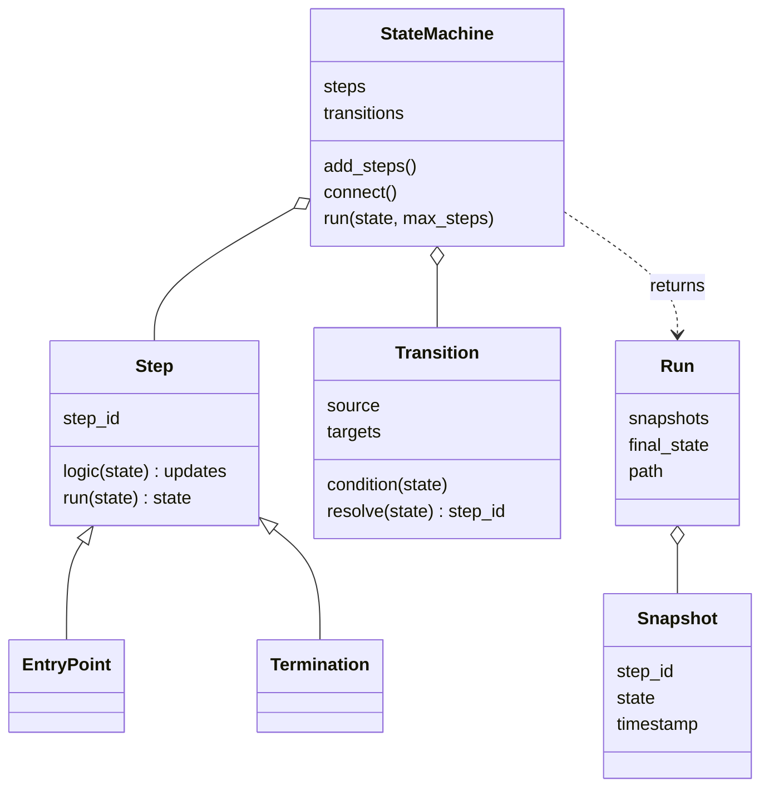
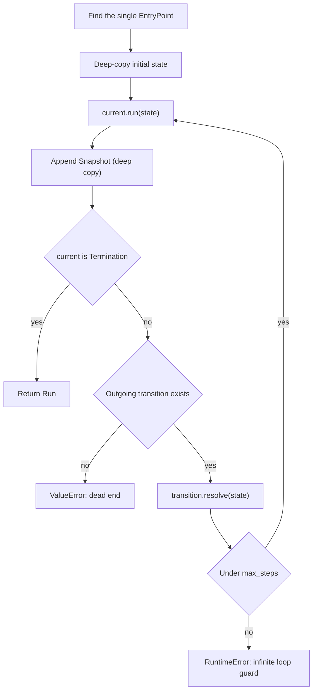
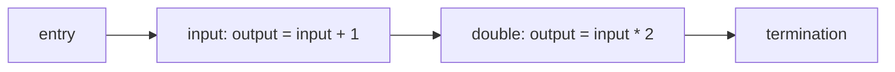
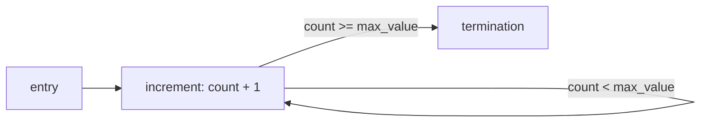
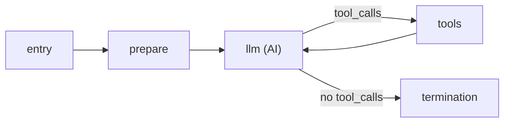

# Implementing Agent State Management with Python

> [!abstract] TL;DR
> `lib/state_machine.py` is a small, AI-free **workflow engine**. You register steps, connect them with fixed or conditional transitions, and `run()` threads a shared `TypedDict` state from an `EntryPoint` to a `Termination`, recording a snapshot after every step. ==It contains no LLM calls: it is the *orchestration skeleton* that an agent plugs into. LLM calls and tool executions become step functions, and "did the model ask for tools" becomes a transition condition.== It turns the theory in [[Agent State Management]] into running code.

**Prerequisites:** [[Agent State Management]] · [[Building Agents with Tools in Python]]
**Related:** [[Runtime or Orchestration Layer]] · [[Directed Acyclic Graph (DAG)]] · [[Implementing Agentic Workflows/Implementing Agentic Workflows in Python|Implementing Agentic Workflows in Python]] · [[Tool Use]] · [[AI Memory]]

> [!note] Source scope
> Based on `python notebooks/Implementing Agent State Management with Python/lib/state_machine.py` and the demo script `agentState.py` in the same folder. Neither file calls an LLM. Section 6 (wiring an agent onto the machine) and the framework comparison are *beyond the code*: they are illustrative sketches showing how the engine is meant to be used, not code from the project.

> [!todo]- Contents
> - [[#1. Core Concepts]]
> - [[#2. Architecture at a Glance]]
> - [[#3. The Building Blocks]]
> - [[#4. How run Executes]]
> - [[#5. The Demo Script – Two Workflows]]
> - [[#6. Connecting It to AI – An Agent on the Machine]]
> - [[#7. Pitfalls and Failure Modes]]
> - [[#8. Key Takeaways]]
> - [[#9. Critical Analysis]]
> - [[#10. Self-Test]]
> - [[#11. Glossary]]
> - [[#Further Reading]]

---

## 1. Core Concepts

> [!info]+ Definition – Workflow engine
> Code that runs a graph of steps in an order determined by edges and the current state. It knows nothing about *what* the steps do, only how to sequence them and carry state between them.

^def-engine

> [!info]+ Definition – Partial update
> A step returns only the fields it wants to change. The engine merges them into the existing state, so steps don't have to rebuild the whole state object.

^def-partial-update

> [!info]+ Definition – Snapshot
> A deep copy of the state taken right after a step runs, tagged with the step ID and a timestamp. The ordered list of snapshots is a full trace of the run.

^def-snapshot

**Why an AI course teaches an AI-free file.** In [[Agent State Management]] the agent is a state machine whose steps happen to call an LLM. This file builds the *machine* part separately. Keeping orchestration independent of the model has three benefits:

| Benefit | What it means here |
|---|---|
| Testability | You can test routing and state flow with plain functions (as the demo does) before spending tokens |
| Swappability | Any step can call any model, tool or human, because the engine only sees `state → updates` |
| Control | Code, not the model, decides what runs next and when to stop ([[Runtime or Orchestration Layer#^control-spectrum|control spectrum]]) |

---

## 2. Architecture at a Glance



| Piece | Role | Agent analogy |
|---|---|---|
| `StateSchema` (TypeVar bound to `Mapping`) | The typed shape of state | The agent's state schema: query, messages, tool calls |
| `Step` | A unit of work: `logic(state)` returns updates | "Call the LLM", "execute tools" |
| `EntryPoint` / `Termination` | No-op start and end markers | Receive the query / return the final answer |
| `Transition` | Edge to one target, or several chosen by `condition` | "Tool calls present → tools, else → finish" |
| `Snapshot` / `Run` | Trace of every state, plus `final_state` and `path` | Agent trace for debugging and evaluation |
| `max_steps` | Hard iteration cap | Step budget against runaway tool loops |

---

## 3. The Building Blocks

### 3.1 Step – logic plus merge

`Step.run` calls the user-supplied `logic(state)`, treats `None` as "no change", then merges:

```python
updates = self.logic(state) or {}
return cast(StateSchema, {**state, **updates})
```

- **Merge semantics are shallow overwrite.** A returned key replaces the old value entirely. There is no "append" behaviour, so a step that adds a message must return the *whole* new list (`state["messages"] + [new_msg]`).
- The `cast` is only for the type checker. Nothing validates the result against the schema at runtime.

^merge-semantics

### 3.2 EntryPoint and Termination

Both are `Step`s whose logic is `_no_update`, so they pass state through unchanged. They exist to mark where a run starts and stops. `run()` requires **exactly one** `EntryPoint`. Several `Termination`s are allowed (e.g. "answered" vs "escalated").

### 3.3 Transition – fixed or conditional edges

`resolve(state)` picks the next step ID:

| Case | Behaviour |
|---|---|
| No condition, one target | Always go there |
| No condition, several targets | `ValueError`: ambiguous |
| Condition given | Call it; it may return a `Step` or a step ID string |
| Condition returns something not in `targets` | `ValueError`: the declared edges are enforced |

^transition-rules

That last rule matters for AI use: even if a router decides dynamically, it can only choose among edges you declared. If the decision ever came from model output, a hallucinated step name would be rejected instead of executed.

### 3.4 StateMachine – registration

- `add_steps` rejects duplicate IDs.
- `connect` requires both ends to be registered first, then stores **one transition per source** (`self.transitions[source.step_id] = ...`).

---

## 4. How run Executes



^run-loop

Key properties:

- **Input isolation.** The caller's initial state is deep-copied, so `run()` never mutates it.
- **Immutable history.** Each snapshot is deep-copied, so later steps can't rewrite earlier snapshots, even if a step mutates nested lists in place.
- **Fail loud.** Dead ends, ambiguous edges, bad conditions and loop overruns all raise exceptions instead of silently stopping.
- **The budget counts every step**, including `EntryPoint` and `Termination`. A run that needs $k$ loop iterations uses $k + 2$ of the `max_steps` budget (see [[#10. Self-Test|Q4]]).

^budget-counting

---

## 5. The Demo Script – Two Workflows

`agentState.py` exercises the engine with arithmetic, no AI.

### 5.1 Linear chain



With `{"input": 4}`: after `input`, `output = 5`. After `double`, `output = 8`, overwriting 5 (both steps read `input`, not the previous `output`). Path: `entry → input → double → termination`, 4 snapshots.

This is a fixed chain: the [[Prompt Chaining for Agentic Reasoning - Study Guide|prompt-chaining]] shape, with arithmetic standing in for LLM calls.

### 5.2 Loop with a conditional edge



`check_counter` returns the `increment` or `termination` Step object. With `count = 0, max_value = 10`, the run takes 10 increments, giving 12 snapshots (entry + 10 + termination).

This is the **agent loop shape**: repeat a step until a condition read from state says stop. Replace "count < max" with "the model requested tools" and you have the loop from [[Agent State Management#4. The Execution Loop]].

> [!note] Small mismatch in the demo
> The first workflow's initial state `{"input": 4}` omits `output`, which the `Schema` declares. It runs fine because `TypedDict` isn't enforced at runtime, which shows that the schema is documentation, not validation.

---

## 6. Connecting It to AI – An Agent on the Machine

*Beyond the code: an illustrative sketch.* The engine already supports everything the tool-calling agent loop needs. `call_llm` and `run_tool` are placeholders for whatever client and tool registry you use ([[Building Agents with Tools in Python#^agent-loop|agent loop]]).

```python
class AgentState(TypedDict):
    user_query: str
    instructions: str
    messages: list[dict]
    tool_calls: list[dict]

def prepare(state):
    return {"messages": [
        {"role": "system", "content": state["instructions"]},
        {"role": "user", "content": state["user_query"]},
    ]}

def llm_step(state):
    reply = call_llm(state["messages"])               # the only place AI happens
    return {
        "messages": state["messages"] + [reply.message],  # whole list: merge overwrites
        "tool_calls": reply.tool_calls or [],
    }

def tool_step(state):
    results = [run_tool(c) for c in state["tool_calls"]]
    return {
        "messages": state["messages"] + results,
        "tool_calls": [],                              # clear, or the loop re-runs tools
    }

entry, end = EntryPoint[AgentState](), Termination[AgentState]()
prep = Step[AgentState]("prepare", prepare)
llm = Step[AgentState]("llm", llm_step)
tools = Step[AgentState]("tools", tool_step)

agent = StateMachine[AgentState](AgentState)
agent.add_steps([entry, prep, llm, tools, end])
agent.connect(entry, prep)
agent.connect(prep, llm)
agent.connect(llm, [tools, end], lambda s: tools if s["tool_calls"] else end)
agent.connect(tools, llm)

run = agent.run(initial_state, max_steps=20)
```



^agent-on-machine

How each engine feature maps to an AI concern:

| Engine feature | AI concern it addresses |
|---|---|
| Steps are `state → updates` | LLM calls, tool calls, validators and human reviews all fit the same interface |
| Conditional transition | Lets the model's output (tool calls present or not) steer the flow, while code decides the step |
| Condition must return a declared target | Model-influenced routing can't jump to an undeclared step |
| `max_steps` | Caps runaway tool loops and therefore cost ([[Runtime or Orchestration Layer#5.1 Budgets]]) |
| Snapshots with timestamps | A per-step trace: which prompt went in, what came back, how long each step took |
| `Run.path` | Shows the route the agent took; useful for evaluation (did it call the tool it should have) |
| Multiple `Termination`s | Separate "answered", "escalated to human", "failed validation" endings |
| Deep-copied input | The same initial state can be replayed against different models or prompts |

Other AI patterns that fit without changing the engine:

- **Gates and retries:** an LLM step, then a validation step with a conditional edge back to the LLM on failure ([[Gate Checks]], [[LLM Feedback Loops]]).
- **Routing:** a classifier step writes a label into state, and a condition maps label → branch ([[Implementing Agentic Workflows/Routing Workflow|Routing Workflow]]).
- **Evaluator–optimizer:** generator step ↔ evaluator step loop, ending when a score in state passes a threshold ([[Implementing Agentic Workflows/Evaluator-Optimizer Workflow|Evaluator-Optimizer Workflow]]).

> [!tip] Same idea in frameworks
> LangGraph's `StateGraph` has the same shape: nodes are `state → partial update`, edges and conditional edges, `START`/`END` markers, and a recursion limit. The main difference is that LangGraph lets each field declare a reducer (e.g. append to messages) instead of always overwriting, and it adds checkpointing and parallel branches.

---

## 7. Pitfalls and Failure Modes

| Failure | Symptom | Mitigation |
|---|---|---|
| Returning only the new message for `messages` | History collapses to the last message; the model loses context | Return the full concatenated list (shallow overwrite, [[#^merge-semantics]]) |
| Calling `connect` twice on the same source | The first edge silently disappears | Pass all targets and a condition in one `connect` call |
| `max_steps` too tight | `RuntimeError` on a legitimate long run; entry and termination count too | Size it as loop iterations + 2 + margin ([[#^budget-counting]]) |
| Putting clients or open connections in state | `deepcopy` fails or is slow at every snapshot | Keep state JSON-like; access clients through closures or globals |
| Large state (long histories, big tool outputs) | Memory grows with steps × state size, since every snapshot is a full copy | Trim history, or store large blobs by reference |
| Not clearing `tool_calls` | Tools re-run every loop until `max_steps` | Tool step resets the field |
| Trusting the schema | Missing or wrong-typed keys slip through (as in the demo) | Validate at step boundaries with Pydantic for LLM and tool data |
| Condition returns an undeclared step | `ValueError` mid-run | Declare every possible target in `connect` |
| Exception inside a step | Run aborts; snapshots so far are lost with the exception | Catch inside steps and write errors to state, or route to an error `Termination` |

---

## 8. Key Takeaways

- [ ] The module is a generic workflow engine with no AI inside; AI enters through step functions.
- [ ] Steps return **partial updates**, merged by shallow overwrite.
- [ ] Transitions are fixed or conditional, and conditions may only pick declared targets ([[#^transition-rules]]).
- [ ] `run()` goes from one `EntryPoint` to a `Termination`, snapshotting deep copies after every step ([[#^run-loop]]).
- [ ] `max_steps` is the loop guard, and it counts every step including entry and termination.
- [ ] The counter-loop demo has the same shape as the LLM ↔ tools agent loop ([[#^agent-on-machine]]).
- [ ] Snapshots and `path` give the traceability claimed in [[Agent State Management]].

---

## 9. Critical Analysis

**What it does well.** Small, readable and strict. Fail-loud validation of edges and targets is the right default for agent systems, where silent misrouting is worse than a crash. Snapshots make every run inspectable, which is the practical meaning of "debuggable" in the lecture.

**What it lacks for production agents.**

| Gap | Why it matters for AI workloads |
|---|---|
| No persistence or resume | A crash or a human-approval pause loses the run. LLM steps are slow and costly to repeat ([[Runtime or Orchestration Layer#^def-durable|durable execution]]) |
| No partial `Run` on failure | When a step raises, the trace you most need for debugging is lost |
| No async or parallel steps | Can't fan out independent tool calls or workers ([[Implementing Agentic Workflows/Parallelization Workflow|Parallelization Workflow]]) |
| No reducers | Every step must rebuild lists by hand, a common source of lost history |
| No runtime schema validation | LLM output can put malformed data into state unnoticed |
| Step budget only | No token, cost or wall-clock budget, which is what actually limits LLM agents |

**Cost of snapshots.** Each snapshot deep-copies the full state. If the message list grows by $m$ tokens' worth of data per loop, snapshot memory over $n$ steps is $\sum_{i=1}^{n} (S_0 + i\,m) = O(n^2)$: the same quadratic shape as the token cost of resending history ([[Agent State Management#10. Critical Analysis]]). Fine for a teaching engine, worth fixing (structural sharing, diffs) at scale.

**Security.** The engine itself is a good trust boundary: routing is code, and a condition can't reach an undeclared step. But it treats state as trusted. Tool output written into `messages` flows into the next LLM call unchanged, so [[Prompt Injection]] defences must live in the step functions. Snapshots also store everything, so secrets placed in state end up in traces.

**How to evaluate an agent built on it.** Use `Run.path` and snapshots as test fixtures: assert expected paths for known queries (e.g. "weather question → exactly one tools visit"), measure average steps to termination, and track how often runs hit `max_steps`.

> [!question] Discussion questions
> - Should a condition ever call an LLM directly, or should an LLM step always write its decision into state first?
> - How would you add checkpointing so a run can pause for human approval and resume?
> - Would you add an append reducer for `messages`, or keep overwrite semantics for simplicity?

---

## 10. Self-Test

> [!question]- Q1. The file contains no LLM calls. Where would AI enter a workflow built on it
> Inside step `logic` functions (e.g. a step that sends `state["messages"]` to a model and returns the reply and tool calls) and indirectly through conditions that read model output stored in state. The engine only sequences steps.

> [!question]- Q2. A step returns `{"messages": [new_msg]}`. What happens to the history, and why
> The history is replaced by a one-item list. `Step.run` merges with `{**state, **updates}`, a shallow overwrite. To append, return `state["messages"] + [new_msg]`.

> [!question]- Q3. Why does the machine reject a condition that returns a step not listed in targets
> To keep routing inside the declared graph. Edges document and constrain possible flows, so a buggy (or model-influenced) router fails loudly instead of jumping somewhere unexpected.

> [!question]- Q4. Quantitative – With the default max_steps of 100, what is the largest max_value the counter demo can reach, starting from 0
> The run needs entry + max_value increments + termination = max_value + 2 steps, and the loop allows at most 100. So max_value ≤ 98. At 99 it needs 101 steps and raises `RuntimeError`.

> [!question]- Q5. Design – Add a human-approval stop before any tool that sends email. Which engine features would you use, and what is missing
> Add an `approval` step and a conditional edge from the LLM step: email tool calls → `approval`, other tool calls → `tools`, none → termination. From `approval`, a condition on an `approved` field routes to `tools` or back to the LLM with a rejection message. What's missing: the engine can't pause and resume, so you need checkpointing (save state and current step ID, reload later) or a blocking human input inside the step.

> [!question]- Q6. Why are the initial state and every snapshot deep-copied
> So the caller's input is never mutated, and later steps that mutate nested objects (lists, dicts) in place can't rewrite earlier snapshots. The trace stays an accurate record of each step.

> [!question]- Q7. Which demo workflow corresponds to a prompt chain, and which to an agent loop
> The linear `input → double` workflow is a fixed chain (prompt chaining). The `increment` loop with `check_counter` is the agent-loop shape: repeat a step until state says stop.

> [!tip] No flashcards
> Per vault convention, notes on the python notebooks don't get a flashcards deck. Concept cards for this topic live in [[Agent State Management - Flashcards]].

---

## 11. Glossary

| Term | Meaning |
|---|---|
| `StateSchema` | Type variable for the state type, bound to `Mapping` so `**state` works |
| `Step` | Named unit of work; `logic(state)` returns updates or `None` |
| `EntryPoint` / `Termination` | No-op steps marking the start and end of a run |
| `Transition` | Edge from a source step to one or more targets, with an optional condition |
| Condition | Function of state returning the next `Step` or step ID |
| `Snapshot` | Deep copy of state after a step, with step ID and timestamp |
| `Run` | All snapshots in order; exposes `final_state` and `path` |
| `max_steps` | Iteration cap that raises `RuntimeError` when exceeded |
| Shallow merge | `{**state, **updates}`: returned keys overwrite, others are kept |
| Reducer | Per-field merge rule (e.g. append); absent here, present in LangGraph |

---

## Further Reading

- [Python `typing` – TypedDict and Generic](https://docs.python.org/3/library/typing.html)
- [Python `copy.deepcopy`](https://docs.python.org/3/library/copy.html)
- [LangGraph documentation](https://langchain-ai.github.io/langgraph/)
- [Anthropic – Building effective agents](https://www.anthropic.com/research/building-effective-agents)
