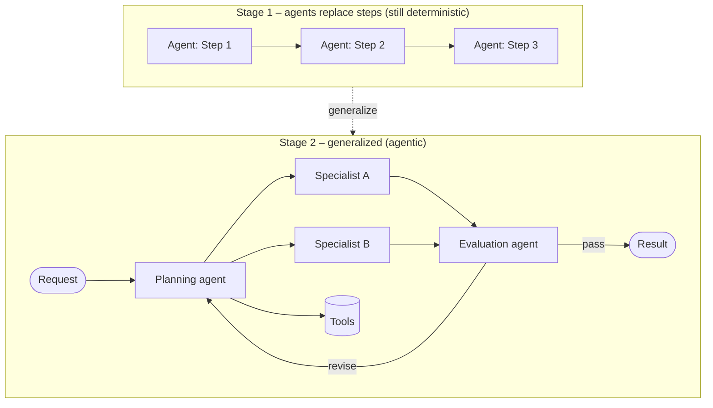
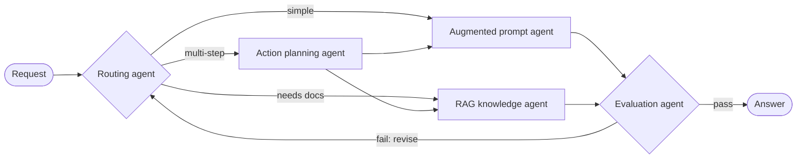
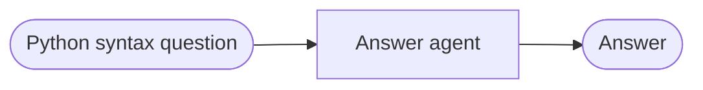
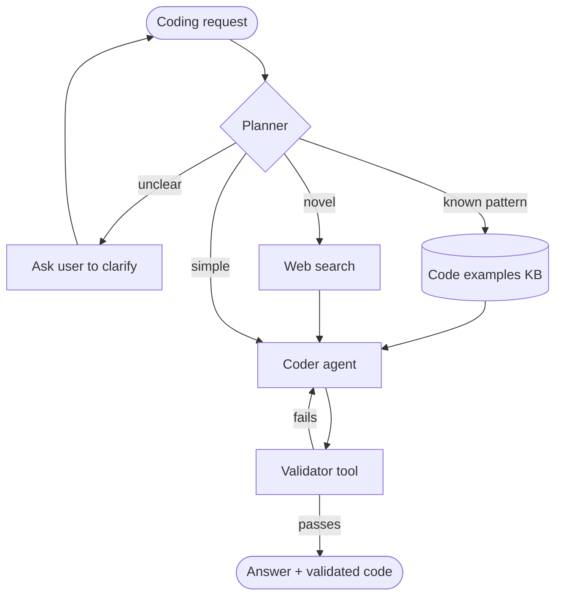

# Agentic Workflow Modeling

> [!abstract] TL;DR
> Agentic workflow modeling is drawing the **blueprint for a team of agents** that completes a job with a defined start and end. The practical path is to start from a documented **deterministic automation**, replace steps with agents, then ==generalize==: add planning, tools, and decision-making so the system handles more kinds of task and finds better paths. Modeling shifts from **process-centric** (tasks, sequence, simple rules) to ==agent-centric== (capabilities, goals, decision frameworks, adaptation rules, constraints, feedback loops). A small catalogue of **building-block agents** (direct, augmented, knowledge-augmented, RAG, evaluation, routing, action planning) gives you the parts to compose.

**Prerequisite:** [[Agent Components and Agent Types]] · [[AI Agents]] · [[Prompt Chaining for Agentic Reasoning - Study Guide]]
**Next:** [[Implementing Agentic Workflows in Python]] (building these agents and workflows in code)
**Related:** [[Agentic AI#3. Levels of Autonomy]] · [[Planning Agents]] · [[Task Decomposition]] · [[Multi-Agent Systems]] · [[Runtime or Orchestration Layer]] · [[Directed Acyclic Graph (DAG)]] · [[LLM Feedback Loops]] · [[Gate Checks]]

**Sources:** Course reading "Agentic Workflow Modeling" (the pasted text contained this reading twice; treated as one source) and the short reading on agent types as building blocks. The reliability math, the model-spec template, and the critical analysis are *beyond the lecture*. The reading promises to show "how to visually map out what each agent does", but the text supplied contains no mapping method or diagram; the Mermaid diagrams here are my own.

> [!todo]- Contents
> 1. [[#1. Core Concepts]]
> 2. [[#2. From Deterministic Automation to Agentic Workflow]]
> 3. [[#3. Workflows vs. Chatbots]]
> 4. [[#4. Process-Centric vs. Agent-Centric Modeling]]
> 5. [[#5. Building-Block Agents]]
> 6. [[#6. Worked Example – The Evolving Code Assistant]]
> 7. [[#7. Pitfalls and Failure Modes]]
> 8. [[#8. Key Takeaways]]
> 9. [[#9. Critical Analysis]]
> 10. [[#10. Self-Test]]
> 11. [[#11. Glossary]]

---

## 1. Core Concepts

> [!info]+ Definition – Agentic workflow modeling
> Designing how a set of AI agents **work together to complete a complex job**: what each agent does, how they connect, and how the system adapts when things change. The aim is a workflow that is both ==powerful and flexible==.

^def-workflow-modeling

> [!info]+ Definition – Deterministic automation
> A process that follows a **fixed script**: same steps, same order, simple rules at decision points. Examples: an email auto-responder, a simple data-processing routine.

^def-deterministic

> [!info]+ Definition – Generalization
> The step that turns an automation into an agentic workflow: making the system able to ==handle more types of tasks and find better ways to do them without being reprogrammed==, typically by adding a planning agent, tools, and decision-making.

^def-generalization

---

## 2. From Deterministic Automation to Agentic Workflow

The reading's recommended development path has two stages.

| Stage | What you do | Result |
|---|---|---|
| 1. Start with what you know | Take a well-documented (possibly already automated) process and **replace each step with an agent** | Still essentially deterministic: agents do what they are told, in order. That is fine as a starting point |
| 2. Generalize | Add a **planning agent** up front that reads each request, works out what needs doing, and picks the agents and tools to use, "like a smart project manager" | An adaptive system that handles a wider range of tasks |

^automation-to-agentic



> [!important] When not to generalize
> If all you need is ==one specific, unchanging process executed efficiently, deterministic automation may be all you need==. Generalize only when you need variety of tasks or smarter paths. This matches the vault's rule to grant the minimum autonomy that solves the task ([[Agentic AI#3. Levels of Autonomy]]).

^when-not-to-generalize

---

## 3. Workflows vs. Chatbots

| Aspect | Agentic workflow | Conversational chatbot |
|---|---|---|
| Purpose | Complete a job or process | Hold an ongoing conversation |
| Lifecycle | ==Defined start and end== | Continues until the user stops |
| Success | The task is done (measurable) | The user is satisfied turn by turn |

Workflows are not rigid, though. Two strengths set them apart from fixed automation:

- **Reflect and iterate:** agents review their own work or others' work to improve the result ([[LLM Feedback Loops]]).
- **Find different paths:** agents can choose different sequences of actions, possibly finding more efficient routes than a fixed script.

---

## 4. Process-Centric vs. Agent-Centric Modeling

| Dimension | Deterministic (process-centric) | Agentic (agent-centric) |
|---|---|---|
| Unit of design | The **task** | The **agent** |
| What you specify | Tasks, sequence, dependencies, inputs/outputs, decision points | Capabilities, goals, decision frameworks, adaptation rules, constraints, feedback loops |
| Decision points | Few; simple rules | LLM-driven choices among options |
| Diagram | Traditional flowchart | Agent map: roles, handoffs, loops |
| Focus | Rigid connections between tasks | What each agent can do and how it chooses |

^process-vs-agent

### 4.1 The six elements of an agent-centric model

| Element | Question it answers | Where it lives in the vault |
|---|---|---|
| **Agent capabilities** | What can each agent do? | [[Agent Components and Agent Types#2. The Five Components of an Agent]], [[Tool Use]] |
| **Goal structure** | What are the objectives, and how is success measured? | [[Task Decomposition]], [[LLM Evaluation]] |
| **Decision-making frameworks** | How do agents evaluate options and choose? | [[Chain-of-Thought and ReAct]], [[Tree-of-Thought]] |
| **Adaptation rules** | How do agents adjust from feedback or new information? | [[Planning Agents#3. Plan-Execute-Replan Loop]] |
| **Environment constraints** | What are the boundaries and rules of their world? | [[Gate Checks]], [[Runtime or Orchestration Layer]] |
| **Feedback loops** | How does information from later stages improve earlier ones? | [[LLM Feedback Loops]] |

^six-elements

A compact way to write one agent's model (*beyond the lecture*):

```yaml
agent: CodeValidator
capabilities: [run_python_sandbox, run_linter]
goal: "Return pass/fail with error trace for a code snippet"
success_metric: "No false passes on the test suite"
decision_framework: "If tests fail, return the first failing trace; never edit code"
adaptation: "None (deterministic checker)"
constraints: [no network, 10 s timeout, read-only filesystem]
feedback: "Its failures are sent back to the Coder agent for revision"
inputs: {code: str, tests: str}
outputs: {passed: bool, trace: str | null}
```

---

## 5. Building-Block Agents

The reading lists common agent "specialists" to compose into workflows (not exhaustive).

| Agent | What it does | Closest type on the spectrum ([[Agent Components and Agent Types#^agent-type-table]]) |
|---|---|---|
| **Direct Prompt Agent** | Sends the user's query straight to the LLM | Direct Prompting |
| **Augmented Prompt Agent** | Adds a persona or system instructions to shape the response | Prompt Augmentation |
| **Knowledge Augmented Prompt Agent** | Persona **plus** a specific, curated knowledge base; told to ==ignore the LLM's general knowledge== | Prompt Augmentation (static knowledge) |
| **RAG Knowledge Prompt Agent** | ==Dynamically retrieves== relevant information from a large dataset before answering; flexible and less prone to making things up | Prompt Augmentation → Dynamic Context |
| **Evaluation Agent** | Quality controller: assesses other agents' output against criteria and may request revisions | A role, usually Prompt Augmentation with a rubric |
| **Routing Agent** | The "project manager": sends each incoming task to the best specialist agent | A role; classifier-style Prompt Augmentation |
| **Action Planning Agent** | Breaks a complex goal into a sequence of smaller, executable steps | Toward Autonomous ([[Planning Agents]]) |

^building-blocks

> [!note] Two different classifications
> The **spectrum types** classify agents by ==how they manage the LLM's context==. The **building blocks** classify them by ==the job they do in the workflow==. Evaluation, Routing, and Action Planning are roles; each can be built at different spectrum levels. In this reading, "Augmented Prompting" is defined narrowly as adding a system message for a persona; the earlier reading also included few-shot examples and retrieved documents.

### 5.1 Knowledge-augmented vs. RAG

| | Knowledge Augmented Prompt Agent | RAG Knowledge Prompt Agent |
|---|---|---|
| Knowledge | Small, curated, fixed | Large dataset |
| How it gets in | Put into the prompt in full | Relevant pieces retrieved per query |
| Scales to | Whatever fits in the context window | Very large corpora |
| Main risk | Context overflow; stale curation | Retrieval misses or noise ([[Retrieval-Augmented Generation]]) |

### 5.2 Composing blocks – a canonical pattern



### 5.3 Reliability of a composed workflow (beyond the lecture)

If the router picks the right specialist with probability $r$ and the specialist is correct with probability $s$, one pass is correct with probability $r \cdot s$. An evaluator that catches failures and allows up to $k$ attempts raises this. Assuming a perfect evaluator and independent attempts:

$$
P_{\text{success}} = 1 - (1 - r s)^{k}
$$

Example: $r = 0.9$, $s = 0.8$ gives $0.72$ in one pass, and $1 - 0.28^{3} \approx 0.98$ with $k = 3$. A real evaluator has false passes and false fails, so the true gain is smaller, and retries on the same input are correlated. See [[LLM Feedback Loops#^stop-conditions]] for bounding $k$.

---

## 6. Worked Example – The Evolving Code Assistant

This is the reading's example, expanded into the two modeling styles.

**Before (deterministic):** answers one specific type of Python syntax question.



**After (generalized):** the reading adds three things.

| Addition | What it enables |
|---|---|
| Planning capability | Understands different question types: Python, Java, debugging, new features |
| Tools | Knowledge base of code examples, code validation tool, web search |
| Decision-making power | Chooses to answer from knowledge, use a tool, or ==ask the user for clarification== |

Agent-centric model of the generalized assistant (*beyond the lecture*):

| Element | Specification |
|---|---|
| Capabilities | Planner: classify request. Coder: write/explain code. Validator: run code. Searcher: KB + web |
| Goal structure | Correct, runnable answer; success = code passes validation, user question answered |
| Decision framework | Planner decides: answer directly / retrieve examples / validate / ask for clarification |
| Adaptation rules | If validation fails twice, switch strategy (search for a known solution) or ask the user |
| Environment constraints | Sandboxed execution, no secrets, step cap, allowed languages |
| Feedback loops | Validator errors go back to the Coder; unclear requests go back to the user |



---

## 7. Pitfalls and Failure Modes

| Failure | Symptom | Mitigation |
|---|---|---|
| Premature generalization | Planner and many agents for a task a script could do; slow, costly, flaky | Start deterministic; generalize only for real variety ([[#^when-not-to-generalize]]) |
| "Agent-washing" | Each step is an agent, but nothing adapts; you pay LLM cost for fixed logic | Keep deterministic steps as plain code; use agents where judgment is needed |
| Vague goal structure | Workflow never knows when it is done; loops | Measurable success criteria and stop conditions |
| Router misclassification | Requests go to the wrong specialist | Test routing on labeled examples; add a fallback / "unsure" route |
| Evaluator bias | Evaluation agent approves bad output (same model grading itself) | Rubrics, deterministic checks first ([[Gate Checks]]), different model or human spot checks |
| Knowledge-augmented leakage | Agent told to use only the curated KB still uses general knowledge | Require citations to the KB; refuse when no source is found |
| Stale plans | Planner's plan stops matching reality after a tool failure | Plan-execute-replan ([[Planning Agents]]) |
| Unbounded feedback loops | Revise cycle never converges | Max iterations, improvement threshold ([[LLM Feedback Loops]]) |

---

## 8. Key Takeaways

- [ ] I can describe the two-stage path: replace steps with agents (still deterministic), then generalize.
- [ ] I know deterministic automation is sometimes the right answer.
- [ ] I can explain how a workflow differs from a chatbot (defined start and end; job completion).
- [ ] I can name the two workflow strengths: reflect and iterate, find different paths.
- [ ] I can list the six elements of an agent-centric model.
- [ ] I can name the seven building-block agents and say what each does.
- [ ] I can tell apart the spectrum types (context handling) and building blocks (workflow role).
- [ ] I can model the generalized code assistant in agent-centric terms.

---

## 9. Critical Analysis

- **"Start deterministic, then generalize" is sound engineering.** It gives you a baseline to measure against: if the agentic version doesn't beat the script on quality, coverage, or cost, you shouldn't ship it. The reading doesn't say how to measure that, which is the key missing step ([[LLM Evaluation]]).
- **Agent-centric modeling risks losing the process view.** Workflows still have dependencies and ordering. Good designs keep a process graph (often a [[Directed Acyclic Graph (DAG)]]) for the *fixed* parts and use agent-centric specs only where choices happen. The two views are complementary, not alternatives.
- **"Find different paths" cuts both ways.** Different paths make results harder to reproduce, test, and audit. In regulated settings, that variability can be a defect.
- **The building-block list mixes levels.** Direct and Augmented Prompt Agents are *implementation* types. Routing, Evaluation, and Planning are *roles*. A cleaner model is role × implementation (e.g. a RAG-based evaluator).
- **"Ignoring the LLM's general knowledge" can't be guaranteed by prompting.** Parametric knowledge still leaks into answers. You can only reduce it (citations, refusals, grounding checks), not switch it off ([[LLM Hallucinations]]).
- **Security:** a routing agent is a control point. If an attacker can steer routing through prompt content, they choose which tools run. The planner's tool choices and the evaluator's pass/fail are also targets for [[Prompt Injection]]. Put constraints in the runtime, not only in prompts.

> [!question] Discussion questions
> 1. What metric would tell you it's time to move from deterministic automation to a generalized workflow?
> 2. Should the evaluation agent use the same model as the agents it grades? What changes if it doesn't?
> 3. How would you visualize an agent-centric model so that both handoffs and adaptation rules are visible?

---

## 10. Self-Test

> [!question]- Q1. What are the two stages of the path from automation to an agentic workflow?
> (1) Replace each step of a documented process with an agent; the result is still deterministic. (2) Generalize: add planning, tools, and decision-making so the system handles more task types and finds better paths.

> [!question]- Q2. When is deterministic automation all you need?
> When you only need to execute one specific, unchanging process efficiently.

> [!question]- Q3. List the six elements you define in agent-centric modeling.
> Agent capabilities, goal structure, decision-making frameworks, adaptation rules, environment constraints, feedback loops.

> [!question]- Q4. How does a Knowledge Augmented Prompt Agent differ from a RAG Knowledge Prompt Agent?
> The knowledge-augmented agent uses a persona plus a fixed, curated knowledge base and is told to ignore general knowledge. The RAG agent retrieves relevant pieces from a large dataset at query time, which makes it more flexible and scalable.

> [!question]- Q5. (Quantitative) Router accuracy 0.95, specialist accuracy 0.85, perfect evaluator, up to 2 attempts. What is the success rate?
> One pass: $0.95 \times 0.85 \approx 0.81$. With 2 attempts: $1 - 0.19^2 \approx 0.96$. Real evaluators and correlated retries make this an upper bound.

> [!question]- Q6. (Design) Model an invoice-processing workflow that today is a fixed script, and say what you would generalize first.
> Keep extraction → validation → posting as a fixed chain with deterministic gates. Generalize first where variety appears: add a **routing agent** for invoice types (PO-backed, utilities, foreign currency) and an **evaluation agent** for low-confidence extractions. Constraints: no posting above a threshold without human approval. Feedback: posting errors are fed back as new test cases.

> [!question]- Q7. Name two ways an agentic workflow differs from a chatbot, and two ways it differs from rigid automation.
> Versus a chatbot: defined start and end; focused on completing a job. Versus rigid automation: agents can reflect and iterate, and can choose different paths to the goal.

### Flashcards

> [!tip] Flashcards
> Review cards for this note are in [[Agentic Workflow Modeling - Flashcards]].

---

## 11. Glossary

| Term | Meaning |
|---|---|
| Deterministic automation | A fixed-script process with the same steps in the same order |
| Generalization | Making an automation handle more task types and find better paths, via planning, tools, and decisions |
| Process-centric modeling | Designing around tasks, sequence, dependencies, and simple rules |
| Agent-centric modeling | Designing around agent capabilities, goals, decision frameworks, adaptation, constraints, and feedback |
| Routing agent | Sends each task to the most suitable specialist agent |
| Evaluation agent | Checks outputs against criteria and requests revisions |
| Action planning agent | Breaks a goal into an ordered sequence of executable steps |

---

## Further Reading

- [Building Effective Agents (Anthropic)](https://www.anthropic.com/research/building-effective-agents) – workflows vs. agents; routing, orchestrator-workers, evaluator-optimizer patterns
- [Plan-and-Solve Prompting (Wang et al., 2023)](https://arxiv.org/abs/2305.04091)
- [Self-Refine: Iterative Refinement with Self-Feedback (Madaan et al., 2023)](https://arxiv.org/abs/2303.17651)
- [Retrieval-Augmented Generation for Knowledge-Intensive NLP Tasks (Lewis et al., 2020)](https://arxiv.org/abs/2005.11401)

%% Study hint: the six agent-centric elements spell "C-G-D-A-E-F": Capabilities, Goals, Decisions, Adaptation, Environment, Feedback. %%
