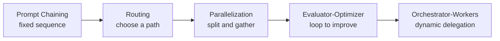

# Agentic Workflow Patterns

> [!abstract] TL;DR
> This is the **hub** for the course section on agentic workflow patterns. It covers five reusable ways to connect LLM calls and agents: ==Prompt Chaining, Routing, Parallelization, Evaluator-Optimizer, and Orchestrator-Workers==. Each pattern has a **theory** note and an **implementation** note. They are ordered roughly from most predictable (code controls the flow) to most flexible (an LLM decides what work to do).

**Previous:** [[Implementing Agentic Workflows in Python]]
**Background:** [[Agentic Workflow Modeling]] (building-block agents) · [[Prompt Chaining for Agentic Reasoning - Study Guide#4. Chaining Patterns]] (earlier coverage of the same family of patterns)

---

## 1. The Five Patterns

| # | Pattern | Core idea | Who controls the flow | Theory | Implementation |
|---|---|---|---|---|---|
| 1 | **Prompt Chaining** | Fixed sequence of LLM calls; each output feeds the next, with gates between | Code (fixed order) | [[Prompt Chaining Workflow]] | [[Implementing Prompt Chaining Workflow]] |
| 2 | **Routing** | Classify the input, then send it to the best specialist path | Code + LLM classifier | [[Routing Workflow]] | [[Implementing Routing Workflow]] |
| 3 | **Parallelization** | Split the task, run independent subtasks at the same time, aggregate the results | Code (fixed split) + aggregator | [[Parallelization Workflow]] | [[Implementing Parallelization Workflow]] |
| 4 | **Evaluator-Optimizer** | One LLM generates, another evaluates and gives feedback, loop until good enough | Code loop + LLM judge | [[Evaluator-Optimizer Workflow]] | [[Implementing Evaluator-Optimizer Workflow]] |
| 5 | **Orchestrator-Workers** | A central LLM breaks the task down at runtime and delegates to workers, then combines results | LLM orchestrator | [[Orchestrator-Workers Workflow]] | [[Implementing Orchestrator-Workers Workflow]] |

^pattern-table

Notes that don't exist yet appear as unresolved links. They'll resolve as each part of the section is written.

The arrow shows increasing flexibility (and cost and variance), not a required order. Real systems combine them. For example, a router can send each request to a chain, and one chain step can be an evaluator-optimizer loop.

---

## 2. Links to the Building-Block Agents

The patterns are compositions of the building blocks from [[Agentic Workflow Modeling#^building-blocks]]:

| Pattern | Main building blocks |
|---|---|
| Prompt Chaining | Augmented / knowledge-augmented prompt agents in sequence + validation gates |
| Routing | **Routing agent** + specialist agents |
| Parallelization | Parallel specialist agents + an aggregator (synthesizer, voter, or selector) |
| Evaluator-Optimizer | Generator agent + **evaluation agent** |
| Orchestrator-Workers | **Action planning agent** (orchestrator) + worker agents |

---

## 3. Choosing a Pattern

| If the task… | Start with |
|---|---|
| Has clear, fixed steps | Prompt Chaining |
| Comes in distinct categories that need different handling | Routing |
| Splits into independent parts, or benefits from several attempts or votes | Parallelization |
| Has clear quality criteria and improves with revision | Evaluator-Optimizer |
| Needs subtasks you can't predict in advance | Orchestrator-Workers |

> [!important] Design principle
> Pick the ==simplest pattern that meets the quality bar==, and measure before adding complexity ([[Prompt Chaining for Agentic Reasoning - Study Guide#^design-principle]]).
