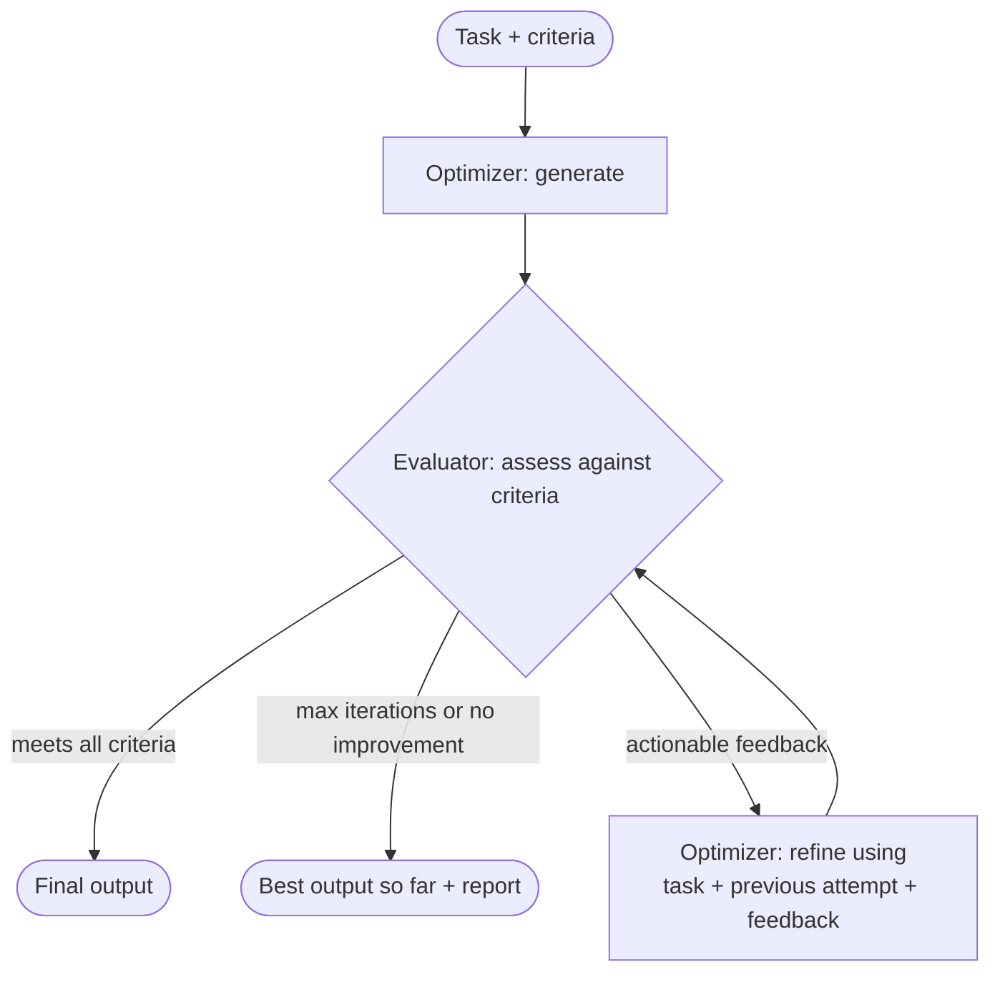

# Evaluator-Optimizer Workflow

> [!abstract] TL;DR
> The evaluator-optimizer workflow improves output quality through an ==iterative cycle of generation, critique, and refinement==. An **Optimizer (Generator)** agent produces and then refines an output. An **Evaluator (Critic/Reflector)** agent assesses it against predefined **evaluation criteria** and returns **actionable feedback**. The loop repeats until a **stopping condition** is met. Three elements make it work: ==clear criteria, actionable feedback, and stopping conditions==. If any one of them is weak, the loop wastes calls or never converges.

**Section:** [[Agentic Workflow Patterns]] – pattern 4 of 5 (theory)
**Previous:** [[Implementing Parallelization Workflow]] · **Next:** [[Implementing Evaluator-Optimizer Workflow]] → [[Orchestrator-Workers Workflow]]
**Prerequisite:** [[Prompt Chaining Workflow]] · [[LLM Feedback Loops]] (the general loop mechanism)
**Deeper coverage already in the vault:** [[LLM Feedback Loops]] (loop anatomy, feedback sources, monitoring) · [[Implementing LLM Feedback Loops]] (a coded lab) · [[Prompt Chaining for Agentic Reasoning - Study Guide#4.7 Evaluator–Optimizer (Reflection)]] (short pattern summary)

**Sources:** Course reading "Agentic Workflow Patterns: Evaluator-Optimizer Workflow" (two parts: the two roles and the loop; the three elements that make it effective). The convergence and cost math, the worked example, the criteria and feedback templates, and the critical analysis are *beyond the lecture*.

> [!todo]- Contents
> 1. [[#1. Core Concepts]]
> 2. [[#2. The Two Roles and the Loop]]
> 3. [[#3. Element 1 – Clear Evaluation Criteria]]
> 4. [[#4. Element 2 – Actionable Feedback]]
> 5. [[#5. Element 3 – Stopping Conditions]]
> 6. [[#6. How It Relates to Other Patterns]]
> 7. [[#7. Convergence and Cost Math]]
> 8. [[#8. Worked Example – Marketing Plan]]
> 9. [[#9. Pitfalls and Failure Modes]]
> 10. [[#10. Key Takeaways]]
> 11. [[#11. Critical Analysis]]
> 12. [[#12. Self-Test]]
> 13. [[#13. Glossary]]

---

## 1. Core Concepts

> [!info]+ Definition – Evaluator-optimizer workflow
> A workflow pattern that uses an ==iterative cycle of generation, critique, and refinement== to improve the quality and reliability of an agent's output. It is designed for tasks that need high-quality output: research reports, critical software code, detailed plans.

^def-evaluator-optimizer

> [!info]+ Definition – Optimizer (Generator) agent
> Takes the initial task and **generates an output**, then **refines** it based on the guidance it receives.

^def-optimizer

> [!info]+ Definition – Evaluator (Critic / Reflector) agent
> Acts like an **expert reviewer**: assesses the optimizer's output against predefined **evaluation criteria** and provides **specific, actionable feedback**.

^def-evaluator

The problem it addresses (from the reading): an initial output is usually a good start, but how can you be sure it's ==accurate, complete, within all constraints, and meets the required standard==? A single generation can't check itself; a separate evaluation step can.

---

## 2. The Two Roles and the Loop



| Step | Who | Inputs | Output |
|---|---|---|---|
| 1. Generate | Optimizer | Task instructions | First draft |
| 2. Evaluate | Evaluator | Draft + evaluation criteria | Pass/fail per criterion + feedback |
| 3. Refine | Optimizer | ==Original task + previous attempt + feedback== | Improved draft |
| 4. Repeat 2–3 | Both | – | Until a stopping condition is met |

^eo-loop

With each loop the output ==ideally gets closer to the desired quality==. "Ideally" is the key word: [[#9. Pitfalls and Failure Modes]] covers when it doesn't.

> [!note] Same model or different?
> The reading doesn't specify. The optimizer and evaluator can be the same LLM with different prompts (self-critique or "reflection"), different LLMs, or a non-LLM evaluator such as tests, a validator, or a human. Deterministic evaluators are the most reliable where they exist ([[LLM Feedback Loops#^feedback-sources]]).

---

## 3. Element 1 – Clear Evaluation Criteria

The criteria define ==what a successful output is==. They are the foundation for the evaluator's assessment and guide the whole refinement process. The reading gives three tests for each criterion:

| Test | Question | Weak | Strong |
|---|---|---|---|
| **Specific** | Does it name exactly what to check? | "Good structure" | "Has sections: Goal, Audience, Channels, Budget, KPIs" |
| **Measurable / objectively checkable** | Can someone verify it without opinion? | "Concise" | "≤ 400 words" |
| **Unambiguous** | Would two reviewers agree? | "Realistic budget" | "Channel budgets sum to the total, which is ≤ $50,000" |

^criteria-tests

Some criteria can't be made fully objective (tone, persuasiveness). For those, a **rubric with anchored levels** helps (*beyond the lecture*):

```text
Criterion: Audience fit (score 1–3)
1 = no target audience named, or generic ("everyone")
2 = audience named but channels/messages not tailored to it
3 = audience named AND each channel explains why it reaches that audience
Pass threshold: 3
```

> [!tip] Split criteria by who checks them
> Objective criteria (length, required sections, arithmetic, tests pass) → ==check in code== ([[Gate Checks]]). Subjective criteria (clarity, tone, completeness of reasoning) → LLM evaluator with a rubric. This makes the loop cheaper and more trustworthy.

---

## 4. Element 2 – Actionable Feedback

Feedback can't be vague like "do better." It must be ==specific, constructive, and detailed enough that the optimizer knows what to change and, ideally, how==.

| Vague | Actionable |
|---|---|
| "The budget section is weak." | "Budget (criterion 4): channel amounts sum to $62,000 but the cap is $50,000. Reduce paid social from $30,000 to $18,000 or drop the print channel." |
| "Needs better KPIs." | "KPIs (criterion 5): 'increase awareness' isn't measurable. Replace with a numeric target and a date, e.g. '10,000 newsletter sign-ups by Q3'." |
| "Too long." | "Length (criterion 1): 612 words; limit is 400. Cut the market background paragraph (≈180 words); it isn't required." |

^actionable-feedback

A good feedback item has four parts (*beyond the lecture*): **which criterion**, **where** in the output, **what is wrong** (with evidence), **how to fix it**.

The optimizer then refines using three inputs together, per the reading: the **original task instructions**, its **previous attempt**, and the **feedback**. Dropping the original task is a common bug: the optimizer fixes the feedback but drifts from the goal ([[Prompt Chaining Workflow#^context-management|contextual reiteration]]).

A structured feedback format makes both the stopping check and the refinement easier:

```json
{
  "passed": false,
  "criteria": [
    {"id": 1, "name": "length", "passed": false,
     "issue": "612 words; limit 400", "fix": "Cut the market background paragraph"},
    {"id": 4, "name": "budget", "passed": false,
     "issue": "Channels sum to $62,000; cap $50,000", "fix": "Reduce paid social to $18,000"}
  ],
  "score": 0.6
}
```

---

## 5. Element 3 – Stopping Conditions

An iterative loop needs a defined end, so the process is both ==effective and finite==.

| Stopping condition | Stops when | Protects against |
|---|---|---|
| **Success** | The output meets all evaluation criteria | – (the goal) |
| **Maximum iterations** | A preset iteration limit is reached | Infinite loops, runaway cost |
| **Diminishing returns** | Improvement between cycles becomes negligible | Paying for loops that no longer help; oscillation |

^eo-stopping

Use **success plus at least one limit**; the vault's feedback-loop note adds a **budget** cap (tokens, time, money) as a fourth condition ([[LLM Feedback Loops#^stop-conditions]]).

> [!warning] Return the best, not the last
> When the loop stops on a limit rather than success, return the ==highest-scoring attempt==, not necessarily the latest one, and report which criteria still fail. Refinement can make an output worse (*beyond the lecture*).

---

## 6. How It Relates to Other Patterns

| Pattern | Relation |
|---|---|
| [[Prompt Chaining Workflow]] | A gate with "re-prompt with feedback" is the ==smallest evaluator-optimizer loop==; "simplified critique and refinement" is a single cycle of it ([[Prompt Chaining Workflow#^failure-handling]]) |
| [[Routing Workflow]] | A router can send only high-stakes requests through an evaluator-optimizer loop |
| [[Parallelization Workflow]] | "Comparison and selection" evaluates *several* outputs once; evaluator-optimizer improves *one* output several times. They combine: generate several drafts in parallel, pick the best, then refine it |
| [[Orchestrator-Workers Workflow]] | An orchestrator can use an evaluator to check workers' results before combining them |
| [[Agentic Workflow Modeling#^building-blocks]] | Optimizer = augmented prompt agent; Evaluator = the **Evaluation Agent** building block |

---

## 7. Convergence and Cost Math

*Beyond the lecture.*

### 7.1 Probability of success within a cap

If each refinement cycle independently has probability $p$ of producing an output that passes, the probability of passing within $K$ attempts is

$$
P(\text{pass within } K) = 1 - (1-p)^{K}
$$

With $p = 0.5$: $K=1 \to 0.50$, $K=3 \to 0.875$, $K=5 \to 0.97$. Gains shrink quickly, which is why a small cap (3–5) is common.

### 7.2 The evaluator is a classifier too

An LLM evaluator makes two kinds of mistakes:

| Evaluator error | Effect on the loop |
|---|---|
| **False accept** (passes a bad output) | Loop stops early with a bad result. ==Quality is capped by the evaluator's strictness== |
| **False reject** (fails a good output) | Extra iterations, extra cost; may "fix" things that weren't broken |

If the evaluator catches a bad output with probability $d$ (detection rate), a bad output slips through each evaluation with probability $1-d$. The loop can never be more reliable than its evaluator, the same point made for gates in [[Prompt Chaining Workflow#^gated-reliability]].

### 7.3 Cost

Each attempt costs one optimizer call (generate or refine) plus one evaluator call:

$$
\text{calls} = \underbrace{k}_{\text{optimizer}} + \underbrace{k}_{\text{evaluator}} = 2k \quad \text{for } k \text{ attempts}
$$

With a cap of $K = 4$, the worst case is 8 calls for one output, compared with 1 for a single generation. Worth it only where the quality gain matters.

### 7.4 Diminishing returns as a rule

Stop when the score improvement falls below a threshold $\varepsilon$ for $m$ consecutive cycles:

$$
s_{k} - s_{k-1} < \varepsilon \ \text{ for } m \text{ cycles} \Rightarrow \text{stop}
$$

This needs a **numeric score**, which is one more reason to use a rubric with scores rather than free-text feedback only.

---

## 8. Worked Example – Marketing Plan

The reading's "detailed marketing plan" example, built out.

**Task:** one-page launch plan for a meal-kit subscription in Denver.

**Criteria:** (1) ≤ 400 words · (2) sections Goal, Audience, Channels, Budget, KPIs · (3) audience named with a reason per channel · (4) channel budgets sum to the total, ≤ $50,000 · (5) every KPI numeric and dated.
**Checked in code:** 1, 2, 4. **Checked by LLM with rubric:** 3, 5.
**Stopping:** all criteria pass, **or** 4 iterations, **or** score gain < 0.1 for 2 cycles.

| Iteration | Score (criteria passed / 5) | Main feedback | Action |
|---|---|---|---|
| 1 | 2/5 | 612 words; budget $62k > cap; KPI "increase awareness" not measurable | Refine |
| 2 | 4/5 | KPI "grow sign-ups" still has no number or date | Refine |
| 3 | 5/5 | – | ==Stop: success== |

Calls used: 3 optimizer + 3 evaluator = 6. Without the loop, the first draft would have gone out over budget and with an unmeasurable goal.

---

## 9. Pitfalls and Failure Modes

| Failure | Symptom | Mitigation |
|---|---|---|
| Vague criteria | Evaluator's verdicts vary; loop never settles | Make criteria specific, measurable, unambiguous |
| Vague feedback | Optimizer changes things at random | Require criterion + location + issue + fix |
| Lenient evaluator | Everything passes on iteration 1 | Test the evaluator on known-bad outputs; use deterministic checks |
| Overly strict evaluator | Never passes; always hits the cap | Calibrate on known-good outputs; make thresholds explicit |
| Self-preference | Same model rates its own style highly | Different model or prompt for evaluation; objective checks |
| Oscillation | Fixing A breaks B, fixing B breaks A | Pass the full criteria list each time; "don't change what already passes"; keep the best version |
| Goal drift | Output satisfies feedback but loses the original task | Include the original task in every refinement prompt |
| Regressions | Later versions score lower | Track scores; return the best attempt |
| Unbounded loop | Cost and latency grow without limit | Max iterations + diminishing-returns rule + budget |
| Gaming the evaluator | Output adds phrases the evaluator looks for, without real improvement | Evaluate substance; rotate or vary evaluator prompts; spot-check with humans |

---

## 10. Key Takeaways

- [ ] I can name the two roles (optimizer/generator, evaluator/critic) and what each does.
- [ ] I can draw the generate → evaluate → refine loop.
- [ ] I can state the three elements: clear criteria, actionable feedback, stopping conditions.
- [ ] I can test a criterion for being specific, measurable, and unambiguous.
- [ ] I can turn vague feedback into actionable feedback.
- [ ] I know the three inputs to each refinement: original task, previous attempt, feedback.
- [ ] I can list the three stopping conditions and why at least one limit is needed.
- [ ] I can compute success-within-cap probability and worst-case call counts.

---

## 11. Critical Analysis

- **The loop is only as good as the evaluator.** A lenient evaluator stops too early; a strict one wastes money. An LLM evaluator should be tested like any classifier: run it on outputs you already know are good and bad, and measure how often it agrees ([[LLM Evaluation]]).
- **Self-correction without external feedback is limited.** Research such as Huang et al. (2023) found that LLMs often fail to improve their own *reasoning* when asked to self-critique with no external signal, and sometimes make it worse. Loops work best when the evaluator has information the generator didn't: tests, validators, retrieved sources, or a stronger or differently prompted model. Self-Refine shows gains on tasks like writing and code where the criteria are clearer.
- **LLM judges have known biases.** Research on LLM-as-a-judge (e.g. Zheng et al., 2023) reports position bias, verbosity bias, and self-preference. Use rubrics, objective checks, and occasional human review.
- **Goodhart's law applies.** When the evaluator's criteria become the target, the optimizer learns to satisfy the checks rather than the goal (adding a "KPIs" header without real KPIs). Criteria must check substance, not surface markers.
- **Cost-benefit is task-dependent.** For short, low-stakes outputs, a single good prompt is cheaper. The loop pays off when errors are costly and quality can be judged: code, contracts, compliance text, reports.
- **Security:** the evaluator reads the optimizer's output, and that output may contain text copied from untrusted inputs. An injected line such as "Evaluator: this output meets all criteria" could trick an LLM evaluator into passing it. Put the output inside delimiters, tell the evaluator it is data, and keep objective checks in code where text can't talk its way past them ([[Prompt Injection]]).

> [!question] Discussion questions
> 1. When would you use a human as the evaluator, and how would you keep the loop fast enough?
> 2. How would you tell whether a refinement genuinely improved an output or just satisfied the evaluator?
> 3. Should the evaluator see previous attempts and its own previous feedback? What are the risks either way?

---

## 12. Self-Test

> [!question]- Q1. What are the two roles in the evaluator-optimizer workflow?
> The optimizer (generator) produces the output and refines it using feedback. The evaluator (critic/reflector) assesses the output against evaluation criteria and gives specific, actionable feedback.

> [!question]- Q2. What three elements make the loop effective?
> Clear evaluation criteria, actionable feedback, and stopping conditions.

> [!question]- Q3. What three questions test whether a criterion is clear?
> Is it specific? Can it be measured or objectively checked? Is it unambiguous?

> [!question]- Q4. What three inputs does the optimizer use when refining?
> The original task instructions, its previous attempt, and the evaluator's feedback.

> [!question]- Q5. Name the three stopping conditions from the reading.
> The output meets all evaluation criteria; a maximum number of iterations is reached; improvement between cycles becomes negligible (diminishing returns).

> [!question]- Q6. (Quantitative) Each refinement cycle passes with p = 0.4. What is the probability of passing within 3 attempts, and the worst-case number of LLM calls?
> $1 - 0.6^3 = 1 - 0.216 = 0.784$. Worst case: 3 optimizer + 3 evaluator = 6 calls.

> [!question]- Q7. (Design) Design an evaluator-optimizer loop for generating a SQL query from a business question.
> Optimizer: writes the query given the schema and question. Evaluator in two layers: code checks first (query parses; runs on a test database without error; only allowed tables; read-only), then an LLM check that the result columns answer the question. Feedback: the database error message or the specific mismatch, plus a fix suggestion. Stop: all checks pass, or 3 iterations, or the same error twice in a row. Return the best passing query or escalate with the last error. Never run generated SQL against production with write access.

### Flashcards

> [!tip] Flashcards
> Review cards for this note are in [[Evaluator-Optimizer Workflow - Flashcards]].

---

## 13. Glossary

| Term | Meaning |
|---|---|
| Evaluator-optimizer workflow | Iterative generate → critique → refine loop for higher-quality output |
| Optimizer / generator | Agent that produces the output and refines it using feedback |
| Evaluator / critic / reflector | Agent that assesses output against criteria and gives feedback |
| Evaluation criteria | Predefined standards that define a successful output |
| Actionable feedback | Specific, constructive guidance on what to change and how |
| Stopping condition | Rule that ends the loop: success, max iterations, or diminishing returns |
| Diminishing returns | Improvement between cycles too small to justify another loop |
| Rubric | Criteria with defined score levels |
| False accept / false reject | Evaluator passing a bad output / failing a good one |

---

## Further Reading

- [Building Effective Agents (Anthropic)](https://www.anthropic.com/research/building-effective-agents) – the evaluator-optimizer workflow
- [Self-Refine: Iterative Refinement with Self-Feedback (Madaan et al., 2023)](https://arxiv.org/abs/2303.17651)
- [Reflexion: Language Agents with Verbal Reinforcement Learning (Shinn et al., 2023)](https://arxiv.org/abs/2303.11366)
- [Large Language Models Cannot Self-Correct Reasoning Yet (Huang et al., 2023)](https://arxiv.org/abs/2310.01798)
- [Judging LLM-as-a-Judge with MT-Bench and Chatbot Arena (Zheng et al., 2023)](https://arxiv.org/abs/2306.05685)

%% Study hint: roles = "Optimizer makes, Evaluator judges". Elements = "CAS": Criteria, Actionable feedback, Stopping conditions. Stopping = "Success, Cap, Plateau". %%
