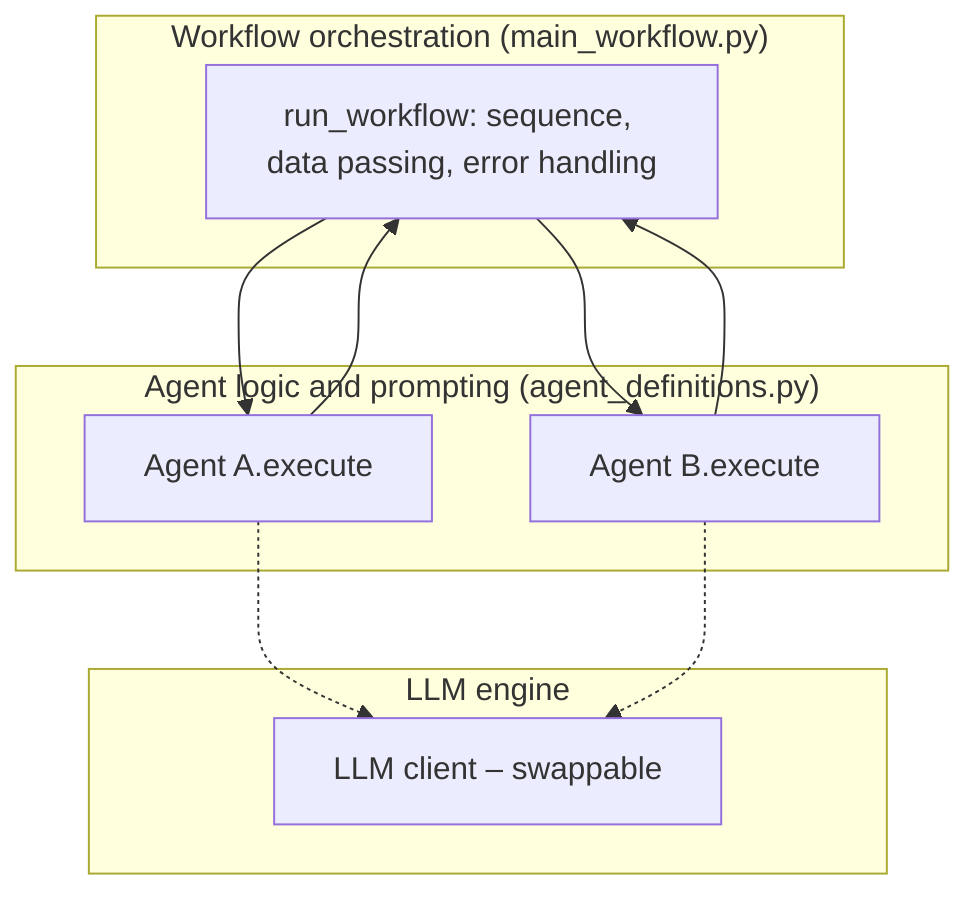
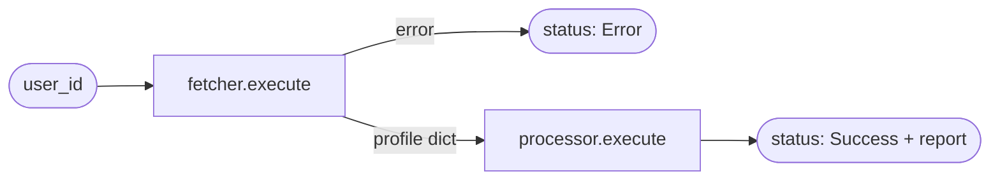

# Implementing Agentic Workflows in Python

> [!abstract] TL;DR
> You can build agents with a **framework** (pre-built abstractions) or **from scratch** in Python with an LLM directly; from scratch costs more effort but gives ==maximum control and insight into how agents work together==. A system has three layers: the **LLM (engine)**, **agent logic and prompting**, and **workflow orchestration**. In code, keep ==three concerns separate==: agent **definitions** (classes in a module), agent **instantiation** (configured objects), and workflow **implementation** (sequence and data flow between agents).

**Prerequisite:** [[Agentic Workflow Modeling]] · [[Agent Components and Agent Types]]
**Next:** [[Agentic Workflow Patterns]] (Prompt Chaining, Routing, Evaluator-Optimizer, Orchestrator-Workers)
**Related:** [[Runtime or Orchestration Layer]] · [[Task Chaining]] · [[Implementing Gate Checks]] · [[Pydantic for Structured LLM Output - Study Guide]] · [[Tool Use]] · [[Multi-Agent Systems]]

**Sources:** Course reading "Implementing an Agentic Workflow in Python" (three parts: overview, code structure, and the fetch-and-process example). The code review, the LLM-backed extension, and the critical analysis are *beyond the lecture*. The reading's explanation text contains find-and-replace typos (`Workspaceer`, `Workspaceed_user_data` for `fetcher`, `fetched_user_data`); the code itself uses the correct names, and this note does too.

> [!todo]- Contents
> 1. [[#1. Core Concepts]]
> 2. [[#2. Framework vs. From Scratch]]
> 3. [[#3. The Three System Layers]]
> 4. [[#4. The Three Code Concerns]]
> 5. [[#5. Worked Example – Fetch-and-Process Workflow]]
> 6. [[#6. Code Review of the Example]]
> 7. [[#7. Extension – Adding an LLM and a Generic Orchestrator]]
> 8. [[#8. Pitfalls and Failure Modes]]
> 9. [[#9. Key Takeaways]]
> 10. [[#10. Critical Analysis]]
> 11. [[#11. Self-Test]]
> 12. [[#12. Glossary]]

---

## 1. Core Concepts

> [!info]+ Definition – Agent class
> A Python class that serves as the ==blueprint for a type of agent==: its attributes (configuration such as name, data source, persona) and methods (its behavior, typically one `execute` entry point).

^def-agent-class

> [!info]+ Definition – Agent instance
> An object created from an agent class and **configured for one specific role or task** in a workflow, e.g. `DataFetchingAgent(name="UserProfileFetcher", data_source="MainUserDatabase")`.

^def-agent-instance

> [!info]+ Definition – Workflow orchestration
> The code that manages how agents work together: ==the sequence of operations, the flow of information between agents, and overall execution==. See [[Runtime or Orchestration Layer]].

^def-orchestration

---

## 2. Framework vs. From Scratch

| | Agent framework | From scratch (Python + LLM API) |
|---|---|---|
| Speed to first result | Fast | Slower |
| Control | Limited to the framework's abstractions | ==Maximum== |
| Insight into internals | Hidden behind abstractions | You see exactly how agents work together |
| Maintenance | Framework handles plumbing; you track its changes | You own all of it |
| Best when | Standard patterns, tight timelines | Learning, custom behavior, strict control needs |

The reading's point: the choice depends on **goals, timelines, and the level of customization and understanding** you need, and learning the from-scratch principles helps you understand what complex tools do inside.

---

## 3. The Three System Layers

| Layer | Role | Design goal |
|---|---|---|
| **1. LLM models – the engine** | Provide the core intelligence | ==Swappable==: connect or change models as new ones appear |
| **2. Agent logic and prompting** | Python code defining how each agent behaves; prompts; agent-specific capabilities | Each agent type implements its distinct capability |
| **3. Workflow orchestration** | Sequence, information flow, multi-agent execution | Connects agents into a working process |

^three-layers



These map onto the components from [[Agent Components and Agent Types#2. The Five Components of an Agent]]: persona and prompting strategy live in layer 2, tools are called from layer 2, and interaction (input/output contracts) is what layer 3 wires together.

---

## 4. The Three Code Concerns

| Concern | Where | What it contains |
|---|---|---|
| **1. Agent library/module** | e.g. `workflow_agents/agent_definitions.py` | Class definitions for agent types (blueprints) |
| **2. Agent instantiation logic** | The driver script | Import classes; create and **configure** instances for their roles |
| **3. Workflow implementation logic** | The driver script | Sequence of tasks, data passed between instances, collaboration toward the goal |

^three-concerns

> [!tip] Why separate them
> This ==separation of concerns== gives modularity and clarity: one agent class can be reused in many workflows with different configurations, and you can change a workflow without touching agent code. It is ordinary object-oriented design applied to agents.

Project layout from the reading:

```text
your_project_directory/
├── workflow_agents/
│   ├── __init__.py          # can be empty; makes the folder a package
│   └── agent_definitions.py
└── main_workflow.py         # run: python main_workflow.py
```

---

## 5. Worked Example – Fetch-and-Process Workflow

**Scenario:** fetch a user profile, then extract key fields from it.

### 5.1 Agent definitions (condensed)

```python
# workflow_agents/agent_definitions.py
class Agent:
    """Base class: common interface for all agents."""
    def __init__(self, name):
        self.name = name

    def execute(self, data=None):
        raise NotImplementedError("Each agent must implement the 'execute' method.")

class DataFetchingAgent(Agent):
    def __init__(self, name, data_source):
        super().__init__(name)
        self.data_source = data_source

    def execute(self, user_id):
        # Simulated fetch; in reality an API call or DB query
        if user_id == "123":
            return {"user_id": "123", "name": "Alice Wonderland", "occupation": "Dreamer"}
        return {"user_id": user_id, "error": "User not found"}

class DataProcessingAgent(Agent):
    def __init__(self, name, fields_to_extract=None):
        super().__init__(name)
        self.fields_to_extract = fields_to_extract or ["name", "occupation"]

    def execute(self, fetched_data):
        if "error" in fetched_data:
            return {"processed_info": None, "error": fetched_data["error"]}
        info = {f: fetched_data.get(f, "N/A") for f in self.fields_to_extract}
        return {"processed_info": info, "original_data_keys": list(fetched_data.keys())}
```

### 5.2 Instantiation and workflow (condensed)

```python
# main_workflow.py
from workflow_agents.agent_definitions import DataFetchingAgent, DataProcessingAgent

def run_user_data_workflow(user_id):
    # 2. Instantiation: configure each agent for its role
    fetcher = DataFetchingAgent(name="UserProfileFetcher", data_source="MainUserDatabase")
    processor = DataProcessingAgent(name="UserInfoExtractor",
                                    fields_to_extract=["name", "occupation", "user_id"])

    # 3. Workflow: sequence + data passing + error handling
    fetched = fetcher.execute(user_id=user_id)
    if fetched.get("error"):
        return {"status": "Error", "details": fetched["error"]}   # stop early
    report = processor.execute(fetched_data=fetched)
    return {"status": "Success", "data": report}

if __name__ == "__main__":
    print(run_user_data_workflow("123"))   # Success
    print(run_user_data_workflow("456"))   # Error: User not found
```

The original has `print` statements at each step for tracing; they are removed here for brevity.

### 5.3 Expected results

| Input | Path | Result |
|---|---|---|
| `"123"` | fetch → process | `{"status": "Success", "data": {"processed_info": {"name": "Alice Wonderland", "occupation": "Dreamer", "user_id": "123"}, "original_data_keys": ["user_id", "name", "occupation"]}}` |
| `"456"` | fetch → **stop** | `{"status": "Error", "details": "User not found"}` |



---

## 6. Code Review of the Example

*Beyond the lecture.* The example is a teaching scaffold. Reviewed as production code:

| Issue | Why it matters | Better |
|---|---|---|
| ==No LLM is involved== | These are deterministic functions wrapped in classes, i.e. stage 1 of [[Agentic Workflow Modeling#^automation-to-agentic]] | Put LLM calls in agent logic where judgment is needed (see [[#7. Extension – Adding an LLM and a Generic Orchestrator]]) |
| Inconsistent `execute` signatures (`data`, `user_id`, `fetched_data`) | The base-class interface can't be used polymorphically; an orchestrator can't loop over agents generically | One signature: `execute(state) -> state` |
| Errors as dict keys | Every caller must remember to check `"error"`; easy to miss | Exceptions or a typed result (`Ok`/`Err`), or Pydantic models ([[Pydantic for Structured LLM Output - Study Guide]]) |
| Error handled twice | Workflow stops on error *and* the processor also checks for it | Decide who owns error handling (the orchestrator) |
| Untyped dicts between agents | Handoff contract is implicit | Typed state ([[Task Chaining#3. Handoff Contracts and State]]) |
| `print` for tracing | No levels, no run IDs, not machine-readable | `logging` with a run ID; tracing ([[Runtime or Orchestration Layer#5. Durability, Budgets and Observability]]) |
| Agents built inside the workflow function | Hard to swap in fakes for tests | Pass agents in (dependency injection) |

---

## 7. Extension – Adding an LLM and a Generic Orchestrator

*Beyond the lecture.* A sketch that keeps the reading's three concerns but adds a **swappable LLM** (layer 1) and a **uniform interface** so the orchestrator is generic (layer 3).

```python
# workflow_agents/agent_definitions.py
from typing import Protocol

class LLMClient(Protocol):                       # layer 1: any model that fits this shape
    def complete(self, system: str, user: str) -> str: ...

class Agent:
    def __init__(self, name: str):
        self.name = name
    def execute(self, state: dict) -> dict:      # one signature for all agents
        raise NotImplementedError

class DataFetchingAgent(Agent):                  # tool-style agent, no LLM
    def __init__(self, name, fetch_fn):
        super().__init__(name)
        self.fetch_fn = fetch_fn
    def execute(self, state):
        return {**state, "profile": self.fetch_fn(state["user_id"])}

class SummaryAgent(Agent):                       # augmented prompt agent (persona)
    def __init__(self, name, llm: LLMClient, persona: str):
        super().__init__(name)
        self.llm, self.persona = llm, persona
    def execute(self, state):
        text = self.llm.complete(system=self.persona,
                                 user=f"Summarize this profile in one sentence: {state['profile']}")
        return {**state, "summary": text}
```

```python
# main_workflow.py
class WorkflowError(Exception): ...

def run_sequential(agents, state):
    for agent in agents:                         # generic: works for any list of agents
        state = agent.execute(state)
        if state.get("error"):
            raise WorkflowError(f"{agent.name}: {state['error']}")
    return state

llm = MyLLMAdapter(model="...")                 # swap models by swapping the adapter
pipeline = [
    DataFetchingAgent("UserProfileFetcher", fetch_fn=db.get_user),
    SummaryAgent("ProfileSummarizer", llm, persona="You are a concise HR assistant."),
]
result = run_sequential(pipeline, {"user_id": "123"})
```

What changed and why:

- `LLMClient` is a `Protocol`, so any model provider can be plugged in through a small adapter. This is the "swappable engine" of [[#^three-layers]].
- All agents share `execute(state) -> state`, so the workflow is data (a list), and `run_sequential` can later grow into a router or a DAG runner ([[Directed Acyclic Graph (DAG)]]) without changing agents.
- Next steps would be gates after each step ([[Implementing Gate Checks]]), budgets and checkpoints ([[Runtime or Orchestration Layer#4. A Minimal Runtime]]).

### 7.1 Latency and reliability of a sequential chain

For $n$ sequential agents with latencies $t_i$ and independent success rates $p_i$:

$$
T_{\text{total}} = \sum_{i=1}^{n} t_i, \qquad P_{\text{success}} = \prod_{i=1}^{n} p_i
$$

Independent agents can run in parallel, giving $T = \max_i t_i$ for that stage. Example: fetch (0.2 s, $p = 0.999$) then LLM summary (2.5 s, $p = 0.95$) gives $T \approx 2.7$ s and $P \approx 0.949$. The LLM step dominates both, which is where gates and retries pay off ([[Prompt Chaining for Agentic Reasoning - Study Guide#^error-compounding]]).

---

## 8. Pitfalls and Failure Modes

| Failure | Symptom | Mitigation |
|---|---|---|
| Hard-coded model calls in every agent | Changing models means editing every class | One LLM client interface; inject it |
| Inconsistent agent interfaces | Orchestrator full of special cases | Uniform `execute(state) -> state` |
| Silent failure propagation | Bad data flows downstream; wrong final output | Check or validate after each step; fail fast |
| Missing `__init__.py` or wrong run directory | `ModuleNotFoundError: workflow_agents` | Run from the project root; keep the package file |
| Mutating shared state | One agent's change breaks another | Return new state (`{**state, ...}`) or use immutable models |
| Framework lock-in | Can't express custom control flow | Understand the from-scratch pattern; keep a thin adapter around the framework |
| No tests for agents | Regressions when prompts or models change | Unit-test deterministic agents; use a fake `LLMClient` for LLM agents; evaluate on fixed test sets ([[LLM Evaluation]]) |

---

## 9. Key Takeaways

- [ ] I can compare building with a framework vs. from scratch.
- [ ] I can name the three system layers: LLM engine, agent logic and prompting, workflow orchestration.
- [ ] I know the LLM layer should be swappable.
- [ ] I can name the three code concerns: agent definitions, instantiation, workflow implementation.
- [ ] I can lay out the project structure and explain why `__init__.py` is there.
- [ ] I can trace the fetch-and-process example for both a found and a missing user.
- [ ] I can list at least three improvements to the example (uniform interface, typed results, logging, injected LLM).

---

## 10. Critical Analysis

- **The example isn't agentic yet.** Nothing in it uses an LLM or makes a decision, so it shows *structure*, not *agency*. That is a reasonable teaching choice, but it is the "replace each step with an agent" stage from [[Agentic Workflow Modeling]]. The value of the structure only shows once agents differ in what they can do.
- **Class-per-agent isn't the only design.** Many agents differ only in configuration (persona, tools, model). A single configurable `LLMAgent` class plus config data can replace many subclasses. Use subclasses when behavior (not just configuration) differs.
- **From scratch vs. frameworks is not binary.** In practice, teams often use a thin SDK for the LLM and tools and write orchestration themselves, or use a framework only for durability and tracing.
- **What changes at scale:** you need durable state and resume after crashes, concurrency for parallel agents, rate limiting, cost tracking, and tracing ([[Runtime or Orchestration Layer]]). A `for` loop in `main_workflow.py` provides none of this.
- **Evaluation:** deterministic agents can be unit-tested exactly. LLM agents need test sets and graded outputs. The uniform interface makes both possible because any agent can be run in isolation on fixed inputs.
- **Security:** a real `DataFetchingAgent` touches a database. Give it least-privilege credentials, validate `user_id` before querying, and treat fetched data as untrusted if it is later passed to an LLM ([[Prompt Injection]]).

> [!question] Discussion questions
> 1. At what point would you switch from your own orchestration code to a framework?
> 2. Should error handling live in agents, in the orchestrator, or in separate gate objects?
> 3. How would you design the `LLMClient` interface to support tool calling and structured output, not just text?

---

## 11. Self-Test

> [!question]- Q1. What are the two paths for building agents, and what is the trade-off?
> Use an existing framework (pre-built components, faster) or build from scratch with Python and an LLM directly (more effort, but maximum control and insight). The choice depends on goals, timelines, and the customization and understanding needed.

> [!question]- Q2. Name the three layers of an agentic system and what each does.
> LLM models (the engine, ideally swappable), agent logic and prompting (Python code defining agent behavior and prompts), and workflow orchestration (sequence, information flow, and execution across agents).

> [!question]- Q3. Name the three code concerns and where each lives in the example.
> Agent definitions: classes in `workflow_agents/agent_definitions.py`. Instantiation: creating configured objects in `main_workflow.py`. Workflow implementation: the call sequence and data passing in `run_user_data_workflow`.

> [!question]- Q4. What does `run_user_data_workflow("456")` return, and why doesn't the processor run?
> `{"status": "Error", "details": "User not found"}`. The fetcher returns a dict containing `"error"`, and the workflow checks for it and returns before calling the processor.

> [!question]- Q5. Why does the base `Agent.execute` raise `NotImplementedError`?
> It defines a common interface that every subclass must override. Calling it on the base class (or a subclass that forgot to implement it) fails loudly instead of silently doing nothing.

> [!question]- Q6. (Quantitative) Three sequential agents take 0.3 s, 2.0 s, and 1.5 s with success rates 0.99, 0.93, 0.95. What are total latency and success rate? What if the last two could run in parallel?
> Sequential: $T = 3.8$ s, $P = 0.99 \times 0.93 \times 0.95 \approx 0.875$. Parallel last two: $T = 0.3 + \max(2.0, 1.5) = 2.3$ s. The success rate is unchanged, because all three must still succeed.

> [!question]- Q7. (Design) Extend the example so the processor uses an LLM and the model can be swapped without changing agent code.
> Define an `LLMClient` interface (e.g. a `Protocol` with `complete(system, user)`), write one adapter per provider, and pass the client into the agent's constructor. The agent builds its prompt and calls `self.llm.complete(...)`. Swapping models means passing a different adapter at instantiation time. Add a uniform `execute(state) -> state` so the orchestrator stays generic.

### Flashcards

> [!tip] Flashcards
> Review cards for this note are in [[Implementing Agentic Workflows in Python - Flashcards]].

---

## 12. Glossary

| Term | Meaning |
|---|---|
| Agent framework | A library with pre-built agent components and abstractions |
| Agent class | Blueprint defining an agent type's attributes and methods |
| Agent instance | A configured object of an agent class, set up for one role |
| Separation of concerns | Keeping definitions, instantiation, and workflow logic in separate places |
| Workflow orchestration | Code managing sequence, data flow, and execution across agents |
| `__init__.py` | File that marks a folder as a Python package so its modules can be imported |
| Dependency injection | Passing collaborators (e.g. an LLM client) into an object instead of creating them inside it |

---

## Further Reading

- [Python tutorial – Classes](https://docs.python.org/3/tutorial/classes.html)
- [Python tutorial – Modules and packages](https://docs.python.org/3/tutorial/modules.html)
- [typing.Protocol (PEP 544)](https://peps.python.org/pep-0544/)
- [Building Effective Agents (Anthropic)](https://www.anthropic.com/research/building-effective-agents) – argues for starting with simple, direct LLM calls before adopting frameworks

%% Study hint: "Blueprint → Object → Flow" = definitions, instantiation, workflow. %%
