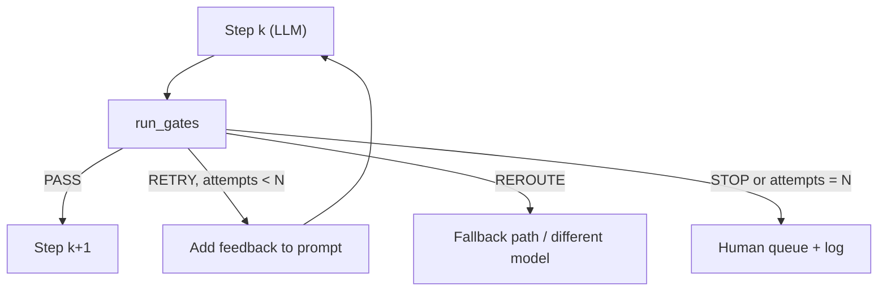

# Implementing Gate Checks

> [!abstract] TL;DR
> [[Gate Checks]] explains *what* gates are. This note covers *how to build them*. A gate is a function that returns **pass, retry-with-feedback, reroute, or stop**, together with a reason that can be logged. ==Build gates as small, composable, deterministic-first functions, and wrap each LLM step in a bounded validate–retry loop with an escalation path.== Pydantic does the format gate. Code does the logic gate. A judge model or a human is only for what can't be checked by rules.

**Prerequisites:** [[Gate Checks]] · [[Pydantic for Structured LLM Output - Study Guide]]
**Related:** [[Output Validation]] · [[LLM Feedback Loops]] · [[Chaining prompts for Agentic Reasoning#6. Implementing Gate Checks]] · [[Task Chaining]] · [[Runtime or Orchestration Layer]] · [[Sonar Ticket and Outage Classification - How-To]]

> [!note] Source scope
> This expands the table in [[Chaining prompts for Agentic Reasoning#6. Implementing Gate Checks]]. The gate interface, the composition pattern and the metrics are *beyond the lecture* (engineering practice).

> [!todo]- Contents
> - [[#1. Core Concepts]]
> - [[#2. A Gate Interface]]
> - [[#3. Composing Gates in a Chain]]
> - [[#4. Worked Example – Claim Extraction Step]]
> - [[#5. Observability and Tuning]]
> - [[#6. Pitfalls and Failure Modes]]
> - [[#7. Key Takeaways]]
> - [[#8. Critical Analysis]]
> - [[#9. Self-Test]]
> - [[#10. Glossary]]
> - [[#Further Reading]]

---

## 1. Core Concepts

> [!info]+ Definition – Gate (implementation view)
> A function `gate(output, context) -> Verdict`, where `Verdict ∈ {PASS, RETRY(feedback), REROUTE(target), STOP(reason)}`.

^def-gate-impl

> [!info]+ Definition – Validate–retry loop
> Run the step, apply the gates, and on `RETRY` add the gate's feedback to the prompt and run the step again. Stop after $N$ attempts and escalate.

^validate-retry

The three lecture gate types map to implementation tools like this:

| Gate type ([[Gate Checks#2. The Three Core Gate Types\|lecture]]) | Implementation |
|---|---|
| Format | Pydantic model / JSON Schema / structured-output mode |
| Content | Keyword and entity checks, quote matching against the source, a classifier |
| Logic | Business rules in code, DB lookups, compile or run tests |

---

## 2. A Gate Interface

```python
from dataclasses import dataclass
from enum import Enum

class Action(Enum):
    PASS = "pass"; RETRY = "retry"; REROUTE = "reroute"; STOP = "stop"

@dataclass
class Verdict:
    action: Action
    gate: str
    reason: str = ""
    feedback: str = ""       # text sent back to the model on RETRY

def run_gates(output, ctx, gates) -> Verdict:
    for g in gates:                          # ordered cheapest-first
        v = g(output, ctx)
        if v.action is not Action.PASS:
            return v                         # short-circuit
    return Verdict(Action.PASS, "all")
```

> [!tip] Feedback that names the error
> Retry feedback should say *what* failed and *where*, e.g. "`evidence_quote` was not found in the ticket text. Quote exactly." Pydantic's `e.errors()` gives the field locations for free.

---

## 3. Composing Gates in a Chain



```python
def gated_step(step, gates, ctx, max_attempts=3):
    prompt = step.build_prompt(ctx)
    for attempt in range(1, max_attempts + 1):
        raw = step.llm(prompt)
        try:
            out = step.schema.model_validate_json(raw, context=ctx)   # format gate
        except ValidationError as e:
            prompt = step.with_feedback(prompt, raw, str(e.errors())); continue
        v = run_gates(out, ctx, gates)                                # content + logic gates
        log(step.name, attempt, v)
        if v.action is Action.PASS:    return out
        if v.action is Action.RETRY:   prompt = step.with_feedback(prompt, raw, v.feedback); continue
        if v.action is Action.REROUTE: return route(v, ctx)
        break
    return escalate(step.name, ctx)                                   # never fail silently
```

**Ordering rule:** schema → deterministic content → logic → expensive (judge or human). See [[Gate Checks#5. Designing a Gate Stack]].

`gated_step` handles **one** step. The [[Runtime or Orchestration Layer#4. A Minimal Runtime|runtime]] calls it for each link, persists state between links, and enforces budgets across the whole run.

---

## 4. Worked Example – Claim Extraction Step

Step: pull out `{customer_id, outage_start, services_affected[]}` from an email.

| Gate | Type | Check | On failure |
|---|---|---|---|
| G1 | Format | Pydantic: types, ISO datetime, `services_affected` from an enum | RETRY with the field errors |
| G2 | Content | `customer_id` appears in the email text | RETRY: "quote the ID exactly" |
| G3 | Logic | Customer exists in CRM, `outage_start` ≤ now | REROUTE to an identity-lookup step |
| G4 | Policy | No PII in free-text fields sent downstream | Redact, then PASS |
| G5 | Escalation | ≥3 attempts | STOP → human queue |

A fuller real implementation is in [[Sonar Ticket and Outage Classification - How-To]].

---

## 5. Observability and Tuning

Log every verdict as `(step, gate, attempt, action, reason)`. Useful metrics:

- **Pass rate on first attempt, per gate.** Shows which prompt needs work.
- **Retry success rate.** If retries rarely fix a failure, stop retrying and reroute.
- **Escalation rate.** Human workload and cost.
- **False rejection rate.** Take a sample of rejected outputs and label them by hand.

Expected calls per step, where $q$ is the first-attempt pass rate and retries are independent with the same pass rate:

$$
E[\text{calls}] = \sum_{k=0}^{N-1} (1-q)^k = \frac{1-(1-q)^N}{q}
$$

For $q=0.8$ and $N=3$ this is $1.24$ calls, and the escalation probability is $(1-q)^N = 0.008$.

---

## 6. Pitfalls and Failure Modes

| Failure | Symptom | Mitigation |
|---|---|---|
| Vague retry feedback | Same error repeats | Name the field and the rule. Include the bad value |
| Unbounded loops | Cost spikes | `max_attempts`, a token budget |
| Gates with side effects | Retries duplicate writes | Keep gates pure. Make actions idempotent |
| Only format gates | Well-formed but wrong output | Add content and logic gates ([[Output Validation]]) |
| No logging | Can't tell which gate fails | Structured verdict logs |
| Judge gate before cheap gates | High cost | Order gates cheapest first |

---

## 7. Key Takeaways

- [ ] A gate returns PASS, RETRY(feedback), REROUTE or STOP, with a logged reason.
- [ ] Use Pydantic for format, code for logic, and a judge model or human only when rules can't do the check.
- [ ] Bound retries and always escalate. Never fail silently.
- [ ] Retry feedback must be specific.
- [ ] Measure first-attempt pass rate, retry success and escalation rate for each gate.

---

## 8. Critical Analysis

- **Retries assume independence.** The formula above assumes independent attempts. In practice failures are correlated (the same prompt produces the same mistake), so real retry gains are smaller. Rerouting to a different prompt or model breaks that correlation.
- **Validators are models too.** An LLM-judge gate has its own precision and recall. Evaluate it like a classifier ([[Model Evaluation]]).
- **At scale.** Gate logic tends to spread across the codebase. Keep gates declarative and versioned, and test them with unit tests using fixtures of good and bad outputs.
- **Security.** Gates are where you enforce tool allow-lists and permission checks before an action runs ([[Prompt Injection]]).

> [!question] Discussion
> 1. When should a failing gate *repair* output instead of retrying?
> 2. How would you A/B test a new gate without hurting production traffic?

---

## 9. Self-Test

> [!question]- Q1. What four outcomes can a gate return?
> PASS, RETRY (with feedback), REROUTE (to a fallback), STOP (escalate).

> [!question]- Q2. Quantitative – q = 0.6, N = 3. What are the expected calls and the escalation probability?
> $E=(1-0.4^3)/0.6 = 0.936/0.6 \approx 1.56$ calls. Escalation $=0.4^3=0.064$.

> [!question]- Q3. Why keep gates free of side effects?
> Retries run them again. Side effects (writes, emails) would be duplicated.

> [!question]- Q4. Design – gates for an agent that issues account credits
> Format (amount is a decimal, reason from an enum), content (reason is supported by ticket evidence), logic (amount ≤ policy cap, account in good standing, no duplicate credit), approval (a human above the threshold), and an idempotency key on the write.

> [!tip] Flashcards
> Review with [[Implementing Gate Checks - Flashcards]].

---

## 10. Glossary

| Term | Meaning |
|---|---|
| Verdict | A gate's result: action + reason + feedback |
| Short-circuit | Stop at the first failing gate |
| Reroute | Send to an alternate path or model instead of retrying |
| Idempotent | Safe to repeat with the same effect |

---

## Further Reading

- [Pydantic – Validators](https://docs.pydantic.dev/latest/concepts/validators/)
- [Self-Refine (Madaan et al., 2023)](https://arxiv.org/abs/2303.17651)
- [Building Effective Agents – Anthropic](https://www.anthropic.com/engineering/building-effective-agents)
