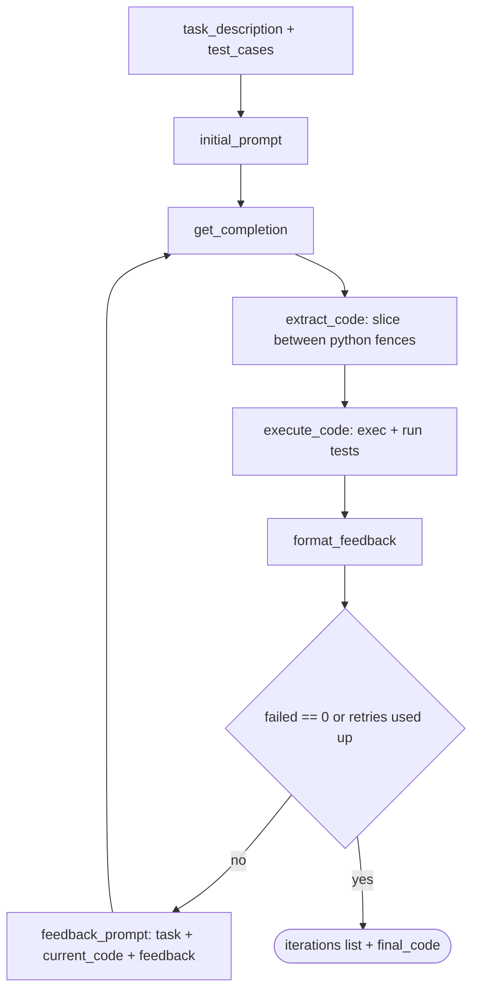

# Implementing LLM Feedback Loops

> [!abstract] TL;DR
> This is the hands-on companion to [[LLM Feedback Loops]]. The Lesson 5 notebook builds a **code-correcting loop**: an LLM writes `process_data`, a harness `exec`s it against test cases, the failures are formatted into text, and that text goes into the next prompt. ==The tests are the specification. The loop can only be as good as the tests and the feedback formatter.== In my run the model went from 8/12 → 12/12 passing in one revision. However, the loop cell as I submitted it **made no new LLM calls**. It reused stale variables from earlier cells (see [[#6. Debrief – What My Run Actually Showed]]).

**Prerequisites:** [[LLM Feedback Loops]] · [[Prompt Chaining for Agentic Reasoning - Study Guide]]
**Related:** [[LLM Feedback Loops#^five-parts|Five parts of a loop]] · [[LLM Feedback Loops#^stop-conditions|Stop conditions]] · [[Implementing Gate Checks]] · [[Output Validation]] · [[Tool Use]]

> [!note] Source scope
> Based on the Lesson 5 notebook (`lesson-5-implementing-llm-feedback-loops.ipynb`), the exercise instructions, and the outputs saved in my copy. Model: `gpt-4.1-nano` via the Vocareum OpenAI proxy, `temperature=0.7`. The reference solutions, the harness critique, the "stale state" debrief, and the critical analysis are *beyond the lecture* (my own analysis).

> [!todo]- Contents
> - [[#1. Core Concepts]]
> - [[#2. The Harness – What the Helper Functions Do]]
> - [[#3. Lab Walkthrough]]
> - [[#4. Reference Solutions for the TODO Cells]]
> - [[#5. Worked Example – The Trace]]
> - [[#6. Debrief – What My Run Actually Showed]]
> - [[#7. Pitfalls and Failure Modes]]
> - [[#8. Key Takeaways]]
>     - [[#8.1 Lesson Outcomes – Where This Lab Hit Them]]
> - [[#9. Critical Analysis]]
> - [[#10. Self-Test]]
> - [[#11. Glossary]]
> - [[#Further Reading]]

---

## 1. Core Concepts

> [!info]+ Definition – Code-correcting loop
> A [[LLM Feedback Loops#^def-feedback-loop|feedback loop]] in which the **evaluator is code execution against tests**. The feedback signal is the list of failing tests, each with its inputs, expected value, and actual value or exception.

^def-code-loop

> [!info]+ Definition – Test harness
> The code that loads the generated code, calls the target function on each test case, compares results, and records pass/fail. In this lab: `execute_code()` + `format_feedback()`.

^def-harness

> [!info]+ Definition – Requirement drift (as simulated in the lab)
> New tests are added **after** the first draft (median mode, invalid mode → `ValueError`). They stand in for requirements discovered in production. The loop has to satisfy them even though the original `task_description` never mentions them.

^def-req-drift

How the notebook maps onto the [[LLM Feedback Loops#^five-parts|five parts of a loop]]:

| Part | Notebook implementation |
|---|---|
| Generator | `get_completion()` → `gpt-4.1-nano` |
| Evaluator | `execute_code(code, test_cases)` (Python `exec` + equality check) |
| Feedback formatter | `format_feedback(results)` |
| Stop condition | `failed == 0` **or** `max_retries` reached |
| Memory | `current_code` + `current_feedback` (last iteration only) plus the `iterations` list for monitoring |



^lab-flow

---

## 2. The Harness – What the Helper Functions Do

### 2.1 `execute_code(code, test_cases)`
1. `exec(code, namespace)` inside `redirect_stdout/stderr`. A syntax error or import-time crash is recorded as `execution_error` **and no tests run**.
2. For each test: if `inputs` is a `dict`, call `process_data(**inputs)`. Otherwise call `process_data(*inputs)`.
3. Pass if `actual == expected`.
4. If the call raises, it passes **only** if `expected` is an exception *class* and the error is an instance of it. That is how `{"expected": ValueError}` works.

> [!warning] Harness sharp edges
> - `*inputs` **unpacks** whatever you give it. `([1, 2, 3])` is *not* a tuple; it's just a list in parentheses. The harness then calls `process_data(1, 2, 3)`. Write `([1, 2, 3],)` for a one-argument call.
> - `==` on floats is exact. `0.1 + 0.2 == 0.3` is `False`, so averages of non-integer data can fail even when the code is correct. `math.isclose` would be safer.
> - `3 == 3.0` is `True`, so these tests **can't tell an int from a float**. A test expecting `3` is also passed by `3.0`.
> - `exec` runs model-written code **in the notebook process** with no sandbox, no timeout, and full filesystem and network access. (See [[#9. Critical Analysis]].)

^harness-edges

### 2.2 `format_feedback(results)`
- Execution error → error type + message + full traceback + "fix the syntax or runtime errors".
- Otherwise → `"Test Results: X passed, Y failed"`, then for each **failed** test: inputs, expected, actual or error.
- Passing tests are **not** listed. The model isn't told what already works, which is a small oscillation risk (see [[LLM Feedback Loops#^pitfalls]]).

This is exactly the "specific, located, measured" feedback described in [[LLM Feedback Loops#4.2 Making feedback actionable]].

### 2.3 `extract_code(response)`
```python
lines = code.split("\n")
start = lines.index("```python") + 1
end = lines.index("```", start)
```
It only works if the model puts ` ```python ` **alone on its own line** with no trailing spaces. If the model skips the fence, uses ` ```py `, or indents it, `list.index` raises `ValueError` and **the whole loop crashes**. It is a format [[Gate Checks|gate]] with no retry path.

---

## 3. Lab Walkthrough

| Step | What you do | What to observe |
|---|---|---|
| 1. Setup | Imports, API client, pick `MODEL` | `gpt-4.1-nano` is cheap, so iterations are affordable |
| 2. Task + tests | Write `task_description`; add test cases | These are the only "spec" the model sees |
| 3. Initial generation | Write `initial_prompt`; generate, extract, execute, format | First-draft pass rate |
| 4. Expand tests | Run the new 12-case suite against the *old* code | Simulated requirement drift, so failures appear |
| 5. One feedback iteration | Write `feedback_prompt` with task + code + feedback | Does one revision fix everything? |
| 6. Feedback loop | Set `max_retries`; fill in the generation block and the loop body | Pass count across iterations |
| 7. Review | `pprint(iterations)`, print final code | Trace = the monitoring artifact |

### 3.1 The expanded test suite (given)

| # | Inputs | Expected | Requirement it encodes |
|---|---|---|---|
| 1–4 | sum/average on clean lists | 15, 3.0, 65, 13.0 | Original spec |
| 5 | `([], "sum")` | `None` | Empty list → `None` |
| 6–7 | median, odd / even length | 3, 2.5 | **New** median mode |
| 8 | `([1, 2, "a", 3], "sum")` | 6 | Ignore non-numerics |
| 9 | `([1, 2, None, 3, "b", 4], "average")` | 2.5 | Ignore `None` and strings |
| 10 | `([10], "median")` | 10 | Median of a single element |
| 11 | `([], "median")` | `None` | Empty list for every mode |
| 12 | `(..., "invalid_mode")` | `ValueError` | **New** error contract |

^expanded-tests

> [!important] Tests as specification
> The `task_description` never mentions median or `ValueError`. The model learns those requirements **only from the failing-test feedback**. This is test-driven development with the LLM as implementer: ==the feedback is carrying the spec==.

---

## 4. Reference Solutions for the TODO Cells

*(My solutions. The notebook leaves `**********` placeholders.)*

### 4.1 Task description
```python
task_description = """
Write a Python function `process_data(data_list, mode='average')`.

- `data_list` is a list that may contain numbers and non-numeric values.
- `mode` is 'sum' or 'average' (default 'average').
- If mode is 'sum', return the sum of the numbers.
- If mode is 'average', return the arithmetic mean of the numbers.

Examples:
process_data([1, 2, 3, 4, 5], mode='average')  # 3.0
process_data([1, 2, 'a', 3], mode='sum')        # 6
"""
```
Naming the signature explicitly matters, because tests that use `dict` inputs call by keyword (`data_list=`).

### 4.2 Extra initial test cases
```python
test_cases = [
    {"inputs": ([1, 2, 3, 4, 5], "sum"), "expected": 15},
    {"inputs": ([1, 2, 3, 4, 5], "average"), "expected": 3.0},
    {"inputs": ([10, 20, 30], "sum"), "expected": 60},
    {"inputs": ([10, 20, 30], "average"), "expected": 20.0},
    {"inputs": ([7], "average"), "expected": 7.0},
    {"inputs": ([1, 2, "a", 4, 5], "sum"), "expected": 12},
    {"inputs": ([1, 2, 3, 4, 5],), "expected": 3.0},   # default mode: note the trailing comma
]
```

### 4.3 `initial_prompt`
```python
initial_prompt = f"""
You are a Python programming assistant.

{task_description}

Write only the function surrounded by ```python and ``` without any additional explanations or examples.

Example:

```python
def process_data(data_list, mode='average'):
    # Your code here
    pass
```
"""
```

### 4.4 Feedback prompt – single iteration
```python
feedback_prompt = f"""
You are an expert Python developer. You wrote a function based on these requirements:

{task_description}

Here is your current implementation:
```python
{initial_code}
```

I've tested your code and here are the results:
{initial_feedback}

Please carefully review the test results and revise the Python function to correctly
implement 'sum', 'average', and 'median' modes, ignore non-numeric values in calculations,
return None for empty lists, and raise ValueError for an unknown mode.
The revised code must pass all the provided test cases.
Return only the function surrounded by ```python and ```.
"""
```

### 4.5 The loop (the version that actually regenerates)
```python
max_retries = 3
iterations = []

# Iteration 0: fresh generation against the EXPANDED test suite
initial_response = get_completion(messages=[{"role": "user", "content": initial_prompt}])
initial_code = extract_code(initial_response)
initial_results = execute_code(initial_code, test_cases)
initial_feedback = format_feedback(initial_results)

iterations.append({"iteration": 0, "code": initial_code,
                   "test_results": {"passed": initial_results["passed"],
                                    "failed": initial_results["failed"]}})
current_code, current_feedback = initial_code, initial_feedback

for i in range(max_retries):
    if iterations[-1]["test_results"]["failed"] == 0:
        print("\nSuccess! All tests passed.")
        break
    feedback_prompt = f"""..."""   # as in 4.4, using current_code / current_feedback
    improved_response = get_completion(messages=[{"role": "user", "content": feedback_prompt}])
    improved_code = extract_code(improved_response)
    improved_results = execute_code(improved_code, test_cases)
    improved_feedback = format_feedback(improved_results)

    iterations.append({"iteration": i + 1, "code": improved_code,
                       "test_results": {"passed": improved_results["passed"],
                                        "failed": improved_results["failed"]}})
    current_code, current_feedback = improved_code, improved_feedback

best = max(iterations, key=lambda it: it["test_results"]["passed"])   # best, not last
```

> [!tip] Two upgrades beyond the notebook
> 1. Return the **best** iteration, not the last ([[LLM Feedback Loops#4.1 Stop conditions – every loop needs at least two|why]]).
> 2. Check the pass condition *after* the last retry too. As written, if the final retry succeeds, the loop ends without printing "Success".

---

## 5. Worked Example – The Trace

My actual run (`gpt-4.1-nano`).

**Iteration 0 (first draft):**
```python
def process_data(data, mode='average'):
    numeric_values = [item for item in data if isinstance(item, (int, float))]
    if not numeric_values:
        return None
    if mode == 'sum':
        return sum(numeric_values)
    elif mode == 'average':
        return sum(numeric_values) / len(numeric_values)
    else:
        return None
```

| Suite | Result | Failures |
|---|---|---|
| My initial 6 tests | 4 / 6 | #5, #6: `takes from 1 to 2 positional arguments but 5 were given`. **These are test bugs, not code bugs** (see [[#^harness-edges]]) |
| Expanded 12 tests | 8 / 12 | #6, #7, #10 median → `None`; #12 invalid mode → `None` instead of `ValueError` |

The first draft was already robust on non-numerics and empty lists, **without being told**. It failed only on requirements it could not have known about.

**Iteration 1 (after feedback):** it added a `median` branch (sort, odd/even midpoint) and changed `else: return None` to `raise ValueError("Invalid mode")`. **12 / 12.**

| Iteration | Passed | Failed | What changed |
|---|---|---|---|
| 0 | 8 | 4 | — |
| 1 | 12 | 0 | + median, + `ValueError` |

^my-trace

> [!example] Why one iteration was enough
> Every failing test showed input, expected, and actual. The two missing behaviours are each **one branch** of code. The feedback named them exactly. That is the best case for a code loop: ==small, local, fully specified fixes==. Compare the lecture's `sort_numbers` example, which needed three revisions ([[LLM Feedback Loops#^code-refinement-trace]]).

---

## 6. Debrief – What My Run Actually Showed

> [!failure] The loop cell never called the LLM
> In my notebook, cell 6 left the *initial generation block* empty and the loop body's four lines **commented out**:
> ```python
> # ********** <-- improved_response = ?
> # ********** <-- improved_code = ?
> ```
> It still printed `8 passed → 12 passed → Success!` because `initial_code`, `initial_results`, `improved_code` and `improved_results` were **still in the kernel** from cells 12 and 14. The "loop" just re-logged earlier results. `max_retries` was never defined either; `range(3)` was hard-coded.
>
> **Lesson:** ==Jupyter hidden state can make a broken loop look like a working one.== Use *Restart & Run All* before trusting a loop's output. Better still, put the loop inside a function so it can only see its own arguments.

^stale-state

Other things to fix in my submission:

| Issue | Where | Fix |
|---|---|---|
| Role left as `You are **********` | `initial_prompt` | "You are a Python programming assistant." (The model coped, but by luck.) |
| `task_description` didn't name the parameter or show the examples | cell 6 | See [[#4.1 Task description]] |
| `([1,2,3,4,5])` isn't a tuple | tests 5–6 | `([1,2,3,4,5],)` |
| "iterate through the code until you can pass all tests, do not iterate more than 10 times" | `feedback_prompt` | The model **can't run code**. Iterating is the harness's job. Ask for one revised function instead. |
| No output-format reminder in the feedback prompt | `feedback_prompt` | Restate "only the function in ```python fences", or `extract_code` may crash |
| API key pasted in the notebook | setup cell | Use `os.getenv("OPENAI_API_KEY")`; don't commit or share the notebook with the key |

---

## 7. Pitfalls and Failure Modes

| Failure | Symptom | Mitigation |
|---|---|---|
| Stale notebook state | Loop "succeeds" with zero API calls | Restart & Run All; wrap the loop in a function ([[#^stale-state]]) |
| Buggy test | Correct code "fails"; the model is pushed to satisfy a wrong spec | Review tests first; a failing test is a claim that needs checking |
| Missing trailing comma | `takes N positional arguments` errors | Single-argument tuples need `(x,)` |
| Fence-format drift | `ValueError: '```python' is not in list` crashes the loop | Regex extraction with fallback; treat a parse failure as feedback and retry |
| Exact float equality | Correct averages fail | `math.isclose` in the harness |
| `bool` is a subclass of `int` | `[True, 2]` sums to 3 | Filter with `type(x) in (int, float)` or exclude `bool` explicitly (untested in this lab) |
| Test overfitting | Code special-cases the exact test inputs | Held-out tests the loop never sees ([[LLM Feedback Loops#10. Critical Analysis]]) |
| Unsandboxed `exec` | Generated code can delete files or call the network | Subprocess/container, timeout, no network ([[#9. Critical Analysis]]) |
| Infinite loop in generated code | Harness hangs | Per-test timeout (subprocess + `timeout=`) |
| Returning last instead of best | Regression shipped | Track `best` by pass count |

---

## 8. Key Takeaways

- [ ] A code-correcting loop = generate → `exec` + tests → format failures → revise, bounded by `max_retries`.
- [ ] Test cases **are** the specification. New requirements can be introduced purely through failing tests.
- [ ] Good feedback = inputs + expected + actual/error for each failure. That's what let `gpt-4.1-nano` fix everything in one pass.
- [ ] Expected exceptions can be tested by passing the exception class as `expected`.
- [ ] `(x)` is not a tuple; `(x,)` is.
- [ ] `extract_code` is a brittle format gate. A missing fence crashes the loop instead of triggering a retry.
- [ ] Jupyter kernel state can fake a working loop. Restart & Run All before trusting results.
- [ ] Never `exec` model-generated code outside a sandbox in anything but a toy setting.
- [ ] Return the best iteration and log every iteration (`iterations` list = the trace).

### 8.1 Lesson Outcomes – Where This Lab Hit Them

The course-stated outcomes are also listed in [[LLM Feedback Loops#^lesson5-outcomes]]. Here is how each showed up in this notebook:

| Outcome | In this lab |
|---|---|
| **Feedback loop architecture** – generation, programmatic evaluation, feedback construction, iterative re-prompting | `get_completion` → `execute_code` → `format_feedback` → `feedback_prompt` ([[#^lab-flow]]) |
| **Automated output evaluation** – objectively test the quality or correctness of LLM output | 12-case suite incl. expected-exception tests; pass/fail counts per iteration ([[#^expanded-tests]]) |
| **Crafting prompts for revision** – prior work + specific, actionable feedback | `feedback_prompt` carries `task_description`, the previous code, and failures as inputs/expected/actual ([[#4.4 Feedback prompt – single iteration\|4.4]]) |
| **Iterative AI problem-solving** – multiple attempts | `for i in range(max_retries)` with early exit on `failed == 0` ([[#4.5 The loop (the version that actually regenerates)\|4.5]]) |
| **Building self-correcting systems** – AI helps refine its own output to higher standards | 8/12 → 12/12 in one revision ([[#^my-trace]]), plus the hardening needed for real use ([[#9. Critical Analysis]]) |

---

## 9. Critical Analysis

**What the lab demonstrates, and what it doesn't.** Going from 8/12 to 12/12 in one step shows that *specific external feedback* works when the fixes are small and local. It doesn't show that the loop converges on harder tasks. With only one iteration there's no evidence about oscillation, stagnation, or regression. A fairer test would use a task where the first draft passes perhaps 30% of tests, with interacting requirements (e.g. `mode="trimmed_mean"` plus weighting), run over many seeds at `temperature=0.7`.

**Evidence quality.** n = 1 run, one model, one task, 12 tests. The first draft already handled non-numerics and empty lists that the task description never mentioned, so the model's priors did much of the work. Report pass@1 vs pass-after-k over ≥20 runs before claiming the loop "works".

**Tests are a weak oracle.** The loop maximizes *tests passed*, not correctness (Goodhart). 12 tests leave most of the behaviour space unspecified: `bool`, `float('nan')`, numeric strings like `"3"`, nested lists, `Decimal`, very large lists. A loop that passes all 12 has a spec coverage problem, not a certificate of correctness. Mitigations: held-out tests, property-based testing (e.g. Hypothesis: "sum mode equals `sum` of the numeric filter"), and mutation testing to measure how strong the suite is.

**Security (the biggest real-world gap).** `exec(code, namespace)` runs untrusted model output with the notebook's full privileges. An empty `namespace` dict is **not** a sandbox: `__builtins__` is injected automatically, so `__import__("os")` works. If a task description or feedback ever includes untrusted text (a GitHub issue, a web page), that becomes a [[Prompt Injection|prompt-injection]] → code-execution chain. Production code loops need an isolated container or VM, no network, CPU/memory/time limits, a read-only filesystem, and the tests kept outside the model's reach so it can't edit them.

**At scale.** Each iteration costs one LLM call plus test runtime, and the context grows with the code and the feedback. Run the cheap gates first (fence parse → `ast.parse` → lint → fast unit tests) before slow integration tests. The same principle appears in [[Implementing Gate Checks]].

**Design choice worth questioning.** The feedback prompt carries **only the last code and last feedback**. That keeps context small but loses the history. If iteration 2 breaks something iteration 1 fixed, the model doesn't know it once worked. Listing passing tests too ("keep these passing") is a cheap guard.

> [!question] Discussion questions
> 1. When the model fails a test, how do you decide whether the code or the test is wrong? Should the loop ever be allowed to propose test changes?
> 2. Would property-based tests produce better or worse feedback text for an LLM than example-based tests?
> 3. How would you measure the loop's value over simply sampling 4 independent drafts and keeping the best (best-of-*k*)?
> 4. What minimum sandbox would you accept before running this loop on user-submitted task descriptions?

---

## 10. Self-Test

> [!question]- Q1. Map the notebook's functions onto the five parts of a feedback loop.
> Generator = `get_completion`; evaluator = `execute_code`; feedback formatter = `format_feedback`; stop condition = `failed == 0` or `max_retries`; memory = `current_code` + `current_feedback` (plus the `iterations` log). `extract_code` is an extra format gate between the generator and the evaluator.

> [!question]- Q2. Why did my test `{"inputs": ([1, 2, 3, 4, 5]), "expected": 3.0}` fail with "takes from 1 to 2 positional arguments but 5 were given"?
> Parentheses around one expression don't make a tuple, so `inputs` is the list itself. The harness calls `process_data(*inputs)`, which unpacks it into five positional arguments. Fix: `([1, 2, 3, 4, 5],)`.

> [!question]- Q3. How does the harness test that invalid modes raise `ValueError`?
> The test sets `expected` to the class `ValueError`. When the call raises, the harness marks it passed if `isinstance(expected, type) and isinstance(e, expected)`. If the function *returns* instead (e.g. `None`), `None == ValueError` is `False`, so the test fails. That is what happened to the first draft.

> [!question]- Q4. (Quantitative) Verify the expected values of tests 7 and 9.
> Test 7: sorted `[1, 2, 3, 5]`, even length 4, median $=\frac{2+3}{2}=2.5$. Test 9: the numeric filter keeps `[1, 2, 3, 4]`, and the mean is $\frac{10}{4}=2.5$.

> [!question]- Q5. (Quantitative) Suppose each revision independently fixes all remaining failures with probability $p = 0.6$, and `max_retries = 3`. What is the probability the loop ends with 12/12? Why is the independence assumption optimistic?
> $1-(1-0.6)^3 = 1-0.064 = 0.936$. It's optimistic because failures are correlated: if the model misread the requirement once, the same prompt and feedback tend to produce the same misreading. Hence the no-progress stop in [[LLM Feedback Loops#^stop-conditions]].

> [!question]- Q6. The loop printed "Success!" but made no API calls. How is that possible, and how do you prevent it?
> The loop body's LLM and test lines were commented out, so the loop appended the `improved_code`/`improved_results` values already in the kernel from an earlier cell. Prevent it with Restart & Run All, by wrapping the loop in a function with explicit inputs, and by logging a call counter or token usage per iteration.

> [!question]- Q7. (Design) Harden this lab into a service that fixes user-submitted functions. List your changes.
> > [!example] Answer sketch
> > - **Isolation:** run each candidate in a container subprocess with no network, CPU/memory/time limits, and a read-only filesystem except a temp directory.
> > - **Extraction:** regex for fenced blocks with fallback. A parse failure becomes feedback instead of a crash. Run `ast.parse` before execution.
> > - **Tests:** visible tests go in the feedback, held-out tests decide the final verdict, plus property-based tests. `math.isclose` for floats.
> > - **Loop:** `max_retries`, a no-progress stop (the same failing set twice), return best-so-far, and list passing tests in the prompt to stop regressions.
> > - **Monitoring:** log per iteration the prompt hash, code, pass/fail vector, tokens, and latency.
> > - **Security:** treat the task text as untrusted; delimit it as data ([[Prompt Injection]]).

> [!question]- Q8. Why is the feedback prompt instruction "iterate through the code until you can pass all tests" ineffective?
> A single completion can't execute code or observe test results. The *harness* provides the iteration. The model can only pretend to iterate, which wastes tokens and can produce made-up "test passed" claims. Ask for one corrected function, and let the loop do the iterating.

### Flashcards

> [!tip] Flashcards
> Review this lab in [[Implementing LLM Feedback Loops - Flashcards]]. The concept deck is [[LLM Feedback Loops - Flashcards]].

---

## 11. Glossary

| Term | Meaning |
|---|---|
| Code-correcting loop | A feedback loop whose evaluator is code execution against tests |
| Test harness | Code that runs the candidate function over the test cases and records the results |
| `execute_code` | Notebook helper: `exec` the code, run the tests, return pass/fail and errors |
| `format_feedback` | Notebook helper: turn the results into text for the next prompt |
| `extract_code` | Notebook helper: slice the code out of the ```python fence |
| Requirement drift | New requirements appearing after the first draft; simulated here by the expanded tests |
| Expected-exception test | A test whose `expected` value is an exception class |
| Hidden (kernel) state | Variables left over from earlier notebook cells that affect later ones |
| Held-out tests | Tests used only for the final verdict, never shown to the model |
| Property-based testing | Tests that assert invariants over generated inputs rather than fixed examples |
| Sandbox | An isolated execution environment that limits what untrusted code can do |

---

## Further Reading

- [Chen et al., 2023 – Teaching Large Language Models to Self-Debug](https://arxiv.org/abs/2304.05128)
- [Shinn et al., 2023 – Reflexion: Language Agents with Verbal Reinforcement Learning](https://arxiv.org/abs/2303.11366)
- [Chen et al., 2021 – Evaluating Large Language Models Trained on Code (HumanEval, pass@k)](https://arxiv.org/abs/2107.03374)
- [Python docs – Built-in `exec`](https://docs.python.org/3/library/functions.html#exec)
- [Hypothesis – property-based testing for Python](https://hypothesis.readthedocs.io/)

%%
Study hint: the three things to remember for the exam are
(1) tests = spec, (2) feedback = inputs/expected/actual, (3) stop = success OR cap, return best.
The stale-kernel-state debrief is a great interview anecdote about evaluating agent loops honestly.
%%
