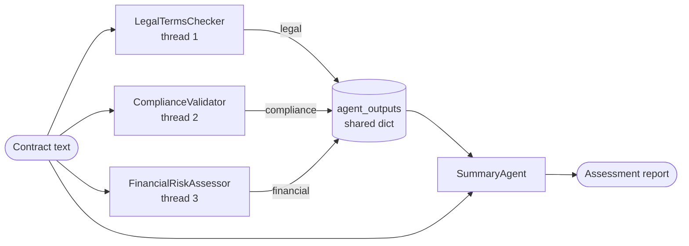

# Implementing Parallelization Workflow

> [!abstract] TL;DR
> The exercise builds an **enterprise contract analysis system**. Three specialist agents (legal terms, compliance, financial risk) analyze the same contract **at the same time** using Python `threading`, write their results into a **shared dictionary**, and a **summary agent** synthesizes them into one report. That is ==aspect-based decomposition + synthesizer aggregation== ([[Parallelization Workflow#^decomposition-strategies]]). The pattern is right, but the plumbing has a serious flaw: I tested that a failed agent thread ==crashes the summary on the first run and silently reuses the previous contract's analysis on later runs==, because the shared dictionary is global and never cleared. The improved version keeps results local, captures failures per agent, and tells the synthesizer what's missing.

**Section:** [[Agentic Workflow Patterns]] – pattern 3 of 5 (implementation)
**Previous:** [[Parallelization Workflow]] (theory) · **Next:** [[Evaluator-Optimizer Workflow]]
**Related:** [[Implementing Routing Workflow#6. Improved Version]] (parallel context gathering with `ThreadPoolExecutor`) · [[Implementing Prompt Chaining Workflow]] · [[Runtime or Orchestration Layer]]

**Sources:** Course exercise code (contract analysis with threads; full listing in [[#Appendix – Original Exercise Code]]). The failure tests, the improved version, the expected-findings checklist, and the critical analysis are *beyond the lecture*. All tests were run offline with a fake OpenAI client; nothing here was run against the live API.

> [!todo]- Contents
> 1. [[#1. Setup]]
> 2. [[#2. Architecture of the Exercise]]
> 3. [[#3. Code Walkthrough]]
> 4. [[#4. Review Against the Theory]]
> 5. [[#5. Testing Failure Behavior]]
> 6. [[#6. Improved Version]]
> 7. [[#7. Evaluating the Output – Expected Findings]]
> 8. [[#8. Latency and Cost]]
> 9. [[#9. Pitfalls and Failure Modes]]
> 10. [[#10. Key Takeaways]]
> 11. [[#11. Critical Analysis]]
> 12. [[#12. Self-Test]]
> 13. [[#13. Glossary]]

---

## 1. Setup

Same environment as [[Implementing Prompt Chaining Workflow#1. Setup]] (`openai`, `python-dotenv`, `.env` key, Vocareum `base_url`), plus the standard-library `threading` module. Differences from the earlier exercises:

| Setting | Here | Earlier exercises |
|---|---|---|
| Model | `gpt-4` | `gpt-3.5-turbo` |
| Temperature | `0.3` | `0` |
| LLM calls | Directly via `client.chat.completions.create` in each class | Through a `call_openai` wrapper |

---

## 2. Architecture of the Exercise

| Component | Role in the pattern | Output |
|---|---|---|
| `LegalTermsChecker` | Aspect agent – liability, rights, obligations, ambiguous language | `agent_outputs["legal"]` |
| `ComplianceValidator` | Aspect agent – data privacy, labor law, industry regulation | `agent_outputs["compliance"]` |
| `FinancialRiskAssessor` | Aspect agent – financial risk, liability exposure, payment terms | `agent_outputs["financial"]` |
| `SummaryAgent` | **Synthesizer / aggregator LLM** | Report: Executive Summary, Legal, Compliance, Financial, Recommended Actions |
| `analyze_contract` | Scatter (start threads) + gather (join) + aggregate (call summary) | Final report |
| `agent_outputs` | Module-level **shared dictionary** that collects results | – |

^contract-components



The **golden rule** holds: none of the three analyses needs another's output ([[Parallelization Workflow#^golden-rule]]). The summary agent also gets the **original contract**, so it can check the specialists' claims against the source.

---

## 3. Code Walkthrough

### 3.1 An aspect agent

```python
class LegalTermsChecker:
    def run(self, contract_text):
        response = client.chat.completions.create(
            model="gpt-4",
            messages=[
                {"role": "system", "content": "You are a legal expert specializing in contract law. "
                 "Analyze the contract for potentially problematic legal terms ... Focus on liability, "
                 "rights, obligations, and ambiguous language."},
                {"role": "user", "content": f"Analyze this contract for problematic legal terms and clauses:\n\n{contract_text}"}],
            temperature=0.3)
        agent_outputs["legal"] = response.choices[0].message.content   # write to the shared dict
```

The three agent classes are identical apart from the **system prompt** (the aspect) and the **dictionary key**. `run` doesn't return anything: a thread's target function can't hand back a value through `join()`, so the exercise writes results into a shared dictionary instead.

### 3.2 Scatter and gather with threads

```python
threads = [
    threading.Thread(target=legal_agent.run, args=(contract_text,)),
    threading.Thread(target=compliance_agent.run, args=(contract_text,)),
    threading.Thread(target=financial_agent.run, args=(contract_text,)),
]
for t in threads:
    t.start()          # scatter: all three API calls in flight at once
for t in threads:
    t.join()           # gather: wait until every thread has finished
final_analysis = summary_agent.run(contract_text, agent_outputs)   # aggregate
```

> [!info]+ Why threads work here despite the GIL
> Python's Global Interpreter Lock lets only one thread run Python code at a time, but it is ==released while a thread waits on network I/O==. These agents spend almost all their time waiting for the API, so the three calls genuinely overlap. For CPU-heavy work, threads would not speed things up (you'd use processes instead).

^threads-io-bound

### 3.3 The synthesizer

The summary prompt contains the **full contract**, all three analyses under headings, and a fixed report structure (5 sections), with the instruction to be "concise, actionable, and highlight the most critical findings." This is the [[Parallelization Workflow#^aggregation-strategies|synthesizer LLM]] aggregation strategy.

---

## 4. Review Against the Theory

| Theory element ([[Parallelization Workflow]]) | In the exercise | Verdict |
|---|---|---|
| Split the task | Aspect-based: legal, compliance, financial | ✅ |
| Independent subtasks | No agent depends on another | ✅ |
| Process in parallel | Three threads, started together, joined together | ✅ |
| Aggregate | Synthesizer LLM with a fixed report structure | ✅ |
| Handle a failed or slow worker | ==None==: thread exceptions are swallowed; no timeout | ❌ |
| Synthesizer reports conflicts, cites sources | Not asked for | ⚠️ |
| Consistent worker output format | Free text, different shapes per agent | ⚠️ |

^parallel-review

**Further issues (beyond the lecture):**

| Issue | Why it matters | Fix |
|---|---|---|
| ==Global `agent_outputs` never cleared== | Results from an earlier run can leak into a later one | Create the results container inside `analyze_contract` |
| Comment says "thread-safe collection" | Writing *different* keys is safe in CPython, but the dict is shared across **runs** and **concurrent callers**, which is the real problem | Local results per run |
| Three copy-pasted classes | Adding an aspect means copying a class | One `SpecialistAgent` class configured with a role and task |
| No LLM wrapper | Model, temperature, and error handling repeated three times | A single `call_llm` function |
| Contract text inserted as plain text | A contract containing "ignore previous instructions…" is read as instructions | Put it in delimiters and tell agents it is data ([[Prompt Injection]]) |
| `print` from several threads | Log lines interleave unpredictably | `logging`, with the agent name in each record |
| Output is presented as a legal assessment | Readers may treat it as legal advice | State that it's decision support, reviewed by counsel |

---

## 5. Testing Failure Behavior

*Beyond the lecture.* I ran the exercise's structure against a fake OpenAI client that can make a chosen agent's API call raise an error, and replaced `threading.excepthook` to print thread deaths.

| Run | Contract | Failing agent | What happened |
|---|---|---|---|
| 1 | A | compliance | Thread died; `join()` returned normally; summary ==crashed with `KeyError: 'compliance'`== |
| 2 | A | none | Correct report |
| 3 | B | compliance | Thread died; summary ==succeeded using contract A's compliance analysis== |

^thread-failure-test

Log of run 3's report (fake output):

```text
SUMMARY<LEGAL:legal findings on contract B | COMPLIANCE:compliance findings on contract A | FINANCIAL:financial findings on contract B>
```

> [!danger] Why this matters
> Two facts combine:
> 1. An exception inside a `threading.Thread` ==doesn't propagate to `join()`==. The thread just ends, and the main code carries on as if it succeeded.
> 2. `agent_outputs` is a **module-level** dictionary, so it still holds the last successful value for each key.
>
> The result is the worst kind of failure: a report about contract B that includes compliance findings about contract A, ==with no error or warning==. In a real contract review, that could mean signing off on a clause nobody actually checked.

---

## 6. Improved Version

*Beyond the lecture.* Changes:

- **One `SpecialistAgent` class**; the aspects are configuration (a list), so adding a fourth aspect is one entry.
- **`ThreadPoolExecutor`** instead of raw threads: `future.result()` ==returns the value or re-raises the worker's exception== in the main thread, so there's no need for a shared dictionary.
- **Results and failures are local to each run**, so stale data can't leak.
- **Per-agent error handling and a timeout**: one failure doesn't sink the others.
- **The synthesizer is told what's missing** and must not fill that section in itself; it must cite clause numbers and report disagreements.
- **A minimum-coverage rule**: if fewer than 2 of 3 analyses succeed, return `failed` rather than a thin report.
- The contract goes inside `<contract>` delimiters, so it is clearly marked as data.

```python
import logging
from concurrent.futures import ThreadPoolExecutor

log = logging.getLogger("contract_review")

def call_llm(system_prompt, user_prompt, model="gpt-4", temperature=0.3):
    response = client.chat.completions.create(
        model=model, temperature=temperature,
        messages=[{"role": "system", "content": system_prompt},
                  {"role": "user", "content": user_prompt}])
    return response.choices[0].message.content

class SpecialistAgent:
    """One class for all aspect agents; only the role and focus differ."""
    def __init__(self, key, system_prompt, task):
        self.key, self.system_prompt, self.task = key, system_prompt, task

    def run(self, contract_text):
        return call_llm(self.system_prompt,
                        f"{self.task}\n\n<contract>\n{contract_text}\n</contract>")

SPECIALISTS = [
    SpecialistAgent("legal", LEGAL_SYSTEM_PROMPT,
                    "Analyze this contract for problematic legal terms and clauses."),
    SpecialistAgent("compliance", COMPLIANCE_SYSTEM_PROMPT,
                    "Analyze this contract for regulatory and industry compliance issues."),
    SpecialistAgent("financial", FINANCIAL_SYSTEM_PROMPT,
                    "Analyze this contract for financial risks and liabilities."),
]

def run_specialists(contract_text, agents=SPECIALISTS, timeout_s=120):
    """Scatter: run every agent in parallel. Gather: return results AND failures."""
    results, failures = {}, {}
    with ThreadPoolExecutor(max_workers=len(agents)) as pool:
        futures = {agent.key: pool.submit(agent.run, contract_text) for agent in agents}
        for key, future in futures.items():
            try:
                output = future.result(timeout=timeout_s)      # re-raises the worker's exception
                if not output or not output.strip():
                    raise ValueError("empty output")
                results[key] = output
            except Exception as exc:                           # one failure must not sink the rest
                failures[key] = repr(exc)
                log.warning("agent=%s failed: %r", key, exc)
    return results, failures

def synthesize(contract_text, results, failures):
    sections = "\n\n".join(f"{key.upper()} ANALYSIS:\n{text}" for key, text in results.items())
    missing = ", ".join(failures) or "none"
    prompt = (f"<contract>\n{contract_text}\n</contract>\n\n{sections}\n\n"
              f"MISSING ANALYSES: {missing}\n\n"
              "Write a contract assessment report: 1. Executive Summary 2. Key Legal Concerns "
              "3. Compliance Issues 4. Financial Risks 5. Recommended Actions.\n"
              "Cite the clause number for every finding. If analyses disagree, say so. "
              "If an analysis is missing, state that its section was not assessed; "
              "do not fill it in yourself.")
    return call_llm("You are a senior contract analyst skilled at synthesizing expert insights "
                    "into clear, actionable business recommendations.", prompt)

def analyze_contract(contract_text, min_required=2):
    results, failures = run_specialists(contract_text)
    if len(results) < min_required:
        return {"status": "failed", "failures": failures, "report": None}
    report = synthesize(contract_text, results, failures)
    return {"status": "partial" if failures else "ok", "failures": failures, "report": report}
```

(`LEGAL_SYSTEM_PROMPT` etc. are the exercise's system prompts, unchanged.)

### 6.1 Test run with a fake LLM

Each fake specialist call sleeps 0.3 s to simulate API latency.

| Scenario | Status | Failures | What the synthesizer received | Time |
|---|---|---|---|---|
| All succeed | `ok` | – | LEGAL, COMPLIANCE, FINANCIAL; missing = none | 0.30 s |
| Compliance fails | `partial` | compliance | LEGAL, FINANCIAL; ==missing = compliance== | 0.30 s |
| Legal and compliance fail | `failed` | legal, compliance | Not called; `report = None` | 0.30 s |

^improved-parallel-test

What this shows:
- The three calls **ran in parallel**: 0.30 s total instead of 0.9 s sequentially.
- A failure is **visible** (status and failure list) instead of a crash or stale data.
- The synthesizer is told exactly which section wasn't assessed, so the report can say so instead of inventing it.

> [!note] Timeout caveat
> `future.result(timeout=...)` stops *waiting*, but it doesn't kill the running thread, and the timeouts apply one future at a time. For strict deadlines, also set a timeout on the API client itself.

---

## 7. Evaluating the Output – Expected Findings

*Beyond the lecture; this is a study aid, not legal advice.* One way to evaluate a parallel reviewer is to list the issues a competent reviewer should find in the sample contract, then measure how many the report catches (its **recall**). Issues visible in the exercise's sample contract:

| Clause | Likely finding | Aspect |
|---|---|---|
| §4 Confidentiality | No definition of confidential information, no duration, no exclusions; binds only the Consultant | Legal |
| §5 Intellectual property | No carve-out for the Consultant's pre-existing tools or know-how; unclear when the assignment takes effect | Legal |
| §7 Governing law | Governing law is set, but no venue or dispute-resolution process | Legal |
| §8 Limitation of liability | Only the Consultant's liability is capped (at fees paid, which is ambiguous: paid to date or in total?); the Client's isn't | Legal / Financial |
| §9 Indemnification | One-way: the Client indemnifies the Consultant; nothing in the other direction | Legal / Financial |
| §3 Compensation | $10,000/month × 12 = up to $120,000; no terms on expenses, late payment, or invoice disputes | Financial |
| Missing | No data protection or privacy terms, though the Consultant gets confidential information and advises on technology implementation | Compliance |
| Missing | No independent-contractor, insurance, or warranty clauses; worker-classification rules may matter for a California consultant | Compliance |

^expected-findings

$$
\text{recall} = \frac{\text{expected findings mentioned in the report}}{\text{total expected findings}}
$$

Checking recall on a few sample contracts, before and after a prompt change, tells you whether the change helped. Pair it with a check for **unsupported claims** (findings that cite a clause that doesn't say that) ([[LLM Evaluation]]).

---

## 8. Latency and Cost

$$
T = \max(t_{\text{legal}}, t_{\text{compliance}}, t_{\text{financial}}) + t_{\text{summary}}
\qquad \text{vs.} \qquad
T_{\text{seq}} = t_{\text{legal}} + t_{\text{compliance}} + t_{\text{financial}} + t_{\text{summary}}
$$

Example: specialists at 12 s, 15 s, and 10 s, summary at 18 s. Parallel: $15 + 18 = 33$ s. Sequential: $55$ s. That is about a 40% saving, and the summary step is now the largest single cost in time.

**Tokens:** the contract is sent **four** times (three specialists plus the summary), and the summary's input also contains all three analyses, so it is the largest prompt. For long contracts, consider sending the summary only the analyses plus the clauses they cite, rather than the full text. Parallelization saves time, not tokens ([[Parallelization Workflow#5.1 Latency and cost]]).

---

## 9. Pitfalls and Failure Modes

| Failure | Symptom | Mitigation |
|---|---|---|
| Exception inside a thread | Thread dies silently; later code crashes or uses stale data | `ThreadPoolExecutor` + `future.result()`; catch per agent |
| Global results dictionary | Previous run's results leak into the current report | Local results per call |
| Concurrent callers | Two analyses overwrite each other's keys | Local results; no module-level state |
| One slow agent | Whole analysis waits | Timeouts on the API client and the futures |
| Synthesizer fills in a missing section | Report looks complete but a section was never analyzed | Tell it what's missing; require "not assessed" |
| Synthesizer drops findings | A specialist's key issue isn't in the report | Require clause citations; check coverage against the specialists' outputs |
| Contradictions between agents | Report blurs a real disagreement | Instruct the synthesizer to report conflicts explicitly |
| Rate limits with many parallel agents | 429 errors | Limit `max_workers`; retry with backoff |
| Injected text in the contract | Agents follow instructions hidden in the document | Delimit the contract as data; review outputs |
| Treated as legal advice | Business acts on unreviewed output | Frame as decision support; human review before signing |

---

## 10. Key Takeaways

- [ ] I can map the exercise to the pattern: aspect-based split, three parallel threads, synthesizer aggregation.
- [ ] I can explain start/join and why threads help for API calls despite the GIL.
- [ ] I can explain why the exercise uses a shared dictionary (threads don't return values).
- [ ] I can describe both failure modes I tested: `KeyError` on the first run, stale data on later runs.
- [ ] I can rewrite the scatter-gather with `ThreadPoolExecutor` and per-agent error handling.
- [ ] I can make the synthesizer report missing analyses and conflicts instead of hiding them.
- [ ] I can evaluate the output with an expected-findings checklist and a recall score.
- [ ] I can compute parallel vs. sequential latency for the workflow.

---

## 11. Critical Analysis

- **The pattern is well chosen.** Contract review decomposes naturally by aspect, the aspects really are independent, and a synthesizer is the right aggregator for a report. The exercise demonstrates the theory note's aspect-based + synthesizer pairing cleanly.
- **Concurrency bugs are the real lesson.** The flaw isn't in the AI part; it is ordinary concurrent-programming hygiene: shared mutable state and swallowed thread errors. Agentic systems inherit every classic distributed-systems failure, and they are harder to spot because the LLM will write a fluent report from whatever data it is given.
- **Aspect boundaries overlap.** Limitation of liability and indemnification are legal *and* financial issues, so two agents may analyze them differently. That can be a strength (two views) if the synthesizer reports the disagreement, or a weakness (duplication, contradictions) if it doesn't.
- **Evaluation is hard for open-ended reports.** There's no single correct answer to vote on. An expected-findings checklist (recall), a check for unsupported claims (precision), and expert review of a sample are the practical tools ([[LLM Evaluation]]).
- **What changes at scale:** batches of contracts need a concurrency limit and rate-limit handling, caching of specialist outputs per contract version, structured findings (clause, issue, severity) rather than free text so reports can be compared, and durable storage so a failed summary doesn't rerun the specialists ([[Runtime or Orchestration Layer]]).
- **Security and governance:** contracts are confidential. Sending them to an external API needs approval and appropriate data-handling terms, and prompts or logs shouldn't retain contract text longer than necessary. Contracts from counterparties are untrusted input and could carry injected instructions ([[Prompt Injection]]).

> [!question] Discussion questions
> 1. Should each specialist see the whole contract, or only the clauses relevant to its aspect? What are the trade-offs?
> 2. Is a report with one missing analysis ever acceptable to deliver, and to whom?
> 3. How would you add a voting step to make the legal analysis more reliable, and what would it cost?

---

## 12. Self-Test

> [!question]- Q1. Which decomposition and aggregation strategies does the exercise use?
> Aspect-based decomposition (legal, compliance, financial) and a synthesizer LLM (the `SummaryAgent`) for aggregation.

> [!question]- Q2. Why does the exercise store results in a shared dictionary instead of returning them?
> A function run as a `threading.Thread` target can't return a value to the caller through `join()`. Writing to a shared dictionary is a simple way to collect each thread's result.

> [!question]- Q3. Why do threads speed this workflow up even though Python has a GIL?
> The GIL is released while a thread waits on network I/O. The agents spend most of their time waiting for the API, so the three calls overlap.

> [!question]- Q4. What happens in the original code if the compliance agent's API call fails on a second run?
> The thread dies without the error reaching `join()`. `agent_outputs["compliance"]` still holds the previous run's value, so the summary silently uses the previous contract's compliance analysis.

> [!question]- Q5. How does `ThreadPoolExecutor` fix the error handling?
> `future.result()` returns the worker's return value or re-raises its exception in the main thread, so each agent's success or failure can be handled explicitly, and results can be kept in local variables instead of a global dictionary.

> [!question]- Q6. (Quantitative) Specialists take 20 s, 14 s, and 17 s; the summary takes 16 s. What are the parallel and sequential latencies, and the saving?
> Parallel: $20 + 16 = 36$ s. Sequential: $20 + 14 + 17 + 16 = 67$ s. Saving: $31$ s, about 46%.

> [!question]- Q7. (Design) Add a fourth aspect agent for data privacy. What changes in the original code and in the improved version?
> Original: copy a class, write a new system prompt, add a new key, add a thread, and add a new section to the summary prompt (four edits across the file). Improved: add one `SpecialistAgent("privacy", PRIVACY_PROMPT, task)` entry to `SPECIALISTS`. The synthesizer builds its sections from whatever results exist, so it needs no change unless you want a dedicated report section.

---

## 13. Glossary

| Term | Meaning |
|---|---|
| `threading.Thread` | Runs a function in a separate thread; `start()` launches it, `join()` waits for it |
| GIL | Global Interpreter Lock; one thread runs Python code at a time, but it's released during I/O |
| Shared dictionary | A dict written by several threads to collect their results |
| `ThreadPoolExecutor` | Standard-library pool that runs functions in threads and returns futures |
| Future | Handle to a running task; `result()` returns its value or re-raises its exception |
| Synthesizer agent | LLM that combines several analyses into one report |
| Stale data | A result left over from an earlier run and reused by mistake |
| Recall (findings) | Share of expected issues that the report actually mentions |

---

## Further Reading

- [Python `threading` documentation](https://docs.python.org/3/library/threading.html)
- [Python `concurrent.futures` documentation](https://docs.python.org/3/library/concurrent.futures.html)
- [Building Effective Agents (Anthropic)](https://www.anthropic.com/research/building-effective-agents) – parallelization (sectioning and voting)

---

## Appendix – Original Exercise Code

> [!example]- Full contract analysis exercise (as provided)
> ```python
> import os
> from openai import OpenAI
> from dotenv import load_dotenv
> import threading
>
> # Load environment variables and initialize OpenAI client
> load_dotenv()
> client = OpenAI(
>     base_url = "https://openai.vocareum.com/v1",
>     api_key=os.getenv("OPENAI_API_KEY"))
>
> # Shared dict for thread-safe collection of agent outputs
> agent_outputs = {}
>
> # Example contract text (in a real application, this would be loaded from a file)
> contract_text = """
> CONSULTING AGREEMENT
>
> This Consulting Agreement (the "Agreement") is made effective as of January 1, 2025 (the "Effective Date"), by and between ABC Corporation, a Delaware corporation ("Client"), and XYZ Consulting LLC, a California limited liability company ("Consultant").
>
> 1. SERVICES. Consultant shall provide Client with the following services: strategic business consulting, market analysis, and technology implementation advice (the "Services").
>
> 2. TERM. This Agreement shall commence on the Effective Date and shall continue for a period of 12 months, unless earlier terminated.
>
> 3. COMPENSATION. Client shall pay Consultant a fee of $10,000 per month for Services rendered. Payment shall be made within 30 days of receipt of Consultant's invoice.
>
> 4. CONFIDENTIALITY. Consultant acknowledges that during the engagement, Consultant may have access to confidential information. Consultant agrees to maintain the confidentiality of all such information.
>
> 5. INTELLECTUAL PROPERTY. All materials developed by Consultant shall be the property of Client. Consultant assigns all right, title, and interest in such materials to Client.
>
> 6. TERMINATION. Either party may terminate this Agreement with 30 days' written notice. Client shall pay Consultant for Services performed through the termination date.
>
> 7. GOVERNING LAW. This Agreement shall be governed by the laws of the State of Delaware.
>
> 8. LIMITATION OF LIABILITY. Consultant's liability shall be limited to the amount of fees paid by Client under this Agreement.
>
> 9. INDEMNIFICATION. Client shall indemnify Consultant against all claims arising from use of materials provided by Client.
>
> 10. ENTIRE AGREEMENT. This Agreement constitutes the entire understanding between the parties and supersedes all prior agreements.
>
> IN WITNESS WHEREOF, the parties have executed this Agreement as of the date first above written.
> """
>
> class LegalTermsChecker:
>     """Agent that checks for problematic legal terms and clauses in contracts."""
>     def run(self, contract_text):
>         print("Legal Terms Checker analyzing contract...")
>         response = client.chat.completions.create(
>             model="gpt-4",
>             messages=[
>                 {"role": "system", "content": "You are a legal expert specializing in contract law. Analyze the contract for potentially problematic legal terms, clauses, or language that could create legal issues or disputes. Focus on liability, rights, obligations, and ambiguous language."},
>                 {"role": "user", "content": f"Analyze this contract for problematic legal terms and clauses:\n\n{contract_text}"}
>             ],
>             temperature=0.3
>         )
>         agent_outputs["legal"] = response.choices[0].message.content
>         print("Legal Terms Checker completed analysis.")
>
> class ComplianceValidator:
>     """Agent that validates regulatory and industry compliance of contracts."""
>     def run(self, contract_text):
>         print("Compliance Validator analyzing contract...")
>         response = client.chat.completions.create(
>             model="gpt-4",
>             messages=[
>                 {"role": "system", "content": "You are a compliance expert specializing in regulatory requirements across industries. Analyze the contract for potential compliance issues related to data privacy, labor laws, industry-specific regulations, and standard business practices."},
>                 {"role": "user", "content": f"Analyze this contract for regulatory and industry compliance issues:\n\n{contract_text}"}
>             ],
>             temperature=0.3
>         )
>         agent_outputs["compliance"] = response.choices[0].message.content
>         print("Compliance Validator completed analysis.")
>
> class FinancialRiskAssessor:
>     """Agent that assesses financial risks and liabilities in contracts."""
>     def run(self, contract_text):
>         print("Financial Risk Assessor analyzing contract...")
>         response = client.chat.completions.create(
>             model="gpt-4",
>             messages=[
>                 {"role": "system", "content": "You are a financial analyst specializing in contract risk assessment. Analyze the contract for financial risks, liability exposure, payment terms issues, and potential financial implications that could negatively impact a business."},
>                 {"role": "user", "content": f"Analyze this contract for financial risks and liabilities:\n\n{contract_text}"}
>             ],
>             temperature=0.3
>         )
>         agent_outputs["financial"] = response.choices[0].message.content
>         print("Financial Risk Assessor completed analysis.")
>
> class SummaryAgent:
>     """Agent that synthesizes findings from all specialized agents."""
>     def run(self, contract_text, inputs):
>         print("Summary Agent synthesizing findings...")
>         combined_prompt = (
>             f"Contract:\n{contract_text}\n\n"
>             f"Here are the expert analyses:\n\n"
>             f"LEGAL ANALYSIS:\n{inputs['legal']}\n\n"
>             f"COMPLIANCE ANALYSIS:\n{inputs['compliance']}\n\n"
>             f"FINANCIAL ANALYSIS:\n{inputs['financial']}\n\n"
>             "Please synthesize these analyses into a comprehensive contract assessment report with the following sections:\n"
>             "1. Executive Summary\n"
>             "2. Key Legal Concerns\n"
>             "3. Compliance Issues\n"
>             "4. Financial Risks\n"
>             "5. Recommended Actions\n\n"
>             "The report should be concise, actionable, and highlight the most critical findings."
>         )
>         
>         response = client.chat.completions.create(
>             model="gpt-4",
>             messages=[
>                 {"role": "system", "content": "You are a senior contract analyst skilled at synthesizing expert insights into clear, actionable business recommendations."},
>                 {"role": "user", "content": combined_prompt}
>             ],
>             temperature=0.3
>         )
>         return response.choices[0].message.content
>
> # Main function to run all agents in parallel
> def analyze_contract(contract_text):
>     """Run all agents in parallel and summarize their findings."""
>     # Create agent instances
>     legal_agent = LegalTermsChecker()
>     compliance_agent = ComplianceValidator()
>     financial_agent = FinancialRiskAssessor()
>     summary_agent = SummaryAgent()
>     
>     # Run agents in parallel
>     threads = [
>         threading.Thread(target=legal_agent.run, args=(contract_text,)),
>         threading.Thread(target=compliance_agent.run, args=(contract_text,)),
>         threading.Thread(target=financial_agent.run, args=(contract_text,))
>     ]
>     
>     # Start all threads
>     for t in threads:
>         t.start()
>     
>     # Wait for all threads to complete
>     for t in threads:
>         t.join()
>     
>     # Generate summary from all agent outputs
>     final_analysis = summary_agent.run(contract_text, agent_outputs)
>     
>     return final_analysis
>
> if __name__ == "__main__":
>     print("Enterprise Contract Analysis System")
>     print("Analyzing contract...")
>     
>     final_analysis = analyze_contract(contract_text)
>     print("\n=== FINAL CONTRACT ANALYSIS ===\n")
>     print(final_analysis)
> ```

%% Study hint: the exercise teaches scatter (start), gather (join), aggregate (summary). The review teaches the two concurrency rules: no shared state across runs, and never let a worker fail silently. %%
