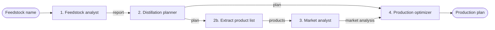

# Implementing Prompt Chaining Workflow

> [!abstract] TL;DR
> The course demo implements prompt chaining as a **refinery optimization workflow**: four persona agents (feedstock analyst → distillation planner → market analyst → production optimizer) plus a small extraction call, each a plain Python function wrapping one OpenAI chat call, wired together by `run_refinery_chain`. It shows the core mechanic clearly: ==each agent's output string becomes part of the next agent's prompt==. But it has ==no intermediate validation==, which is the main safeguard the theory reading calls for. This note walks through the code, reviews it against [[Prompt Chaining Workflow]], and adds a tested version with gates, re-prompting with feedback, and logging.

**Section:** [[Agentic Workflow Patterns]] – pattern 1 of 5 (implementation)
**Previous:** [[Prompt Chaining Workflow]] (theory) · **Next:** [[Routing Workflow]]
**Related:** [[Implementing Agentic Workflows in Python]] · [[Implementing Gate Checks]] · [[LLM Feedback Loops]] · [[Pydantic for Structured LLM Output - Study Guide]]

**Sources:** Course demo code (refinery prompt chain, full listing in [[#Appendix – Original Course Code]]). The code review, the gated version, and its test are *beyond the lecture*. The gated version was run offline against a fake LLM to check the control flow; it has not been run against the live API.

> [!todo]- Contents
> 1. [[#1. Setup]]
> 2. [[#2. Architecture of the Demo]]
> 3. [[#3. Code Walkthrough]]
> 4. [[#4. Review Against the Theory]]
> 5. [[#5. Improved Version – Gates, Feedback, Logging]]
> 6. [[#6. Cost and Latency]]
> 7. [[#7. Pitfalls and Failure Modes]]
> 8. [[#8. Key Takeaways]]
> 9. [[#9. Critical Analysis]]
> 10. [[#10. Self-Test]]
> 11. [[#11. Glossary]]

---

## 1. Setup

| Item | Detail |
|---|---|
| Packages | `openai`, `python-dotenv` (`pip install openai python-dotenv`) |
| API key | `OPENAI_API_KEY` in a `.env` file, loaded with `load_dotenv()` |
| Endpoint | `base_url="https://openai.vocareum.com/v1"`, the course's proxy. Outside the course, drop `base_url` to use OpenAI directly |
| Model | `gpt-3.5-turbo` by default; `temperature=0` for more repeatable output |

> [!warning] Keep the key out of source control
> Add `.env` to `.gitignore`. The key is read from the environment, never hard-coded.

---

## 2. Architecture of the Demo

| Step | Agent (persona) | Input | Output sections |
|---|---|---|---|
| 1 | `feedstock_analyst_agent` – feedstock analyst | Feedstock name | FEEDSTOCK COMPOSITION · YIELD POTENTIAL · PROCESSING NOTES |
| 2 | `distillation_planner_agent` – refinery planner | Full feedstock report | PRODUCT ALLOCATION (%) · ASSUMPTIONS · NOTES FOR OPERATIONS |
| 2b | Inline `call_openai` – extraction | Full distillation plan | Product list (free text) |
| 3 | `market_analyst_agent` – market analyst | Product list | PRODUCT DEMAND ANALYSIS · PRICE TRENDS · MARKET RECOMMENDATIONS |
| 4 | `production_optimizer_agent` – production strategist | Distillation plan **+** market analysis | OPTIMIZED PRODUCTION PLAN · RATIONALE · STRATEGIC NOTES |

^refinery-steps



> [!note] Not strictly linear
> Step 4 takes **two** earlier outputs (fan-in), so the dependency structure is a small [[Directed Acyclic Graph (DAG)]], not a straight line. Step 2b is a hidden fifth LLM call that does ==selective context passing==: the market analyst gets only the product names, not the whole plan.

---

## 3. Code Walkthrough

### 3.1 The LLM wrapper – one place to call the model

```python
def call_openai(system_prompt, user_prompt, model="gpt-3.5-turbo"):
    response = client.chat.completions.create(
        model=model,
        messages=[{"role": "system", "content": system_prompt},
                  {"role": "user", "content": user_prompt}],
        temperature=0)
    return response.choices[0].message.content
```

- Every agent goes through this one function. That is the "swappable engine" layer from [[Implementing Agentic Workflows in Python#^three-layers]]: changing the model or provider means editing one place.
- **System prompt = persona + output format; user prompt = the task data.** This split is the [[Agent Components and Agent Types#^persona|persona]] component in practice.

### 3.2 An agent – persona, required sections, task

```python
def distillation_planner_agent(feedstock_report):
    system_prompt = """You are a refinery planner.
Use the feedstock report to propose an allocation through the distillation tower.
Include:
# PRODUCT ALLOCATION (percentage of each product)
# ASSUMPTIONS
# NOTES FOR OPERATIONS
"""
    user_prompt = f"Based on this feedstock report, plan the distillation:\n\n{feedstock_report}"
    return call_openai(system_prompt, user_prompt)
```

Each agent is a function, not a class (compare [[Implementing Agentic Workflows in Python#5. Worked Example – Fetch-and-Process Workflow]]). The **required `#` headers** give the output a predictable shape, which is what a later gate could check, though the demo never does.

### 3.3 The chain – output becomes input

```python
def run_refinery_chain(feedstock_name):
    feedstock_report  = feedstock_analyst_agent(feedstock_name)          # step 1
    distillation_plan = distillation_planner_agent(feedstock_report)     # step 2
    product_list      = call_openai("List all products from the distillation plan above.",
                                    distillation_plan)                   # step 2b
    market_analysis   = market_analyst_agent(product_list)               # step 3
    production_plan   = production_optimizer_agent(distillation_plan,
                                                   market_analysis)      # step 4
    return {"feedstock": feedstock_report, "distillation": distillation_plan,
            "market": market_analysis, "plan": production_plan}
```

The chain is **hard-coded order** in plain Python: the code decides the sequence, and the LLM only fills in each step. Returning all intermediate outputs (not just the final plan) makes the chain inspectable.

---

## 4. Review Against the Theory

How the demo scores against [[Prompt Chaining Workflow]]:

| Theory element | In the demo | Verdict |
|---|---|---|
| Decomposition into focused steps | 4 personas, each with one job | ✅ |
| Output → next input | f-strings pass outputs forward | ✅ |
| [[Prompt Chaining Workflow#^validation-methods\|Intermediate validation]] | ==None==. Required sections are requested but never checked | ❌ |
| [[Prompt Chaining Workflow#^failure-handling\|Failure handling]] | None: no retry, no fallback; an API error crashes the run | ❌ |
| Logging and monitoring | `print` statements only; validation results don't exist to log | ⚠️ |
| [[Prompt Chaining Workflow#^context-management\|Selective context passing]] | Yes for the market analyst (product list only); no elsewhere (full reports passed) | ⚠️ |
| Contextual reiteration | The original feedstock and goal are not restated in later steps | ❌ |

^demo-review

**Further issues (beyond the lecture):**

| Issue | Why it matters | Fix |
|---|---|---|
| Market analyst asked for "current demand and pricing" | The model has ==no live data==; it will produce plausible but invented figures ([[LLM Hallucinations]]) | Give it a data tool/API, or tell it to label figures as general, not current |
| Step 2b prompt says "the distillation plan **above**" but the plan is in the *user* message, and the system prompt comes first | Confusing instruction; works mostly by luck | "Extract the product names from the text. One per line." |
| Percentages in PRODUCT ALLOCATION are never checked to sum to 100% | A wrong allocation flows into the final plan (the reading's "first calculation" error) | Programmatic gate |
| `message.content` can be `None` | The next f-string silently inserts "None" | Check for empty output |
| Free-text handoffs | Downstream parsing depends on headers the model may skip | Structured output ([[Pydantic for Structured LLM Output - Study Guide]]) |
| `gpt-3.5-turbo` | Older model; weaker at following format rules | Make the model a config value |
| `temperature=0` | More repeatable, but ==not guaranteed deterministic== | Don't rely on identical outputs in tests |

---

## 5. Improved Version – Gates, Feedback, Logging

*Beyond the lecture.* It keeps the demo's `call_openai` wrapper and personas but adds what the theory asks for:

- **Validators** (programmatic + rule-based) that return an error message or `None`.
- A **`run_step`** helper: call → validate → ==re-prompt with the specific errors== → give up loudly after `max_attempts`.
- **Logging** of step, attempt, and validation errors.
- **Selective context passing** (only the allocation section goes to extraction) and **contextual reiteration** (the goal is restated in later prompts).

```python
import logging, re

log = logging.getLogger("refinery_chain")

class ChainValidationError(Exception):
    pass

# ---- validators: return None if OK, else an error message ----
def require_sections(*headers):                       # rule-based
    def check(text):
        missing = [h for h in headers if h not in text]
        return f"Missing sections: {', '.join(missing)}" if missing else None
    return check

def allocation_sums_to_100(text, tolerance=2.0):      # programmatic
    section = text.split("# PRODUCT ALLOCATION", 1)[-1].split("\n#", 1)[0]
    pcts = [float(p) for p in re.findall(r"(\d+(?:\.\d+)?)\s*%", section)]
    if not pcts:
        return "No percentages found under # PRODUCT ALLOCATION"
    total = sum(pcts)
    if abs(total - 100) > tolerance:
        return f"Product allocation sums to {total:.1f}%; it must sum to 100%"
    return None

def not_empty(text):
    return None if text and text.strip() else "Empty output"

# ---- gated step: validate, re-prompt with feedback, then fail loudly ----
def run_step(name, system_prompt, user_prompt, validators, max_attempts=3):
    prompt = user_prompt
    for attempt in range(1, max_attempts + 1):
        output = call_openai(system_prompt, prompt) or ""
        errors = [e for check in validators if (e := check(output))]
        log.info("step=%s attempt=%d errors=%s", name, attempt, errors or "none")
        if not errors:
            return output
        prompt = (f"{user_prompt}\n\nYour previous answer:\n{output}\n\n"
                  "It failed validation:\n- " + "\n- ".join(errors) +
                  "\nRewrite the complete answer and fix these problems.")
    raise ChainValidationError(f"{name} failed after {max_attempts} attempts: {errors}")
```

The chain, with the gates attached (step 2 and 2b shown; steps 1, 3, 4 follow the same shape with `require_sections` for their headers):

```python
def run_refinery_chain(feedstock_name):
    goal = f"Recommend a production plan for feedstock '{feedstock_name}'."
    feedstock_report = run_step("feedstock", FEEDSTOCK_SYSTEM,
                                f"Analyze the feedstock: {feedstock_name}",
                                [not_empty, require_sections(*FEEDSTOCK_HEADERS)])

    distillation_plan = run_step(
        "distillation",
        "You are a refinery planner. Propose an allocation through the distillation tower. "
        "Include:\n# PRODUCT ALLOCATION (one line per product with a percentage; "
        "percentages must sum to 100%)\n# ASSUMPTIONS\n# NOTES FOR OPERATIONS",
        f"GOAL: {goal}\n\nFeedstock report:\n{feedstock_report}",     # reiteration
        [not_empty, require_sections(*DISTILLATION_HEADERS), allocation_sums_to_100])

    allocation = distillation_plan.split("# PRODUCT ALLOCATION", 1)[-1].split("\n#", 1)[0]
    product_list = run_step(                                            # selective context
        "product_list",
        "Extract the product names from the text. Return one product name per line, nothing else.",
        allocation, [not_empty])

    market_analysis = run_step("market", MARKET_SYSTEM_NO_LIVE_DATA,
                               f"Products:\n{product_list}",
                               [not_empty, require_sections(*MARKET_HEADERS)])

    production_plan = run_step("optimizer", OPTIMIZER_SYSTEM,
                               f"GOAL: {goal}\n\nDistillation plan:\n{distillation_plan}\n\n"
                               f"Market analysis:\n{market_analysis}",
                               [not_empty, require_sections(*OPTIMIZER_HEADERS)])
    return {"feedstock": feedstock_report, "distillation": distillation_plan,
            "products": product_list, "market": market_analysis, "plan": production_plan}
```

(`FEEDSTOCK_SYSTEM`, `*_HEADERS`, etc. are the demo's prompts and header lists pulled into constants. `MARKET_SYSTEM_NO_LIVE_DATA` adds: "You have no live market data: describe typical demand and price drivers and label them as general, not current.")

### 5.1 Test run with a fake LLM

`call_openai` was replaced by a fake that (a) returns an allocation summing to 90% on the first try and (b) always omits `# STRATEGIC NOTES` from the optimizer. Log output:

```text
INFO step=feedstock attempt=1 errors=none
INFO step=distillation attempt=1 errors=['Product allocation sums to 90.0%; it must sum to 100%']
INFO step=distillation attempt=2 errors=none
INFO step=product_list attempt=1 errors=none
INFO step=market attempt=1 errors=none
INFO step=optimizer attempt=1 errors=['Missing sections: # STRATEGIC NOTES']
INFO step=optimizer attempt=2 errors=['Missing sections: # STRATEGIC NOTES']
INFO step=optimizer attempt=3 errors=['Missing sections: # STRATEGIC NOTES']
RAISED: optimizer failed after 3 attempts: ['Missing sections: # STRATEGIC NOTES']
```

^fake-llm-test

What this shows:
- **Re-prompt with feedback** fixed the allocation error on attempt 2. The error message told the model exactly what was wrong.
- A persistent failure ==stops the chain loudly== instead of passing an incomplete plan downstream. A real system would then apply a **fallback** (return the partial results for human review, or use a simpler template).
- The log says exactly which step failed and why, which the original's `print` output could not.

> [!note] Limits of these validators
> `require_sections` checks that headers exist, not that the content under them is sensible. `allocation_sums_to_100` reads every `N%` in the section, so a line like "Gasoline 40% (range 35–45%)" would be miscounted. Asking for JSON output with a schema is more robust ([[Pydantic for Structured LLM Output - Study Guide]]).

---

## 6. Cost and Latency

The chain is sequential, so latency adds up. With $n$ LLM calls of latency $t_i$:

$$
T = \sum_{i=1}^{n} t_i
$$

| Version | LLM calls (best case) | LLM calls (worst case) |
|---|---|---|
| Original demo | 5 | 5 |
| Gated, `max_attempts = 3` | 5 | $5 \times 3 = 15$ |

Tokens also grow along the chain because full reports are forwarded. The optimizer's prompt contains both the distillation plan and the market analysis. At, say, 600 tokens per report, the optimizer's input is about 1,200+ tokens before instructions, while the extraction step's input (allocation section only) is a small fraction of that. That is what selective context passing saves.

In the fake-LLM run above, the chain made 8 calls: 5 base + 1 distillation retry + 2 optimizer retries.

---

## 7. Pitfalls and Failure Modes

| Failure | Symptom | Mitigation |
|---|---|---|
| Unchecked early output | Wrong allocation leads to a confident but wrong final plan | Gate step 2 with a programmatic check |
| Hallucinated market data | Specific but invented prices and trends | Data tool/API, or label as general knowledge |
| Missing sections | Later steps lose information they expected | `require_sections` gate + re-prompt |
| `None` content | "None" appears in the next prompt | `not_empty` gate |
| Blind retries | Same failure repeated, cost grows | Include the specific errors in the re-prompt |
| Unhandled API errors | Crash midway, earlier results lost | Catch API exceptions; retry with backoff; save intermediate outputs |
| Context bloat in fan-in steps | Optimizer ignores parts of its input | Pass summaries or only the needed sections |
| Committed `.env` | Leaked API key | `.gitignore`; rotate if leaked |

---

## 8. Key Takeaways

- [ ] I can explain how `call_openai` centralizes model access and why that matters.
- [ ] I can describe each of the four agents and the hidden extraction step.
- [ ] I can explain why step 4 makes the chain a small DAG, not a line.
- [ ] I can list what the demo is missing compared to the theory (validation, failure handling, reiteration).
- [ ] I can write a validator that returns an error message and a `run_step` loop that re-prompts with it.
- [ ] I can explain why the market analyst's "current" pricing is unreliable.
- [ ] I can estimate call counts and latency for the original and gated versions.

---

## 9. Critical Analysis

- **Good teaching demo, not a safe chain.** It shows the mechanics of chaining very clearly, but it leaves out the safeguard its own theory reading calls essential. As written, it demonstrates error propagation rather than preventing it.
- **Headers are a weak contract.** Markdown sections are readable for humans but fragile for code. For anything a later step must *compute on* (percentages), structured output is the right handoff.
- **The domain adds risk.** Refinery allocation and production decisions have real safety and financial consequences. The LLM has no plant data, no crude assay, and no live prices, so the output is at best a plausible template. In practice, the LLM should draft and explain, while yields come from process models and prices come from market feeds, with a human sign-off ([[Agentic AI#6. Governance and Safety]]).
- **How to evaluate it:** fixed feedstock test cases, checks on every intermediate output (section presence, allocation sums), expert review of a sample of final plans, and tracking of retry and fallback rates over time ([[LLM Evaluation]]).
- **What changes at scale:** caching step 1 for repeated feedstocks, parallel runs across many feedstocks, rate limiting, cost tracking, and durable checkpoints so a failure at step 4 doesn't repeat steps 1–3 ([[Runtime or Orchestration Layer]]).
- **Security:** the feedstock name goes straight into a prompt. If it came from users, it could carry injected instructions that propagate down the chain ([[Prompt Injection]]). Validate inputs and treat each step's output as data.

> [!question] Discussion questions
> 1. Which single gate in this chain gives the most value per unit of cost, and why?
> 2. Should the market analyst be an LLM at all, or a tool call with the LLM only interpreting the data?
> 3. How would you change the design if the optimizer needed to send a plan back to the planner for revision? (Preview of [[Evaluator-Optimizer Workflow]].)

---

## 10. Self-Test

> [!question]- Q1. What does `call_openai` do, and why is it useful to have one wrapper?
> It sends a system prompt (persona and format) and a user prompt (task data) to the chat completions API at temperature 0 and returns the text. One wrapper means the model, provider, or call settings can be changed in one place.

> [!question]- Q2. Trace the data flow through `run_refinery_chain`.
> Feedstock name → feedstock report → distillation plan → (extraction call) product list → market analysis. Then the distillation plan and market analysis together → production plan. All four reports are returned.

> [!question]- Q3. Which theory element is most clearly missing from the demo, and what's the risk?
> Intermediate validation. Nothing checks the outputs, so an error in an early step (e.g. an allocation that doesn't sum to 100%) propagates into the final plan.

> [!question]- Q4. Where does the demo use selective context passing, and where could it do more?
> The market analyst gets only the extracted product list, not the full plan. It could do more by passing only the allocation section to the extraction step and summaries (not full reports) to the optimizer.

> [!question]- Q5. What does `run_step` do when validation fails, and what happens after the last attempt?
> It builds a new prompt containing the original task, the previous answer, and the specific validation errors, then calls the LLM again. After `max_attempts` it raises `ChainValidationError`, so the failure is visible instead of being passed downstream.

> [!question]- Q6. (Quantitative) Each call takes 3 s. What are the best- and worst-case latencies for the gated chain with `max_attempts = 3`?
> Best case: 5 calls × 3 s = 15 s. Worst case: 15 calls × 3 s = 45 s (though in the worst case the chain raises on the first step that exhausts its attempts, so it would stop earlier in practice).

> [!question]- Q7. (Design) Change the distillation planner to return structured output. What would you validate?
> Ask for JSON like `{"allocation": [{"product": str, "percent": float}], "assumptions": [str], "ops_notes": [str]}` and validate it with a Pydantic model: percent between 0 and 100, percentages sum to 100 ± tolerance, product names unique and non-empty, at least one assumption. Then the extraction step (2b) is unnecessary: the product list is just the `product` fields.

## 11. Glossary

| Term | Meaning |
|---|---|
| `call_openai` | Wrapper sending a system and user prompt to the chat completions API |
| System prompt | Persona, rules, and output format for an agent |
| User prompt | The task data for this call, often the previous step's output |
| Fan-in | A step that takes outputs from more than one earlier step |
| Validator | A function that returns `None` if the output is OK, otherwise an error message |
| `run_step` | Helper that calls, validates, re-prompts with feedback, and fails loudly |
| `temperature=0` | Sampling setting that makes output more repeatable, but not guaranteed identical |

---

## Further Reading

- [OpenAI Python library](https://github.com/openai/openai-python)
- [python-dotenv](https://github.com/theskumar/python-dotenv)
- [Python logging HOWTO](https://docs.python.org/3/howto/logging.html)
- [Building Effective Agents (Anthropic)](https://www.anthropic.com/research/building-effective-agents) – prompt chaining with programmatic gates

---

## Appendix – Original Course Code

> [!example]- Full refinery prompt-chaining demo (as provided)
> ```python
> import os
> from openai import OpenAI # type: ignore
> from dotenv import load_dotenv # type: ignore
>
> # Load environment variables and initialize OpenAI client
> load_dotenv()
> client = OpenAI(
>     base_url = "https://openai.vocareum.com/v1",
>     api_key=os.getenv("OPENAI_API_KEY"))
>
> def call_openai(system_prompt, user_prompt, model="gpt-3.5-turbo"):
>     """Simple wrapper for OpenAI API calls"""
>     response = client.chat.completions.create(
>         model=model,
>         messages=[
>             {"role": "system", "content": system_prompt},
>             {"role": "user", "content": user_prompt}
>         ],
>         temperature=0
>     )
>     return response.choices[0].message.content
>
> def feedstock_analyst_agent(feedstock_name):
>     """Analyzes incoming hydrocarbon feedstock"""
>     system_prompt = """You are a refinery feedstock analyst.
> Provide a detailed analysis of the input hydrocarbon feed.
> Always include these sections:
> # FEEDSTOCK COMPOSITION
> # YIELD POTENTIAL
> # PROCESSING NOTES
> """
>     user_prompt = f"Analyze the feedstock: {feedstock_name}"
>     print(f"Feedstock Analyst working on: {feedstock_name}")
>     return call_openai(system_prompt, user_prompt)
>
> def distillation_planner_agent(feedstock_report):
>     """Plans the distillation based on feedstock analysis"""
>     system_prompt = """You are a refinery planner.
> Use the feedstock report to propose an allocation through the distillation tower.
> Include:
> # PRODUCT ALLOCATION (percentage of each product)
> # ASSUMPTIONS
> # NOTES FOR OPERATIONS
> """
>     user_prompt = f"Based on this feedstock report, plan the distillation:\n\n{feedstock_report}"
>     print("Distillation Planner generating product allocation...")
>     return call_openai(system_prompt, user_prompt)
>
> def market_analyst_agent(product_list_text):
>     """Analyzes market demand for refinery products"""
>     system_prompt = """You are a market analyst for petroleum products.
> Provide current demand and pricing insights.
> Format the response as:
> # PRODUCT DEMAND ANALYSIS
> # PRICE TRENDS
> # MARKET RECOMMENDATIONS
> """
>     user_prompt = f"Analyze market conditions for the following products:\n{product_list_text}"
>     print("Market Analyst evaluating market demand...")
>     return call_openai(system_prompt, user_prompt)
>
> def production_optimizer_agent(distillation_output, market_analysis):
>     """Recommends production strategy based on operations and market"""
>     system_prompt = """You are a refinery production strategist.
> Make a recommendation balancing operational output and market demand.
> Include:
> # OPTIMIZED PRODUCTION PLAN
> # RATIONALE
> # STRATEGIC NOTES
> """
>     user_prompt = f"""Use the following inputs to recommend a production plan:
>
> Distillation Plan:
> {distillation_output}
>
> Market Analysis:
> {market_analysis}
> """
>     print("Production Optimizer creating final plan...")
>     return call_openai(system_prompt, user_prompt)
>
> def run_refinery_chain(feedstock_name):
>     """Run the refinery agentic workflow"""
>     print(f"\nStarting refinery optimization workflow for: '{feedstock_name}'")
>
>     # Step 1: Feedstock Analysis
>     feedstock_report = feedstock_analyst_agent(feedstock_name)
>     print("\nFeedstock analysis complete.")
>
>     # Step 2: Distillation Planning
>     distillation_plan = distillation_planner_agent(feedstock_report)
>     print("\nDistillation planning complete.")
>
>     # Step 3: Market Analysis
>     # We need to extract the list of products from the distillation plan
>     system_prompt = "List all products from the distillation plan above."
>     product_list = call_openai(system_prompt, distillation_plan)
>
>     # This list of products is then used to perform market analysis
>     market_analysis = market_analyst_agent(product_list)
>     print("\nMarket analysis complete.")
>
>     # Step 4: Production Optimization
>     production_plan = production_optimizer_agent(distillation_plan, market_analysis)
>     print("\nProduction optimization complete.")
>
>     # Print results
>     print("\n===== FEEDSTOCK REPORT =====")
>     print(feedstock_report)
>
>     print("\n===== DISTILLATION PLAN =====")
>     print(distillation_plan)
>
>     print("\n===== MARKET ANALYSIS =====")
>     print(market_analysis)
>
>     print("\n===== FINAL PRODUCTION PLAN =====")
>     print(production_plan)
>
>     return {
>         "feedstock": feedstock_report,
>         "distillation": distillation_plan,
>         "market": market_analysis,
>         "plan": production_plan
>     }
>
> # Run the example
> if __name__ == "__main__":
>     feedstock_input = "Light Sweet Crude"
>     results = run_refinery_chain(feedstock_input)
> ```

%% Study hint: the demo = mechanics of chaining; the gated version = the theory's safeguards. Know both, and be able to point at exactly where each safeguard goes. %%
