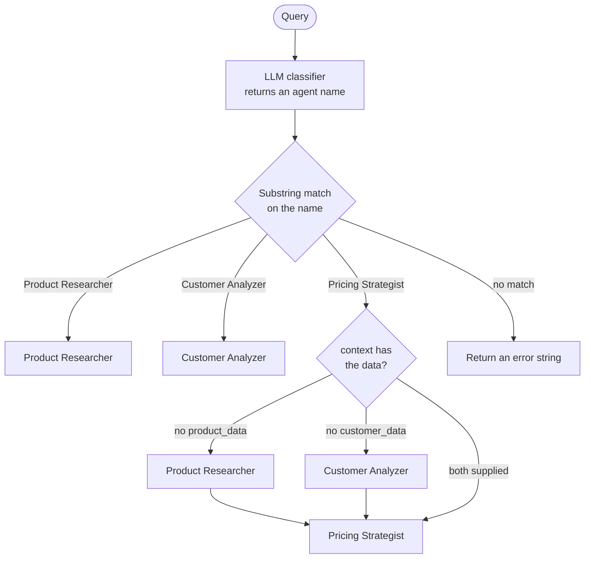

# Implementing Routing Workflow

> [!abstract] TL;DR
> The exercise builds a **retail routing agent**. An LLM classifier picks one of three specialists (Product Researcher, Customer Analyzer, Pricing Strategist), and an `if/elif` block dispatches the query. The pricing route shows ==routing with context gathering==: before calling the Pricing Strategist, the router runs the other two agents (unless their data is supplied in `context`) and passes both outputs in. The structure is right. The weak point is the handoff between classification and dispatch: ==free-text agent names matched by substring==, which I tested to misroute, fail to route, or crash on plausible LLM replies. The improved version uses a closed label set, exact matching, a dispatch table, a fallback, and parallel context gathering.

**Section:** [[Agentic Workflow Patterns]] – pattern 2 of 5 (implementation)
**Previous:** [[Routing Workflow]] (theory) · **Next:** [[Parallelization Workflow]]
**Related:** [[Implementing Prompt Chaining Workflow]] (same `call_openai` wrapper and setup) · [[Gate Checks]] · [[Pydantic for Structured LLM Output - Study Guide]]

**Sources:** Course exercise code (retail routing agent, full listing in [[#Appendix – Original Exercise Code]]). The edge-case tests, the improved version, and the critical analysis are *beyond the lecture*. All tests were run offline with a fake LLM; nothing here was run against the live API.

> [!todo]- Contents
> 1. [[#1. Setup]]
> 2. [[#2. Architecture of the Exercise]]
> 3. [[#3. Code Walkthrough]]
> 4. [[#4. Review Against the Theory]]
> 5. [[#5. Testing the Original Dispatch Logic]]
> 6. [[#6. Improved Version]]
> 7. [[#7. Call Counts and Latency]]
> 8. [[#8. Pitfalls and Failure Modes]]
> 9. [[#9. Key Takeaways]]
> 10. [[#10. Critical Analysis]]
> 11. [[#11. Self-Test]]
> 12. [[#12. Glossary]]

---

## 1. Setup

Same as [[Implementing Prompt Chaining Workflow#1. Setup]]: `openai` and `python-dotenv`, `OPENAI_API_KEY` in `.env`, the course's Vocareum `base_url`, `gpt-3.5-turbo` at `temperature=0`, and the same `call_openai(system_prompt, user_prompt)` wrapper.

---

## 2. Architecture of the Exercise

| Component | Role in the pattern | Input → output |
|---|---|---|
| `routing_agent` | **Classification** (LLM call) + **dispatch** (`if/elif`) | Query (+ optional `context`) → specialist's answer |
| `product_researcher_agent` | Specialist | Query → product info, trends, competitor pricing |
| `customer_analyzer_agent` | Specialist | Query → customer feedback, preferences, patterns |
| `pricing_strategist_agent` | Specialist that ==needs other agents' output== | Query + product data + customer data → pricing strategy |

^retail-router-components



The pricing branch is the recap's ==router orchestrating a sub-sequence of calls to gather context before delegating== ([[Routing Workflow#4.1 Routing with context gathering]]). Inside that branch it is a small prompt chain with fan-in, like step 4 of the refinery demo ([[Implementing Prompt Chaining Workflow#^refinery-steps]]).

---

## 3. Code Walkthrough

### 3.1 Classification – the LLM picks an agent name

```python
system_prompt = """You are an AI assistant that can route retail queries to the right agents.
...
Agents available:
- Product Researcher Agent: Researches product specifications, market trends, and competitor pricing.
- Customer Analyzer Agent: Analyzes customer feedback, preferences, and purchasing patterns.
- Pricing Strategist Agent: Recommends optimal pricing strategies based on research and analysis.

Respond only with the agent's name, nothing else."""
agent_choice = call_openai(system_prompt, f"Given the query: '{query}', which agent should handle this task?")
```

Good practice here: each agent is listed **with a description of its capability**, which is how the reading says a worker's "appropriateness" is defined ([[Routing Workflow#4. Stage 2 – Task Dispatch]]). The output constraint ("only the agent's name") is a request, not a guarantee.

### 3.2 Dispatch – substring matching

```python
if "Product Researcher" in agent_choice:
    return product_researcher_agent(query)
elif "Customer Analyzer" in agent_choice:
    return customer_analyzer_agent(query)
elif "Pricing Strategist" in agent_choice:
    ...  # context gathering, then pricing_strategist_agent
else:
    return f"Couldn't route query. Agent decision was: {agent_choice}"
```

Substring matching is lenient: "Product Researcher Agent." with a trailing period still routes. But it is **case-sensitive and order-dependent** (see [[#5. Testing the Original Dispatch Logic]]).

### 3.3 Context gathering on the pricing route

```python
product_data = context["product_data"] if context and "product_data" in context \
               else product_researcher_agent(query)
customer_data = context["customer_data"] if context and "customer_data" in context \
                else customer_analyzer_agent(query)
return pricing_strategist_agent(query, product_data, customer_data)
```

(Condensed from the original.) The `context` parameter is the important design idea: ==callers can supply real data== (catalog records, CRM exports) and skip the LLM-generated stand-ins. Without it, the pricing strategy is built entirely on LLM-generated "research".

---

## 4. Review Against the Theory

| Theory element ([[Routing Workflow]]) | In the exercise | Verdict |
|---|---|---|
| Classification stage | LLM-based, with capability descriptions | ✅ |
| Task dispatch stage | `if/elif` on the classifier's text | ✅ (fragile) |
| Specialization | Three personas with distinct prompts | ✅ |
| Context gathering before delegation | Pricing route runs both other agents, or uses `context` | ✅ |
| Label passed with the input | The specialist gets only the query, not the label | ⚠️ |
| Fallback route | Returns an error *string* that looks like a normal result | ⚠️ |
| "Other" category | None: every query is forced toward one of three agents | ❌ |
| Validation of the classifier output | None: `None` or unexpected text isn't handled | ❌ |
| Resource optimization (model tiering) | All calls use the same model | ❌ (not attempted) |

^router-review

**Further issues (beyond the lecture):**

| Issue | Why it matters | Fix |
|---|---|---|
| Customer Analyzer has no customer data | It will invent "customer behavior" ([[LLM Hallucinations]]) | Supply real data via `context` or a data tool; otherwise label output as hypothetical |
| Product Researcher asked for "competitor pricing" with no data source | Invented prices feed straight into the pricing strategy (error propagation) | Same; gate the pricing route on real data |
| The two context calls run one after the other | They're independent, so latency is wasted | Run them in parallel |
| Classification and dispatch in one function | Hard to test or evaluate the classifier alone | Separate `classify()` and a dispatch table |
| Query inserted in quotes into the classifier prompt | A query containing `'` or instructions can confuse it ([[Prompt Injection]]) | Closed label set + exact match, so injected text can't create a route |

---

## 5. Testing the Original Dispatch Logic

*Beyond the lecture.* I isolated the `if/elif` block and fed it plausible classifier replies:

| Classifier reply | Routed to | Correct |
|---|---|---|
| `'Pricing Strategist Agent'` | pricing | ✅ |
| `'Pricing Strategist Agent (it will need Product Researcher input)'` | ==product== | ❌ misrouted: the first `if` matches first |
| `'pricing strategist agent'` | ==unrouted== | ❌ case-sensitive match fails |
| `'Product Researcher Agent.'` | product | ✅ |
| `None` (empty API content) | ==TypeError crash== | ❌ |

^dispatch-test

> [!warning] Lesson
> Free-text labels plus substring matching produce ==silent misrouting==: the misrouted query still gets a fluent answer, just to the wrong question. Classifier output should be a **closed set of short labels, matched exactly**, with a fallback for anything else ([[Gate Checks#^gate-format]]).

---

## 6. Improved Version

*Beyond the lecture.* Changes:

- `classify()` is separate, returns one of a **closed label set** including `other`, normalizes the reply, **re-prompts with feedback** once if the label is invalid, and falls back to `other` instead of crashing.
- A **dispatch table** (`HANDLERS`) replaces `if/elif`, so adding a route is one line ([[Routing Workflow#^routing-benefits|scalability]]).
- `handle_pricing()` gathers missing context **in parallel** and still honors supplied `context`.
- The router returns a **structured result** (`status`, `label`, `result`), so callers can tell success from failure.

```python
import logging
from concurrent.futures import ThreadPoolExecutor

log = logging.getLogger("router")
LABELS = {"product_research", "customer_analysis", "pricing", "other"}

CLASSIFIER_PROMPT = """You classify retail queries. You do not answer them.
Return exactly one label and nothing else:
product_research  - product specifications, market trends, competitor products
customer_analysis - customer feedback, preferences, purchasing patterns
pricing           - what price to charge, pricing strategy
other             - anything else, or unclear"""

def normalize(text):
    return (text or "").strip().strip("'\"`.").lower().replace(" ", "_")

def classify(query, max_attempts=2):
    prompt = f"Query: {query}"
    for attempt in range(1, max_attempts + 1):
        raw = call_openai(CLASSIFIER_PROMPT, prompt)
        label = normalize(raw)
        log.info("classify attempt=%d raw=%r label=%s", attempt, raw, label)
        if label in LABELS:
            return label
        prompt = (f"Query: {query}\n\nYour previous answer {raw!r} is not a valid label. "
                  f"Answer with exactly one of: {', '.join(sorted(LABELS))}.")
    return "other"                                          # fallback, never a crash

def handle_pricing(query, context):
    """Context gathering: reuse supplied data, otherwise fetch both inputs in parallel."""
    context = context or {}
    jobs = {}
    with ThreadPoolExecutor(max_workers=2) as pool:
        if "product_data" not in context:
            jobs["product_data"] = pool.submit(product_researcher_agent, query)
        if "customer_data" not in context:
            jobs["customer_data"] = pool.submit(customer_analyzer_agent, query)
        gathered = {key: job.result() for key, job in jobs.items()}
    data = {**gathered, **context}                          # supplied data wins
    return pricing_strategist_agent(query, data["product_data"], data["customer_data"])

HANDLERS = {
    "product_research": lambda q, ctx: product_researcher_agent(q),
    "customer_analysis": lambda q, ctx: customer_analyzer_agent(q),
    "pricing": handle_pricing,
}

def routing_agent(query, context=None):
    label = classify(query)                                  # stage 1: what
    handler = HANDLERS.get(label)                            # stage 2: where
    if handler is None:                                      # "other" → no specialist
        return {"status": "unrouted", "label": label, "result": None}
    return {"status": "ok", "label": label, "result": handler(query, context)}
```

The three specialist functions are unchanged from the exercise.

### 6.1 Test run with a fake LLM

| Query | Fake classifier reply | `context` | LLM calls | Result |
|---|---|---|---|---|
| Specs and trends for wireless earbuds? | `"Product_Research."` → normalized | – | 2 | ok, `product_research` |
| Optimal price for organic skincare? | `"Pricing Strategist Agent"` (invalid), then `"pricing"` after feedback | – | 5 | ok, `pricing` |
| Same, with supplied product data | same as above | `product_data` | 4 | ok, `pricing` (only the customer call was made) |
| What's the weather tomorrow? | `"other"` | – | 1 | unrouted, `other` |
| gibberish request | `"I think Sales Agent"` twice | – | 2 | unrouted, `other` (fallback after retry) |

^router-fake-test

What this shows: normalization absorbs trivial formatting noise; invalid labels trigger **re-prompt with feedback** and then a safe **fallback**; supplied `context` **skips** the matching gathering call.

> [!note] Where "unrouted" should go
> In a real system, `status: "unrouted"` should go to a human queue or a general-purpose agent, and the rate of `other` should be monitored for new categories ([[Routing Workflow#7. Pitfalls and Failure Modes]]).

---

## 7. Call Counts and Latency

LLM calls per query (original version, no `context`):

| Route | Calls | Breakdown |
|---|---|---|
| Product research | 2 | classifier + researcher |
| Customer analysis | 2 | classifier + analyzer |
| Pricing | 4 | classifier + researcher + analyzer + strategist |

With per-call latency $t$, the original pricing route takes $4t$ because everything is sequential. With parallel context gathering:

$$
T_{\text{pricing}} = t_{\text{cls}} + \max(t_{\text{prod}}, t_{\text{cust}}) + t_{\text{price}} \approx 3t
$$

That saves about 25% on the pricing route. Supplying both data sets in `context` reduces it to 2 calls. **Model tiering** (*beyond the lecture*): the classifier only outputs one label, so it is the obvious place for a smaller, cheaper model ([[Routing Workflow#^routing-cost]]).

---

## 8. Pitfalls and Failure Modes

| Failure | Symptom | Mitigation |
|---|---|---|
| Free-text labels + substring match | Misrouting when the reply mentions two agents | Closed label set; exact match after normalizing |
| Case-sensitive matching | Lowercase reply is unrouted | Normalize before matching |
| `None` from the API | Crash in the `in` check | Treat empty as invalid; retry, then fall back |
| Error returned as a normal string | Caller shows "Couldn't route query…" as if it were an answer | Structured result with `status` |
| No "other" route | Off-topic queries forced to a specialist | Add `other` → human or general agent |
| Specialists without data | Invented customer insights and competitor prices | `context` with real data; data tools; label hypothetical output |
| Sequential independent calls | Slow pricing route | Parallelize context gathering |
| Classifier untested | Misroutes go unnoticed | Labeled test set; confusion matrix per label ([[Routing Workflow#5.1 End-to-end accuracy]]) |

---

## 9. Key Takeaways

- [ ] I can describe the retail router's four functions and which pattern stage each implements.
- [ ] I can explain the pricing route as routing with context gathering, and the role of the `context` parameter.
- [ ] I can show three ways substring dispatch fails (misroute, unrouted, crash).
- [ ] I can write a classifier with a closed label set, normalization, a retry with feedback, and a fallback.
- [ ] I can replace `if/elif` dispatch with a handler table.
- [ ] I can count LLM calls per route and explain the latency gain from parallel gathering.

---

## 10. Critical Analysis

- **The routing mechanics are right; the handoff is fragile.** Classification and dispatch are both present, but they are joined by free text. The general lesson from [[Gate Checks]] applies: ==every LLM output that code acts on needs a format contract and a check==, and a router's label is exactly that kind of output.
- **The pricing route is really an orchestrator.** Once the router decides which *other* agents to run and combines their outputs, it is doing orchestrator-workers work with a fixed plan. The line between routing and orchestration is whether the sub-tasks are fixed in code (here) or decided by an LLM at runtime ([[Orchestrator-Workers Workflow]]).
- **Grounding is the bigger risk than routing.** Even with perfect routing, the specialists have no retail data, so every answer is generic or invented. For a real retailer, the value comes from connecting them to catalog, sales, and review data (tools or RAG), with routing deciding *which* data source to consult.
- **How to evaluate it:** a labeled set of queries per category, including ambiguous and off-topic ones; accuracy and a confusion matrix for `classify()` alone; separate quality review of each specialist; tracking of `other` and retry rates.
- **What changes at scale:** more categories (consider hierarchical labels), caching of research results per product, a cheaper model for classification, and timeouts on the parallel calls.
- **Security:** because the label set is closed and matched exactly, injected text in a query can't create a new route. It can still steer the choice among existing routes, so no route should grant permissions or access by itself.

> [!question] Discussion questions
> 1. Should the pricing route always gather both inputs, or should an LLM decide which inputs are needed? What does that change?
> 2. Is `other → unrouted` enough, or should the router ask the user a clarifying question?
> 3. How would you pass the classifier's label and reason to the specialist, and would it help?

---

## 11. Self-Test

> [!question]- Q1. Which parts of `routing_agent` implement classification and which implement dispatch?
> Classification: the LLM call that returns an agent name. Dispatch: the `if/elif` block that calls the matching specialist function, including the context-gathering steps on the pricing route.

> [!question]- Q2. What does the `context` parameter do on the pricing route?
> It lets the caller supply `product_data` and/or `customer_data`. Supplied data is used directly; missing data is generated by calling the Product Researcher or Customer Analyzer first.

> [!question]- Q3. Why does the reply "Pricing Strategist Agent (it will need Product Researcher input)" go to the wrong agent?
> Dispatch checks `"Product Researcher" in agent_choice` first, and that substring appears in the reply, so the first branch matches before the pricing branch is checked.

> [!question]- Q4. Name three improvements to the classifier.
> A closed set of short labels including `other`; normalizing the reply and matching it exactly; re-prompting once with feedback on an invalid label, then falling back to `other` instead of crashing.

> [!question]- Q5. Why is the pricing strategy unreliable even when routing is correct?
> Its inputs come from agents with no real product or customer data, so they are generated by the LLM. Errors or inventions in those inputs propagate into the recommendation.

> [!question]- Q6. (Quantitative) Each call takes 2 s. What is the pricing route's latency originally, with parallel gathering, and with both data sets supplied?
> Original: 4 sequential calls = 8 s. Parallel gathering: 2 + max(2, 2) + 2 = 6 s. Both supplied: classifier + strategist = 4 s.

> [!question]- Q7. (Design) Add a "returns and refunds" route that needs the customer's order history first. What changes?
> Add the label `returns` with a definition to `LABELS` and the classifier prompt. Add a handler that first fetches order history with a real data lookup (a function, not an LLM), then calls a returns-policy agent with the query, label, and order data. Add labeled test queries for the new category, and make sure refund actions need human approval.

### Flashcards

> [!tip] Flashcards
> Review cards for this note are in [[Implementing Routing Workflow - Flashcards]].

---

## 12. Glossary

| Term | Meaning |
|---|---|
| `routing_agent` | Function that classifies a query with an LLM and dispatches it to a specialist |
| Substring dispatch | Choosing a branch by checking whether a name appears in the classifier's text |
| Closed label set | A fixed list of allowed classifier outputs, matched exactly |
| Normalization | Cleaning a reply (case, whitespace, punctuation) before matching |
| Dispatch table | A dict mapping labels to handler functions |
| `context` | Optional caller-supplied data that replaces context-gathering calls |
| Parallel gathering | Running independent context calls at the same time |

---

## Further Reading

- [Python `concurrent.futures`](https://docs.python.org/3/library/concurrent.futures.html)
- [OpenAI Python library](https://github.com/openai/openai-python)
- [Building Effective Agents (Anthropic)](https://www.anthropic.com/research/building-effective-agents) – routing and orchestrator-workers patterns

---

## Appendix – Original Exercise Code

> [!example]- Full retail routing exercise (as provided)
> ```python
> import os
> from openai import OpenAI
> from dotenv import load_dotenv
>
> # Load environment variables and initialize OpenAI client
> load_dotenv()
> client = OpenAI(
>     base_url = "https://openai.vocareum.com/v1",
>     api_key=os.getenv("OPENAI_API_KEY"))
>
> # --- Helper Function for API Calls ---
> def call_openai(system_prompt, user_prompt, model="gpt-3.5-turbo"):
>     """Simple wrapper for OpenAI API calls."""
>     response = client.chat.completions.create(
>         model=model,
>         messages=[
>             {"role": "system", "content": system_prompt},
>             {"role": "user", "content": user_prompt}
>         ],
>         temperature=0
>     )
>     return response.choices[0].message.content
>
>
> # --- Agents for Different Retail Tasks ---
>
> def product_researcher_agent(query):
>     """Product researcher agent gathers product information."""
>     system_prompt = """You are a product research agent for a retail company. Your task is to provide 
>     structured information about products, market trends, and competitor pricing."""
>     
>     user_prompt = f"Research this product thoroughly: {query}"
>     return call_openai(system_prompt, user_prompt)
>
>
> def customer_analyzer_agent(query):
>     """Customer analyzer agent processes customer data and feedback."""
>     system_prompt = """You are a customer analysis agent. Your task is to analyze customer feedback, 
>     preferences, and purchasing patterns."""
>     
>     user_prompt = f"Analyze customer behavior for: {query}"
>     return call_openai(system_prompt, user_prompt)
>
>
> def pricing_strategist_agent(query, product_data=None, customer_data=None):
>     """Pricing strategist agent recommends optimal pricing."""
>     system_prompt = """You are a pricing strategist agent. Your task is to recommend optimal pricing 
>     strategies based on product research and customer analysis."""
>     
>     user_prompt = f"""Recommend a pricing strategy for: {query}
>     
>     Product information: {product_data if product_data else 'No product data available'}
>     
>     Customer information: {customer_data if customer_data else 'No customer data available'}"""
>     
>     return call_openai(system_prompt, user_prompt)
>
>
> # --- Routing Agent with LLM-Based Task Determination ---
> def routing_agent(query, context=None):
>     """Routing agent that determines which agent to use based on the query."""
>     
>     # Use LLM to analyze the query and determine the correct task type
>     system_prompt = """You are an AI assistant that can route retail queries to the right agents. 
>     You will be given a query, and your job is to determine the appropriate agent to handle it.
>     Agents available:
>     - Product Researcher Agent: Researches product specifications, market trends, and competitor pricing.
>     - Customer Analyzer Agent: Analyzes customer feedback, preferences, and purchasing patterns.
>     - Pricing Strategist Agent: Recommends optimal pricing strategies based on research and analysis.
>     
>     Respond only with the agent's name, nothing else."""
>     
>     user_prompt = f"Given the query: '{query}', which agent should handle this task?"
>     
>     agent_choice = call_openai(system_prompt, user_prompt)
>     print(f"Selected agent: {agent_choice}")
>     
>     # Route the query to the correct agent based on the choice
>     if "Product Researcher" in agent_choice:
>         print("Routing query to Product Researcher Agent...")
>         return product_researcher_agent(query)
>     
>     elif "Customer Analyzer" in agent_choice:
>         print("Routing query to Customer Analyzer Agent...")
>         return customer_analyzer_agent(query)
>     
>     elif "Pricing Strategist" in agent_choice:
>         print("Routing query to Pricing Strategist Agent...")
>         
>         # For pricing strategy, we might need additional information
>         # First, get product information
>         product_data = None
>         if context and "product_data" in context:
>             product_data = context["product_data"]
>         else:
>             print("Getting product information first...")
>             product_data = product_researcher_agent(query)
>         
>         # Then, get customer insights
>         customer_data = None
>         if context and "customer_data" in context:
>             customer_data = context["customer_data"]
>         else:
>             print("Getting customer insights...")
>             customer_data = customer_analyzer_agent(query)
>         
>         # Finally, determine pricing strategy using both inputs
>         return pricing_strategist_agent(query, product_data, customer_data)
>     
>     else:
>         return f"Couldn't route query. Agent decision was: {agent_choice}"
>
>
> # --- Example Usage ---
> if __name__ == "__main__":
>     # Example queries
>     queries = [
>         "What are the specifications and current market trends for wireless earbuds?",
>         "What do customers think about our premium coffee brand?",
>         "What should be the optimal price for our new organic skincare line?"
>     ]
>     
>     # Process each query
>     for query in queries:
>         print(f"\nQuery: {query}")
>         print("\nProcessing...")
>         
>         result = routing_agent(query)
>         print("\nResult:")
>         print(result)
>         print("\n" + "-"*80)
> ```

%% Study hint: the exercise's lesson is the pricing branch (context gathering). The review's lesson is the label handoff: closed set + exact match + fallback. %%
