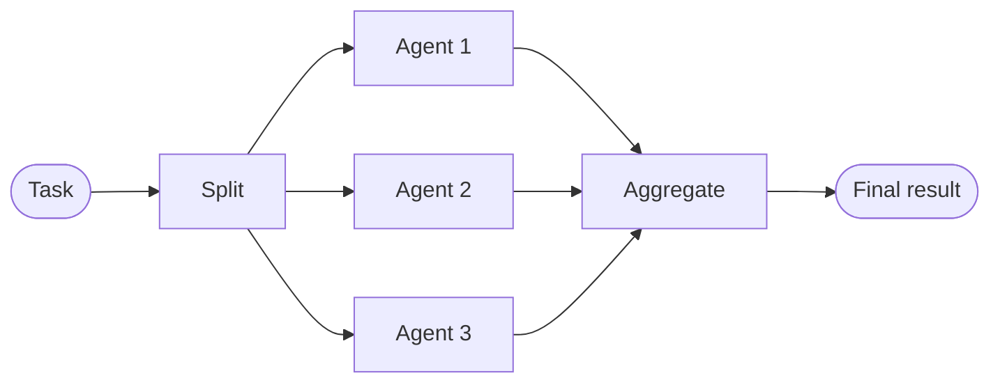
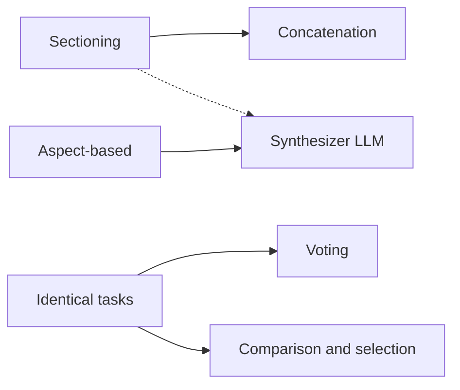
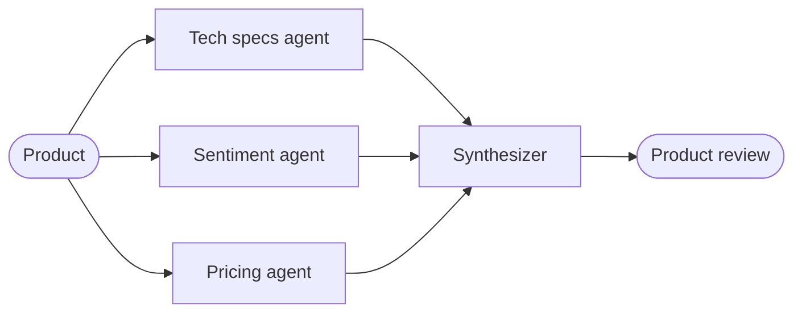

# Parallelization Workflow

> [!abstract] TL;DR
> Parallelization has ==multiple agents work on different parts of a task, or the same task, at the same time==, then combines their results. It is the **scatter-gather** pattern: split → process in parallel → aggregate. It buys **speed** and also **diversity and reliability** (several perspectives, or several votes). The golden rule is that ==subtasks must be largely independent==; dependent steps belong in a chain. The three decomposition strategies (sectioning, aspect-based, identical tasks) pair naturally with four aggregation strategies (concatenation, comparison and selection, voting, synthesizer LLM).

**Section:** [[Agentic Workflow Patterns]] – pattern 3 of 5 (theory)
**Previous:** [[Implementing Routing Workflow]] · **Next:** [[Implementing Parallelization Workflow]] → [[Evaluator-Optimizer Workflow]]
**Prerequisite:** [[Task Decomposition]] · [[Prompt Chaining Workflow]] (the sequential alternative)
**Related:** [[Prompt Chaining for Agentic Reasoning - Study Guide#4.4 Parallelization]] and [[Prompt Chaining for Agentic Reasoning - Study Guide#4.5 Map-Reduce|4.5 Map-Reduce]] (earlier short coverage) · [[Directed Acyclic Graph (DAG)]] (dependencies decide what can run in parallel) · [[Implementing Routing Workflow#6. Improved Version]] (parallel context gathering)

**Sources:** Course reading "Agentic Workflow Patterns: Parallelization" (three parts: the pattern and the independence rule; decomposition and aggregation strategies; lesson recap). The recap describes an exercise using Python `threading`, a **shared dictionary** for results, **aspect-based decomposition**, and a **synthesizer agent**; that code wasn't included, so it will be covered in [[Implementing Parallelization Workflow]]. The latency and voting math, the worked example, and the critical analysis are *beyond the lecture*.

> [!todo]- Contents
> 1. [[#1. Core Concepts]]
> 2. [[#2. The Golden Rule – Independence]]
> 3. [[#3. Decomposition Strategies]]
> 4. [[#4. Aggregation Strategies]]
> 5. [[#5. Speed, Cost, and Voting Math]]
> 6. [[#6. Worked Example – Product Review]]
> 7. [[#7. Pitfalls and Failure Modes]]
> 8. [[#8. Key Takeaways]]
> 9. [[#9. Critical Analysis]]
> 10. [[#10. Self-Test]]
> 11. [[#11. Glossary]]

---

## 1. Core Concepts

> [!info]+ Definition – Parallelization
> A workflow pattern in which ==multiple agents work on different parts of a task, or on the same task, simultaneously==, and their outputs are combined into one result.

^def-parallelization

> [!info]+ Definition – Scatter-gather
> The distributed-computing pattern parallelization mirrors: a problem is **scattered** to multiple workers and their individual findings are **gathered** back together.

^def-scatter-gather

Analogy from the reading: a **team project**. Instead of one person doing everything in order, the work is split among team members who tackle their parts at the same time.

The pattern has three parts:

| Part | Question |
|---|---|
| 1. **Split** the main task | How is the work divided? ([[#3. Decomposition Strategies]]) |
| 2. **Process** subtasks in parallel | Which agent handles each piece? |
| 3. **Aggregate** the outputs | How do the pieces become one coherent result? ([[#4. Aggregation Strategies]]) |

^three-parts

> [!important] Not just about speed
> Several agents can also produce ==diverse perspectives or solutions==, which can make the outcome richer or more dependable. The "identical tasks" strategy exists purely for that reason.

---

## 2. The Golden Rule – Independence

> [!warning] Golden rule
> ==Subtasks must be largely independent of one another.== Agent A working on subtask A shouldn't need to wait for agent B to finish subtask B.

^golden-rule

If the output of one subtask is a direct input for another, those parts belong in a **sequential** pattern such as [[Prompt Chaining Workflow]]. Real workflows mix both. For example, in the refinery demo, the feedstock analysis and distillation plan must be sequential, but independent steps could run side by side ([[Implementing Prompt Chaining Workflow#^refinery-steps]]).

A useful way to see it (*beyond the lecture*): draw the task as a [[Directed Acyclic Graph (DAG)]]. Nodes with no path between them can run in parallel; edges force order.

| Chain vs. parallel | Prompt chaining | Parallelization |
|---|---|---|
| Dependency | Each step needs the previous output | Subtasks independent |
| Latency | Sum of steps | Max of parallel steps (+ split and aggregate) |
| Main risk | Error propagation | Inconsistent or conflicting outputs to reconcile |
| Combined in practice | Chain *around* a parallel stage | Parallel stage *inside* a chain |

---

## 3. Decomposition Strategies

| Strategy | Use when | How | Example |
|---|---|---|---|
| **Sectioning / sharding** | Input is ==large and divisible== | Split the input into chunks; process each chunk in parallel | Each book chapter summarized by a different agent |
| **Aspect-based decomposition** | One subject has ==several independent aspects== | Different agents investigate different facets at once | Product review: technical specs, user sentiment, competitor pricing |
| **Identical tasks for diversity or voting** | You want ==variety or reliability== | Run the same core task several times, perhaps with varied prompts or models | Several creative drafts; several classifiers voting on a label |

^decomposition-strategies

> [!tip] Sharding vs. aspects
> Sharding splits the **input** (same question, different pieces of data). Aspect-based splits the **question** (same data, different questions). Identical tasks split **nothing**: they repeat the same work to get diversity or agreement.

---

## 4. Aggregation Strategies

| Strategy | How it works | Pairs naturally with | Example |
|---|---|---|---|
| **Concatenation** | Simply join the outputs | Sectioning | Append chapter summaries into one document |
| **Comparison and selection** | Evaluate outputs against predefined criteria and pick the best | Identical tasks (diversity) | Pick the strongest of five taglines |
| **Voting / majority rule** | The most frequent output wins | Identical tasks (voting) | Three classifiers; label chosen by 2 of 3 |
| **Synthesizer / aggregator LLM** | A dedicated LLM weaves multiple, possibly diverse outputs into ==one coherent, more nuanced response== | Aspect-based; also sectioning when a smooth whole is needed | Combine specs, sentiment, and pricing into one product review |

^aggregation-strategies

Solid lines are the most common pairings; the dashed line is used when concatenated chunks need to read as one piece (*beyond the lecture*). Comparison and selection is essentially an evaluator choosing among candidates, which previews [[Evaluator-Optimizer Workflow]].

---

## 5. Speed, Cost, and Voting Math

*Beyond the lecture.*

### 5.1 Latency and cost

For $n$ parallel subtasks with latencies $t_i$, plus split and aggregate steps:

$$
T_{\text{parallel}} = t_{\text{split}} + \max_i t_i + t_{\text{agg}}
\qquad \text{vs.} \qquad
T_{\text{sequential}} = \sum_i t_i
$$

Cost doesn't shrink: all $n$ calls still run, and the aggregator adds one more. ==Parallelization trades cost for time== (and for reliability, in the voting case).

Example: three aspect agents at 4 s, 5 s, and 6 s, plus a 5 s synthesizer. Sequential: $4+5+6+5 = 20$ s. Parallel: $6 + 5 = 11$ s. The slowest worker and the aggregator set the floor.

### 5.2 Majority voting

If $n$ voters (odd) are each correct with probability $p$ and ==make independent errors==, majority vote is correct with

$$
P_{\text{maj}} = \sum_{k=\lceil n/2 \rceil}^{n} \binom{n}{k} p^{k} (1-p)^{n-k}
$$

| $p$ | $n = 1$ | $n = 3$ | $n = 5$ |
|---|---|---|---|
| 0.80 | 0.80 | 0.896 | 0.942 |
| 0.60 | 0.60 | 0.648 | 0.683 |

^voting-math

> [!warning] The independence assumption is the catch
> Copies of the same model with the same prompt tend to make the **same** mistakes, so real gains are smaller than the table. Varying prompts, models, or reasoning paths (the reading's "varied prompts or models") makes errors less correlated. Voting also only helps when $p > 0.5$; below that, it makes things worse.

---

## 6. Worked Example – Product Review

The reading's aspect-based example, built out:

| Stage | What happens |
|---|---|
| Split (aspect-based) | Product: wireless earbuds. Three independent aspects |
| Agent 1 – Technical specs | Battery life, codecs, water resistance, from the spec sheet |
| Agent 2 – User sentiment | Themes from customer reviews: comfort, connection drops |
| Agent 3 – Competitor pricing | Price position against three comparable products, from a price feed |
| Aggregate (synthesizer LLM) | One review: strengths, weaknesses, value for money, with each claim traced to an agent's finding |

Why it fits the pattern: none of the three agents needs another's output (golden rule satisfied), each aspect has its own prompt and data source, and the synthesizer resolves tensions such as "great specs, but users report connection drops" into one judgment.

A variation with **voting**: to label each customer review as positive, negative, or mixed, run three classifier prompts in parallel per review and take the majority label.

---

## 7. Pitfalls and Failure Modes

| Failure | Symptom | Mitigation |
|---|---|---|
| Hidden dependencies | An agent's output assumes something another agent decides | Check independence with a dependency graph; move dependent parts into a chain |
| Chunk boundaries (sharding) | Context split across chunks is lost; references break | Overlapping chunks; split on natural boundaries (chapters, sections) |
| Inconsistent formats | Aggregator can't combine outputs cleanly | Same output schema for all workers ([[Gate Checks#^gate-format]]) |
| Synthesizer drops or invents content | Final answer misses a key finding or adds unsupported claims | Ask the synthesizer to cite which worker each point came from; check coverage |
| Contradictions papered over | Synthesizer smooths conflicting findings into vague text | Tell it to report conflicts explicitly |
| Correlated voters | Voting adds cost but not accuracy | Vary prompts or models; measure agreement vs. accuracy on labeled data |
| Ties in voting | No majority | Odd number of voters; tie-break rule or escalate |
| One slow or failed worker | Whole stage waits or crashes | Timeouts; retries; proceed with partial results and say so |
| Rate limits | Parallel calls throttled by the API | Limit concurrency; back off and retry |
| Cost surprise | $n$ calls per item, plus the aggregator | Budget per item; parallelize only where time or reliability matters |

---

## 8. Key Takeaways

- [ ] I can define parallelization and relate it to scatter-gather.
- [ ] I can name the three parts: split, process in parallel, aggregate.
- [ ] I know the golden rule (independence) and when to use a chain instead.
- [ ] I can name and choose between the three decomposition strategies.
- [ ] I can name the four aggregation strategies and pair each with a decomposition strategy.
- [ ] I can compute parallel vs. sequential latency.
- [ ] I can compute majority-vote accuracy and explain why correlated errors reduce the gain.

---

## 9. Critical Analysis

- **"Diverse perspectives" needs real diversity.** Running the same model with the same prompt several times gives mostly the same answer. Diversity comes from different prompts, personas, models, data sources, or sampling settings. Without that, voting and selection add cost without much benefit.
- **The aggregator is a single point of failure.** A synthesizer LLM can drop findings, invent connections, or blur contradictions. Its output needs checks too: coverage of each worker's key points, and no claims without a source.
- **Speed gains are capped.** The slowest worker, the split step, and the aggregator set a floor (the same logic as Amdahl's law). With API rate limits, "parallel" calls may be partly serialized anyway.
- **Evidence for voting is strong where answers are checkable.** Self-consistency (sampling several reasoning paths and taking the majority answer) is known to improve accuracy on reasoning tasks with a single correct answer. For open-ended outputs there's no "majority", so selection or synthesis is needed instead.
- **How to evaluate it:** compare against the sequential or single-call baseline on the same test set for quality, latency, and cost. For voting, measure how often voters agree and whether agreement actually predicts correctness.
- **Security:** each parallel worker is another place untrusted input can enter. If one worker reads a poisoned document, the synthesizer may carry injected text into the final answer. Treat worker outputs as data and keep the synthesizer's instructions separate from them ([[Prompt Injection]]).

> [!question] Discussion questions
> 1. When does parallelizing a workflow make the result *worse* rather than just more expensive?
> 2. Is a synthesizer LLM always better than concatenation for sharded summaries? What could it lose?
> 3. How would you detect that your voters' errors are correlated?

---

## 10. Self-Test

> [!question]- Q1. What is parallelization, and what are its three parts?
> Multiple agents working on different parts of a task, or the same task, at the same time. Parts: split the task, process subtasks in parallel, aggregate the outputs into one result.

> [!question]- Q2. What is the golden rule, and what do you do if it doesn't hold?
> Subtasks must be largely independent: no agent should need another's output to do its work. If one subtask's output is another's input, use a sequential pattern such as prompt chaining for those parts.

> [!question]- Q3. Name the three decomposition strategies with an example each.
> Sectioning/sharding: summarize each book chapter in parallel. Aspect-based: tech specs, sentiment, and pricing agents for one product. Identical tasks: several classifiers voting on the same label, or several creative drafts.

> [!question]- Q4. Name the four aggregation strategies and which decomposition each fits best.
> Concatenation (sectioning), comparison and selection (identical tasks for diversity), voting/majority rule (identical tasks for reliability), synthesizer LLM (aspect-based, or sectioning when a coherent whole is needed).

> [!question]- Q5. Besides speed, why parallelize?
> To get diverse perspectives or solutions, and more dependable results through voting or selecting the best of several.

> [!question]- Q6. (Quantitative) Each classifier is 70% accurate with independent errors. What is majority-vote accuracy with 3 voters? Five parallel workers take 3, 4, 4, 5, 8 s and aggregation takes 4 s: what are sequential and parallel latencies?
> Voting: $0.7^3 + 3(0.7^2)(0.3) = 0.343 + 0.441 = 0.784$. Latency: sequential $3+4+4+5+8+4 = 28$ s; parallel $\max = 8$, plus 4 s, so 12 s.

> [!question]- Q7. (Design) You need to review a 200-page contract for risks. Design a parallel workflow.
> Shard by section (with small overlaps so cross-references aren't lost). Each worker extracts risks in a fixed schema (clause, risk type, severity, quote). Optionally add aspect-based workers across the whole contract for specific risk types (liability, termination, IP). Aggregate with a synthesizer that deduplicates, reports conflicts, and cites clause numbers, followed by a coverage check that every section was processed. Limit concurrency for rate limits, and keep a human review for high-severity items.

### Flashcards

> [!tip] Flashcards
> Review cards for this note are in [[Parallelization Workflow - Flashcards]].

---

## 11. Glossary

| Term | Meaning |
|---|---|
| Parallelization | Several agents working on parts of a task, or the same task, at the same time |
| Scatter-gather | Distribute a problem to workers, then collect their results |
| Sectioning / sharding | Splitting a large input into chunks processed in parallel |
| Aspect-based decomposition | Different agents analyzing different facets of one subject |
| Identical tasks | Running the same task several times for diversity or voting |
| Concatenation | Joining parallel outputs together |
| Comparison and selection | Scoring candidates against criteria and picking the best |
| Majority vote | Choosing the most frequent output |
| Synthesizer / aggregator LLM | An LLM that combines several outputs into one coherent response |

---

## Further Reading

- [Building Effective Agents (Anthropic)](https://www.anthropic.com/research/building-effective-agents) – parallelization with sectioning and voting
- [Self-Consistency Improves Chain of Thought Reasoning in Language Models (Wang et al., 2022)](https://arxiv.org/abs/2203.11171) – voting over sampled reasoning paths
- [MapReduce: Simplified Data Processing on Large Clusters (Dean & Ghemawat, 2004)](https://research.google/pubs/mapreduce-simplified-data-processing-on-large-clusters/) – the classic scatter-gather design

%% Study hint: decomposition = "SAI" (Sectioning, Aspects, Identical); aggregation = "CCVS" (Concatenate, Compare-select, Vote, Synthesize). %%
