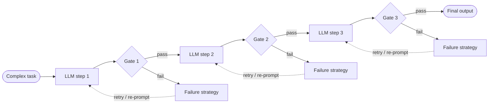
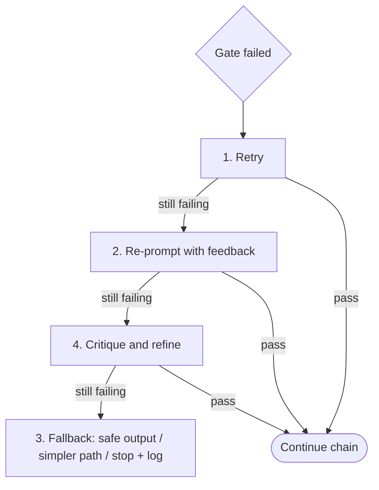

# Prompt Chaining Workflow

> [!abstract] TL;DR
> Prompt chaining ==decomposes a complex task into a sequence of simpler LLM calls, where each output feeds the next==, like stations on an assembly line. Each call is simpler, which improves multi-step reasoning and can reduce hallucinations. The cost is a **dependency chain**: an early mistake ==propagates and compounds==. The fix is **intermediate validation** (quality-control gates between steps), a **failure strategy** for when a gate trips, and **careful context management** so each step gets exactly the context it needs.

**Section:** [[Agentic Workflow Patterns]] – pattern 1 of 5 (theory)
**Next:** [[Implementing Prompt Chaining Workflow]] → [[Routing Workflow]]
**Prerequisite:** [[Task Decomposition]] · [[Implementing Agentic Workflows in Python]]
**Deeper coverage already in the vault:** [[Prompt Chaining for Agentic Reasoning - Study Guide]] (patterns, trade-offs, design) · [[Gate Checks]] (gate taxonomy) · [[Implementing Gate Checks]] (code) · [[LLM Feedback Loops]] (re-prompting with feedback)

**Sources:** Course reading "Agentic Workflow Patterns: Prompt Chaining Workflow" (two parts: the pattern and its risk; validation methods, failure handling, and context management). The mappings to existing notes, the reliability math, the worked example, and the critical analysis are *beyond the lecture*.

> [!todo]- Contents
> 1. [[#1. Core Concepts]]
> 2. [[#2. The Pattern – Assembly Line of LLM Calls]]
> 3. [[#3. The Risk – Error Propagation]]
> 4. [[#4. Intermediate Validation – Four Methods]]
> 5. [[#5. When Validation Fails – Four Strategies]]
> 6. [[#6. Context Management]]
> 7. [[#7. Worked Example – Multi-Step Financial Report]]
> 8. [[#8. Pitfalls and Failure Modes]]
> 9. [[#9. Key Takeaways]]
> 10. [[#10. Critical Analysis]]
> 11. [[#11. Self-Test]]
> 12. [[#12. Glossary]]

---

## 1. Core Concepts

> [!info]+ Definition – Prompt chaining
> A workflow pattern that ==decomposes a complex task into a sequence of smaller steps==, each usually one LLM call, where **the output of one call becomes the input of the next**. See also [[Chaining prompts for Agentic Reasoning#^def-prompt-chaining]].

^def-prompt-chaining-workflow

> [!info]+ Definition – Error propagation
> In a dependency chain, a flawed or incomplete output from an early step is carried into later steps, where it can ==propagate and compound== until it derails the whole workflow.

^def-error-propagation

> [!info]+ Definition – Intermediate validation
> Systematically checking the **accuracy, relevance, and format** of each step's output ==before it is passed to the next step==. The validation points are "quality control gates" on the assembly line. Full taxonomy in [[Gate Checks]].

^def-intermediate-validation

---

## 2. The Pattern – Assembly Line of LLM Calls

| Assembly line | Prompt chain |
|---|---|
| Specialized stations | One LLM call per subtask |
| Each worker does one job | Each prompt focuses on one subtask |
| Part moves to the next station | Output becomes the next prompt's input |
| Quality control between stations | Validation gates between steps |

**Why it helps (from the reading):**

- Each individual LLM call is **simpler**.
- **Enhanced reasoning** across multiple steps.
- Can **reduce hallucinations** by keeping the model focused on one subtask ([[LLM Hallucinations]]).



The code decides the order of steps; the LLM only does the work inside each step. That puts prompt chaining at the **fixed chain** level of the control spectrum ([[Prompt Chaining for Agentic Reasoning - Study Guide#3. The Spectrum – Chain to Agent]]), which is why it is the most predictable of the agentic workflow patterns.

---

## 3. The Risk – Error Propagation

The reading's example: a small mistake in the **first calculation** of a multi-step financial report carries through, making all following calculations wrong.

Quantitatively (*beyond the lecture*): with per-step success $p$, an unvalidated $n$-step chain succeeds with $p^{\,n}$ ([[Prompt Chaining for Agentic Reasoning - Study Guide#^error-compounding]]). Validation changes this. Suppose a gate catches a bad output with probability $d$ (its detection rate) and allows up to $k$ attempts. The probability that a step ends with a correct output is

$$
p_{\text{step}} = p \sum_{i=0}^{k-1} \big((1-p)\,d\big)^{i}
$$

| Setting | $p$ | $d$ | $k$ | $p_{\text{step}}$ | 5-step chain |
|---|---|---|---|---|---|
| No gates | 0.90 | – | 1 | 0.900 | $0.9^5 \approx$ **0.59** |
| Gates + retries | 0.90 | 0.80 | 3 | ≈ 0.978 | $0.978^5 \approx$ **0.89** |
| Perfect gates | 0.90 | 1.00 | 3 | 0.999 | ≈ **0.995** |

^gated-reliability

> [!important] What this shows
> Gates only help ==as much as they detect==. A gate with low detection lets errors through silently, and retries can't fix what isn't caught. Also note that when a gate catches a failure and retries run out, the step *fails visibly* (a fallback is triggered) instead of passing a wrong answer downstream. That is the main win.

---

## 4. Intermediate Validation – Four Methods

| Method | How it works | Good for | Example | Maps to ([[Gate Checks]]) |
|---|---|---|---|---|
| **Programmatic checks** | Custom code verifies specific conditions | Structure, bounds, types | Valid JSON; summary within length; numbers in range | [[Gate Checks#^gate-format\|Format]] + [[Gate Checks#^gate-logic\|Logic]] |
| **LLM-based validation** | Another LLM call evaluates the output | Subtle qualities that are hard to codify | Factual accuracy, relevance, tone | [[Gate Checks#^gate-content\|Content]] (LLM-as-judge) |
| **Rule-based validation** | Checks against a declared set of explicit rules | Required patterns or values | Email must have a salutation and a closing | Content / Logic, with the ruleset as the focus |
| **Confidence scoring** | Compares the generator's confidence score against a threshold | Deciding whether to trust an output | Below threshold → corrective action | [[Gate Checks#^other-gate-types\|Confidence gate]] |

^validation-methods

> [!note] Programmatic vs. rule-based
> The reading separates them even though rules are usually implemented in code. The difference is **emphasis**: programmatic checks are ad hoc conditions you write for a step; rule-based validation is ==adherence to a declared ruleset==, which can be reviewed, versioned, and owned by domain experts.

> [!tip] Combining methods (beyond the lecture)
> Order them cheapest and most deterministic first: programmatic → rule-based → confidence → LLM-based. There is no point paying for an LLM judge on output that isn't even valid JSON. See [[Gate Checks#5. Designing a Gate Stack]].

---

## 5. When Validation Fails – Four Strategies

| # | Strategy | What it does | Use when |
|---|---|---|---|
| 1 | **Retry** | Re-run the same prompt | Transient LLM issues (random bad sample) |
| 2 | **Re-prompt with feedback** | Add the validator's specific reasons (e.g. "summary too long") to a revised prompt and regenerate | The failure reason is known and fixable – ==key for iterative refinement== |
| 3 | **Fallback mechanisms** | Terminate and log; or route to a simpler task or a predefined safe output | Retries have failed |
| 4 | **Simplified critique and refinement** | One prompt: LLM critiques its previous output against criteria. Next prompt: refine based on the critique | Quality issues without a single clear error message |

^failure-handling



The escalation order in the diagram is a sensible default (*beyond the lecture*); the reading lists the strategies but doesn't order them.

> [!warning] Logging and monitoring
> The reading stresses keeping ==comprehensive logs of inputs, outputs, and validation results at every step==. Without them you can't tell where or why a chain fails. See [[Runtime or Orchestration Layer#5. Durability, Budgets and Observability]] and [[LLM Feedback Loops#5. Monitoring Improvements Across Iterations]].

Related vault notes: the fuller failure-strategy table (adds repair-in-code, reroute, escalate to human, abort) is at [[Gate Checks#^failure-strategies]]; the mechanics of strategies 2 and 4 are in [[LLM Feedback Loops]].

---

## 6. Context Management

Each step needs enough context from earlier steps, but **too much or irrelevant context degrades performance** or exceeds the context window. It is a balancing act.

| Technique | What it means | Why |
|---|---|---|
| **Selective context passing** | Pass only the most relevant parts of previous outputs; ==plan what each step truly needs== | Keeps the model focused; saves tokens |
| **Distribution across prompts** | Chaining itself spreads information over several calls | Works within finite context limits |
| **Contextual reiteration** | Restate important context (e.g. the original goal, key constraints) in each new prompt | Prevents the model "forgetting" early details |

^context-management

Goal: ==necessary and sufficient context for each step==. These ideas are developed further in [[Stage-Specific Prompting#^minimal-context]] (minimal context per stage) and [[Prompt Chaining for Agentic Reasoning - Study Guide#^reinject-goal]] (re-injecting the goal).

A simple budget view (*beyond the lecture*): if step $i$ receives the original input $x$ plus all prior outputs $y_1, \dots, y_{i-1}$, total input tokens grow roughly as

$$
\sum_{i=1}^{n} \Big(|x| + \sum_{j<i} |y_j|\Big) = O(n^2)
$$

in the chain length when outputs are similar in size, while selective passing keeps each step roughly constant, $O(n)$ overall.

---

## 7. Worked Example – Multi-Step Financial Report

Built from the reading's financial-report example (*details beyond the lecture*).

| Step | LLM task | Context passed (selective) | Gate | On failure |
|---|---|---|---|---|
| 1. Extract | Pull revenue, costs, period from raw statements → JSON | Raw statements only | Programmatic: valid JSON, all fields, numbers ≥ 0 | Re-prompt with the parse error |
| 2. Calculate | Compute margins and growth | Step 1 JSON only (not raw text) | Programmatic: recompute in code and compare | Replace with code result (fallback) |
| 3. Analyze | Explain the drivers of change | Step 2 figures + goal restated | LLM-based: every claim supported by the figures | Critique and refine |
| 4. Write | Executive summary for the CFO | Step 3 analysis + tone rules | Rule-based: ≤ 200 words, has headline and recommendation; confidence check | Re-prompt with feedback ("too long") |

Why the gate on step 2 matters most: it is the "first calculation" from the reading. A wrong margin there makes steps 3 and 4 fluent, confident, and wrong. A deterministic recomputation is cheap and catches it with near-perfect detection ($d \approx 1$).

```text
Step 3 prompt (with contextual reiteration)
GOAL: Produce a Q3 financial summary for the CFO.     <- restated every step
CONSTRAINT: Use only the figures below; no outside data.
FIGURES: {step2_json}
TASK: List the 3 main drivers of the change in operating margin, each citing a figure.
OUTPUT: JSON {"drivers": [{"driver": str, "evidence": str}]}
```

---

## 8. Pitfalls and Failure Modes

| Failure | Symptom | Mitigation |
|---|---|---|
| No intermediate gates | Final output is wrong; unclear which step broke | Gate every step whose output others depend on |
| Weak gates | Gates pass bad outputs; false sense of safety | Measure each gate's detection rate on known-bad examples |
| Blind retries | Same failure repeats; cost grows | Re-prompt **with feedback**; cap attempts |
| Self-assessed confidence trusted | Model reports high confidence on wrong answers | Prefer token log-probabilities or agreement across samples; calibrate thresholds |
| LLM validator shares the generator's blind spots | Judge approves the error | Deterministic checks first; different model or prompt for judging |
| Context overload | Later steps ignore instructions or drift | Selective context passing |
| Lost early details | Later steps contradict the original goal | Contextual reiteration |
| Silent fallback | Chain "succeeds" with a safe default nobody notices | Log and count fallbacks; alert on rates |
| Over-chaining | Many steps for a task one prompt could do | Chain only when evaluation shows one prompt falls short |

---

## 9. Key Takeaways

- [ ] I can define prompt chaining and explain the assembly-line analogy.
- [ ] I can give the three benefits: simpler calls, better multi-step reasoning, fewer hallucinations.
- [ ] I can explain error propagation using the financial report example.
- [ ] I can define intermediate validation and what it checks (accuracy, relevance, format).
- [ ] I can name and compare the four validation methods.
- [ ] I can name the four failure strategies and when to use each.
- [ ] I know why logging inputs, outputs, and validation results at each step matters.
- [ ] I can explain selective context passing and contextual reiteration.
- [ ] I can compute chain reliability with and without gates.

---

## 10. Critical Analysis

- **"Reduces hallucinations" is plausible but conditional.** Narrow prompts give the model less room to invent, but each step is still an LLM call that can hallucinate, and a chain has *more* calls. The net effect depends on gates. Without them, you may just move the hallucination to a step where it is harder to see.
- **Confidence scoring is the weakest method as described.** Many LLM APIs don't return a usable confidence score, and a model's self-reported confidence ("I am 90% sure") is often poorly calibrated. Token log-probabilities or agreement across several samples are better signals, and thresholds need calibrating on labeled data.
- **LLM-based validation is not independent.** A judge using the same model and similar prompt tends to share the generator's errors, so its detection rate $d$ is lower than it appears. Use different models, rubrics, and deterministic checks where possible ([[LLM Evaluation]]).
- **Gates cost money and time.** Every LLM-based gate adds a call per step; with retries, worst-case cost grows as $n \cdot k$ calls. Budget gates and stop conditions are needed ([[LLM Feedback Loops#^stop-conditions]]).
- **Fixed chains are brittle to input variety.** When inputs vary a lot, one fixed sequence doesn't fit all; that motivates the routing and orchestrator patterns that come later in [[Agentic Workflow Patterns]].
- **Security:** each step's output becomes the next step's *prompt*. If step 1 processes untrusted text (an email, a web page), injected instructions can travel down the chain. Treat intermediate outputs as data, validate structure, and don't let free text from one step act as instructions in the next ([[Prompt Injection]]).

> [!question] Discussion questions
> 1. How would you measure the detection rate $d$ of an LLM-based validator before trusting it?
> 2. When is a predefined "safe output" fallback worse than stopping the chain?
> 3. Is simplified critique and refinement a form of validation, a failure strategy, or both?

---

## 11. Self-Test

> [!question]- Q1. What is prompt chaining, and why does it improve results?
> Decomposing a complex task into a sequence of simpler LLM calls where each output feeds the next. Each call is simpler and focused, which improves multi-step reasoning and can reduce hallucinations.

> [!question]- Q2. What is the inherent risk of prompt chaining, and what addresses it?
> Error propagation through the dependency chain: an early flawed output carries into and compounds through later steps. Intermediate validation (quality-control gates between steps) addresses it.

> [!question]- Q3. Name the four validation methods, with one example each.
> Programmatic checks (valid JSON, length limit), LLM-based validation (factual accuracy, tone), rule-based validation (email has a salutation and closing), confidence scoring (reject outputs below a threshold).

> [!question]- Q4. A gate reports "summary too long". Which failure strategy fits best, and why?
> Re-prompt with feedback: the failure reason is specific and fixable, so include it in a revised prompt. A plain retry would likely produce another long summary.

> [!question]- Q5. What are selective context passing and contextual reiteration?
> Selective context passing: send each step only the relevant parts of prior outputs. Contextual reiteration: restate key context (goal, constraints) in each new prompt so the model doesn't lose it.

> [!question]- Q6. (Quantitative) Steps succeed with p = 0.85. Gates detect errors with d = 0.9 and allow 2 attempts. Compare a 4-step chain with and without gates.
> Without gates: $0.85^4 \approx 0.52$. With gates: $p_{\text{step}} = 0.85 \times (1 + 0.15 \times 0.9) = 0.85 \times 1.135 \approx 0.965$, so the chain is $0.965^4 \approx 0.87$.

> [!question]- Q7. (Design) Design a 3-step chain that turns a customer complaint email into a reply draft, with gates and failure strategies.
> 1) **Extract** issue, product, sentiment → JSON. Gate: programmatic (schema). Failure: re-prompt with the parse error. 2) **Plan** the response points given company policy. Gate: rule-based (must include apology if sentiment is negative; no refund promises over a limit). Failure: re-prompt with the broken rule. 3) **Write** the reply. Gate: LLM-based tone check + rule-based (salutation, closing, ≤ 150 words). Failure: critique and refine; fallback to a template reply flagged for a human. Pass only the JSON and plan forward, not the raw email, and restate the goal and tone rules in each prompt. Treat the email as untrusted input.

### Flashcards

> [!tip] Flashcards
> Review cards for this note are in [[Prompt Chaining Workflow - Flashcards]].

---

## 12. Glossary

| Term | Meaning |
|---|---|
| Prompt chaining | Sequence of LLM calls where each output feeds the next |
| Dependency chain | Steps that rely on earlier steps' outputs |
| Error propagation | An early mistake carried and amplified through later steps |
| Intermediate validation | Checking each step's output before passing it on |
| Programmatic check | Custom code verifying a specific condition |
| Rule-based validation | Checking output against a declared set of explicit rules |
| Confidence scoring | Using a confidence score and threshold to decide whether to trust an output |
| Re-prompt with feedback | Regenerating with the validator's failure reasons in the prompt |
| Fallback | Stop and log, route to a simpler task, or return a safe output |
| Selective context passing | Passing only the relevant parts of prior outputs forward |
| Contextual reiteration | Restating important context in each new prompt |

---

## Further Reading

- [Building Effective Agents (Anthropic)](https://www.anthropic.com/research/building-effective-agents) – prompt chaining as the first workflow pattern, with programmatic gates
- [AI Chains: Transparent and Controllable Human-AI Interaction by Chaining Large Language Model Prompts (Wu et al., 2022)](https://arxiv.org/abs/2110.01691)
- [Self-Refine: Iterative Refinement with Self-Feedback (Madaan et al., 2023)](https://arxiv.org/abs/2303.17651) – the critique-and-refine strategy
- [Lost in the Middle: How Language Models Use Long Contexts (Liu et al., 2023)](https://arxiv.org/abs/2307.03172) – why excess context hurts

%% Study hint: validation = "PLRC" (Programmatic, LLM, Rule, Confidence); failure handling = "RRFC" (Retry, Re-prompt, Fallback, Critique). %%
