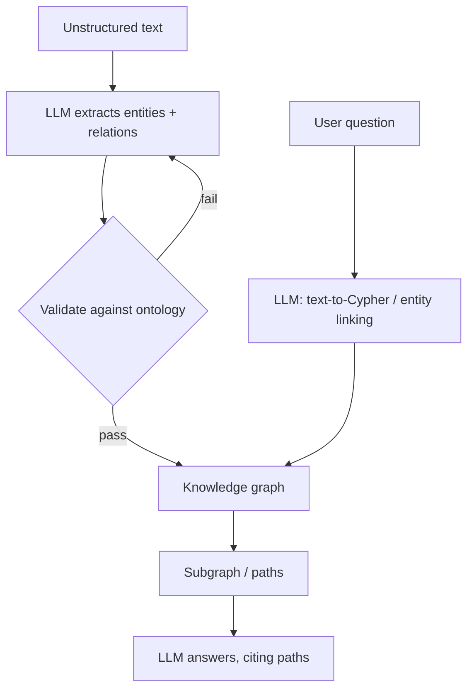

# Knowledge Graphs

> [!abstract] TL;DR
> A knowledge graph (KG) stores facts as **entities (nodes)** connected by **typed relations (edges)**, for example `(OLT-7) -[SERVES]-> (Node-12)`. ==Vector search finds text that *sounds* relevant. A graph can follow explicit relationships across several hops.== That suits multi-hop questions, impact analysis and structured agent memory. The cost is building the graph: extracting entities and relations, and keeping the schema up to date.

**Prerequisites:** [[Vector Databases]] · [[Retrieval-Augmented Generation]]
**Related:** [[AI Memory]] · [[AI Agents]] · [[Chain-of-Thought and ReAct]] · [[LLM Hallucinations]]

> [!note] Source scope
> Written to fill links from the RAG, memory and agents notes. The content is standard KG and GraphRAG material (*beyond the lecture*).

> [!todo]- Contents
> - [[#1. Core Concepts]]
> - [[#2. KG vs Vector Store]]
> - [[#3. Knowledge Graphs with LLMs]]
> - [[#4. Worked Example – Outage Impact Analysis]]
> - [[#5. Pitfalls and Failure Modes]]
> - [[#6. Key Takeaways]]
> - [[#7. Critical Analysis]]
> - [[#8. Self-Test]]
> - [[#9. Glossary]]
> - [[#Further Reading]]

---

## 1. Core Concepts

> [!info]+ Definition – Knowledge graph
> A directed, labelled multigraph $G=(V,E,R)$. Here $V$ is the set of entities, $R$ is the set of relation types, and $E \subseteq V \times R \times V$ is the set of facts (triples).

^def-kg

| Model | Representation | Query language | Examples |
|---|---|---|---|
| **RDF / triple store** | (subject, predicate, object) | SPARQL | Wikidata, GraphDB |
| **Property graph** | Nodes and edges carry key-value properties | Cypher / GQL, Gremlin | Neo4j, Neptune |

> [!info]+ Definition – Ontology / schema
> The allowed entity types and relation types, with their constraints (e.g. `SERVES: OLT → Node`). It is what makes the graph queryable and checkable.

^def-ontology

---

## 2. KG vs Vector Store

| Question type | [[Vector Databases\|Vector store]] | Knowledge graph |
|---|---|---|
| "Find docs about X" | ✅ Strong | Weak |
| Multi-hop ("customers served by nodes fed by OLT-7") | ❌ Weak | ✅ Strong |
| Aggregation / counts | ❌ | ✅ |
| Fuzzy, paraphrased queries | ✅ | Weak without entity linking |
| Explainability | Similarity score | An explicit path |
| Build cost | Low (chunk + embed) | High (extraction + schema) |

They are complementary. **Hybrid GraphRAG** uses vectors to find entry nodes, then traverses the graph from there.

---

## 3. Knowledge Graphs with LLMs



| Pattern | Idea |
|---|---|
| **LLM-built KG** | The LLM extracts triples. An [[Output Validation\|ontology gate]] rejects triples that break the schema |
| **Text-to-query** | The LLM writes Cypher/SPARQL, and the database runs it (validate it as untrusted code) |
| **GraphRAG** | Build an entity graph, find communities, summarize each one. Good for "global" questions about a corpus |
| **KG as agent memory** | Store user and entity facts as triples that can be updated ([[AI Memory]]) |
| **KG as a tool** | A ReAct agent calls `graph_query()` like any other tool ([[Chain-of-Thought and ReAct]]) |

---

## 4. Worked Example – Outage Impact Analysis

Graph: `(OLT)-[FEEDS]->(Splitter)-[SERVES]->(Premise)<-[AT]-(Account)`.

Question: *"Which business accounts are affected if OLT-7 port 3 fails?"*

```cypher
MATCH (o:OLT {id:"OLT-7"})-[:FEEDS {port:3}]->(:Splitter)-[:SERVES]->(p:Premise)<-[:AT]-(a:Account {type:"business"})
RETURN a.id, a.name, p.address
```

A vector search over tickets could not reliably answer this three-hop question. The LLM's job is to turn the question into the query and write up the result. The graph does the reasoning.

---

## 5. Pitfalls and Failure Modes

| Failure | Symptom | Mitigation |
|---|---|---|
| Extraction errors | Wrong or duplicate edges | Ontology validation, entity resolution, confidence thresholds |
| Entity-resolution failure | "OLT7", "OLT-7" and "olt 7" become separate nodes | Canonical IDs, fuzzy matching step |
| Schema drift | Queries break | Version the ontology and migrate the data |
| Unsafe generated queries | `DETACH DELETE` from text-to-Cypher | Read-only credentials, query allow-list |
| Stale facts | Topology changed | Sync from the system of record, timestamp the edges |

---

## 6. Key Takeaways

- [ ] A KG is typed triples (entity, relation, entity) governed by an ontology.
- [ ] Graphs win on multi-hop questions, aggregation and explainability. Vectors win on fuzzy recall.
- [ ] LLMs can build KGs (extraction) and query them (text-to-query). Both need validation.
- [ ] GraphRAG uses vectors to find the entry nodes and graph traversal to follow relations.

---

## 7. Critical Analysis

- **Build cost versus benefit.** For many corpora a good hybrid vector search with reranking is enough. Build a KG when the domain already has structure (network topology, CRM relations) or the questions are really multi-hop.
- **Evidence.** GraphRAG results are promising for summarizing a whole corpus, but its indexing is expensive (many LLM calls). Check it against a strong vector baseline on *your* questions.
- **At scale.** Keeping extraction consistent across millions of documents is hard. Errors add up across hops, in the same way as $p^n$ ([[AI Reliability]]).
- **Security.** Text-to-query is code generation. Run it with least privilege. Poisoned source text can plant false edges.

> [!question] Discussion
> 1. For an ISP, which should be the source of truth, the KG or the OSS/BSS systems? How do you keep them in sync?
> 2. Is an LLM-extracted KG more or less prone to hallucination than direct RAG?

---

## 8. Self-Test

> [!question]- Q1. What is a triple?
> (subject, predicate, object), e.g. `(OLT-7, FEEDS, Splitter-3)`. It is a single fact in the graph.

> [!question]- Q2. Name a question type where KGs beat vector search, and explain why.
> Multi-hop questions such as "accounts behind OLT-7". They need explicit relation traversal, not text similarity.

> [!question]- Q3. Quantitative – extraction is 90% accurate per edge. What is the chance a 3-hop path is fully correct?
> $0.9^3 \approx 0.73$.

> [!question]- Q4. Design – how would you safely let an agent query a Neo4j graph?
> Use read-only credentials, give the model the schema in its prompt, validate the generated Cypher (block write clauses, add a LIMIT), set a timeout, and cite the returned paths in the answer.

> [!tip] Flashcards
> Review with [[Knowledge Graphs - Flashcards]].

---

## 9. Glossary

| Term | Meaning |
|---|---|
| Triple | (subject, predicate, object) fact |
| Ontology | Schema of entity and relation types |
| Entity resolution | Merging mentions that refer to the same real-world entity |
| Cypher / SPARQL | Property-graph / RDF query languages |
| GraphRAG | RAG that retrieves from graph structure or community summaries |

---

## Further Reading

- [Knowledge Graphs survey (Hogan et al.)](https://arxiv.org/abs/2003.02320)
- [From Local to Global: A GraphRAG Approach (Edge et al., 2024)](https://arxiv.org/abs/2404.16130)
- [W3C RDF](https://www.w3.org/RDF/)
