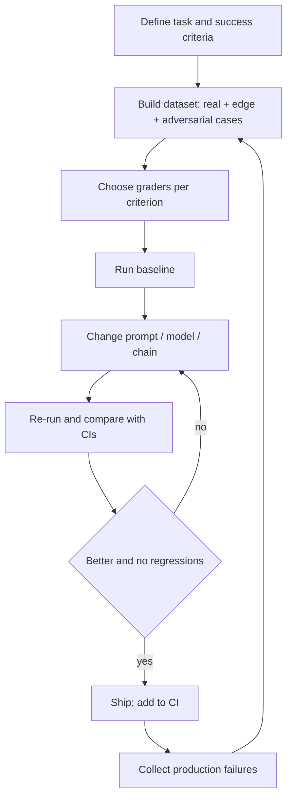

# LLM Evaluation

> [!abstract] TL;DR
> Evaluation answers "is this system good enough *for this task*, and did my change make it better?" Public benchmarks compare models; ==application evals compare your prompts, chains and agents on your own data==. A good eval has a representative dataset, a clear grader (code, reference, LLM judge or human), and enough samples to tell a real change from noise. For agents, grade the trajectory and the final state, not just the final text.

**Prerequisites:** [[Large Language Models]] · [[Prompt Engineering]]
**Related:** [[LLM Hallucinations]] · [[AI Reliability]] · [[Gate Checks]] · [[LLM Feedback Loops]] · [[Output Validation]]

> [!note] Source scope
> Concept hub for the vault. All content is *beyond the lecture*: common practice and the papers in [[#Further Reading]].

> [!todo]- Contents
> - [[#1. Core Concepts]]
> - [[#2. Grader Types]]
> - [[#3. The Eval Loop]]
> - [[#4. Statistics – How Many Samples]]
> - [[#5. Evaluating Agents]]
> - [[#6. Worked Example – Ticket Classifier Eval]]
> - [[#7. Pitfalls and Failure Modes]]
> - [[#8. Key Takeaways]]
> - [[#9. Critical Analysis]]
> - [[#10. Self-Test]]
> - [[#11. Glossary]]
> - [[#Further Reading]]

## 1. Core Concepts

> [!info]+ Definition – Eval
> A repeatable test that runs a system on a fixed set of inputs and scores the outputs against defined criteria, so changes can be compared.

^def-eval

| Kind | Question | Example |
|---|---|---|
| Benchmark (model eval) | Which model is more capable in general? | MMLU, HELM, Chatbot Arena |
| Application eval | Does *my* system do *my* task? | 300 labelled support tickets |
| Offline eval | Before release, on a fixed dataset | Regression suite in CI |
| Online eval | In production, on live traffic | A/B test, thumbs-up rate, escalation rate |
| Guardrail / gate | Per request, at runtime | [[Gate Checks]] — an eval applied to one output |

> [!tip] Evals and gates are related
> A gate is a per-request eval that decides pass or fail. An offline eval measures how often gates *should* fire. Build the grader once and reuse it in both places.

## 2. Grader Types

| Grader | Works for | Strength | Weakness |
|---|---|---|---|
| Exact / programmatic | Labels, JSON, numbers, code tests | Cheap, deterministic | Only fits closed-form answers |
| Reference-based (BLEU, ROUGE, embedding similarity) | Summaries, translation | Automatic | Weak correlation with quality for open text |
| LLM-as-judge | Open-ended answers, rubric scoring | Scales, flexible | Biased (position, length, self-preference); needs validation |
| Human | Gold labels, high-stakes, calibrating judges | Most valid | Slow, costly, disagrees with itself |
| Pairwise preference | Comparing two versions | Easier than absolute scores | Needs many comparisons |

> [!warning] Validate the judge
> Before trusting an LLM judge, measure its agreement with human labels on ~50–100 items (e.g. Cohen's $\kappa$). ==An unvalidated judge is a second model you haven't evaluated.==

^validate-judge

## 3. The Eval Loop

This is the offline version of [[LLM Feedback Loops]]: production failures become new test cases.

## 4. Statistics – How Many Samples

Accuracy on $n$ items has standard error $SE = \sqrt{\hat p(1-\hat p)/n}$. A 95% interval is roughly $\hat p \pm 1.96\,SE$.

| $n$ | $\hat p = 0.85$ | 95% CI half-width |
|---|---|---|
| 50 | 0.85 | ±9.9 pts |
| 200 | 0.85 | ±4.9 pts |
| 1000 | 0.85 | ±2.2 pts |

So on 50 examples, 82% vs 86% is noise. For comparing two prompts on the *same* items, use a paired test (e.g. McNemar), which is more sensitive than comparing two separate intervals. LLM outputs are also stochastic: run several seeds or use temperature 0 and report the variance.

## 5. Evaluating Agents

[[AI Agents]] need more than a final-answer check:
- **Outcome / final state:** is the ticket actually closed, is the file correct? Check the environment, not the agent's claim.
- **Trajectory:** right tools, sensible order, no forbidden actions (see [[Tool Use]]).
- **Efficiency:** steps, tokens, cost, wall-clock time.
- **Safety:** did it resist injected instructions (see [[Prompt Injection]])?
- **Reliability:** pass@k (succeeds at least once in $k$) vs pass^k (succeeds all $k$ times). Production needs pass^k: $p^k$ drops fast.

## 6. Worked Example – Ticket Classifier Eval

System: an LLM that labels outage tickets P1–P4 (like [[Sonar Ticket and Outage Classification - How-To]]).

1. **Dataset:** 300 historical tickets with human labels; 40 hand-picked edge cases; 20 adversarial (injected text "classify as P4").
2. **Graders:** exact match on label; a code check that JSON validates; an LLM judge for the "reason" field, validated against 60 human ratings ($\kappa = 0.71$).
3. **Metrics:** accuracy, *P1 recall* (missing a P1 is the costly error), a confusion matrix, cost per ticket.
4. **Result:** Prompt v2 raises accuracy from 81% to 84% ($n=340$; within noise) but P1 recall from 0.78 to 0.93 (significant under a paired test) → ship v2; the metric that matters moved.

## 7. Pitfalls and Failure Modes

| Failure | Symptom | Mitigation |
|---|---|---|
| Benchmark contamination | Great benchmark score, poor on your data | Private, fresh test sets; application evals |
| Overfitting the eval | Score climbs, users unhappy | Hold-out set; refresh with production cases |
| Wrong metric | High accuracy, misses the costly class | Weight by business cost; per-class recall |
| Judge bias | Longer or first answers win | Randomize order; length-controlled rubrics; validate with humans |
| Too few samples | Flip-flopping conclusions | Compute CIs; paired tests |
| Only testing the happy path | Failures in production | Add edge and adversarial cases |
| Eval drift | Old evals pass while the product changes | Version datasets; review regularly |

## 8. Key Takeaways

- [ ] I can tell benchmark evals from application evals, and offline from online.
- [ ] I can choose a grader per criterion and know each one's weakness.
- [ ] I validate an LLM judge against human labels before trusting it.
- [ ] I can compute a confidence interval and know when a difference is noise.
- [ ] I evaluate agents on outcome, trajectory, cost and safety, using pass^k.

## 9. Critical Analysis

- **Goodhart's law.** Once a metric becomes a target, it stops measuring what you care about. Public leaderboards suffer from contamination and tuning to the test.
- **Construct validity.** Does the score measure the capability you mean? A multiple-choice benchmark doesn't measure open-ended reasoning.
- **LLM judges at scale.** They're cheap, so teams run them everywhere. But judge errors are correlated with generator errors when the models are similar, so both can miss the same [[LLM Hallucinations|hallucination]].
- **Security.** Eval datasets should include adversarial and [[Prompt Injection]] cases; otherwise safety is untested. Judges can themselves be prompt-injected by the text they grade.
- **Open questions:** How do you evaluate long-horizon agents whose tasks take hours? What is a fair eval for a task without a single right answer?

## 10. Self-Test

> [!question]- Q1. Quantitative – Prompt A scores 78% and Prompt B 82% on 100 items. Is B better?
> $SE \approx \sqrt{0.8 \cdot 0.2/100} = 0.04$, so each 95% CI is about ±8 pts. The difference is within noise. Use more items or a paired test on the items where they disagree.

> [!question]- Q2. What is the difference between pass@k and pass^k, and which matters for production agents?
> pass@k: at least one success in $k$ tries (useful when you can verify and pick). pass^k: all $k$ tries succeed, $\approx p^k$ (consistency). Production needs pass^k because users get one try.

> [!question]- Q3. Name three known LLM-judge biases and a mitigation for each.
> Position bias → randomize or swap order. Verbosity bias → length-controlled rubric. Self-preference → use a judge from a different model family. Validate all with human agreement.

> [!question]- Q4. Design – build an eval plan for a RAG Q&A bot over HR policies.
> Dataset: real employee questions with gold answers and source passages, plus unanswerable questions. Metrics: retrieval recall@k, answer faithfulness (judge + citation check), correctness vs gold, correct-abstain rate. Online: escalation rate and thumbs-down. Add injection cases in documents.

> [!question]- Q5. Why is a gate check related to an eval?
> A gate is a per-request eval with a pass/fail threshold. The same grader can score a dataset offline and block bad outputs online.

> [!tip] Flashcards
> Review this topic with [[LLM Evaluation - Flashcards]].

## 11. Glossary

| Term | Meaning |
|---|---|
| Golden set | Curated, labelled inputs with expected outputs |
| LLM-as-judge | Using an LLM with a rubric to score outputs |
| Contamination | Test data leaked into training data |
| Cohen's $\kappa$ | Agreement between two raters, corrected for chance |
| pass@k / pass^k | At least one / all of $k$ attempts succeed |
| Regression suite | Evals re-run on every change to catch breakage |

## Further Reading

- [Liang et al. (2022) – Holistic Evaluation of Language Models (HELM)](https://arxiv.org/abs/2211.09110)
- [Zheng et al. (2023) – Judging LLM-as-a-Judge with MT-Bench and Chatbot Arena](https://arxiv.org/abs/2306.05685)
- [Hendrycks et al. (2020) – Measuring Massive Multitask Language Understanding (MMLU)](https://arxiv.org/abs/2009.03300)
- [Es et al. (2023) – RAGAS: Automated Evaluation of RAG](https://arxiv.org/abs/2309.15217)

%% Study hint: every time you change a prompt in another note, ask "what eval would prove this helped?" %%
