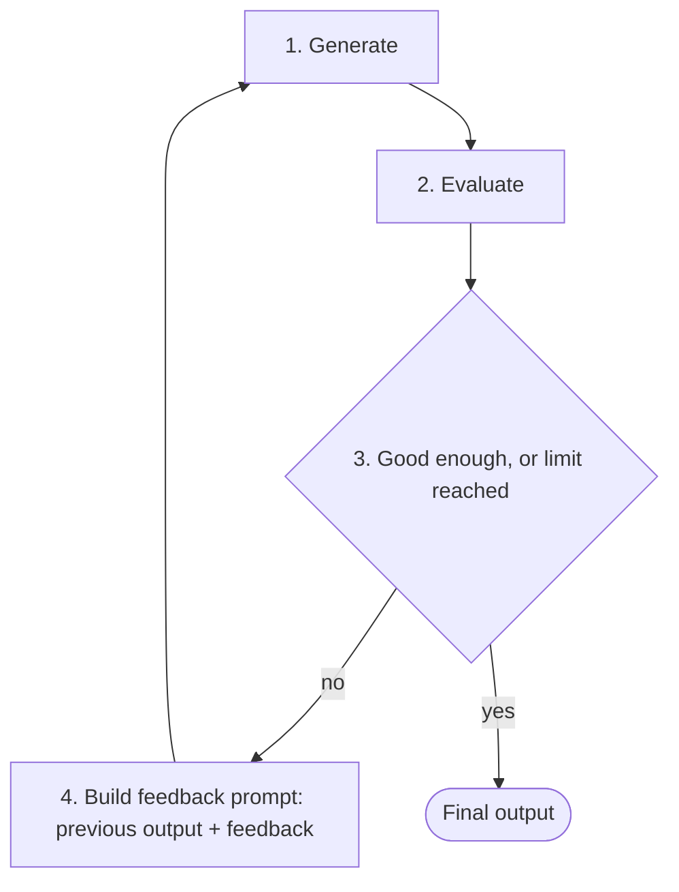
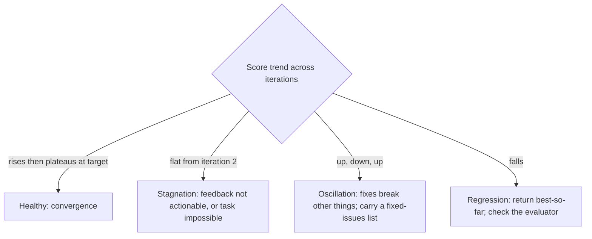

# LLM Feedback Loops

> [!abstract] TL;DR
> A feedback loop has an LLM **generate** an output, **evaluate** it, and **feed the evaluation back** into the next prompt. The cycle repeats until the output is good enough or a limit is reached. It is [[Prompt Chaining for Agentic Reasoning - Study Guide|prompt chaining]] bent back on itself. ==The quality of the loop is set by the quality of the feedback==. Concrete, external signals (test failures, validation errors, user corrections) drive real improvement. Vague self-critique often doesn't. Every loop needs a **stop condition** and **monitoring**, or you can't tell whether it is converging, stuck, or getting worse.

**Prerequisites:** [[Prompt Chaining for Agentic Reasoning - Study Guide]] · [[Gate Checks]]
**Related:** [[Pydantic for Structured LLM Output - Study Guide#4. The Validate–Retry Loop|Validate–retry loop]] · [[Chain-of-Thought and ReAct]] · [[Model Predictive Control (MPC)]] · [[Reinforcement Learning (RL)]]

> [!note] Source scope
> The lecture covered four areas: core concepts, sources of feedback, monitoring, and the code-refinement example. The original reading notes are kept verbatim in [[#Original Reading Notes]]. Anything marked *(beyond the lecture)* is my own addition: the loop skeleton code, stop-condition design, the self-correction research, the control-theory lens, and the critical analysis.

> [!todo]- Contents
> - [[#1. Core Concepts]]
> - [[#2. Anatomy of a Feedback Loop]]
> - [[#3. Sources of Feedback]]
> - [[#4. Implementing the Loop]]
> - [[#5. Monitoring Improvements Across Iterations]]
> - [[#6. Worked Example 1 – Iterative Code Refinement]]
> - [[#7. Worked Example 2 – The Coffee-Chat Email]]
> - [[#8. Pitfalls and Failure Modes]]
> - [[#9. Key Takeaways]]
>     - [[#9.1 Lesson 5 Learning Outcomes]]
> - [[#10. Critical Analysis]]
> - [[#11. Self-Test]]
> - [[#12. Glossary]]
> - [[#Further Reading]]
> - [[#Original Reading Notes]]

---

## 1. Core Concepts

> [!info]+ Definition – Feedback loop
> A process in which a system **observes its own output**, compares it against criteria, and uses that comparison to produce a better next output. For LLMs, the observation and comparison become text in the next prompt.

^def-feedback-loop

> [!info]+ Definition – Feedback signal
> The information passed back into the loop, such as "Too informal", "Test 2 failed: expected `[1,2,3]`, got `None`", or "Missing field `email_address`". It tells the model **what is wrong** and ideally **how far off** it is.

^def-feedback-signal

**The everyday version (from the lecture).** You write an email for a coffee chat. You reread it, realize it's too blunt, and revise it. That's a manual feedback loop. Automating it means replacing *you* in each role:

| Role | You, manually | Automated |
|---|---|---|
| Writer | You draft | LLM drafts |
| Critic | You reread and judge | Same LLM, another LLM, rules, tests, or a user |
| Reviser | You rewrite using your judgment | LLM rewrites with the critique in its prompt |
| Decider | You decide it's good enough | Stop condition in code |

> [!important] Why feedback loops matter for agents
> A single LLM call is a one-shot guess. A loop lets the system ==correct itself using evidence==. This is what lets agents take on multi-step tasks, precise tasks (code, structured data), and tasks where the first try is rarely right. It is the basis for adaptive AI.

^why-loops

---

## 2. Anatomy of a Feedback Loop

The underlying mechanism is **prompt chaining**: one step's output becomes the next step's input. In a feedback loop, the chain points back to its start, carrying the evaluation along with it.




^loop-diagram

Every loop has five parts. If one is missing, the loop is broken:

| Part | Question it answers | Example (code refinement) |
|---|---|---|
| **Generator** | Who produces the output? | LLM writes `sort_numbers` |
| **Evaluator** | What judges it? | `pytest` runs the test suite |
| **Feedback formatter** | How is the judgment turned into useful text? | "Test X failed: input, expected, actual" |
| **Stop condition** | When do we stop? | All tests pass, **or** 5 iterations |
| **Memory** | What does the next iteration see? | Previous code + latest test results |

^five-parts

> [!tip] Chain vs loop
> A **chain** is a straight line: extract → analyze → generate. A **loop** repeats the *same* step until the criteria are met. Most real agents combine them, as a chain with small loops at the risky steps. A [[Gate Checks|gate check]] with retry is the smallest possible feedback loop.

---

## 3. Sources of Feedback

The lecture names four sources. They are **not equally trustworthy**, and that's the most useful thing to understand about them.

| Source | How it works | Signal strength | Cost | Best for |
|---|---|---|---|---|
| **Self-correction** | Ask the LLM to critique its own output against your criteria | ⚠️ Weak. The same blind spots that caused the error judge it | Low (1 extra call) | Style, tone, checking against a checklist |
| **External tools** | Run the code, call an API, execute a query; use errors or results | ✅ Strong. Ground truth from the real world | Medium (tool runtime) | Code, SQL, math, anything executable |
| **Validation checks** | Programmatic rules: parse JSON, check fields, types, ranges | ✅ Strong within its scope | Very low | Structured output, formats, constraints |
| **User input** | A human says what's wrong ("no outdoor activities") | ✅ Strongest on *intent*, but slow | High (human time) | Preferences, ambiguous goals, final approval |

^feedback-sources

### 3.1 Self-correction – useful but overrated
- **How:** "Review this email for politeness. List problems, then rewrite it."
- **Works when:** the criteria are explicit and checkable by reading (tone, length, required sections, a rubric).
- **Fails when:** the model has to find its **own reasoning errors** with no new information. *(Beyond the lecture:)* research such as Huang et al. (2023) found that LLMs often can't improve reasoning answers through intrinsic self-correction alone, and sometimes change right answers to wrong ones. Gains reported in methods like Self-Refine are strongest on tasks with clear quality criteria.
- **Improve it:** use a *different* model or persona as critic, give it a concrete rubric, or ask it to verify specific claims rather than to "improve" the output.

### 3.2 External tools – the gold standard
- Running code gives facts, not opinions: a stack trace, failing tests, actual vs expected output.
- **Key point from the lecture:** detailed feedback matters. "FAIL" alone is weak. "Input `[3,1,2]`, expected `[1,2,3]`, got `None`" gives the model something to fix.
- Tools are also how [[Chain-of-Thought and ReAct|ReAct]] agents observe the world. Every *Observation* is feedback.

### 3.3 Validation checks – cheap and precise
- Example from the lecture: when extracting to JSON, code checks validity and required fields. The error becomes feedback: "Missing `email_address` field".
- Pydantic makes this systematic: the `ValidationError` list *is* the feedback prompt. See [[Pydantic for Structured LLM Output - Study Guide#4. The Validate–Retry Loop|the validate–retry loop]].
- Limit: validation checks the **shape** of the output, not whether it's **true**, unless you deliberately design checks against the source data.

### 3.4 User input – the intent signal
- Example from the lecture: "This itinerary doesn't include any outdoor activities." The request goes back to the agent to regenerate.
- A **blocking tool call** pauses the agent until the user replies (human-in-the-loop).
- Use it for things only the user knows (preferences, priorities) and for approving high-stakes actions. It's too slow to use on every iteration.

> [!example]- Rule of thumb for picking a source
> 1. Can it be **executed or parsed**? Use tools or validation.
> 2. Can it be judged against an **explicit rubric**? Use an LLM critic, preferably a different model.
> 3. Does it depend on **what the user wants**? Ask the user.
> 4. Is it none of the above? Be suspicious of the loop. You may be looping on noise.

---

## 4. Implementing the Loop

*(Beyond the lecture: the lecture describes the steps. This is a minimal skeleton that implements them.)*

```python
def feedback_loop(task: str, generate, evaluate, max_iters: int = 5):
    """generate(prompt) -> output; evaluate(output) -> (passed: bool, score: float, feedback: str)"""
    history = []
    output = generate(task)
    for i in range(1, max_iters + 1):
        passed, score, feedback = evaluate(output)
        history.append({"iter": i, "output": output, "score": score, "feedback": feedback})
        if passed:
            return output, history                               # success stop
        if i >= 3 and score <= history[-3]["score"]:
            break                                                # no-progress stop
        output = generate(REFINE_PROMPT.format(task=task, previous=output, feedback=feedback))
    return best_of(history), history                             # limit reached: return best, not last
```

**The refinement prompt (from the lecture, templated):**

```text
Re-write the Python function called sort_numbers using the provided feedback.

TASK:
{task}

FUNCTION:
{previous}

FEEDBACK:
{feedback}

Fix every issue in FEEDBACK. Do not change behaviour that already passes.
Return only the code.
```

### 4.1 Stop conditions – every loop needs at least two

| Stop condition | Why |
|---|---|
| **Success:** criteria met (all tests pass, validation clean) | The goal |
| **Iteration cap:** e.g. 3–5 | Prevents infinite loops and runaway cost |
| **No progress:** score flat or falling for *k* iterations | Stops oscillation and wasted calls |
| **Budget:** tokens, time, money | A hard ceiling in production |

^stop-conditions

> [!warning] Return the best iteration, not the last
> Loops can **regress**: iteration 4 can be worse than iteration 3. Keep the scored history and return the best output when you hit a limit.

### 4.2 Making feedback actionable

| Weak feedback | Strong feedback |
|---|---|
| "Wrong." | "Test `test_empty` failed: input `[]`, expected `[]`, got `IndexError` at line 3." |
| "Make it better." | "Tone: 2 sentences read as demands ('Send me…'). Rephrase as requests." |
| "Invalid JSON." | "`email_address` missing; `amount` must be > 0 (got −5)." |

Strong feedback is **specific** (what failed), **located** (where), **measured** (expected vs actual), and **scoped** (only the problems, not a rewrite request).

### 4.3 What to carry between iterations
- **Minimum:** the task, the latest output, and the latest feedback.
- **Better:** a short list of problems already fixed, so the model doesn't re-break them.
- **Avoid:** the full transcript of every attempt. The context grows, cost rises, and the model can copy old mistakes.

---

## 5. Monitoring Improvements Across Iterations

Building the loop is the first step. The next is knowing whether it works. Monitoring answers three questions:

| Purpose | Question |
|---|---|
| **Evaluate effectiveness** | Are outputs actually improving and converging? |
| **Debug** | If it's stuck or getting worse, why? (Inspect prompts, outputs, feedback) |
| **Optimize** | After how many iterations do gains stop? Is the loop too long or too expensive? |

### 5.1 Metrics (from the lecture, expanded)

| Metric | What it measures | Example |
|---|---|---|
| **Output quality** | Subjective (politeness via an LLM judge or a human) or objective (closeness to the target) | Judge score 3/5 → 5/5 |
| **Error rate** | Objective failures per iteration | Failing tests 3 → 2 → 1 → 0 |
| **Goal adherence** | Are *all* original requirements still met, not just the latest feedback item? | Requirement checklist 4/5 |
| **Step-by-step trace** | Prompt, response and feedback for every iteration | JSON log per run |
| *Iterations to success* *(beyond the lecture)* | Loop efficiency | Median 2, p95 4 |
| *Cost per success* *(beyond the lecture)* | Tokens and time | 12k tokens, 18 s |

^monitoring-metrics

> [!important] The trace log is the most valuable artifact
> The lecture calls it "crucial": it shows the agent's reasoning step by step. A minimal record per iteration:
> ```json
> {"run_id": "r-17", "iter": 2, "prompt_hash": "a91f", "output": "...",
>  "feedback": "test_empty failed: ...", "score": 0.67, "tokens": 1840, "latency_ms": 2100}
> ```
> With this you can spot **oscillation** (the score going up and down), **stagnation** (the same feedback twice), and **regressions** (a previously passing check now fails).

### 5.2 Reading the curves



---

## 6. Worked Example 1 – Iterative Code Refinement

**Lecture setup.** Goal: generate Python that passes the tests. Feedback: test results. Flow: LLM generates code → external tool runs the tests → results go back to the LLM.

**Step 1: generate.** Prompt: *"Write a Python function called `sort_numbers` that takes a list of integers and returns a new list with the numbers sorted in ascending order."*

**Step 2: run the tests (the feedback mechanism).**
```bash
cat $CODE > sort_numbers.py && pytest test_sort_numbers.py
```

**Step 3: build the refinement prompt** with FUNCTION and FEEDBACK ([[#4. Implementing the Loop|template above]]).

**Step 4: iterate and watch.** The lecture's progression was 3 failed → 1 passed → 2 passed → 3 passed. Below is an *illustrative* trace that produces exactly that progression, so you can see what the feedback looks like at each step. The specific tests and code are my construction.

| Iter | Code (gist) | Tests: basic / returns-new-list / rejects-non-list | Feedback sent back |
|---|---|---|---|
| 1 | `def sort_number(nums): nums.sort()` | ❌ ❌ ❌ | `ImportError: cannot import name 'sort_numbers'` (typo in the name) |
| 2 | `def sort_numbers(nums): nums.sort(); return nums` | ✅ ❌ ❌ | "`test_returns_new_list`: the input list was mutated. `test_rejects_non_list`: expected `TypeError` for `'abc'`, got `['a','b','c']`" |
| 3 | `return sorted(nums)` | ✅ ✅ ❌ | "`test_rejects_non_list`: expected `TypeError`, got `['a','b','c']`" |
| 4 | `if not isinstance(nums, list): raise TypeError(...)` then `return sorted(nums)` | ✅ ✅ ✅ | Stop: success |

^code-refinement-trace

What makes this loop work:
- The **evaluator is external and objective** (pytest), so there's no opinion involved.
- The feedback includes **input, expected and actual**, the detail the lecture stresses.
- Each iteration fixes what the feedback named, and the error rate falls monotonically.
- A **cap** (e.g. 5) guarantees termination if the model gets stuck.

---

## 7. Worked Example 2 – The Coffee-Chat Email

The lecture's opening example, written out as a loop with an LLM critic, because there is no test suite for tone.

| Step | Content |
|---|---|
| **Generate** | "Hey, I want to grab coffee Tuesday to pick your brain about your job. Let me know." |
| **Evaluate** (critic prompt with a rubric: polite opener, specific ask, flexibility, gratitude; score each 0/1) | Score 1/4. Feedback: "No greeting or context about who you are. 'Pick your brain' is presumptuous. No flexibility on time. No thanks." |
| **Revise** | "Hi Dana, I'm Sam, a data analyst on the ops team. I've admired your work on the forecasting project. Would you be open to a 20-minute coffee chat in the next couple of weeks? I'm happy to work around your schedule. Thanks for considering it!" |
| **Evaluate** | Score 4/4. Stop. |

> [!tip] Why the rubric matters
> Without the rubric, the critic says "could be more polite" forever. With a **checklist of observable criteria**, the critic's feedback is specific, the score is measurable, and there is a clear stop condition. That turns weak self-correction into a usable validation check.

---

## 8. Pitfalls and Failure Modes

| Failure | Symptom | Mitigation |
|---|---|---|
| **No stop condition** | Loop runs forever; cost explodes | Iteration cap + budget + no-progress stop ([[#^stop-conditions]]) |
| **Vague feedback** | Same error repeated each iteration | Specific, located, measured feedback ([[#4.2 Making feedback actionable]]) |
| **Rubber-stamp critic** | Self-critique approves flawed output | External evaluator, different critic model, explicit rubric |
| **Over-harsh critic** | Never passes; endless revisions | Calibrate the rubric against human-labelled examples; cap iterations |
| **Oscillation** | Fixing A breaks B, fixing B breaks A | Carry a "fixed issues" list; include all criteria in every evaluation |
| **Regression** | The final output is worse than an earlier one | Score every iteration; return the best |
| **Gaming the evaluator** | Code special-cases the test inputs, or deletes the test | Hidden or held-out tests; forbid edits to tests; review diffs |
| **Context bloat** | Rising cost; the model repeats old mistakes | Carry only the latest output + feedback + a fixed-issues summary |
| **Goal drift** | Output satisfies the latest feedback but loses the original requirements | Re-inject the original task every iteration ([[Prompt Chaining for Agentic Reasoning - Study Guide#^reinject-goal\|re-inject goal]]) |
| **Looping on an impossible task** | Stagnation at a fixed score | No-progress stop → escalate to a human |

^pitfalls

---

## 9. Key Takeaways

- [ ] A feedback loop = generate → evaluate → feed back → revise → stop. It's prompt chaining pointed back at itself.
- [ ] Every loop has five parts: generator, evaluator, feedback formatter, stop condition, memory.
- [ ] Feedback sources, strongest first: **external tools ≈ validation checks** (objective) > **user input** (intent) > **self-correction** (weakest alone).
- [ ] Detailed feedback (input, expected, actual) is what makes the next iteration better.
- [ ] Always have at least two stop conditions: success and a hard cap. Add no-progress and budget stops in production.
- [ ] Return the **best** iteration, not the last.
- [ ] Monitor quality, error rate, goal adherence and the full trace. The trace is how you debug.
- [ ] Re-inject the original goal each iteration to prevent drift.
- [ ] Watch for evaluator gaming: a loop optimizes whatever the evaluator measures.

### 9.1 Lesson 5 Learning Outcomes

The course's stated outcomes for this lesson, each mapped to where it is covered. The hands-on part is in [[Implementing LLM Feedback Loops]].

| Outcome | What it means | Where to review |
|---|---|---|
| **Feedback loop architecture** | The cycle: generation → programmatic evaluation → feedback construction → iterative re-prompting | [[#2. Anatomy of a Feedback Loop]] · [[#^five-parts]] · [[Implementing LLM Feedback Loops#^lab-flow]] |
| **Automated output evaluation** | Objectively test the quality or correctness of an LLM's output (tests, validators, execution) instead of eyeballing it | [[#3. Sources of Feedback]] · [[Implementing LLM Feedback Loops#2. The Harness – What the Helper Functions Do]] |
| **Crafting prompts for revision** | Revision prompts carry the model's **prior work** and **specific, actionable feedback** (test failures, error messages), not just "try again" | [[#4.2 Making feedback actionable]] · [[Implementing LLM Feedback Loops#4. Reference Solutions for the TODO Cells]] |
| **Iterative AI problem-solving** | A system that lets the AI make multiple bounded attempts, with stop conditions and a trace | [[#^stop-conditions]] · [[#5. Monitoring Improvements Across Iterations]] · [[Implementing LLM Feedback Loops#^my-trace]] |
| **Building self-correcting systems** | Applications where the AI helps refine its own output to a higher standard of quality or correctness, grounded in external signals | [[#10. Critical Analysis]] · [[Implementing LLM Feedback Loops#9. Critical Analysis]] |

^lesson5-outcomes

- [ ] I can draw the loop and name its five parts.
- [ ] I can build an automated evaluator that returns objective pass/fail with details.
- [ ] I can write a revision prompt containing task + prior output + actionable feedback.
- [ ] I can implement a bounded multi-attempt loop that logs every iteration.
- [ ] I can name one application in my own work where a self-correcting loop would help, and say what its external feedback signal would be.

---

## 10. Critical Analysis

**Limits of the method.**
- A loop **can't create information**. If neither the model nor the evaluator knows the right answer, iterating only reshuffles guesses. Self-correction with no external signal is the clearest case: the critic shares the generator's knowledge and blind spots.
- A loop **optimizes the evaluator, not the goal** (Goodhart's law). Tests that don't cover edge cases produce code that passes the tests and still fails in production. The loop makes this worse, because it searches specifically for outputs the evaluator accepts. It's the in-context version of reward hacking in [[Reinforcement Learning (RL)#8. Pitfalls and Failure Modes|RL]].
- Loops change **outputs, not the model**. The same mistakes recur on the next task. Making a fix permanent requires fine-tuning or RL ([[Reinforcement Learning (RL)#7. RL, MPC and Feedback Loops Compared|comparison]]).

**Evidence quality.** The lecture's 3→0 failing-test progression is illustrative, not measured. The literature is mixed. Methods with external feedback (execution results, tool outputs, e.g. Reflexion on coding tasks) show solid gains. Intrinsic self-correction on reasoning tasks often shows little or negative gain (Huang et al., 2023). Where the feedback comes from matters more than the loop itself.

**Control-theory lens** *(beyond the lecture)*. A basic feedback loop is like a **proportional controller**: it reacts to the current error. That explains the familiar failure modes. Too aggressive a revision overshoots and oscillates. Too timid a revision makes slow progress. Reacting only to the latest error means there is no memory of past errors, which is why a "fixed issues" list helps: it works like an integral term. Planning several steps ahead instead of reacting is the [[Model Predictive Control (MPC)|MPC]] upgrade.

**At scale.** Cost grows with iterations: with a median of 2 and a p95 of 5, the tail dominates the budget. Track the distribution of iterations to success, not just the average. Cache evaluator results where possible. Run cheap checks first (validation) before expensive ones (LLM judge, human).

**How to evaluate a loop.** Compare it against a **single-shot baseline** and against **best-of-*k* sampling** with the same compute. If picking the best of $k$ independent samples matches the loop's quality, the feedback isn't adding anything. Measure the final pass rate on **held-out** checks the loop never saw, to detect evaluator gaming.

**Security.** Feedback content is input to the next prompt. If it includes untrusted text (tool outputs, web pages, user messages), it can carry [[Prompt Injection|prompt injection]] that compounds with every iteration. Delimit feedback as data, and never let an iteration change the loop's own stop conditions or permissions.

> [!question] Discussion questions
> 1. If best-of-*k* sampling matches a feedback loop at equal cost, when would you still prefer the loop? (Think about debuggability and traces.)
> 2. How would you detect that a coding loop is gaming its tests rather than solving the task?
> 3. When should a loop escalate to a human instead of continuing? Can that decision be automated from the trace?

---

## 11. Self-Test

> [!question]- Q1. Name the five parts every feedback loop needs.
> Generator, evaluator, feedback formatter, stop condition, and memory (what carries over between iterations). See [[#^five-parts]].

> [!question]- Q2. Rank the four feedback sources by signal reliability and explain the weakest.
> External tools ≈ validation checks (objective ground truth) > user input (authoritative on intent, but slow) > self-correction. Self-correction is weakest because the critic has the same knowledge and blind spots as the generator. Without new information or an explicit rubric, it often fails to find errors and can even introduce them.

> [!question]- Q3. Rewrite this feedback to be actionable: "The code is wrong."
> "`test_empty_list` failed: input `[]`, expected `[]`, got `IndexError: list index out of range` at line 4 (`nums[0]`)." It is specific (which test), located (line), and measured (expected vs actual).

> [!question]- Q4. (Quantitative) Each iteration independently fixes the remaining bug with probability 0.5. The cap is 4 iterations. What is the probability of success, and the expected number of iterations used?
> $P(\text{success}) = 1 - 0.5^4 = 0.9375$. Expected iterations $= \sum_{i=1}^{4} P(\text{reach iteration } i) = 1 + 0.5 + 0.25 + 0.125 = 1.875$. Real iterations are **not** independent. If the model can't fix it once, it often can't fix it again, which is why a no-progress stop is worth adding.

> [!question]- Q5. (Design) Design a feedback loop for generating SQL queries against a production database.
> > [!example] Answer sketch
> > **Generator:** an LLM with the schema in its prompt. **Evaluators, cheapest first:** (1) a SQL parser (syntax); (2) a validation check that allows only `SELECT` and only known tables; (3) `EXPLAIN` against a **read replica**, rejecting full scans over N rows; (4) execution with a `LIMIT` on a sample, checking result types and columns against the question's expectations. **Feedback:** the parser error, the rejected table, the query-plan cost, or the column mismatch, each with details. **Stops:** success, 4 iterations, or the same error twice → escalate. **Log:** every query, plan and error. **Safety:** read-only credentials enforced outside the loop.

> [!question]- Q6. The loop's scores across iterations are 2, 4, 3, 4, 3. What's happening, and what do you change?
> **Oscillation:** fixes for one issue are breaking another. Carry a list of already-fixed issues in the prompt, evaluate against *all* criteria every time, return the best output (score 4 from iteration 2), and add a no-progress stop.

### Flashcards

> [!tip] Flashcards
> Review this topic in [[LLM Feedback Loops - Flashcards]] using the Spaced Repetition plugin.

---

## 12. Glossary

| Term | Meaning |
|---|---|
| Feedback loop | Generate → evaluate → feed back → revise, repeated until a stop condition |
| Feedback signal | Evaluation information passed into the next prompt |
| Self-correction | The LLM critiques and revises its own output |
| External tool feedback | Results from executing or calling something real (tests, APIs, queries) |
| Validation check | A programmatic rule on the output's structure or content |
| Human-in-the-loop | A user supplies feedback or approval; often via a blocking tool call |
| Stop condition | A rule that ends the loop: success, cap, no progress, or budget |
| Oscillation | Scores alternate because fixes undo each other |
| Regression | A later iteration is worse than an earlier one |
| Trace log | A per-iteration record of prompt, output, feedback and score |
| Evaluator gaming | Satisfying the evaluator without achieving the real goal |

---

## Further Reading

- [Madaan et al., 2023 – Self-Refine: Iterative Refinement with Self-Feedback](https://arxiv.org/abs/2303.17651)
- [Shinn et al., 2023 – Reflexion: Language Agents with Verbal Reinforcement Learning](https://arxiv.org/abs/2303.11366)
- [Huang et al., 2023 – Large Language Models Cannot Self-Correct Reasoning Yet](https://arxiv.org/abs/2310.01798)
- [Anthropic – Building effective agents (evaluator–optimizer workflow)](https://www.anthropic.com/engineering/building-effective-agents)

---

## Original Reading Notes

> [!quote]- Original notes (kept verbatim)
> - **Core Concepts:** Fundamentals of feedback and iteration for LLMs.
> - **Technical Implementation:** Methods to integrate feedback loops into LLM workflows.
> - **Monitoring:** Importance and methods for monitoring the feedback process.
> - **Examples of** Iterative code generation and refinement using feedback loops.
>
> **Feedback Loops: AI Learning by Doing (and Correcting)**
>
> Imagine writing an email for a coffee chat with someone. Your first draft might be blunt. You read it, realize it needs to be politer, and revise it – a manual feedback loop. Now, let's automate this:
>
> 1. An AI drafts the email.
> 2. The same LLM, another LLM, or a set of rules reads it and provides feedback: "Too informal."
> 3. The drafting AI receives this feedback and generates a new, more polite version. This is a simple feedback loop. The system observes its output and uses that observation to improve. It's fundamental for adaptive AI, especially for tasks needing multiple steps or higher precision.
>
> **Anatomy of a Feedback Loop**
>
> The core mechanism is **prompt chaining**. The output of one step becomes input for the next. In a feedback loop, the 'feedback' from evaluating an LLM's output is incorporated into a new prompt for the next iteration, guiding the model towards a better result.
>
> **Sources of Feedback for LLMs:**
>
> - **Self-Correction:** Prompt the LLM to evaluate its own previous response based on your criteria. For example, asking the same LLM to review our coffee email for politeness and then correct it. Its suggestions become feedback for the next iteration.
> - **External Tools:** If it generates code, running that code and getting errors or test results provides concrete feedback.
> - **Validation Checks:** Programmatic checks. If extracting info into JSON, code can parse the output and check validity or missing fields. The result (e.g., "Missing 'email_address' field") becomes feedback.
> - **User Input:** Direct feedback. A user might say, "This itinerary doesn't include any outdoor activities." This is sent back to the LLM agent to regenerate. A blocking tool call can wait for user input.
>
> **Monitoring Improvements Across Iterations**
>
> Building the loop is the first step; knowing if it's working is next! Monitoring helps you:
>
> - **Evaluate effectiveness:** Are outputs improving? Converging to the desired result?
> - **Debug Issues:** If stuck in a loop or outputs worsen, monitoring helps identify why. Inspect prompts, intermediate outputs, and feedback.
> - **Optimize Process:** Find if outputs stop improving after a certain number of iterations or if the process is too long.
>
> **Metrics for Success: What to Monitor?**
>
> 1. **Output Quality:** Subjective (politeness, assessed manually or by an evaluator LLM during development) or objective (error rate, closeness to target format/content for code generation or data extraction).
> 2. **Error Rate:** For tasks with objective criteria.
> 3. **Goal Adherence:** How close is the current output to the overall objective? Are all initial requirements met?
> 4. **Step-by-step Trace (Log):** Crucial. What was the prompt for each step? LLM's response? Feedback generated? This detailed log is invaluable for understanding the agent's "thought" process and debugging.
>
> **Putting it Together: Iterative Code Refinement Example**
>
> - Goal: Generate Python code that passes tests. Feedback: Test results.
> - LLM generates Python code -> External tool runs code against tests -> Test results fed back to LLM.
>
> **Step 1: Initial Code Generation**
> - **Prompt:** "Write a Python function called sort_numbers that takes a list of integers and returns a new list with the numbers sorted in ascending order."
> - **Expected Output:** First attempt at code.
>
> **Step 2: Run Tests (The Feedback Mechanism)**
> - Action: Take generated code, run it against predefined test cases using a Python interpreter/test framework (external tool). `cat $CODE > sort_numbers.py && pytest test_sort_numbers.py`
> - **Expected Output:** Test results (PASS/FAIL). If FAIL, include input, expected output, and actual output. This detailed feedback is important.
>
> **Step 3: Incorporate Feedback into Prompt for Refinement**
> - Prompt: "Re-write the Python function called sort_numbers ... using the provided feedback. FUNCTION: {PREVIOUS_RESULT} FEEDBACK: {TEST_RESULTS}"
> - **Expected Output:** Second attempt at code. The LLM processes this enriched prompt.
>
> **Step 4: Iterate and Observe Improvement**
> - Repeat **Steps 2** (Run Tests) and **3** (Incorporate Feedback). Monitor test results:
>     - Iteration 1: 3 failed tests
>     - Iteration 2: 1 passed test, 2 failed tests
>     - Iteration 3: 2 passed tests, 1 failed test
>     - Iteration 4: 3 passed tests! (Success)
> - This continues until all tests pass or a predefined iteration limit is reached.
>
> This demonstrates how feedback loops enable an AI agent to tackle complex tasks, diagnose issues, and autonomously work towards a solution.
>
> **Key Takeaways:** Implementing feedback loops allows LLM-powered systems and AI agents to iteratively refine outputs. Feedback (from self-critique, external tools, validation checks, user input) is incorporated into subsequent prompts. Monitoring is essential to track progress, debug, and optimize. The code generation example shows how an AI can identify and correct errors autonomously.
>
> Feedback loops allow you to build more capable and reliable AI agents. Experiment with simple feedback loops in your projects. Start simple, pick a task, define feedback mechanisms, and build that iterative process. Frameworks and tools are available, or you can build your own.
