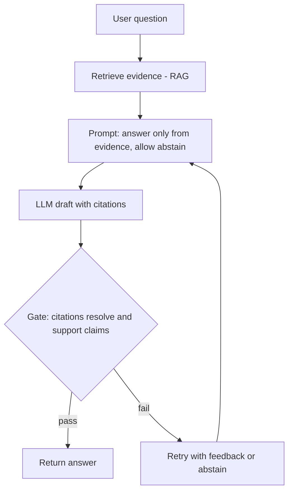

# LLM Hallucinations

> [!abstract] TL;DR
> A hallucination is output that is fluent and confident but ==not supported by the source, the context, or the world==. It is not a bug you can patch out: a next-token predictor trained to always give an answer will produce plausible guesses where it lacks knowledge. You manage it in layers: ground the model ([[Retrieval-Augmented Generation]]), let it abstain, validate outputs ([[Gate Checks]]), and measure the rate ([[LLM Evaluation]]).

**Prerequisites:** [[Large Language Models]] · [[Prompt Engineering]]
**Related:** [[Retrieval-Augmented Generation]] · [[Gate Checks]] · [[Output Validation]] · [[AI Reliability]] · [[Chain-of-Thought and ReAct]]

> [!note] Source scope
> This is a concept hub written for the vault, not a lecture summary. Everything here is *beyond the lecture*: standard material from the literature listed in [[#Further Reading]].

> [!todo]- Contents
> - [[#1. Core Concepts]]
> - [[#2. Why Models Hallucinate]]
> - [[#3. Mitigation Stack]]
> - [[#4. Hallucination in Agentic Systems]]
> - [[#5. Worked Example – Grounded Ticket Summary]]
> - [[#6. Pitfalls and Failure Modes]]
> - [[#7. Key Takeaways]]
> - [[#8. Critical Analysis]]
> - [[#9. Self-Test]]
> - [[#10. Glossary]]
> - [[#Further Reading]]

## 1. Core Concepts

> [!info]+ Definition – Hallucination
> Generated content that is presented as true but is unsupported by, or contradicts, the provided context (**intrinsic**) or verifiable world knowledge (**extrinsic**).

^def-hallucination

| Type | What it contradicts | Example |
|---|---|---|
| Intrinsic | The prompt or retrieved context | The summary says the outage lasted 2 h; the ticket says 20 min |
| Extrinsic | The world (can't be checked from the context) | A fabricated citation, API method, or case law |
| Factuality error | Known facts | Wrong capital, wrong date |
| Faithfulness error | The given source | Adds a cause the source never mentioned |
| Tool/action hallucination | The available tools | Calls a tool or argument that doesn't exist |

## 2. Why Models Hallucinate

- **Training objective.** Next-token likelihood rewards plausible text, not true text. ==The model has no built-in "I don't know" signal== unless training rewards abstention. ^why-objective
- **Evaluation incentives.** Benchmarks that score a wrong answer the same as "I don't know" reward guessing. Kalai et al. (2025) argue this is a main reason hallucination persists after post-training.
- **Knowledge gaps and cutoffs.** Rare facts (seen once or twice in training) are the most likely to be made up.
- **Exposure bias and error compounding.** One early wrong token conditions all later tokens. In a chain of $n$ steps with per-step accuracy $p$, end-to-end accuracy is roughly $p^n$ (see [[AI Reliability]]).
- **Context problems.** Long or noisy context: the model misses the relevant passage ("lost in the middle") and fills the gap.
- **Sycophancy.** The model follows a false premise in the question ("Why did the 2019 update break X?").

## 3. Mitigation Stack



| Layer | Technique | What it fixes | Cost |
|---|---|---|---|
| Input | [[Retrieval-Augmented Generation]], tool lookups | Knowledge gaps, stale facts | Retrieval infra, latency |
| Prompt | "Answer only from context; say *not found* otherwise"; [[Few-Shot Prompting]] with abstain examples | Guessing | Low |
| Decoding | Lower temperature, constrained / structured output | Random drift, format errors | Low; can reduce diversity |
| Reasoning | [[Chain-of-Thought and ReAct]], self-consistency | Multi-step errors | More tokens |
| Output | [[Gate Checks]], [[Output Validation]], citation checking, NLI entailment | Unsupported claims | Extra calls |
| Detection | SelfCheckGPT-style sampling agreement, LLM-as-judge | Unknown unknowns | $k$× generation cost |
| Process | Human review for high-stakes output | Residual risk | People time |

> [!tip] Abstention is a feature
> Give the model an explicit, cheap way out (`"answer": null, "reason": "not in sources"`). With [[Pydantic for Structured LLM Output - Study Guide|Pydantic]] you can make the field optional and then gate on it.

## 4. Hallucination in Agentic Systems

In [[AI Agents]], a hallucination doesn't just produce a wrong sentence. It can trigger a **wrong action**:
- Invented tool names or arguments → fix with strict schemas and good [[Tool Descriptions in Agentic Systems|tool descriptions]].
- Invented observations ("the file was saved") → the orchestrator, not the model, must report tool results ([[Chain-of-Thought and ReAct|ReAct]] observations come from the environment).
- Invented memory → retrieved memories need provenance (see [[AI Memory]]).
- Errors that persist across a chain → put [[Gate Checks]] between steps.

## 5. Worked Example – Grounded Ticket Summary

Task: summarize an incident ticket for an on-call handover (compare [[Sonar Ticket and Outage Classification - How-To]]).

```text
SYSTEM: You summarize incident tickets. Use ONLY the ticket text.
For every claim, cite the ticket line number like [L12].
If a field is not in the ticket, write "unknown". Do not infer root cause.

TICKET:
L1 2026-09-20 14:02 Alert: API p95 latency > 2s
L2 14:10 DB failover triggered
L3 14:22 Latency normal
```

- Hallucinated draft: "Root cause was a DB failover due to disk failure; resolved in 20 min." *Disk failure* has no source line → a citation gate fails.
- Fixed output: "Latency alert at 14:02 [L1]; DB failover 14:10 [L2]; normal by 14:22 [L3] (20 min). Root cause: unknown."

## 6. Pitfalls and Failure Modes

| Failure | Symptom | Mitigation |
|---|---|---|
| RAG ignored | Answer contradicts retrieved docs | Faithfulness gate; put evidence close to the question; cite-or-abstain |
| Fake citations | Citations look right but don't exist or don't support | Resolve every citation programmatically; entailment check |
| False-premise questions | Model "explains" a thing that never happened | Prompt the model to check the premise; few-shot examples of pushback |
| Over-abstention | Model says "unknown" to everything | Measure both error and abstain rates; tune the prompt |
| Judge shares the blind spot | LLM judge approves a fluent fabrication | Use a different model, reference answers, or human spot checks |
| Confidence ≠ correctness | Model says "definitely" when wrong | Don't use verbal confidence as a gate on its own; calibrate |

## 7. Key Takeaways

- [ ] I can tell intrinsic from extrinsic hallucination and faithfulness from factuality.
- [ ] I can explain why the training and evaluation objective encourages guessing.
- [ ] I can design a layered mitigation: ground → allow abstain → validate → measure.
- [ ] I know why an agentic hallucination is worse than a chat one (it triggers actions).
- [ ] I can compute how per-step error compounds over a chain.

## 8. Critical Analysis

- **"Hallucination" is a loose term.** It mixes retrieval failure, reasoning error, false premises, and outdated knowledge. Each needs a different fix, so diagnose before you mitigate.
- **Evidence quality.** Published hallucination rates depend heavily on the benchmark, domain and the definition of "supported". A vendor's "X% fewer hallucinations" rarely transfers to your domain. Measure on your own data.
- **RAG moves the problem.** It turns "the model doesn't know" into "retrieval must find the right passage and the model must use it". Retrieval misses become confident wrong answers.
- **At scale.** A 1% rate across 1M daily requests is 10,000 wrong answers a day. Tail risk dominates, so route by stakes.
- **Security.** Attackers can exploit hallucination: models invent package names, and attackers register them ("slopsquatting"). Injected documents can plant false facts that look grounded (see [[Prompt Injection]]).
- **Open questions:** Can a model be calibrated well enough that its own confidence is a usable gate? Is zero hallucination possible without giving up usefulness?

## 9. Self-Test

> [!question]- Q1. Intrinsic vs extrinsic – classify: a summary adds a date that's not in the source document, and the date is also wrong.
> Intrinsic (unsupported by the source) and also a factuality error. In a grounded task, faithfulness to the source is what you gate on first.

> [!question]- Q2. Quantitative – a 5-step agent chain has 97% per-step correctness. What's the end-to-end rate, and what per-step rate do you need for 95% overall?
> $0.97^5 \approx 0.859$. For 95%: $p = 0.95^{1/5} \approx 0.9898$, so about 99% per step.

> [!question]- Q3. Why do benchmarks that score accuracy only encourage hallucination?
> A guess has some chance of being right, and "I don't know" scores zero. So guessing maximizes expected score. Scoring that penalizes confident errors more than abstentions removes this incentive.

> [!question]- Q4. Design – a legal-research assistant keeps citing cases that don't exist. Propose three controls.
> (1) Answer only from a retrieved case database, with case IDs. (2) A gate that looks up every cited ID and rejects the answer if any fail. (3) An entailment check that the quoted holding appears in the case text, plus human review before filing.

> [!question]- Q5. Why is SelfCheckGPT-style sampling useful, and what does it miss?
> If the model knows a fact, repeated samples agree. Made-up facts vary between samples. It misses errors the model makes *consistently* (a wrong belief learned in training), and it costs $k$ extra generations.

> [!tip] Flashcards
> Review this topic with [[LLM Hallucinations - Flashcards]].

## 10. Glossary

| Term | Meaning |
|---|---|
| Faithfulness | Output is supported by the given source |
| Factuality | Output matches world knowledge |
| Abstention | Model declines to answer when it lacks support |
| Grounding | Tying generation to retrieved or provided evidence |
| Sycophancy | Agreeing with the user's framing even when it's false |
| Calibration | Stated confidence matches actual accuracy |

## Further Reading

- [Ji et al. (2023) – Survey of Hallucination in Natural Language Generation](https://arxiv.org/abs/2202.03629)
- [Kalai et al. (2025) – Why Language Models Hallucinate](https://arxiv.org/abs/2509.04664)
- [Manakul et al. (2023) – SelfCheckGPT](https://arxiv.org/abs/2303.08896)
- [Min et al. (2023) – FActScore](https://arxiv.org/abs/2305.14251)
- [Liu et al. (2023) – Lost in the Middle](https://arxiv.org/abs/2307.03172)

%% Study hint: link every mitigation back to one cause in §2. If you can't, it's a guess. %%
