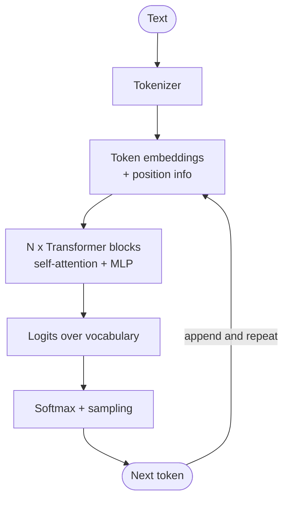

# Large Language Models

> [!abstract] TL;DR
> A large language model is a **transformer neural network** trained on huge text corpora to ==predict the next token==. It is then **post-trained** (instruction tuning, preference tuning, reinforcement learning) to follow instructions and reason. At inference it generates text autoregressively by **sampling** from a probability distribution, so it is ==probabilistic, stateless between calls, bounded by its context window and knowledge cutoff==. Prompting, RAG, tools, memory and agents are all **scaffolding** that compensates for these properties.

**Prerequisite:** [[Artificial Intelligence]]
**Related:** [[Prompt Engineering]] · [[Prompt Instruction Refinement]] · [[AI Agents]] · [[Agentic AI]] · [[LLM Hallucinations]] · [[Retrieval-Augmented Generation]] · [[LLM Evaluation]] · [[Chain-of-Thought and ReAct]]

**Sources:** This is a foundational synthesis note, *beyond the lecture*. It connects to the lecture statement in [[Prompt Instruction Refinement]] that LLMs are "probabilistic systems" that "don't read minds". Technical details come from the papers in [[#Further Reading]].

> [!todo]- Contents
> 1. [[#1. Core Concepts]]
> 2. [[#2. How an LLM Generates Text]]
> 3. [[#3. Training Lifecycle]]
> 4. [[#4. Decoding and Sampling]]
> 5. [[#5. Capabilities, Limits and the Scaffolding They Require]]
> 6. [[#6. Worked Example – Sizing a Model]]
> 7. [[#7. Pitfalls and Misconceptions]]
> 8. [[#8. Key Takeaways]]
> 9. [[#9. Critical Analysis]]
> 10. [[#10. Self-Test]]
> 11. [[#11. Glossary]]

---

## 1. Core Concepts

> [!info]+ Definition – Large language model
> A neural network, almost always a **decoder-only transformer**, with billions of parameters. It is trained to model $P(x_t \mid x_{<t})$, the probability of the next token given all previous tokens, and then adapted to follow instructions.

^def-llm

> [!info]+ Definition – Token
> The unit an LLM reads and writes: a sub-word chunk produced by a tokenizer (e.g. byte-pair encoding). In English, a rough rule is **~4 characters or ~¾ of a word per token**. Cost, context limits and some failure modes (spelling, counting letters) are all measured or caused at the token level.

^def-token

> [!info]+ Definition – Context window
> The maximum number of tokens (prompt + output) the model can attend to in one call. Anything outside it doesn't exist for the model. It is the model's only "working memory" ([[AI Memory]]).

^def-context-window

| Term | Meaning | Why you care |
|---|---|---|
| **Parameters** | Learned weights (e.g. 7B, 70B) | Memory footprint, cost, capability |
| **Pre-training corpus** | Web, books, code; trillions of tokens | Knowledge and biases |
| **Knowledge cutoff** | Date the training data ends | Stale facts → [[Retrieval-Augmented Generation|RAG]] or [[Tool Use|tools]] |
| **Inference** | Running the model to generate | Latency, cost per token |
| **Stateless** | No memory between API calls | You re-send the history every call |

---

## 2. How an LLM Generates Text

**Self-attention** lets every token weigh every earlier token:

$$
\text{Attention}(Q,K,V) = \text{softmax}\!\left(\frac{QK^\top}{\sqrt{d_k}}\right)V
$$

- Compute and memory grow as $O(n^2)$ in sequence length *n* for naive attention. That's one reason long context is expensive.
- Generation is **autoregressive**: one token per forward pass, each conditioned on everything before it. Output length drives latency.
- The **KV cache** stores past keys and values so they aren't recomputed. It's why long conversations use so much GPU memory ([[#6. Worked Example – Sizing a Model]]).

> [!note] Key intuition
> The model produces a probability distribution, not a lookup. ==Every answer is a sample==, which is why the same prompt can give different outputs and why evaluation needs multiple runs ([[LLM Evaluation]]).

^every-answer-is-a-sample

---

## 3. Training Lifecycle

| Stage | Objective | Data | Result |
|---|---|---|---|
| **Pre-training** | Next-token prediction (self-supervised) | Trillions of tokens of web, books, code | "Base model": broad knowledge, completes text, doesn't reliably follow instructions |
| **Supervised fine-tuning (SFT) / instruction tuning** | Imitate high-quality responses | Curated prompt→response pairs | Follows instructions, chat format |
| **Preference tuning** (RLHF, DPO, etc.) | Prefer outputs humans or AI judges rate higher | Pairwise comparisons | More helpful, harmless, better calibrated tone (Ouyang et al., 2022) |
| **RL for reasoning / tool use** | Reward correct outcomes on verifiable tasks | Math, code, agent environments | "Reasoning models" that think before answering; better tool use |

> [!info] Scaling laws (beyond the lecture)
> Loss falls predictably as a power law in parameters *N*, data *D* and compute *C* (Kaplan et al., 2020). Training compute is roughly
> $$C \approx 6ND \text{ FLOPs}$$
> Chinchilla (Hoffmann et al., 2022) showed many models were under-trained. The compute-optimal ratio is about ==20 training tokens per parameter==. Modern models deliberately train far past this, because smaller models that have seen more data are cheaper to *serve*.

^scaling-laws

---

## 4. Decoding and Sampling

The model outputs logits $z_i$. Temperature $\tau$ reshapes them before sampling:

$$
P(i) = \frac{e^{z_i/\tau}}{\sum_j e^{z_j/\tau}}
$$

| Setting | Effect | Use for |
|---|---|---|
| **Greedy / τ → 0** | Always the most likely token; near-deterministic | Extraction, classification, tool arguments |
| **Higher τ (e.g. 0.7–1.0)** | Flatter distribution; more diverse | Brainstorming, creative writing, self-consistency voting |
| **Top-k** | Sample only from the k most likely tokens | Cuts off the long tail |
| **Top-p (nucleus)** | Sample from the smallest set with cumulative probability ≥ p | Adaptive tail cut-off |
| **Structured / constrained decoding** | Only tokens valid under a grammar or JSON schema are allowed | Reliable tool calls and parseable output ([[Tool Descriptions in Agentic Systems]]) |

> [!warning] Temperature 0 isn't a guarantee
> Even at τ = 0, batching and floating-point non-determinism on GPUs can change outputs. Design pipelines to tolerate variation.

---

## 5. Capabilities, Limits and the Scaffolding They Require

Most of this course is about building around LLM limitations. This table maps each limitation to the vault note that addresses it:

| LLM property / limit | Consequence | Scaffolding | Vault note |
|---|---|---|---|
| Knowledge cutoff; no private data | Stale or missing facts | Retrieval, tools | [[Retrieval-Augmented Generation]], [[Tool Use]] |
| Generates plausible text, not verified truth | Hallucinations | Grounding, citations, verification | [[LLM Hallucinations]] |
| Stateless, finite context | Forgets across calls; "lost in the middle" | Memory stores, summarization, context curation | [[AI Memory]], [[Vector Databases]] |
| One forward pass per token | Weak on long multi-step problems without scratch work | CoT, reasoning models, decomposition | [[Chain-of-Thought and ReAct]], [[Prompt Chaining for Agentic Reasoning - Study Guide]] |
| Can't act on the world | Only produces text | Tool calling, agent loops | [[AI Agents]], [[Tool Descriptions in Agentic Systems]] |
| Follows whatever instructions are in context | Prompt injection | Privilege separation, least privilege | [[Prompt Injection]] |
| Stochastic output | Inconsistent results | Evals over many samples, voting, gates | [[LLM Evaluation]], [[AI Reliability]] |
| Tokenization artifacts | Poor at letter counting, some arithmetic | Code-execution tools | [[Tool Use]] |
| Sensitive to wording | Brittle prompts; not portable across models | Systematic prompt refinement | [[Prompt Engineering]], [[Prompt Instruction Refinement]] |

^limits-to-scaffolding

> [!tip] The mental model for this program
> ==LLM = a probabilistic reasoning engine with no memory, no senses and no hands.== Agentic AI adds the memory (stores), senses (retrieval, observations) and hands (tools), plus a control loop. See [[Agentic AI]].

---

## 6. Worked Example – Sizing a Model

**Question:** can you self-host a 7B-parameter model for an internal agent on a 24 GB GPU with 4k-token contexts?

| Item | Calculation | Result |
|---|---|---|
| Weights at FP16 (2 bytes/param) | $7\times10^9 \times 2$ | **14 GB** |
| Weights at 4-bit quantization | $7\times10^9 \times 0.5$ | **3.5 GB** |
| KV cache per sequence (32 layers, $d_{model}$ = 4096, FP16, no grouped-query attention) | $2 \times 32 \times 4096 \times 4096 \text{ tokens} \times 2 \text{ bytes}$ | **≈ 2.1 GB** |
| FP16 total, 4 concurrent sequences | $14 + 4 \times 2.1$ | **≈ 22.4 GB**, which is tight on 24 GB |

> [!example] Interpretation
> FP16 barely fits and leaves little room for concurrency. Quantization or grouped-query attention (which shrinks the KV cache) makes it practical. **Context length drives memory as much as model size does.** That's a real cost of stuffing long histories or many tool definitions into context.

**Training-compute check** (Chinchilla scale): 70B parameters × 1.4T tokens:
$C \approx 6 \times 7\times10^{10} \times 1.4\times10^{12} \approx 5.9\times10^{23}$ FLOPs.

---

## 7. Pitfalls and Misconceptions

| Misconception | Reality | Consequence if ignored |
|---|---|---|
| "The model looks things up" | It generates from learned patterns unless given retrieval or tools | Trusting ungrounded facts |
| "It remembers our last chat" | Stateless; the app re-sends the history | Missing context, privacy surprises |
| "Temperature 0 = deterministic" | Mostly, not guaranteed | Flaky tests |
| "Bigger context = it reads everything equally" | Mid-context information is used less reliably (Liu et al., 2023) | Buried instructions are ignored |
| "Visible reasoning = true reasoning" | CoT can be unfaithful ([[Chain-of-Thought and ReAct#Limitations of Chain-of-Thought]]) | Over-trusting explanations |
| "A prompt that works on model A works on model B" | Prompts aren't portable (A06) | Regressions on upgrade |
| "Benchmark score = my task performance" | Contamination, distribution shift | Bad model choice; build your own evals |

---

## 8. Key Takeaways

- [ ] An LLM is a transformer trained on next-token prediction, then post-trained to follow instructions.
- [ ] It works in **tokens**; cost, limits and some failures are token-level.
- [ ] Output is **sampled**: stochastic, so evaluate over many runs ([[#^every-answer-is-a-sample]]).
- [ ] Stateless, bounded context, knowledge cutoff, no actions. Each needs scaffolding ([[#^limits-to-scaffolding]]).
- [ ] Scaling: $C \approx 6ND$; Chinchilla-optimal ≈ 20 tokens per parameter.
- [ ] Temperature and top-p control diversity; structured decoding controls format.
- [ ] Memory needed = weights + KV cache, and the KV cache grows with context length.

---

## 9. Critical Analysis

- **"Just next-token prediction"?** The objective is simple, but predicting text well seems to require learning rich internal representations. There's an active debate between "stochastic parrot" and "emergent world model" views. For engineering, the useful position is: *capable but unverified*. Treat outputs as hypotheses.
- **Emergence claims.** Some "emergent abilities" appear to be artifacts of discontinuous metrics. Under smooth metrics, the improvement is gradual (Schaeffer et al., 2023). Be sceptical of claims that capabilities appear suddenly at scale.
- **Evaluation quality.** Public benchmarks suffer from **contamination** (test data in the training corpus) and saturation. For agentic work, task-specific evals on your own data matter more than leaderboard rank ([[LLM Evaluation]], [[Model Evaluation]]).
- **At scale.** Inference cost, not training, dominates for deployed agents. Agent loops multiply calls, so token efficiency (context curation, caching, smaller models for easy steps) is an architectural concern ([[Prompt Chaining for Agentic Reasoning - Study Guide#2. Why Chain – Trade-offs]]).
- **Security.** The same instruction-following that makes LLMs useful makes them injectable ([[Prompt Injection]]). Training data can carry biases and memorized sensitive data. Outputs need validation before they drive actions.

> [!question] Open questions
> 1. If reasoning models internalize CoT, which prompt-engineering techniques become obsolete, and which stay essential?
> 2. How should you choose between a large general model and a small fine-tuned model for one step of an agent pipeline?
> 3. What evidence would convince you that a model "understands" a domain rather than pattern-matching it?

---

## 10. Self-Test

> [!question]- Q1. What is the pre-training objective of an LLM?
> Next-token prediction: maximize $P(x_t \mid x_{<t})$ over a huge text corpus. It's self-supervised, because the text provides its own labels.

> [!question]- Q2. Why does the same prompt produce different answers?
> The model outputs a probability distribution and the answer is *sampled* from it. With temperature above 0 (and even at 0, because of hardware non-determinism) outputs vary.

> [!question]- Q3. Quantitative: how much memory do the weights of a 13B model need at FP16 and at 4-bit?
> FP16: $13\times10^9 \times 2 = 26$ GB. 4-bit: $13\times10^9 \times 0.5 = 6.5$ GB (plus KV cache and overhead).

> [!question]- Q4. Quantitative: under Chinchilla scaling, roughly how many training tokens for a compute-optimal 10B model, and how much compute?
> ≈ 20 × 10B = 200B tokens. $C \approx 6 \times 10^{10} \times 2\times10^{11} = 1.2\times10^{22}$ FLOPs.

> [!question]- Q5. Design: map three LLM limitations to agent components that compensate.
> Knowledge cutoff → RAG or search tools. Statelessness → memory store with retrieval. Can't act → tool calling within a ReAct loop. (Also: stochasticity → evals and voting; injection → privilege separation.)

> [!question]- Q6. Why does a longer context increase serving cost beyond token pricing?
> Attention compute grows (up to quadratically) with sequence length, and the KV cache grows linearly with it. That uses GPU memory and reduces how many requests can run concurrently.

### Flashcards
> [!tip] Spaced repetition deck
> The flashcards for this note are in [[Large Language Models - Flashcards]]. Review them with the **Review flashcards** ribbon icon (or the command palette → *Spaced Repetition: Review flashcards*).

---

## 11. Glossary

| Term | Definition |
|---|---|
| **Transformer** | Neural architecture built on self-attention (Vaswani et al., 2017) |
| **Token** | Sub-word unit of text the model processes |
| **Logits** | Raw scores over the vocabulary before softmax |
| **Autoregressive** | Generating one token at a time, each conditioned on the previous ones |
| **KV cache** | Stored attention keys and values for past tokens, reused during generation |
| **SFT** | Supervised fine-tuning on instruction→response pairs |
| **RLHF / DPO** | Preference-based post-training methods |
| **Quantization** | Storing weights at lower precision (e.g. 4-bit) to save memory |
| **Contamination** | Benchmark test data leaking into training data |

---

## Further Reading
- [Attention Is All You Need](https://arxiv.org/abs/1706.03762), Vaswani et al., 2017
- [Language Models are Few-Shot Learners](https://arxiv.org/abs/2005.14165), Brown et al., 2020
- [Scaling Laws for Neural Language Models](https://arxiv.org/abs/2001.08361), Kaplan et al., 2020
- [Training Compute-Optimal Large Language Models (Chinchilla)](https://arxiv.org/abs/2203.15556), Hoffmann et al., 2022
- [Training language models to follow instructions with human feedback (InstructGPT)](https://arxiv.org/abs/2203.02155), Ouyang et al., 2022
- [Lost in the Middle](https://arxiv.org/abs/2307.03172), Liu et al., 2023
- [Are Emergent Abilities of Large Language Models a Mirage?](https://arxiv.org/abs/2304.15004), Schaeffer et al., 2023

%% Study hint: the limits-to-scaffolding table (section 5) is the map of the whole course. Revisit it after each new note. %%
