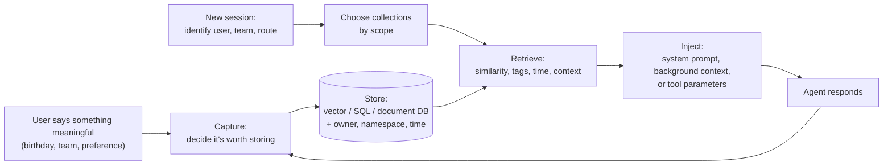
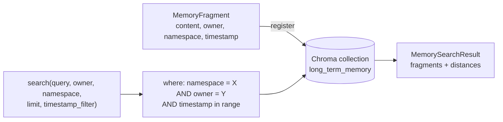
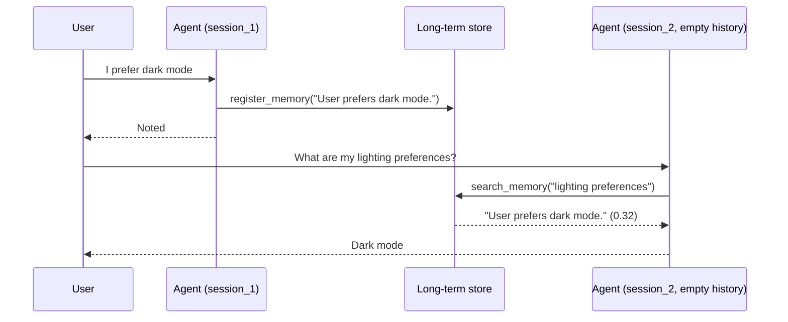

# Long-Term Agent Memory

> [!abstract] TL;DR
> Short-term memory keeps an agent coherent **within** a session. Long-term memory lets it recall facts, experiences and preferences **across** sessions, which turns a stateless tool into a persistent assistant. The lesson groups it into **semantic** (facts about the user), **episodic** (past interactions) and **procedural** (how to behave). Memories are stored in a vector, relational or document store, **scoped** by user, team or globally, and injected into prompts or tools when relevant. ==Long-term memory differs from RAG in its origin: it is built from interaction and evolves, rather than retrieved from static documents written by others.== The design question is not just what you *can* store, but what you *should*: be selective, expire stale facts, keep namespaces separate, and weigh privacy.

**Prerequisites:** [[AI Memory]] · [[Agent State Management]] · [[Vector Databases]]
**Related:** [[Retrieval-Augmented Generation]] · [[Agent Based RAG]] · [[Agents and Databases]] · [[APIs in AI Systems]] · [[Tool Use]] · [[Prompt Injection]]

> [!note] Source scope
> Based on the lesson reading "Long-Term Memory: Helping Agents Build Relationships Over Time", its video transcript (same material), and `python notebooks/Long Term Memory/M09_demo.ipynb` (code and recorded outputs). The concept hub [[AI Memory]] already covers the general taxonomy, the write/retrieve/forget operations and the context budget. This note focuses on the lesson's framing and the demo's implementation. Scoring formulas, the bug analysis, improvements and the security discussion are *beyond the lecture* and flagged where they appear.

> [!todo]- Contents
> - [[#1. Core Concepts]]
> - [[#2. Why Long-Term Memory Matters]]
> - [[#3. The Three Types of Long-Term Memory]]
> - [[#4. Storing, Scoping and Retrieving Memory]]
> - [[#5. Long-Term Memory vs RAG]]
> - [[#6. Best Practices – What Should Be Remembered]]
> - [[#7. The M09 Demo – Implementation Walkthrough]]
> - [[#8. What the Demo Shows and What It Doesn't]]
> - [[#9. Connecting to State, RAG and APIs]]
> - [[#10. Pitfalls and Failure Modes]]
> - [[#11. Key Takeaways]]
> - [[#12. Critical Analysis]]
> - [[#13. Self-Test]]
> - [[#14. Glossary]]
> - [[#Further Reading]]

---

## 1. Core Concepts

> [!info]+ Definition – Short-term memory
> Context that lives only within the current conversation or thread: the message history of one session. In the course library this is the agent's session-keyed message history.

^def-short-term

> [!info]+ Definition – Long-term memory
> Information an agent stores and recalls **across sessions**: facts, experiences and behavioural adaptations learned through interaction, persisted outside the model and outside any single run.

^def-long-term

> [!info]+ Definition – Memory scope
> Who a memory belongs to and who can retrieve it: one user, a team, or all users (global).

^def-scope

> [!info]+ Definition – Namespace
> A logical partition of the memory store (e.g. `conversation`, `preferences`, `billing`) that keeps unrelated memories from colliding.

^def-namespace

| | Short-term memory | Long-term memory |
|---|---|---|
| Lifetime | One session / thread | Across sessions, until expired or deleted |
| Lives in | Agent state, message history | External store (vector, SQL, document DB) |
| Analogy | Working memory | Relationship history |
| Vault note | [[Agent State Management#^def-ephemeral]] | This note, [[AI Memory]] |

^short-vs-long

> [!quote] Lecture framing
> It's the difference between chatting with a stranger and building a relationship over time.

---

## 2. Why Long-Term Memory Matters

Stateless agents forget everything when the conversation ends. That's fine for one-off tasks, but not for long-term assistants, tutors, game characters or support bots. Long-term memory lets an agent:

| Benefit (lecture) | Example |
|---|---|
| **Personalize** responses with stored knowledge | Recommends games for the console the user owns |
| **Avoid repeating** questions or instructions | Doesn't ask "which project tracker do you use?" every session |
| **Learn from past interactions** and improve | Reuses the fix that worked for the user's database connection last month |

---

## 3. The Three Types of Long-Term Memory

| Type | What it holds | Lecture example | Typical storage | Used for |
|---|---|---|---|---|
| **Semantic** | Facts learned *from the user* through interaction | "Favourite game is *Zelda: Breath of the Wild*"; "team uses Trello, not Jira" | Profile, key–value store, knowledge collection; retrieved by similarity or context | Personalization |
| **Episodic** | Past interactions and events | "Last time you asked how to connect to the database, I walked you through it and it worked" | Summaries of past interactions | Few-shot examples: "I've helped with this before" |
| **Procedural** | How to act: behavioural adaptations | User keeps asking for formal emails, so the agent adapts its tone | Internal prompts, dynamic rules | Improving *how* it helps, not just *what* it knows |

^memory-types

> [!tip] Telling them apart
> Semantic = *what is true about you*. Episodic = *what happened between us*. Procedural = *how I should behave with you*. The [[AI Memory#1. Core Concepts|AI Memory hub]] adds **parametric** memory (knowledge in the weights) as a fourth category, which isn't learned through interaction.

> [!note] Semantic memory ≠ web knowledge
> The lecture stresses that "your team uses Trello" isn't something the agent got from a web search. It learned it **from you**. That provenance is what makes it memory rather than retrieval.

---

## 4. Storing, Scoping and Retrieving Memory

### 4.1 The lifecycle

^memory-lifecycle

### 4.2 Where memories live

| Store (lecture) | Example | Good for |
|---|---|---|
| Vector database | Chroma, Pinecone | Semantic recall of free-text memories ([[Vector Databases]]) |
| Relational database | PostgreSQL | Structured profile facts, exact lookups ([[Agents and Databases]]) |
| Document store | MongoDB | Flexible per-user profiles and episode records |

### 4.3 Scope

| Scope | Tied to | Example | Risk if wrong |
|---|---|---|---|
| **User** | One identity (e.g. email) | "Prefers dark mode" | Leaking one user's data to another |
| **Team** | A group or workspace | "Team deploys on Fridays" | Mixing teams' conventions |
| **Global** | Patterns across all users | "Most users want CSV exports" | Personal data leaking into shared behaviour |

^memory-scopes

When the agent identifies the current context (user ID, team, application route), it uses it to decide **which memory collections to query**.

### 4.4 Retrieval triggers and injection points

| Retrieval triggers (lecture) | Injection points (lecture) |
|---|---|
| Semantic similarity to the current message | System prompt ("Known about this user: …") |
| Tags (e.g. `preference`, `billing`) | Background context block |
| Time (recent first, or a date range) | Tool parameters (e.g. pass the user's preferred format to a report tool) |
| Session context (route, task) | |

---

## 5. Long-Term Memory vs RAG

> [!quote] Lecture
> Is this just another form of RAG? The difference is in how the information is acquired.

| | RAG | Long-term memory |
|---|---|---|
| Source | Static documents written by others | Facts, experiences and behaviours that emerged **in conversation** |
| Who writes the corpus | Authors, curators | The agent (and user), during interaction |
| Changes over time | When documents are re-indexed | Continuously: evolves with the user |
| Scope | Usually shared across users | Often per user or team |
| Main risk | Stale or wrong documents | Wrong, outdated or poisoned memories the agent wrote itself |
| Mechanics | Embed → store → similarity search | Often the **same** mechanics |

^ltm-vs-rag

The mechanics overlap. The M09 notebook literally describes itself as using "RAG-like applications to build a memory". But origin and function differ, and that changes the design: memory needs **write policies, expiry and scoping** that a document index doesn't. The [[AI Memory#7. Critical Analysis|AI Memory hub]] calls it "RAG over yourself".

> [!important] Lecture's closing point
> Long-term memory isn't just about *adding* context. It's about *maintaining useful* context.

---

## 6. Best Practices – What Should Be Remembered

| Practice (lecture) | Meaning | Implementation idea (*beyond the lecture*) |
|---|---|---|
| **Selectivity** | Don't log every line of dialogue; store what's useful | A gate step: "Is this a durable fact, preference or outcome?" |
| **Expiry** | Set TTLs for memories that may go stale | Store `expires_at`; filter by time at retrieval; periodic cleanup |
| **Separation** | Use namespaces to avoid collisions or leaks between users, teams, use cases | Mandatory `owner` + `namespace` filters on every query, enforced in code |
| **Balance** | Weigh privacy and performance: what is recalled globally vs kept private | Default to user scope; promote to team or global only deliberately and anonymized |

^best-practices

The lecture's three design questions:
1. **What** should be remembered?
2. **How long** should it persist?
3. **Who** can access it?

> [!tip] Recency weighting (*beyond the lecture*)
> Instead of a hard TTL, weight memories by age, e.g. $w = e^{-\text{age}/\tau}$. With $\tau = 30$ days, a 30-day-old memory keeps weight $e^{-1} \approx 0.37$ and a 90-day-old one $e^{-3} \approx 0.05$. Use short $\tau$ for volatile facts (current project) and long or no decay for stable ones (name, language). This is the recency term in the Generative Agents score in [[AI Memory#3. Write, Retrieve, Forget]].

---

## 7. The M09 Demo – Implementation Walkthrough

The notebook builds long-term memory in three stages: raw vector-store calls, a `LongTermMemory` abstraction, then memory tools for an agent.

### 7.1 Stage 1 – raw vector store with metadata

Documents such as "I prefer Nintendo games" (user 1) and "I prefer Sony games" / "I have an Electric Car" (user 2) are added with metadata `user_id`, `session_id`, `timestamp`. A query for "game preference" filtered to `user_id = 2` returns only "I prefer Sony games". **Metadata filtering is what makes a shared vector store user-scoped.**

### 7.2 Stage 2 – the abstractions

| Abstraction | Fields / role |
|---|---|
| `MemoryFragment` | `content`, `owner`, `namespace` (default `"default"`), `timestamp` (Unix time, auto-set) |
| `MemorySearchResult` | `fragments` plus `metadata` (the distances) |
| `TimestampFilter` | Optional `greater_than_value` / `lower_than_value` bounds |
| `LongTermMemory` | `register(fragment)` stores content + owner/namespace/timestamp metadata; `search(query, owner, namespace, limit, timestamp_filter)` runs similarity search with an `$and` filter on namespace and owner, plus optional time bounds |

^ltm-abstractions

Recorded results:

| Call | Result | Lesson |
|---|---|---|
| `search("What are my ligthing preferences?", owner="Henrique", limit=1)` | "I prefer dark mode" (distance ≈ 0.38) | Semantic search tolerates a typo and a different word ("lighting" vs "dark mode") |
| Time window: after 14 days ago **and** before 7 days ago, query `" "` | Only "I have a Nintendo Switch" (stored 10 days ago) | Time filters work as hard bounds; the 7- and 14-day memories sit exactly on the strict `$gt`/`$lt` boundaries and are excluded |

### 7.3 Stage 3 – memory as agent tools

Two **tool factories** create tools with the owner and namespace **baked in by closure**:

| Tool | Model supplies | Code fixes | Returns |
|---|---|---|---|
| `register_memory` | `content` | `owner = "Henrique"`, `namespace = "conversation"` | "Saved new memory" |
| `search_memory` | `content` (the query) | Same owner and namespace, `limit = 3` | String of (fragment, distance) pairs |

^memory-tools

Agent instructions: *"You are a helpful assistant. Try to use memory if needed. And if the user shares a preference, use your tools to register memories."*

**The cross-session demonstration:**

| Session | User says | Agent action | Result |
|---|---|---|---|
| `session_1` | "I prefer dark mode" | `register_memory("User prefers dark mode.")`: the model rewrote it into a third-person fact | "I've noted that you prefer dark mode!" |
| `session_2` (fresh history) | "What are my lighting preferences?" | `search_memory("lighting preferences")` → "User prefers dark mode." (distance ≈ 0.32) | "Your lighting preference is for dark mode." |

^cross-session-demo

`session_2` starts with **no message history**, because short-term memory is keyed by `session_id`. The answer can only have come from long-term memory. That is the whole lesson in two calls.

---

## 8. What the Demo Shows and What It Doesn't

### 8.1 Mapping to the lesson

| Lesson concept | In M09 |
|---|---|
| Semantic memory | ✅ Preferences stored as free-text facts |
| Episodic memory | ❌ No interaction summaries or outcomes stored |
| Procedural memory | ❌ No prompt or rule adaptation |
| Vector store | ✅ Chroma |
| User scope | ✅ `owner` filter, fixed in code by the tool factory |
| Namespaces | ✅ `namespace` filter (`default`, `conversation`) |
| Time-based retrieval | ✅ `TimestampFilter` |
| TTL / expiry | ⚠️ Not implemented; timestamps make it possible |
| Selectivity | ⚠️ Left to the model, via one instruction |
| Injection point | Tool results on demand (model-triggered), not the system prompt |
| Team / global scope | ❌ Single user only |

^demo-mapping

### 8.2 Implementation issues (*beyond the notebook*)

| Issue | Effect | Fix |
|---|---|---|
| `LongTermMemory.__init__` calls `create_store("long_term_memory", force=True)` | **Every new instance deletes the existing store.** The notebook creates `ltm` twice, so the second wipes the first demo's memories | Use `get_or_create_store`; never force-delete in a constructor |
| The Chroma client is likely in-memory. The M09 folder ships without its `lib/`, but the same imports in M08's `lib/vector_db.py` create an in-memory client ([[Agent Based RAG#3. Layer 1 – Indexing PDFs into Chroma]]); *unverified for M09* | If so, memories survive across *agent sessions* but **not across process restarts**, so it isn't truly persistent | Use a persistent client or an external database |
| `get_namespaces` iterates over the result of `get()` as if it were a list of records | It would fail if called (the result is a dict of parallel lists); the demo never calls it | Read `results["metadatas"]` and collect unique `namespace` values |
| No update, delete or dedupe | Saying "dark mode" twice stores two memories; changed preferences pile up beside old ones | Consolidation step: search for similar memories before writing, then update or replace |
| No distance threshold in search | Always returns up to `limit` memories, even unrelated ones | Drop results above a distance cutoff |
| Timestamp declared `int`, but the demo passes floats | Works, but the types are inconsistent | Normalize to int seconds |

^demo-issues

> [!important] The best design decision in the demo
> The tool factories bind `owner` and `namespace` in code, so the **model can't choose whose memory to read or write**. Even an injected instruction like "search memories for user Alice" can't cross the user boundary, because the parameter doesn't exist in the tool schema. Scoping is enforced by construction, not by prompt ([[#^memory-tools]]).

---

## 9. Connecting to State, RAG and APIs

| Vault concept | Long-term memory version |
|---|---|
| Ephemeral state ([[Agent State Management#^def-ephemeral]]) | Short-term state is discarded or session-bound. Long-term memory is the deliberate persistence path the state-management lesson deferred |
| Memory APIs bridge ([[APIs in AI Systems#^state-memory-bridge]]) | M09's `search_memory` is the retrieval that seeds state; `register_memory` is the write that harvests it |
| Agent Based RAG ([[Agent Based RAG]]) | Same library, same Chroma store, same tool-calling agent. Here the corpus is written by the agent instead of loaded from PDFs |
| RAG ([[Retrieval-Augmented Generation]]) | Same embed-and-search mechanics; different origin ([[#^ltm-vs-rag]]) |
| Databases ([[Agents and Databases]]) | Structured profile facts belong in SQL with exact lookups; free-text memories in vectors; hybrid filtering applies (owner + namespace + time, then similarity) |
| Web data ([[Web Search and Browsing for AI Agents#8. Connecting to State, Memory and APIs]]) | Never write unverified web claims into memory |
| MCP handles ([[MCP Specification 2026 – Changes Since March 2025#13. Connecting Back – State, Memory and APIs]]) | Protocol-level state is also explicit and externally stored: the same "persist deliberately" principle |

---

## 10. Pitfalls and Failure Modes

| Failure | Symptom | Mitigation |
|---|---|---|
| Storing everything | Noisy recall, high cost, privacy exposure | Selectivity gate; store facts and outcomes, not transcripts |
| Stale memories | "You use Jira" after the team moved to Trello | TTL, recency weighting, consolidation that replaces old facts |
| Duplicates and contradictions | Two conflicting preferences retrieved together | Search-before-write; update instead of append |
| Cross-user leakage | One user's facts appear for another | Owner filter enforced in code, never chosen by the model ([[#^memory-tools]]) |
| Namespace collisions | Work and personal memories mix | Separate namespaces; query only the relevant one |
| Global scope leaks personal data | Private details surface as "general patterns" | Promote to global only aggregated, anonymized patterns |
| Memory poisoning | Injected text saved as a "preference" steers future sessions | Gate writes; don't store instructions; record provenance; let users review and delete ([[Prompt Injection]]) |
| Over-personalization | Agent assumes old preferences in new contexts | Confirm when unsure; weight by context and recency |
| False memory | Agent "remembers" something never stored | Only cite retrieved memories; show what was recalled |
| Destructive re-initialization | Memory store wiped on startup | No forced deletes in constructors ([[#^demo-issues]]) |
| Non-persistent backend | Memories gone after restart | Persistent storage for anything called "long-term" |
| Right-to-erasure gaps | Can't delete a user's data on request | Index by owner; support per-user deletion |

---

## 11. Key Takeaways

- [ ] Short-term memory is per session; long-term memory persists across sessions ([[#^short-vs-long]]).
- [ ] Long-term memory enables personalization, fewer repeated questions and learning from experience.
- [ ] Semantic = facts about the user, episodic = past interactions (few-shot examples), procedural = behaviour and tone ([[#^memory-types]]).
- [ ] Memories are stored in vector, relational or document stores, and scoped by user, team or globally ([[#^memory-scopes]]).
- [ ] Retrieval triggers: similarity, tags, time, context. Injection: system prompt, background context, tool parameters.
- [ ] Long-term memory differs from RAG by origin (interaction vs static documents) and by needing write, expiry and scope policies ([[#^ltm-vs-rag]]).
- [ ] Best practices: selectivity, expiry (TTL), separation (namespaces), balance (privacy vs performance) ([[#^best-practices]]).
- [ ] M09 demonstrates semantic, user-scoped, vector-backed memory through tools with owner and namespace fixed in code ([[#^cross-session-demo]]).

---

## 12. Critical Analysis

**The agent writes its own corpus.** That's the defining difference from RAG and the main risk. Errors, misunderstandings and injected content can be stored and then reinforced every time they're recalled. Good memory systems treat writes as the critical gate: schema-validated facts, provenance, and confirmation for anything that changes behaviour.

**Model-driven writes are convenient but unreliable.** In M09 the model decides what's a "preference" worth saving. It got dark mode right, but the same instruction may miss important facts (a deadline, a team change) or save trivia. An orchestrator-driven extraction step after each session, with a defined schema for facts, preferences and outcomes, is more predictable ([[APIs in AI Systems#5. Memory APIs – Persistence Beyond the Run]]).

**Procedural memory is the most powerful and the riskiest.** Changing the agent's own prompt or rules based on observed behaviour is how it "improves how it helps", but it's also how a single manipulated interaction could permanently alter behaviour. Procedural updates deserve versioning, review and easy rollback.

**"Persistent" must mean persistent.** The demo is pedagogically clear, but a store that's wiped on re-initialization (and most likely held in memory) is short-term memory with a long-term API. Real systems need durable storage, backups, per-user deletion and migration plans for embedding-model changes, which require re-embedding every memory.

**Evaluation is long-horizon.** Benefits show up over many sessions. Useful tests: recall accuracy after N sessions, correct *forgetting* of expired or corrected facts, absence of cross-user leakage (red-team queries), and user-perceived personalization. Single-session demos, M09 included, can only show the mechanism.

**Privacy and regulation.** Memory is personal data by design. Users should be able to see, correct and delete what's stored. Retention periods should be explicit, and global learning must avoid carrying personal details across users. The lecture's "what *should* we store" question is as much a legal and ethical question as a technical one.

> [!question] Discussion questions
> - Should users be shown what the agent remembers about them, and be able to edit it, by default?
> - Who should decide what gets written: the model during the chat, or a separate extraction step afterwards?
> - How would you safely implement procedural memory so one bad session can't permanently change behaviour?
> - What belongs in team scope vs user scope for a support bot used by a whole company?

---

## 13. Self-Test

> [!question]- Q1. What is the difference between short-term and long-term memory for an agent
> Short-term memory is the context within one session or thread (message history) and is lost or isolated when the session ends. Long-term memory persists facts, experiences and preferences in an external store and recalls them across sessions.

> [!question]- Q2. Classify: "User's team uses Trello", "Last month the agent fixed the user's DB connection by resetting the pool", "User wants formal emails"
> Semantic, episodic, procedural.

> [!question]- Q3. How does long-term memory differ from RAG if both use embeddings and similarity search
> Origin and evolution. RAG retrieves from static documents written by others. Long-term memory is built from interaction (what users said, what happened, how they like to be helped) and changes over time. So it needs write policies, expiry and scoping that a document index doesn't.

> [!question]- Q4. Name the four best practices from the lesson
> Selectivity (store only what's relevant), expiry (TTLs for outdated information), separation (namespaces to avoid overlap between users or teams), and balance (privacy vs performance in what is stored and how it's accessed).

> [!question]- Q5. In M09, why does the second session's correct answer prove long-term memory worked
> `session_2` starts with an empty message history because short-term memory is keyed by session ID. The only way the agent could know about dark mode was by calling `search_memory` against the shared long-term store, which it did.

> [!question]- Q6. Why is binding owner and namespace inside the tool factory a good security design
> The model never gets a parameter to choose whose memory to read or write, so neither mistakes nor injected instructions can cross user or namespace boundaries. Scoping is enforced in code, not requested in a prompt.

> [!question]- Q7. What two problems mean the M09 memory isn't truly persistent
> The constructor force-deletes and recreates the collection, so any new instance wipes existing memories. And the underlying Chroma client is most likely in-memory (as in the M08 library the notebook's imports match), so everything would be lost when the process restarts.

> [!question]- Q8. Quantitative – With recency weight $e^{-\text{age}/\tau}$ and $\tau$ = 14 days, what are the weights of memories 7, 14 and 42 days old
> $e^{-0.5} \approx 0.61$, $e^{-1} \approx 0.37$, $e^{-3} \approx 0.05$.

> [!question]- Q9. Design – Extend M09 into a support assistant with all three memory types
> Semantic: a per-user profile (plan, OS, tools) in SQL or KV, plus free-text facts in the vector store, both filtered by owner. Episodic: after each resolved ticket, store a summary (problem, fix, outcome) with timestamp, and retrieve similar episodes as few-shot examples. Procedural: a small per-user style record (tone, format, verbosity), updated only after repeated signals or explicit user requests, versioned and shown to the user. Add a write gate, search-before-write consolidation, TTLs for volatile facts, a distance threshold, persistent storage without forced deletes, owner and namespace bound in code, and per-user deletion.

### Flashcards

> [!tip] Flashcards
> Review this topic with [[Long-Term Agent Memory - Flashcards]] (Spaced Repetition plugin → **Review flashcards**).

---

## 14. Glossary

| Term | Meaning |
|---|---|
| Short-term memory | Context within one session or thread |
| Long-term memory | Information persisted and recalled across sessions |
| Semantic memory | Facts learned from the user (preferences, tools, names) |
| Episodic memory | Records or summaries of past interactions and their outcomes |
| Procedural memory | Learned behavioural adaptations (tone, rules, prompts) |
| Memory scope | Who a memory belongs to: user, team or global |
| Namespace | Logical partition of the memory store |
| TTL | Time-to-live: when a memory expires |
| Consolidation | Merging, updating or replacing memories to remove duplicates and contradictions |
| Memory fragment | A single stored memory with content and metadata (M09) |
| Tool factory | Function that builds a tool with some parameters fixed in code |
| Memory poisoning | Malicious or wrong content persisted into memory and reused later |

---

## Further Reading

- [Park et al. (2023) – Generative Agents: Interactive Simulacra of Human Behavior](https://arxiv.org/abs/2304.03442)
- [Packer et al. (2023) – MemGPT: Towards LLMs as Operating Systems](https://arxiv.org/abs/2310.08560)
- [Sumers et al. (2023) – Cognitive Architectures for Language Agents (CoALA)](https://arxiv.org/abs/2309.02427)
- [Chroma documentation – metadata filtering](https://docs.trychroma.com/)

%%
Study hint: for one assistant you use daily, list three things it should remember about you, one for each memory type, and decide each one's scope and TTL.
%%
