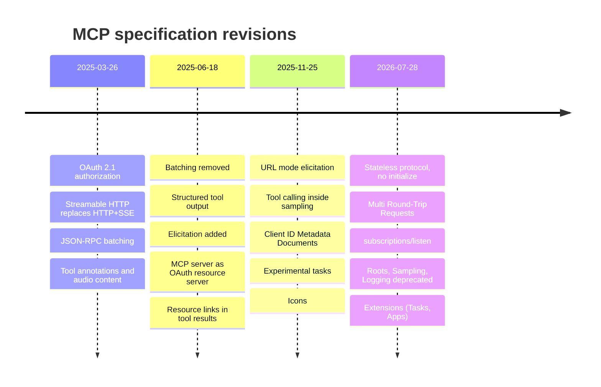
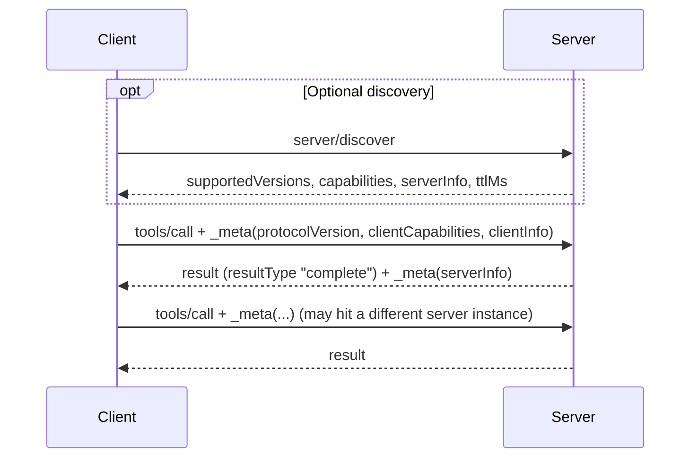
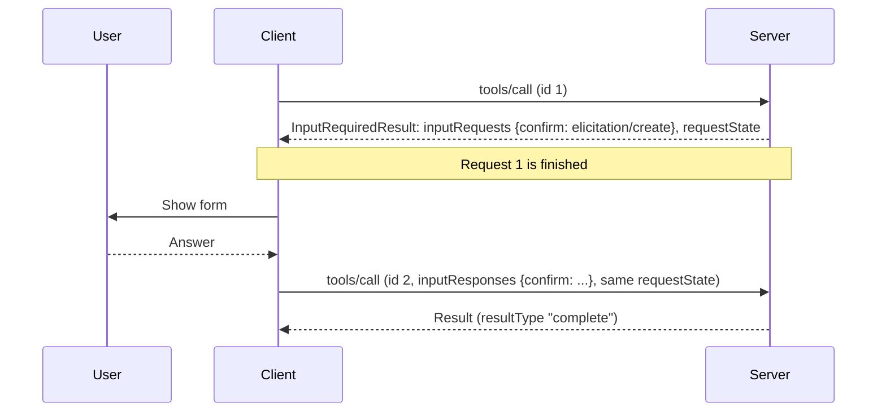
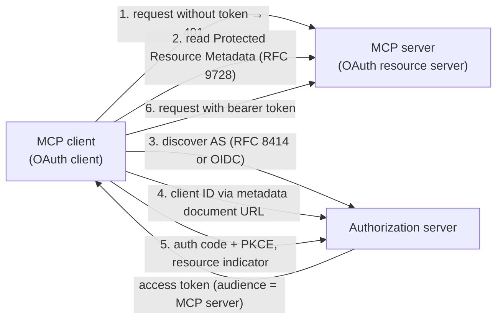

# MCP Specification 2026 – Changes Since March 2025

> [!abstract] TL;DR
> In sixteen months the Model Context Protocol went from a **stateful, session-based protocol** (2025-03-26) to a **stateless, request-scoped one** (2026-07-28). ==The `initialize` handshake and protocol sessions are gone. Every request now carries its own version and capabilities, and any state that spans calls must be passed explicitly as a handle.== Server-initiated requests were replaced by the Multi Round-Trip Requests pattern. Sampling, Roots and Logging are deprecated, elicitation is the main client feature, and long-running tasks and interactive UIs moved into opt-in extensions. Underneath, the protocol now follows the same rule as the [[Agent State Management|agent state]] lesson: whoever needs the state carries it.

**Prerequisites:** [[Model Context Protocol]] · [[Tool Use]]
**Related:** [[APIs in AI Systems]] · [[Agent State Management]] · [[AI Memory]] · [[Runtime or Orchestration Layer]] · [[Prompt Injection]]

> [!note] Source scope
> Based on the official specification pages for [2026-07-28](https://modelcontextprotocol.io/specification/2026-07-28) and [2025-03-26](https://modelcontextprotocol.io/specification/2025-03-26), plus the changelogs for the two revisions in between ([2025-06-18](https://modelcontextprotocol.io/specification/2025-06-18/changelog), [2025-11-25](https://modelcontextprotocol.io/specification/2025-11-25/changelog)) and the [2026-07-28 changelog](https://modelcontextprotocol.io/specification/2026-07-28/changelog). Read 2026-10-05. Interpretation and analysis (marked *analysis*) are mine, not the spec's. For the protocol basics (roles, primitives, risks), start with the [[Model Context Protocol]] hub note, which is updated to the 2026-07-28 spec.

> [!todo]- Contents
> - [[#1. The Short Version]]
> - [[#2. Timeline – Four Revisions]]
> - [[#3. Side-by-Side Comparison]]
> - [[#4. The Big Shift – From Sessions to Stateless Requests]]
> - [[#5. Multi Round-Trip Requests]]
> - [[#6. Subscriptions Replace the GET Stream]]
> - [[#7. Server Features in 2026]]
> - [[#8. Client Features – Elicitation Up, Sampling and Roots Down]]
> - [[#9. Transports]]
> - [[#10. Authorization]]
> - [[#11. Extensions]]
> - [[#12. Deprecations and Governance]]
> - [[#13. Connecting Back – State, Memory and APIs]]
> - [[#14. Migration Checklist]]
> - [[#15. Critical Analysis]]
> - [[#16. Review Questions]]
> - [[#17. Glossary]]
> - [[#Further Reading]]

---

## 1. The Short Version

| If you learned MCP in March 2025… | …in July 2026 it works like this |
|---|---|
| Client sends `initialize`, server replies, client sends `initialized` | No handshake. Each request carries protocol version, client capabilities and client info in `_meta` |
| A connection (or `Mcp-Session-Id`) was a session | No protocol sessions. A connection is just a pipe; cross-call state uses explicit handles |
| Servers could send requests to the client at any time (`sampling/createMessage`, `roots/list`) | Servers return `InputRequiredResult`; the client gathers input and **retries** the original request |
| Sampling was the headline client feature | Sampling is **deprecated**. Elicitation (form and URL modes) is the main client feature |
| GET endpoint and `resources/subscribe` for push notifications | One `subscriptions/listen` request whose response is a notification stream |
| `logging/setLevel`, `ping` | Removed. Log level is set per request in `_meta` (and Logging itself is deprecated) |
| Experimental features lived in core | Optional **extensions** (Tasks, MCP Apps, Skills, auth extensions), negotiated via capabilities |
| OAuth 2.1 with the MCP server's own metadata and default endpoints | MCP server is an OAuth **resource server**, uses Protected Resource Metadata, and clients register via Client ID Metadata Documents |

---

## 2. Timeline – Four Revisions



^timeline

The two middle revisions are bridges. Several 2026 changes reverse or reshape 2025 additions:

| Added in | Feature | What happened by 2026-07-28 |
|---|---|---|
| 2025-03-26 | JSON-RPC batching | Removed in 2025-06-18 |
| 2025-03-26 | `Mcp-Session-Id` sessions, SSE resumability (`Last-Event-ID`) | Both removed |
| 2025-06-18 | Elicitation (server-initiated request) | Kept, but now delivered through MRTR |
| 2025-11-25 | Experimental tasks in core (`tasks/result`, `tasks/list`) | Moved to the Tasks extension; blocking `tasks/result` replaced by polling `tasks/get` plus `tasks/update`; `tasks/list` removed |
| 2025-11-25 | URL-mode elicitation's `elicitationId` and `notifications/elicitation/complete` | Removed; the client learns the outcome by retrying |
| 2025-11-25 | Tool calling inside sampling | Sampling as a whole now deprecated |
| 2025-11-25 | Client ID Metadata Documents (recommended) | Now the preferred registration method; Dynamic Client Registration deprecated |

---

## 3. Side-by-Side Comparison

| Area | 2025-03-26 | 2026-07-28 |
|---|---|---|
| Message format | JSON-RPC 2.0; implementations MUST accept batches | JSON-RPC 2.0; no batching; every result has a required `resultType` (`"complete"` or `"input_required"`) |
| Connection model | Stateful connections | Stateless, self-contained requests |
| Lifecycle | `initialize` → `initialized` → operation → shutdown | None. Optional `server/discover` (servers MUST implement it) |
| Version negotiation | Once, during `initialize` | Per request via `_meta` (and `MCP-Protocol-Version` header on HTTP); mismatch returns `UnsupportedProtocolVersionError` (code -32022) |
| Capability negotiation | Once, both sides | Client capabilities on every request; server capabilities via `server/discover` |
| Server features | Tools, Resources, Prompts | Same three, plus `ttlMs`/`cacheScope` caching hints on list and read results |
| Client features | Sampling (and Roots) | Elicitation; Sampling and Roots deprecated |
| Server-to-client requests | Sent any time over the connection | Only inside an `InputRequiredResult` reply (MRTR) |
| Push notifications | HTTP GET SSE stream; `resources/subscribe` | `subscriptions/listen` with an explicit opt-in filter |
| Utilities | Configuration, progress, cancellation, error reporting, logging (plus ping, completion, pagination) | Configuration, progress, cancellation, error reporting (plus completion, pagination, caching); `ping` and `logging/setLevel` removed |
| Tool definition | `name`, `description`, `inputSchema`, `annotations` | Adds `title`, `icons`, `outputSchema`; schemas may use any JSON Schema 2020-12 keyword; `x-mcp-header` parameter annotation |
| Tool results | Text, image, audio, embedded resource; `isError` | Adds `structuredContent` (any JSON value) and resource links |
| Transports | stdio; Streamable HTTP (new) with sessions, GET stream, resumability | stdio; Streamable HTTP POST-only, no sessions, no resumability, required `Mcp-Method` / `Mcp-Name` headers |
| Authorization | OAuth 2.1 + PKCE; server metadata (RFC 8414) or default `/authorize`, `/token`, `/register` paths; DCR SHOULD | MCP server = OAuth resource server; Protected Resource Metadata (RFC 9728) MUST; RFC 8414 or OIDC discovery; Client ID Metadata Documents preferred; DCR deprecated; `iss` validation (RFC 9207) |
| Extensibility | None formal | `extensions` field in capabilities; official extensions under `io.modelcontextprotocol/…` |
| Observability | `logging` utility | OpenTelemetry trace context (`traceparent`, `tracestate`, `baggage`) in `_meta`; Logging deprecated |
| Governance | Informal | Feature lifecycle policy (Active → Deprecated → Removed) with a minimum 12-month deprecation window; SEP process |

^comparison-table

---

## 4. The Big Shift – From Sessions to Stateless Requests

### 4.1 March 2025 – handshake and session

```mermaid
sequenceDiagram
    participant C as Client
    participant S as Server
    C->>S: initialize (protocolVersion, capabilities, clientInfo)
    S-->>C: result (protocolVersion, capabilities, serverInfo) + Mcp-Session-Id
    C--)S: notifications/initialized
    Note over C,S: Session established; server remembers version and capabilities
    C->>S: tools/list (Mcp-Session-Id)
    C->>S: tools/call (Mcp-Session-Id)
    S->>C: sampling/createMessage (server-initiated, any time)
```

The server remembered who the client was and what it supported for the whole session. On HTTP that meant **sticky routing** (every request in a session had to reach an instance that knew the session) or a shared session store.

### 4.2 July 2026 – every request stands alone



^stateless-flow

The spec states it directly: servers **MUST NOT** rely on earlier requests on the same connection for context such as capabilities, protocol version or client identity, and a connection or stdio process is **not** a conversation or session.

**Where state goes now.** State that must span calls is referenced by an **explicit identifier passed on each request**. The spec's non-normative "Stateful Tools" guidance gives a shopping-cart example: a `create_basket` tool returns `basket_id`, and later calls pass it as an ordinary argument. Design guidance for such handles:

| Concern | Spec guidance |
|---|---|
| Authorization | A handle is a *name, not a capability*: re-check the caller's authorization on every call. Unauthenticated servers need high-entropy handles with bounded lifetime |
| Opacity | Use opaque IDs; structured handles invite guessing |
| Lifetime | State the retention policy in the creating tool's description so the model sees it |
| Expiry | Return a tool execution error for expired handles so the model can recover |

> [!example] Analysis – why make MCP stateless
> Stateless requests let remote servers run behind ordinary load balancers and serverless platforms. Any instance can answer any request, so no sticky sessions or shared session store is needed. Version mismatches surface per request, and a crashed connection loses only in-flight work. The cost is that every request carries extra metadata, and state management moves to the client and the model.

---

## 5. Multi Round-Trip Requests

MRTR replaces **all** server-initiated requests. In 2025 a server in the middle of a tool call could send `sampling/createMessage` or `elicitation/create` back over the connection and wait. That required the same server instance to hold the half-finished call in memory. Now:



^mrtr-flow

| Element | Meaning |
|---|---|
| `InputRequiredResult` | Interim result with `resultType: "input_required"` |
| `inputRequests` | Map of server-assigned keys to requests: `elicitation/create`, `sampling/createMessage` or `roots/list` |
| `inputResponses` | Map with the same keys, carrying the client's answers on the retry |
| `requestState` | Opaque string the client must echo back unchanged; lets the server rebuild its context without storing anything |

Rules worth remembering:

- Allowed only on `tools/call`, `resources/read` and `prompts/get`.
- The retry is a **new request with a new JSON-RPC ID**.
- Servers must not request inputs the client didn't declare in its capabilities.
- `requestState` is **attacker-controlled input**. If it affects authorization or business logic it must be integrity-protected (e.g. HMAC or AEAD). It should bind the authenticated principal, a short expiry and the originating request to limit replay. One-time use still needs server-side enforcement.
- If the client omits needed answers, the server should ask again with a new `InputRequiredResult` rather than error.

> [!tip] Analysis – this is a continuation pattern
> `requestState` works like a web form's hidden field or a signed cookie: the server serializes "where I was" into a token, hands it to the client, and resumes from it on the next request. It's the same idea as checkpointing a state machine ([[Agent State Management#10. Critical Analysis]]), except the checkpoint travels with the client instead of sitting in a database.

---

## 6. Subscriptions Replace the GET Stream

In March 2025, clients could open an HTTP GET to receive unsolicited server messages, and subscribe to resources with `resources/subscribe` / `resources/unsubscribe`. In 2026 both are replaced by **`subscriptions/listen`**: an ordinary request whose response is a long-lived notification stream.

| Filter field | Delivers |
|---|---|
| `toolsListChanged` | `notifications/tools/list_changed` |
| `promptsListChanged` | `notifications/prompts/list_changed` |
| `resourcesListChanged` | `notifications/resources/list_changed` |
| `resourceSubscriptions` (URI list) | `notifications/resources/updated` for those URIs |

The server must first send `notifications/subscriptions/acknowledged` (stating which types it agreed to) and tag notifications with a `subscriptionId`. It must not send types the client didn't ask for. Request-scoped notifications (progress, log messages) still travel on the stream of the request they belong to.

---

## 7. Server Features in 2026

The three primitives are unchanged in purpose:

| Primitive | Controlled by | Purpose |
|---|---|---|
| Tools | Model | Functions the LLM can call |
| Resources | Application | Data identified by URI, attached as context |
| Prompts | User | Templated messages and workflows |

What changed around them:

| Change | Revision | Why it matters |
|---|---|---|
| Structured tool output (`outputSchema`, `structuredContent`) | 2025-06-18, loosened 2026 | Machine-checkable tool results; pairs with [[Structured Outputs]] |
| Resource links in tool results | 2025-06-18 | Tools can point at data instead of inlining it, which keeps context small |
| `title` separate from `name` | 2025-06-18 | `name` is the programmatic ID, `title` is for display |
| Tool-name guidance (1–128 chars, `A–Z a–z 0–9 _ - .`) | 2025-11-25 | Fewer collisions; clients aggregating servers should prefix names |
| Icons | 2025-11-25 | UI metadata for tools, resources, prompts |
| Input validation errors returned as tool execution errors (`isError: true`) | 2025-11-25 | The model sees the error and can self-correct |
| Deterministic `tools/list` order | 2026-07-28 | Better client caching and LLM **prompt-cache** hit rates |
| `ttlMs` + `cacheScope` (`public`/`private`) on list and read results | 2026-07-28 | Clients cache instead of polling; intermediaries know what they may share |
| Resource-not-found error code −32002 → −32602 | 2026-07-28 | Aligns with JSON-RPC "Invalid params" |
| `x-mcp-header` on tool parameters | 2026-07-28 | Expose chosen argument values as HTTP headers (e.g. for gateways and routing) |

> [!warning] Unchanged since 2025: annotations are untrusted
> Both specs say clients **MUST** treat tool annotations (hints like read-only or destructive) as untrusted unless the server is trusted. A malicious server can label a destructive tool "read-only".

---

## 8. Client Features – Elicitation Up, Sampling and Roots Down

| Feature | 2025-03-26 | 2026-07-28 |
|---|---|---|
| **Sampling**: server asks the host's LLM for a completion | Headline client feature, with its own security principle ("LLM Sampling Controls") | **Deprecated** (earliest removal: first revision on or after 2027-07-28). Migration: call LLM provider APIs directly |
| **Roots**: server learns which directories it may use | Supported, with `notifications/roots/list_changed` | **Deprecated**; list-changed notification removed. Migration: pass paths via tool parameters, resource URIs or server config |
| **Elicitation**: server asks the user for input | Didn't exist (added 2025-06-18) | Main client feature, delivered through MRTR |

Elicitation has two modes:

| Mode | Use | Rule |
|---|---|---|
| Form | Structured input against a restricted JSON Schema (strings, numbers, enums with defaults) | MUST NOT request passwords, API keys, tokens or payment credentials |
| URL (added 2025-11-25) | Send the user to an external URL for sensitive or out-of-band steps, such as third-party OAuth or payment | Client must show the target domain and get consent before navigating. Not used for authorizing the client to the MCP server itself |

> [!example] Analysis – why deprecate sampling
> Sampling let a server borrow the host's model without its own API key. It also made servers harder to reason about (a tool call could trigger hidden LLM calls) and required the server-initiated request machinery that statelessness removed. The migration path, "integrate directly with LLM provider APIs", pushes model calls back to an explicit API boundary ([[APIs in AI Systems#3. The Model API – Stateless by Design]]).

---

## 9. Transports

| | 2025-03-26 Streamable HTTP | 2026-07-28 Streamable HTTP |
|---|---|---|
| Endpoint | Single MCP endpoint, POST **and** GET | Single MCP endpoint, **POST only** |
| Sessions | Optional `Mcp-Session-Id` assigned at initialize; 404 means "start a new session" | Removed |
| Server push | GET opens an SSE stream for unsolicited messages | `subscriptions/listen` response stream |
| Resumability | SSE event IDs + `Last-Event-ID` redelivery | Removed. A broken stream loses the in-flight request, and the client MUST re-issue it with a new ID |
| Batching | Accepted | Removed (2025-06-18) |
| Version header | Not required | `MCP-Protocol-Version` header (since 2025-06-18) plus `_meta` |
| Routing headers | None | Required `Mcp-Method` on every POST; `Mcp-Name` on `tools/call`, `resources/read`, `prompts/get` |
| Origin checks | Validate `Origin` | Invalid `Origin` → HTTP 403 (clarified 2025-11-25) |

**stdio** remains the local transport. Because stdio has no HTTP status codes for fallback, a client that supports both modern and legacy servers should send `server/discover` first as a compatibility probe. Auth on stdio still comes from the environment, not the OAuth flow.

The old HTTP+SSE transport (2024-11-05), deprecated since 2025-03-26, is now formally Deprecated under the lifecycle policy.

> [!tip] Analysis – the routing headers
> `Mcp-Method` and `Mcp-Name` let API gateways, WAFs and load balancers route, rate-limit or block by method and tool name **without parsing the JSON body**. That fits the stateless design: infrastructure can make per-request decisions.

---

## 10. Authorization



^auth-flow

| Topic | 2025-03-26 | 2026-07-28 |
|---|---|---|
| Base | OAuth 2.1 (IETF draft) + PKCE | OAuth 2.1 + PKCE |
| MCP server role | Effectively the auth server's front door: metadata at its base URL, or default `/authorize`, `/token`, `/register` paths | **Resource server** only; the authorization server may be separate |
| Discovery | RFC 8414 Authorization Server Metadata (servers SHOULD), with fallback paths | RFC 9728 Protected Resource Metadata (MUST) points to the AS; AS offers RFC 8414 **or** OpenID Connect Discovery, and clients must support both |
| Client registration | Dynamic Client Registration (RFC 7591) SHOULD | **Client ID Metadata Documents** preferred; pre-registration; DCR deprecated (kept for compatibility) |
| Token audience | Not specified | Resource Indicators (RFC 8707) required since 2025-06-18, so a token for server A can't be replayed at server B |
| Scopes | Not specified | Incremental scope consent and step-up via `WWW-Authenticate` (2025-11-25) |
| Response validation | — | AS SHOULD return `iss` (RFC 9207); clients MUST validate it. Credentials keyed by issuer, never reused across authorization servers |
| Extensions | — | OAuth client credentials (machine-to-machine) and enterprise-managed authorization as official auth extensions |

> [!note] Analysis – what the auth changes mean
> The 2025-03 model treated each MCP server as its own identity provider, which doesn't match how enterprises run identity. The 2026 model separates **who issues tokens** (your IdP) from **who accepts them** (the MCP server), and binds tokens to a specific server. That closes the "malicious server collects a token valid elsewhere" hole.

---

## 11. Extensions

Extensions are optional, opt-in on both sides, and advertised in a new `extensions` capability field. Identifiers use a vendor prefix (`io.modelcontextprotocol/…` for official ones, reversed domain names for third parties).

| Extension | What it adds | Status in 2025 |
|---|---|---|
| **Tasks** (`io.modelcontextprotocol/tasks`) | Server may answer with a durable task handle (`resultType: "task"`); client polls `tasks/get`, sends mid-flight input with `tasks/update`; statuses `working`, `input_required`, `completed`, `failed`, `cancelled` | Experimental core feature in 2025-11-25; absent in 2025-03-26 |
| **MCP Apps** (`io.modelcontextprotocol/ui`) | Tools declare a UI resource; host renders interactive HTML (charts, forms, dashboards) in a sandboxed iframe, and the app can call the server's tools | New |
| **Skills over MCP** | Discover and read agent-workflow instructions and supporting files through MCP resources | New |
| **Auth extensions** | OAuth client credentials; enterprise-managed authorization | New |

> [!tip] Analysis – Tasks and durable state
> Tasks are the protocol's answer to work that outlives a request: CI runs, batch jobs, human approvals. A `taskId` is exactly the "explicit handle" the stateless core requires. It is to MCP what checkpointing is to an agent state machine ([[Runtime or Orchestration Layer#^def-durable|durable execution]]).

---

## 12. Deprecations and Governance

**Deprecated in 2026-07-28** (still functional; earliest removal is the first revision on or after 2027-07-28 unless noted):

| Feature | Migration |
|---|---|
| Roots | Pass directories or files via tool parameters, resource URIs or server configuration |
| Sampling | Integrate directly with LLM provider APIs |
| Logging | Log to `stderr` (stdio) or use OpenTelemetry |
| Dynamic Client Registration | Client ID Metadata Documents |
| `includeContext: "thisServer"` / `"allServers"` | Omit or use `"none"`; removed no later than Sampling |
| HTTP+SSE transport (2024-11-05) | Streamable HTTP (earliest removal three months after SEP-2596 reaches Final) |

**Removed outright** (not just deprecated): the `initialize`/`initialized` handshake, `Mcp-Session-Id`, the HTTP GET endpoint, `resources/subscribe`/`unsubscribe`, `ping`, `logging/setLevel`, `notifications/roots/list_changed`, SSE resumability, `notifications/elicitation/complete`, and `elicitationId`.

**Governance.** A formal feature lifecycle (Active → Deprecated → Removed) with a minimum twelve-month deprecation window and a public registry of deprecated features. Changes go through a PR-based SEP (Specification Enhancement Proposal) process. Error codes −32020 to −32099 are now reserved for the spec.

---

## 13. Connecting Back – State, Memory and APIs

The 2026 redesign applies, at the protocol level, the same principles the vault notes describe for agents.

| Vault concept | Where it shows up in MCP 2026 |
|---|---|
| "LLMs are stateless; the client resends the state" ([[Agent State Management#^def-stateless]]) | MCP requests are stateless; the client resends version, capabilities and identity in `_meta` every time |
| State that spans steps must be carried explicitly ([[Agent State Management#^state-fields]]) | Cross-call state lives in explicit handles (`basket_id`, `taskId`) carried in arguments, often by the **model** |
| Checkpoint state to resume after a pause ([[Implementing Agent State Management with Python#9. Critical Analysis]]) | `requestState` in MRTR; durable task handles in the Tasks extension |
| Ephemeral working memory vs long-term memory ([[AI Memory#1. Core Concepts]]) | A request's context is ephemeral; anything durable is the server's own storage behind a handle, with a stated retention policy |
| Each external API call is a step with a trace ([[APIs in AI Systems#^api-state-machine]]) | One request = one self-contained step; OpenTelemetry trace context can be propagated in `_meta` |
| Trim payloads, use prompt caching ([[APIs in AI Systems#^quadratic-cost]]) | Deterministic tool ordering for prompt-cache hits; resource links instead of inlined data; `ttlMs` caching |

> [!important] Analysis – the model now carries more state
> Handles returned by tools land in the agent's message history, so the **agent's state now holds MCP state**. If history is trimmed or summarized and a `basket_id` is lost, the agent can't continue that workflow. Agent memory design (what survives summarization) and MCP tool design (handle lifetime, clear expiry errors) have become coupled.

---

## 14. Migration Checklist

For a server written against 2025-03-26:

- [ ] Remove reliance on `initialize`; read version, capabilities and client info from each request's `_meta`.
- [ ] Implement `server/discover`; return `UnsupportedProtocolVersionError` with supported versions on mismatch.
- [ ] Add `resultType` to every result.
- [ ] Replace any per-connection or per-session state with explicit handles; re-check authorization on each use.
- [ ] Rewrite server-initiated `elicitation/create` / `sampling/createMessage` / `roots/list` calls as `InputRequiredResult` + `requestState`, with integrity protection.
- [ ] Replace GET-stream and `resources/subscribe` support with `subscriptions/listen`.
- [ ] Drop `ping` and `logging/setLevel`; honour per-request `logLevel`, or move to stderr/OpenTelemetry.
- [ ] Plan to remove Sampling and Roots usage before mid-2027.
- [ ] HTTP: drop `Mcp-Session-Id` and resumability; require `Mcp-Method` / `Mcp-Name`; return 403 on bad `Origin`.
- [ ] Auth: publish Protected Resource Metadata, accept only tokens issued for your resource, support Client ID Metadata Documents.
- [ ] Add `ttlMs` / `cacheScope` to list and read results; return `tools/list` in a stable order.
- [ ] Update resource-not-found errors to −32602.

Clients that must talk to both eras ("dual-era") send `server/discover` first on stdio, and fall back to the legacy `initialize` flow when it isn't supported.

---

## 15. Critical Analysis

**Statelessness is the right call for remote servers, and a tax on simple ones.** For a hosted server behind a load balancer, removing sessions eliminates sticky routing and shared session stores. For a local stdio server that only ever has one client, every request now carries redundant metadata, and the stateful-tool pattern pushes bookkeeping into tool design.

**Handles shift risk onto the model.** The spec makes the model "responsible for carrying `basket_id` forward". Models can drop, mistype or hallucinate IDs, and context trimming can delete them. Expect more "unknown handle" errors in long agent runs. Mitigations: short, clearly labelled handles in `structuredContent`, explicit lifetimes in descriptions, and orchestrator-level tracking of live handles outside the message history.

**MRTR trades latency for simplicity.** Every elicitation now costs an extra full request: the original call ends and is re-issued. For a tool that needs $k$ rounds of input, the call takes $k+1$ requests, each re-validating auth and `requestState`. In exchange, no server instance has to hold a suspended call, and a client crash mid-elicitation leaves no orphaned server state.

**Losing resumability is a real regression for flaky networks.** Long streamed responses that break now fail and must be re-issued. Pushing long work into the Tasks extension is the intended fix, but only for servers and clients that adopt it.

**Deprecating sampling reduces capability as well as risk.** Servers that wanted "an LLM without holding a key" (summarizers, classifiers inside a tool) now need their own provider credentials and billing. That's a cost and key-management burden, but it makes every model call visible at an explicit API boundary rather than hidden inside a tool call.

**Security posture improved, but the core warning stands.** Resource indicators, issuer validation, per-request routing headers, integrity-protected `requestState` and form-mode bans on secrets are concrete gains. But the principles section is nearly unchanged: tools are arbitrary code execution, annotations are untrusted, and the protocol "cannot enforce these security principles". [[Prompt Injection]] through tool results and descriptions is untouched by any of these changes.

**Pace of change.** Four revisions in sixteen months, with features added and then removed within a year (batching, sessions, elicitation completion). The new lifecycle policy with a 12-month deprecation window is a direct response, and a sign the protocol is moving from rapid iteration toward stability.

> [!question] Discussion questions
> - Should agent orchestrators track MCP handles in structured state rather than relying on the model to carry them in conversation text?
> - Is MRTR's extra round trip acceptable for interactive tools, or should those move to the Tasks extension?
> - With sampling deprecated, where should "server-side intelligence" live, and who pays for it?
> - Does per-request capability negotiation make it easier or harder for a host to enforce consistent consent policies across servers?

---

## 16. Review Questions

> [!question]- Q1. What replaced the initialize handshake, and how does a client learn what a server supports
> Every request carries `io.modelcontextprotocol/protocolVersion`, `clientCapabilities` and (should) `clientInfo` in `_meta`. Servers must implement `server/discover`, which returns supported versions, capabilities, server info and instructions. Clients may call it first or just send requests and handle `UnsupportedProtocolVersionError`.

> [!question]- Q2. A 2025 server kept a shopping cart per session. How should it work under 2026-07-28
> A creation tool returns an opaque, high-entropy handle (e.g. `basket_id`) with a stated lifetime. Later tool calls pass it as an argument, and the server looks up the cart in its own storage, re-checking authorization each time. Expired handles return a tool execution error so the model can create a new one.

> [!question]- Q3. Walk through an MRTR elicitation and explain why requestState must be protected
> Client sends `tools/call` (id 1). Server returns `InputRequiredResult` with `inputRequests` (an `elicitation/create`) and `requestState`. Client asks the user, then retries `tools/call` with a new id, `inputResponses` and the unchanged `requestState`. Server rebuilds its context and completes. `requestState` passes through the client, so a malicious client could tamper with it. If it affects authorization or logic it needs HMAC/AEAD integrity, bound to the principal, a short TTL and the original request.

> [!question]- Q4. Which features are deprecated in 2026-07-28 and what are their migration paths
> Roots → pass paths via tool parameters, resource URIs or config. Sampling → call LLM provider APIs directly. Logging → stderr or OpenTelemetry. Dynamic Client Registration → Client ID Metadata Documents. `includeContext` thisServer/allServers → omit or `"none"`. HTTP+SSE transport → Streamable HTTP.

> [!question]- Q5. Why do Mcp-Method and Mcp-Name headers matter in a stateless design
> They let gateways, load balancers and firewalls route, rate-limit or block requests by method and tool or resource name without parsing the JSON-RPC body. That supports per-request infrastructure decisions, which is natural once no session context exists.

> [!question]- Q6. How did the role of the MCP server in authorization change
> In 2025-03-26 the server effectively fronted the authorization server, with metadata or default endpoints at its own base URL. Since 2025-06-18 it is an OAuth resource server that publishes Protected Resource Metadata pointing to a separate authorization server. Tokens are bound to it via resource indicators, and by 2026 clients register via Client ID Metadata Documents and validate `iss`.

> [!question]- Q7. Design – An agent orchestrator summarizes old conversation turns to save tokens, and it uses MCP tools that return handles. What could go wrong and how would you prevent it
> Summarization may drop or paraphrase a handle (e.g. `basket_id`), so later tool calls fail or target the wrong object. Prevent it by extracting handles from `structuredContent` into a dedicated field in agent state that is never summarized, re-injecting live handles into each prompt, tracking their expiry, and handling "unknown handle" errors by re-creating state or asking the user.

> [!question]- Q8. Quantitative – A tool needs two rounds of user input via MRTR. How many requests does the call take, and how does that compare with March 2025
> Three `tools/call` requests: the original plus two retries, each with a new JSON-RPC id. In March 2025 it was one long-lived `tools/call` with two server-initiated `elicitation/create` requests nested inside it on the same connection: fewer client requests, but the server had to keep the suspended call in memory.

> [!tip] No flashcards yet
> This is an article. Ask if you want a flashcards deck generated from it.

---

## 17. Glossary

| Term | Meaning |
|---|---|
| `_meta` | Per-request metadata object; carries protocol version, client capabilities, client info, log level, trace context |
| `server/discover` | Required server RPC returning supported versions, capabilities and identity |
| `UnsupportedProtocolVersionError` | Error (−32022) listing the versions a server supports |
| `resultType` | Required result field: `"complete"`, `"input_required"` (or `"task"` with the Tasks extension) |
| MRTR | Multi Round-Trip Requests: server returns `InputRequiredResult`, client retries with `inputResponses` |
| `requestState` | Opaque server-owned string echoed by the client on retry; must be integrity-protected if it matters |
| Handle | Explicit server-minted identifier for cross-call state, passed as an ordinary argument |
| `subscriptions/listen` | Request whose response is a filtered, long-lived notification stream |
| `CacheableResult` | Result carrying `ttlMs` and `cacheScope` |
| Elicitation (form / URL) | Server requests user input via a schema form or an external URL |
| Protected Resource Metadata | RFC 9728 document by which an MCP server names its authorization server |
| Client ID Metadata Document | URL-hosted client metadata used as the OAuth client ID, replacing dynamic registration |
| Resource indicator | RFC 8707 parameter binding a token to a specific MCP server |
| Extension | Opt-in protocol addition negotiated via the `extensions` capability (Tasks, MCP Apps, Skills, auth) |
| SEP | Specification Enhancement Proposal, the change process for the spec |
| Dual-era | Implementation supporting both handshake-based (≤ 2025-11-25) and per-request (≥ 2026-07-28) versions |

---

## Further Reading

- [MCP specification 2026-07-28](https://modelcontextprotocol.io/specification/2026-07-28)
- [2026-07-28 Key Changes (changelog)](https://modelcontextprotocol.io/specification/2026-07-28/changelog)
- [Deprecated features registry](https://modelcontextprotocol.io/specification/2026-07-28/deprecated)
- [Multi Round-Trip Requests](https://modelcontextprotocol.io/specification/2026-07-28/basic/patterns/mrtr)
- [Versioning and compatibility](https://modelcontextprotocol.io/specification/2026-07-28/basic/versioning)
- [Streamable HTTP transport (2026-07-28)](https://modelcontextprotocol.io/specification/2026-07-28/basic/transports/streamable-http)
- [Authorization (2026-07-28)](https://modelcontextprotocol.io/specification/2026-07-28/basic/authorization)
- [MCP specification 2025-03-26](https://modelcontextprotocol.io/specification/2025-03-26)
- [2025-06-18 changelog](https://modelcontextprotocol.io/specification/2025-06-18/changelog) · [2025-11-25 changelog](https://modelcontextprotocol.io/specification/2025-11-25/changelog)
- [MCP extensions overview](https://modelcontextprotocol.io/extensions/overview)
- [RFC 9728 – OAuth 2.0 Protected Resource Metadata](https://datatracker.ietf.org/doc/html/rfc9728) · [RFC 8707 – Resource Indicators](https://datatracker.ietf.org/doc/html/rfc8707)
