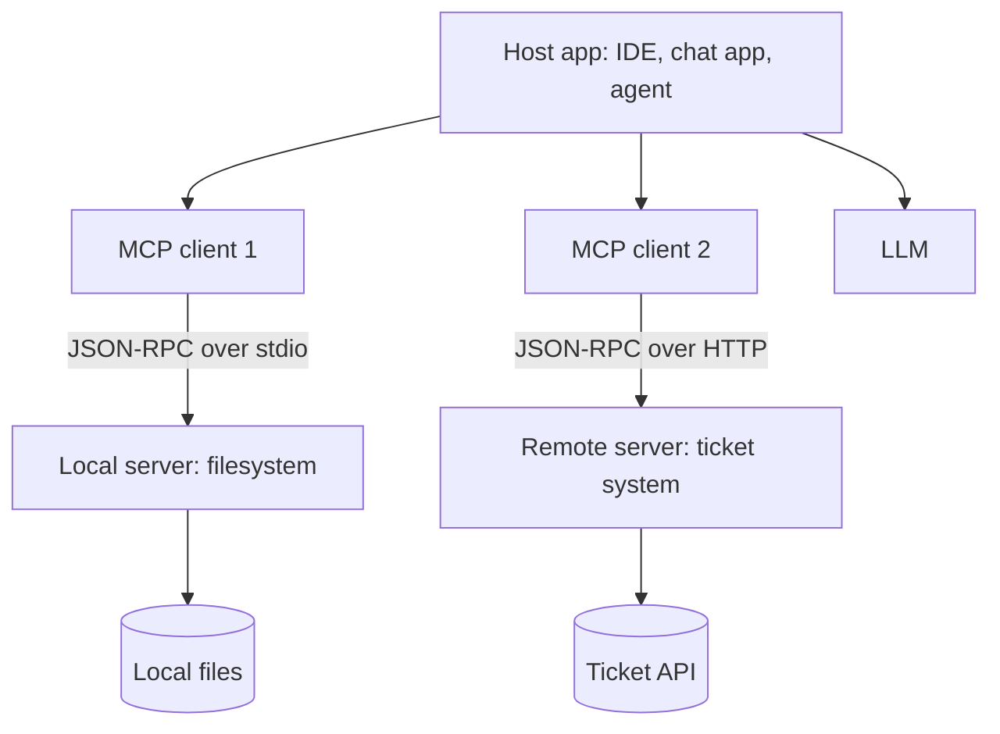

# Model Context Protocol

> [!abstract] TL;DR
> The Model Context Protocol (MCP) is an open standard, introduced by Anthropic in November 2024, for connecting AI applications to external tools and data. Instead of writing a custom integration for every app–service pair, ==a service is wrapped once as an MCP server and any MCP-capable client can use it==. Servers expose **tools**, **resources** and **prompts** over JSON-RPC. MCP standardizes the plumbing, not the trust: every server you connect is code and text you are choosing to trust.

**Prerequisites:** [[Tool Use]] · [[Tool Descriptions in Agentic Systems]]
**Related:** [[MCP Specification 2026 – Changes Since March 2025|MCP 2026 spec changes]] · [[APIs in AI Systems]] · [[AI Agents]] · [[Multi-Agent Systems]] · [[Retrieval-Augmented Generation]] · [[Prompt Injection]]

> [!note] Source scope
> Concept hub, based on the public MCP specification and documentation. *Beyond the lecture.* Updated 2026-10-05 to the **2026-07-28** specification. For what changed since the March 2025 spec (stateless requests, Multi Round-Trip Requests, deprecations, extensions, auth), see [[MCP Specification 2026 – Changes Since March 2025]].

> [!todo]- Contents
> - [[#1. Core Concepts]]
> - [[#2. Architecture]]
> - [[#3. Server Primitives]]
> - [[#4. Worked Example – A Ticket-System Server]]
> - [[#5. Pitfalls and Failure Modes]]
> - [[#6. Key Takeaways]]
> - [[#7. Critical Analysis]]
> - [[#8. Self-Test]]
> - [[#9. Glossary]]
> - [[#Further Reading]]

## 1. Core Concepts

> [!info]+ Definition – MCP
> An open client–server protocol, based on JSON-RPC 2.0, that lets an AI application (host) discover and use capabilities — tools, resources, prompts — provided by external servers in a standard way.

^def-mcp

**The M×N problem.** With $M$ AI apps and $N$ services, custom integrations need $M \times N$ connectors. With a shared protocol you need $M$ clients $+$ $N$ servers. For 10 apps and 50 services: 500 vs 60.

| Without MCP | With MCP |
|---|---|
| Each app writes its own GitHub, Slack, DB connectors | One GitHub MCP server works in any MCP client |
| Tool schemas differ per framework | Standard tool listing and calling |
| Hard to share integrations | Servers can be distributed and reused |

## 2. Architecture



| Role | Responsibility |
|---|---|
| Host | The AI application; manages the LLM, user consent, and clients |
| Client | One connection to one server, inside the host |
| Server | Exposes capabilities; wraps a service or data source |
| Transport | stdio for local servers; Streamable HTTP (POST-only, no sessions) for remote servers |

**Request model (2026-07-28): stateless.** There is no `initialize` handshake and no protocol session. Every request carries its own protocol version, client capabilities and client info in `_meta`, so any server instance can answer it.

| Phase | Messages |
|---|---|
| Discover (optional) | `server/discover` returns supported versions, capabilities and server info. Servers must implement it |
| List | `tools/list`, `resources/list`, `prompts/list` (cacheable via `ttlMs` / `cacheScope`) |
| Use | `tools/call`, `resources/read`, `prompts/get` |
| Need more input | Server returns `InputRequiredResult`; the client gathers input and **retries** the request (Multi Round-Trip Requests) |
| Change notifications | `subscriptions/listen` opens a filtered notification stream (list changes, resource updates) |

State that must span calls (a cart, a browser session) is passed as an explicit **handle**: one tool returns it and later calls send it as an argument.

> [!note] Changed from March 2025
> The 2025-03-26 spec used an `initialize` → `initialized` handshake, optional `Mcp-Session-Id` sessions on HTTP, and servers could send requests to the client at any time. All of that is gone. See [[MCP Specification 2026 – Changes Since March 2025#4. The Big Shift – From Sessions to Stateless Requests|the big shift]] and [[MCP Specification 2026 – Changes Since March 2025#5. Multi Round-Trip Requests|Multi Round-Trip Requests]].

## 3. Server Primitives

| Primitive | Controlled by | What it is | Example |
|---|---|---|---|
| Tools | Model | Functions the LLM can call (name, description, JSON Schema) | `create_ticket` |
| Resources | Application | Read-only data identified by URI, attached as context | `tickets://open/123` |
| Prompts | User | Reusable prompt templates, often slash commands | `/summarize-incident` |

Clients can also offer capabilities to servers, delivered through Multi Round-Trip Requests:

| Client feature | Status in 2026-07-28 | What it is |
|---|---|---|
| **Elicitation** | Active (main client feature) | Server asks the user for input. *Form* mode for structured data (never secrets); *URL* mode sends the user to an external page for sensitive steps such as third-party OAuth or payment |
| **Sampling** | Deprecated | Server asks the host's LLM for a completion. Migrate to calling LLM provider APIs directly |
| **Roots** | Deprecated | Server learns which directories it may use. Migrate to tool parameters, resource URIs or config |

Optional **extensions** add Tasks (durable handles for long-running work), MCP Apps (interactive UI in the chat) and Skills. See [[MCP Specification 2026 – Changes Since March 2025#11. Extensions|extensions]].

Tool descriptions matter just as much here: everything in [[Tool Descriptions in Agentic Systems]] applies to MCP tool definitions.

## 4. Worked Example – A Ticket-System Server

Goal: let any MCP client read and triage outage tickets (compare [[Sonar Ticket and Outage Classification - How-To]]).

```python
# Python MCP SDK (FastMCP style) – illustrative sketch
from mcp.server.fastmcp import FastMCP

mcp = FastMCP("tickets")

@mcp.tool()
def search_tickets(query: str, status: str = "open") -> list[dict]:
    """Search tickets by text. Use to find existing incidents before creating new ones."""
    ...

@mcp.resource("tickets://{ticket_id}")
def get_ticket(ticket_id: str) -> str:
    """Full text of one ticket."""
    ...

if __name__ == "__main__":
    mcp.run()  # stdio transport by default
```

- Read tools only at first; add `update_priority` later behind host-side confirmation.
- The server uses a service account with read-only API scope (least privilege).
- Ticket text returned by the server is untrusted: a ticket can contain injected instructions.

## 5. Pitfalls and Failure Modes

| Failure | Symptom | Mitigation |
|---|---|---|
| Tool poisoning | Malicious instructions hidden in a tool *description* | Install only trusted servers; review descriptions; pin versions |
| Rug pull | Server changes tool behavior or description after approval | Pin versions; alert on changed tool lists |
| Too many tools | Model selection accuracy drops; context fills up | Enable only the servers needed for the task |
| Over-broad credentials | A server can do far more than needed | Scoped tokens; per-server least privilege |
| Indirect injection via results | Fetched content steers the agent | Treat outputs as data; confirm sensitive actions — see [[Prompt Injection]] |
| Tool name collisions | Two servers expose `search` | Prefix tool names with a server identifier (the spec's recommendation); clear descriptions |
| Lost state handles | A tool call fails with "unknown handle" after history was trimmed | Keep handles in structured agent state, not just conversation text ([[Agent State Management]]) |

## 6. Key Takeaways

- [ ] I can explain the M×N integration problem MCP solves.
- [ ] I can name the host, client, server and transport roles.
- [ ] I know the three server primitives and who controls each.
- [ ] I know MCP standardizes connectivity, not trust or safety.
- [ ] I can list MCP-specific risks: tool poisoning, rug pulls, over-broad credentials.
- [ ] I can explain why MCP is now stateless and where cross-call state lives (handles).
- [ ] I know sampling and roots are deprecated and elicitation is the main client feature.

## 7. Critical Analysis

- **Standard ≠ secure.** MCP makes it easy to add many third-party servers, each with text the model reads as instructions. The supply-chain risk is similar to package managers.
- **Protocol vs framework.** MCP handles discovery and calling. It doesn't solve tool selection, planning, or evaluation; those remain agent-design problems ([[AI Agents]], [[LLM Evaluation]]).
- **At scale.** Enterprises need server registries, authentication, audit logs and policy — the governance layer around the protocol. The 2026 spec helps: the MCP server is an OAuth **resource server** behind your own identity provider, tokens are bound to one server, and stateless requests run behind ordinary load balancers.
- **Ecosystem evidence.** Adoption by multiple vendors suggests MCP is becoming a de facto standard. The spec has changed fast: four revisions from March 2025 to July 2026, with some features added and then removed. A formal deprecation policy with a 12-month window now exists. Design for version changes.
- **Open questions:** Who vets public MCP servers? How should a host show the user what each server can do before they approve it?

## 8. Self-Test

> [!question]- Q1. Quantitative – 6 AI apps and 20 services. Integrations needed with and without MCP?
> Without: $6 \times 20 = 120$. With: $6 + 20 = 26$.

> [!question]- Q2. What's the difference between an MCP tool and an MCP resource?
> Tools are model-controlled functions that can act. Resources are application-controlled, read-only data identified by URI, attached as context.

> [!question]- Q3. What is tool poisoning?
> A server hides malicious instructions in a tool description or metadata that the model reads, steering it to misuse other tools or leak data.

> [!question]- Q4. Design – you want a coding agent to use a public "database helper" MCP server. What controls do you apply?
> Review the source and tool descriptions; pin the version; run it with a read-only, scoped DB credential; require confirmation for write tools; log calls; alert if the tool list changes.

> [!question]- Q5. Which transports does MCP use, and when?
> stdio for local servers launched by the host; Streamable HTTP for remote servers. Since 2026-07-28 Streamable HTTP is POST-only, with no sessions or stream resumability.

> [!question]- Q6. A server needs to keep a shopping cart across several tool calls. How does that work under the current spec?
> There are no protocol sessions, so a creation tool returns an opaque handle (e.g. `basket_id`) and later calls pass it as an argument. The server stores the state under that key, re-checks authorization each time, and returns a tool error for expired handles. See [[MCP Specification 2026 – Changes Since March 2025#4. The Big Shift – From Sessions to Stateless Requests|the big shift]].

> [!tip] Flashcards
> Review this topic with [[Model Context Protocol - Flashcards]].

## 9. Glossary

| Term | Meaning |
|---|---|
| Host | The AI application using MCP |
| MCP client | Connection manager to a single server |
| MCP server | Program exposing tools, resources, prompts |
| JSON-RPC 2.0 | The request/response message format MCP uses |
| Sampling | Server asks the host's LLM for a completion (deprecated in 2026-07-28) |
| Elicitation | Server asks the user for input, via a form or an external URL |
| `server/discover` | Request returning a server's supported versions and capabilities |
| Multi Round-Trip Requests | Server replies "input required"; the client retries with the answers |
| Handle | Explicit ID for state spanning multiple calls |
| Tool poisoning | Malicious instructions hidden in tool metadata |

## Further Reading

- [Model Context Protocol – official documentation](https://modelcontextprotocol.io)
- [MCP specification 2026-07-28](https://modelcontextprotocol.io/specification/2026-07-28)
- [2026-07-28 changelog](https://modelcontextprotocol.io/specification/2026-07-28/changelog)
- [[MCP Specification 2026 – Changes Since March 2025]] (vault article)
- [Anthropic – Introducing the Model Context Protocol (2024)](https://www.anthropic.com/news/model-context-protocol)
