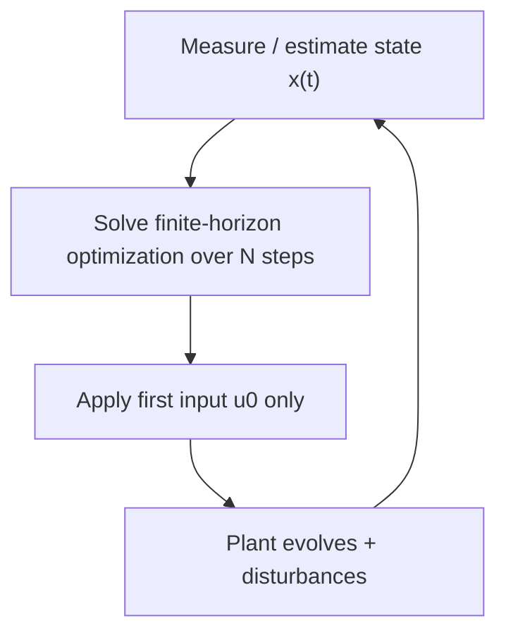

# Model Predictive Control (MPC)

> [!abstract] TL;DR
> MPC is a feedback controller that **plans**. At every time step it uses a model of the system to predict the next $N$ steps and solves an optimization for the best input sequence under constraints. Then it ==applies only the first input, measures the result, and re-plans from scratch==. This "receding horizon" loop combines two things: the foresight and constraint handling of optimal control, and the robustness of feedback. That combination is why MPC runs refineries and autonomous vehicles, and why it's a useful way to think about planning agents that act, observe, and re-plan.

**Related:** [[LLM Feedback Loops]] (reactive feedback) · [[Reinforcement Learning (RL)]] (learned policies) · [[Tree-of-Thought]] · [[Planning Agents]] · [[Chain-of-Thought and ReAct]]

> [!note] Scope
> This is a personal-interest note, not course material, so it has no flashcards. The control theory is standard textbook material. The LLM-agent mapping in §6 is an **analogy I'm drawing**, not an established result.


> [!todo]- Contents
> - [[#1. Core Concepts]]
> - [[#2. The Optimization Problem]]
> - [[#3. The Receding Horizon Loop]]
> - [[#4. Worked Example – Scalar System with Input Limits]]
> - [[#5. MPC Compared with PID, LQR and RL]]
> - [[#6. MPC as a Lens on AI Agents]]
> - [[#7. Variants Worth Knowing]]
> - [[#8. Pitfalls and Failure Modes]]
> - [[#9. Key Takeaways]]
> - [[#10. Critical Analysis]]
> - [[#11. Self-Test]]
> - [[#12. Glossary]]
> - [[#Further Reading]]

---

## 1. Core Concepts

> [!info]+ Definition – Model Predictive Control
> A control strategy that, at every sampling instant, solves a finite-horizon **optimal control problem**, starting from the current measured or estimated state, using a model of the system. It applies the first control move of the optimal sequence and throws the rest away. The problem is solved again at the next instant.

^def-mpc

> [!info]+ Definition – Receding horizon
> The prediction window $[t, t+N]$ slides forward with time. The controller always looks $N$ steps ahead from *now*, so the horizon "recedes" and never arrives.

^def-receding-horizon

The four ingredients:

| Ingredient | Symbol | Role |
|---|---|---|
| **Model** | $x_{k+1} = f(x_k, u_k)$ | Predicts how the state evolves under a given input |
| **Cost** | $\ell(x,u)$, $V_f(x_N)$ | What "good" means: tracking error, effort, energy, economics |
| **Constraints** | $x \in \mathcal{X}$, $u \in \mathcal{U}$ | Physical limits (valve 0–100%), safety limits (temperature ≤ max) |
| **Optimizer** | QP / NLP solver, or sampling | Finds the best input sequence within the time budget |

^four-ingredients

> [!important] Why MPC and not just a good plan
> An **open-loop** plan computed once is only as good as the model. MPC re-plans from the **measured** state at every step. Model errors and disturbances show up in the next measurement and get corrected. ==Feedback comes from re-planning, not from a gain matrix.==

^feedback-by-replanning

---

## 2. The Optimization Problem

At time $t$, with current state estimate $\hat{x}(t)$, solve:

$$
\begin{aligned}
\min_{u_0,\dots,u_{N-1}} \quad & \sum_{i=0}^{N-1} \ell(x_i, u_i) \;+\; V_f(x_N) \\
\text{s.t.} \quad & x_{i+1} = f(x_i, u_i), \quad i = 0,\dots,N-1 \\
& x_0 = \hat{x}(t) \\
& x_i \in \mathcal{X}, \quad u_i \in \mathcal{U} \\
& x_N \in \mathcal{X}_f
\end{aligned}
$$

Then apply $u(t) = u_0^\star$.

**Linear-quadratic special case (the workhorse).** With $f(x,u) = Ax + Bu$, $\ell = x^\top Q x + u^\top R u$, $V_f = x^\top P x$, and polyhedral constraints, the problem is a **convex quadratic program (QP)**. It has a unique global optimum and can be solved reliably in milliseconds or microseconds with warm-started solvers.

| Term | Tuning effect |
|---|---|
| $Q$ (state weight) ↑ | Tracks harder, more aggressive |
| $R$ (input weight) ↑ | Smoother, less control effort, slower |
| $N$ (horizon) ↑ | More foresight, bigger problem, more exposure to model error |
| $V_f$, $\mathcal{X}_f$ (terminal ingredients) | Approximate the cost beyond the horizon; the standard route to **stability guarantees** |

^tuning-table

> [!tip] Tracking versus regulation
> For setpoint tracking, write the cost in terms of the error $x - x_{\text{ref}}$ and often the input increment $\Delta u_k = u_k - u_{k-1}$. Penalizing $\Delta u$ gives smooth actuation and offset-free behavior when combined with a disturbance model.

---

## 3. The Receding Horizon Loop



```python
def mpc_loop(model, cost, constraints, N, estimator, plant):
    u_prev_plan = None
    while True:
        x = estimator.update(plant.measure())                      # feedback enters here
        plan = solve_ocp(model, cost, constraints, x, N,
                         warm_start=shift(u_prev_plan))            # reuse last plan shifted by one
        plant.apply(plan[0])                                        # execute only the first move
        u_prev_plan = plan
```

Two practical details carry most of the engineering effort:
- **Warm starting.** Yesterday's plan shifted by one step is an excellent initial guess, so real-time solvers converge in a few iterations.
- **State estimation.** MPC needs the full state $x$. In practice a Kalman filter or moving-horizon estimator reconstructs it from noisy, partial measurements. A poor estimator means good plans made from the wrong starting point.

---

## 4. Worked Example – Scalar System with Input Limits

**Setup (constructed, checked by hand).** System $x_{k+1} = x_k + u_k$ (an integrator). Cost $J = \sum_{i=1}^{2} x_i^2 + \sum_{i=0}^{1} u_i^2$, so $Q = R = 1$ and $N = 2$. Constraint $|u| \le 3$. Initial state $x_0 = 10$.

**Unconstrained solution.** Minimizing over $u_1$ first gives $u_1 = -\tfrac{1}{2}(x_0 + u_0)$. Substituting back, $J(u_0) = 1.5(x_0+u_0)^2 + u_0^2$, so

$$u_0^\star = -\tfrac{3}{5}x_0 = -0.6\,x_0$$

Without constraints, MPC reduces to a **linear feedback law** $u = -0.6x$, which gives $x_{k+1} = 0.4\,x_k$.

**With the constraint $|u| \le 3$** (each plan checked against the KKT conditions):

| Step $k$ | State $x_k$ | Optimal plan $(u_0, u_1)$ | Applied | Next state |
|---|---|---|---|---|
| 0 | 10 | $(-3, -3)$, both at the limit | $-3$ | 7 |
| 1 | 7 | $(-3, -2)$, first saturated, second interior | $-3$ | 4 |
| 2 | 4 | $(-2.4, -0.8)$, unconstrained | $-2.4$ | 1.6 |
| 3 | 1.6 | $(-0.96, -0.32)$ | $-0.96$ | 0.64 |

^worked-example

Observations:
- **Plans are not commitments.** At $k=1$ the plan's second move was $-2$, but at $k=2$ the controller actually applied $-2.4$, because it re-planned from the new state. ==This is the receding horizon in action.==
- **Constraints change the law.** Near the limits the controller is nonlinear (saturated). Away from them it's the linear law $-0.6x$.
- **Caveat.** In this scalar case, clipping the linear law, $u = \text{clip}(-0.6x, \pm 3)$, happens to give the same moves. With multiple inputs, **state** constraints, or coupled dynamics, clipping is no longer optimal and can even destabilize the system. That gap is the reason MPC exists.

---

## 5. MPC Compared with PID, LQR and RL

| | PID | LQR | MPC | Model-free RL |
|---|---|---|---|---|
| Uses a model | No | Yes (linear) | Yes (any) | No (learns from interaction) |
| Looks ahead | No, reacts to error | Infinite horizon, offline | Finite horizon, **online** | Implicitly, through the value function |
| Handles constraints | No (anti-windup patches) | No | **Yes, natively** | Only via reward shaping / safe RL |
| Computation at run time | Trivial | Trivial (matrix multiply) | Solve an optimization every step | Forward pass of the policy |
| Multi-input coupling | Poor (loops interact) | Good | Good | Good |
| Stability theory | Classical | Strong | Strong with terminal ingredients | Weak |
| Where it wins | Simple single loops | Unconstrained linear systems | Constrained, multivariable, known dynamics | Unknown or complex dynamics, cheap simulation |

^comparison

> [!example]- Link to the other control-analogy notes
> - [[LLM Feedback Loops]] are like **PID**: they react to the last observed error ("tests failed → fix").
> - [[Reinforcement Learning (RL)]] **learns a policy** that amortizes planning into weights.
> - MPC sits in between. It **plans at decision time** with a model, and doesn't need a trained policy.
>
> Model-based RL often combines the last two: it learns the model with RL-style data, then controls with MPC on top of it (§7).

---

## 6. MPC as a Lens on AI Agents

*My own analogy, beyond standard MPC theory.* Map each MPC element onto an LLM-agent loop:

| MPC element | Agent analogue | Example |
|---|---|---|
| Plant | Environment | Codebase, user, APIs, network |
| State estimate $\hat{x}$ | Context / memory / observation summary | Current file contents, test results, conversation |
| Model $f$ | **World model** | The LLM imagining outcomes, a simulator, a dry-run, a type checker |
| Horizon $N$ | Lookahead depth | Planning steps, [[Tree-of-Thought]] depth |
| Cost $\ell$ | Evaluator / reward model / rubric | Tests passed, LLM-as-judge score |
| Constraints | [[Gate Checks]], guardrails, budgets | Schema validity, no destructive commands, token caps |
| Optimizer | Search over candidate plans | Sample $k$ plans and score them, beam search, MCTS |
| Apply first move only | Execute one tool call, then re-plan | Plan-and-execute **with** re-planning |
| Measurement | Observation after acting | Tool output, error message |

^agent-mapping

Where common agent patterns fit:

| Pattern | MPC reading |
|---|---|
| ReAct | $N = 1$, no explicit model: choose the next action, observe, repeat. Receding horizon without prediction |
| Plan-and-execute, no re-plan | **Open-loop** optimal control: fragile to surprises |
| Plan-and-execute with re-plan after each step | **MPC proper** |
| Tree-of-Thought / MCTS planning | Search-based optimizer over action sequences with a learned model |
| Evaluator–optimizer loop | Iterative solver refining *one* plan against a cost; the "solve" step, not the whole loop |

> [!warning] Horizon versus model error
> Predictions compound. If each imagined step is right with probability $p$, an $N$-step imagined trajectory is right with roughly $p^N$ (the same arithmetic as [[Prompt Chaining for Agentic Reasoning - Study Guide#^error-compounding|error compounding]]). With $p = 0.9$, the trajectory is 81% reliable at $N = 2$ and only 59% at $N = 5$. That's why MPC with a learned model uses **short horizons plus frequent re-planning**. It's also why an agent's long imagined plan should be treated as a draft to re-plan against, not a script to follow.

^horizon-vs-error

---

## 7. Variants Worth Knowing

| Variant | Idea | Use when |
|---|---|---|
| **Linear MPC** | Linear model, quadratic cost → QP | Most industrial process control |
| **Nonlinear MPC (NMPC)** | Nonlinear $f$ → nonlinear program, often solved with SQP or interior point methods | Vehicles, robots, chemical reactors |
| **Explicit MPC** | Pre-solve the QP offline as a piecewise-affine function of $x$; at run time just look it up | Small systems with microsecond budgets (embedded) |
| **Robust / tube MPC** | Plan for a nominal model and keep the real state inside a "tube" that bounds the disturbances | Bounded, known uncertainty; safety-critical |
| **Stochastic MPC** | Chance constraints: $\Pr(x \in \mathcal{X}) \ge 1-\epsilon$ | Probabilistic disturbances (e.g. weather, demand) |
| **Economic MPC** | Cost is profit or energy directly, not tracking error | Buildings, grids, process economics |
| **Sampling-based MPC** (random shooting, CEM, MPPI) | Sample many input sequences, roll them through the model, keep or weight the best | Non-differentiable or learned models, GPUs available |
| **Learning-based MPC** | Learn $f$ (or the residual of $f$) from data; MPC on top | Model-based RL (e.g. PETS, PlaNet, TD-MPC) |

^variants

> [!tip] The bridge to deep learning
> Methods like PETS (probabilistic ensemble dynamics + CEM planning) and TD-MPC (learned latent model + a learned terminal value, used as $V_f$) are **MPC with a neural model**. The learned value function plays the role of the terminal cost, estimating everything beyond the horizon. That's the formal meeting point of §5's MPC and RL columns.

---

## 8. Pitfalls and Failure Modes

| Failure | Symptom | Mitigation |
|---|---|---|
| **Model mismatch** | Steady-state offset, sluggish or oscillating response | Disturbance / offset-free formulation, re-identify the model, add a learned residual |
| **Infeasibility** | Solver returns "no solution" after a disturbance pushes the state outside the constraints | Soft constraints with penalized slack variables; a fallback controller |
| **Solve time > sampling time** | Missed deadlines, stale inputs | Warm start, shorter $N$, move blocking, explicit MPC, faster solver |
| **Horizon too short** | Myopic behavior, instability (the controller "doesn't see the wall") | Longer $N$ or a terminal cost / terminal set ([[#^tuning-table]]) |
| **Poor state estimation** | Good plans from the wrong starting point | Kalman filter / moving-horizon estimation; check observability |
| **Tuning by trial and error** | $Q$, $R$ changes have non-obvious effects | Start from Bryson's rule (scale by max acceptable values); tune in simulation |
| **Agent analogue: evaluator hacking** | Plans score well on the evaluator but fail in reality | Real measurements (tests, tools) over imagined scores; re-plan after each action |
| **Agent analogue: open-loop execution** | A long plan keeps running after reality has diverged | Execute one step, observe, re-plan ([[#^feedback-by-replanning]]) |

---

## 9. Key Takeaways

- [ ] MPC = predict with a model → optimize over $N$ steps under constraints → apply the first move → measure → repeat.
- [ ] Feedback comes from re-planning at every step from the measured state.
- [ ] Linear model + quadratic cost + linear constraints gives a convex QP, which is fast and globally optimal.
- [ ] MPC's key advantage over PID/LQR is **native constraint handling** for coupled, multi-input systems.
- [ ] Unconstrained linear-quadratic MPC reduces to a linear feedback gain; constraints make it nonlinear.
- [ ] Terminal cost and terminal set are how you get stability guarantees and compensate for a finite horizon.
- [ ] Longer horizons trade foresight against compounding model error ([[#^horizon-vs-error]]).
- [ ] For agents: plan-and-execute **with re-planning** is MPC. Without re-planning it's open-loop.

---

## 10. Critical Analysis

**Limits of the method.**
- MPC is only as good as its model. The whole design is built to *tolerate* model error through feedback, not to remove it. Large mismatch still degrades performance, and it can break stability guarantees that assume a nominal model.
- Online optimization is a real cost. For fast nonlinear systems, the gap between "the optimal plan" and "the plan found before the deadline" matters. Real-time iteration schemes deliberately accept sub-optimal plans.
- Stability and feasibility guarantees depend on terminal ingredients that practitioners often skip in favor of "a long enough horizon". That usually works, but it's not guaranteed.

**Evidence quality.** Linear MPC has decades of industrial deployment and mature theory (Rawlings, Mayne and Diehl; Mayne et al. 2000). Learning-based MPC has strong benchmark results (e.g. PETS, TD-MPC), but those are simulation benchmarks. Transfer to real hardware is harder to evaluate. The **LLM-agent analogy** in §6 is a framing, not a result. An LLM's "world model" isn't calibrated, its evaluators are noisy and can be gamed, and none of the stability theory carries over.

**What changes at scale.** Large MPC problems (grid dispatch, fleets) are decomposed into distributed or hierarchical MPC: slow economic layers set targets for fast tracking layers. That mirrors orchestrator–worker agent designs. The agent version of solve time is **tokens and latency per re-plan**. Re-planning after every tool call is the robust choice, but it's expensive. Event-triggered re-planning (re-plan only when an observation departs from the prediction) is the MPC-inspired compromise.

**How I'd evaluate an "MPC-style" agent.** Compare three versions: open-loop plan-and-execute, ReAct ($N=1$), and plan-with-re-planning at several horizons. Measure task success, tokens, and **prediction error**: how often the observed tool result matches what the agent predicted before acting. MPC framing suggests prediction error should predict when longer horizons stop helping.

**Security and safety.** In control, constraints are hard safety boundaries enforced by the optimizer. In agents, the equivalent (gate checks, allow-lists) must be enforced **outside** the model, because an LLM can "plan around" a constraint that exists only in its prompt. This matches the lesson in [[Gate Checks]] and [[Prompt Injection]].

> [!question] Open questions
> 1. Could an agent learn a "terminal value" (an estimate of how good a partial state is) that lets it plan with short horizons, the way TD-MPC does?
> 2. What is the agent equivalent of a *feasibility* guarantee: knowing ahead of time that a plan can't paint itself into a corner?
> 3. Is prediction error (predicted vs observed tool output) a useful runtime signal for when an agent should shorten its horizon or ask a human?

---

## 11. Self-Test

> [!question]- Q1. Why does MPC apply only the first input of the optimized sequence?
> Because the rest of the sequence was computed from a prediction. At the next step a fresh measurement is available, and re-optimizing from it corrects for model error and disturbances. Applying only the first move is what turns open-loop optimal control into a feedback controller.

> [!question]- Q2. What makes linear MPC computationally tractable?
> A linear model, quadratic cost, and linear (polyhedral) constraints make each step a **convex QP**. It has a unique global optimum, reliable solvers, and good warm starts from the previous plan shifted by one step.

> [!question]- Q3. (Quantitative) Redo the worked example's first step with $R = 0$ (no input penalty), $N = 2$, $x_0 = 10$, $|u| \le 3$.
> With $R = 0$, $J = (x_0+u_0)^2 + (x_0+u_0+u_1)^2$. Unconstrained, the minimizer drives $x_1 = 0$ with $u_0 = -10$. The constraint binds, so $u_0 = -3$ ($x_1 = 7$) and $u_1 = -3$ ($x_2 = 4$). The applied move is $-3$, the same as before. The input penalty only matters once the state is small enough that the constraint stops binding.

> [!question]- Q4. When is clipping an LQR law not equivalent to MPC?
> When there are several inputs or **state** constraints, or when the dynamics are coupled. Clipping one input ignores how the others should compensate, and it can't anticipate a future state-constraint violation. MPC optimizes all of this jointly over the horizon.

> [!question]- Q5. (Design) Describe a coding agent built on MPC principles.
> > [!example] Answer sketch
> > **State:** repo snapshot plus test results. **Model:** the LLM predicts the effect of a candidate edit (which tests will pass). **Horizon:** 2–3 edits. **Optimizer:** sample 4 candidate edit sequences and score each by predicted tests passed and diff size. **Constraints:** no edits outside the allowed paths, no disabling tests (enforced in code). **Execute:** apply only the first edit, run the real tests, and re-plan from the real results. **Monitor:** the gap between predicted and actual test outcomes. If it's large, shrink the horizon to 1.

---

## 12. Glossary

| Term | Meaning |
|---|---|
| Horizon $N$ | Number of future steps predicted and optimized |
| Receding horizon | Re-solving each step with the window shifted forward |
| QP | Quadratic program: quadratic cost, linear constraints |
| Terminal cost $V_f$ | Estimate of the cost beyond the horizon |
| Terminal set $\mathcal{X}_f$ | Region the final predicted state must reach; used in stability proofs |
| Warm start | Initializing the solver with the previous plan, shifted |
| Soft constraint | A constraint relaxed by a penalized slack variable to avoid infeasibility |
| Explicit MPC | Offline pre-computed piecewise-affine control law |
| MPPI / CEM | Sampling-based trajectory optimizers used with learned models |
| Open-loop vs closed-loop | Executing a fixed plan vs re-planning from measurements |

---

## Further Reading

- J. B. Rawlings, D. Q. Mayne, M. M. Diehl, *Model Predictive Control: Theory, Computation, and Design* (2nd ed.). The standard graduate text.
- D. Q. Mayne et al., "Constrained model predictive control: Stability and optimality," *Automatica*, 2000. The classic stability survey.
- [Chua et al., 2018 – Deep RL in a Handful of Trials using Probabilistic Dynamics Models (PETS)](https://arxiv.org/abs/1805.12114)
- [Hafner et al., 2019 – Learning Latent Dynamics for Planning from Pixels (PlaNet)](https://arxiv.org/abs/1811.04551)
- [Hansen et al., 2022 – Temporal Difference Learning for Model Predictive Control (TD-MPC)](https://arxiv.org/abs/2203.04955)
- [CasADi – optimization framework commonly used for NMPC](https://web.casadi.org/)
- [do-mpc – Python MPC toolbox](https://www.do-mpc.com/)
- Source cited in the original note: [arXiv 2501.11979](https://arxiv.org/html/2501.11979v1). Kept as you had it; I haven't checked its contents.

%% Hands-on idea: implement §4 in ~20 lines with cvxpy, then swap the model for a noisy one and watch re-planning absorb the error. Then do the same with an LLM "predict the test result before running it" loop and log the prediction error. %%
