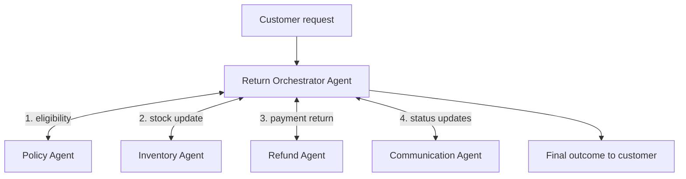
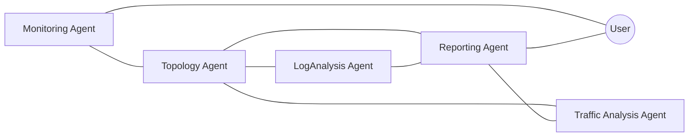
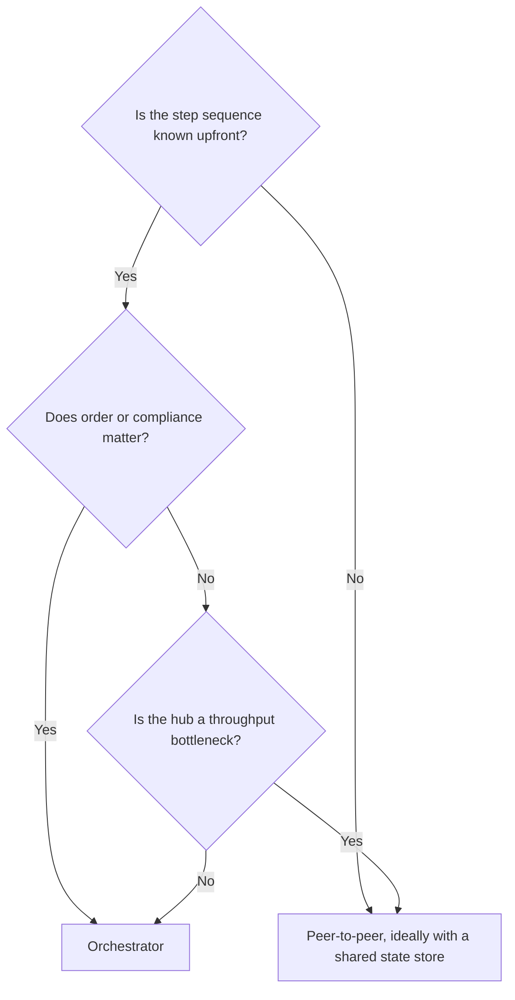

# Multi-Agent Architecture Design

> [!abstract] TL;DR
> Designing a multi-agent system means acting as the architect: you decide ==who does what, how agents talk, and how state and data move== before you write any code. The lecture gives two topologies. The **orchestrator** (hub-and-spoke) pattern suits structured, predictable workflows, such as e-commerce returns or ticket routing. The **peer-to-peer** pattern suits problems where the sequence of steps isn't known upfront, such as diagnosing a network fault. Whichever you choose, you still have to define **roles, communication protocols, state management and data flow**.

**Prerequisites:** [[Multi-Agent Systems]] · [[AI Agents]]
**Related:** [[Orchestrator-Workers Workflow]] · [[Routing Workflow]] · [[Agent State Management]] · [[Runtime or Orchestration Layer]] · [[Task Decomposition]] · [[AI Reliability]]

> [!note] Source scope
> Based on the Udacity lesson "Multi-Agent Architecture Design": the lesson text, the video transcript, and two slides (the return orchestrator at 1:44 and the peer-to-peer network monitoring diagram at 3:22). Material marked *beyond the lecture* is my own addition.

> [!todo]- Contents
> - [[#1. Core Concepts]]
> - [[#2. Orchestrator Pattern – Hub and Spoke]]
> - [[#3. Peer-to-Peer Pattern – Direct Routing]]
> - [[#4. Choosing a Topology]]
> - [[#5. The Four Design Decisions]]
> - [[#6. Worked Examples]]
> - [[#7. Pitfalls and Failure Modes]]
> - [[#8. Key Takeaways]]
> - [[#9. Critical Analysis]]
> - [[#10. Self-Test]]
> - [[#11. Glossary]]
> - [[#Further Reading]]

## 1. Core Concepts

The lecture's framing question is how to build a system where several agents collaborate on a goal that ==no single agent could achieve alone==. Its answer is to sketch the architecture first ("boxes and arrows on a whiteboard"). That forces three questions: *Who talks to whom? What does each agent need to know? How does the overall job get done?*

> [!info]+ Definition – Orchestrator pattern
> A central coordinator receives the task, breaks it down, and delegates subtasks to specialized worker agents, often in a set order. Workers report back to the orchestrator, which ==owns the sequence and the overall state==. Communication flows hub-and-spoke.

^def-orchestrator-pattern

> [!info]+ Definition – Peer-to-peer (direct routing) pattern
> Requests go straight to the most qualified agent, and agents talk to each other directly as needed. When an agent finishes a step, it decides which peer to contact next. No central agent mediates every exchange.

^def-p2p-pattern

| Term | Meaning in this lesson |
|---|---|
| Orchestrator | Central "project manager" agent that delegates and enforces order |
| Worker / specialist | Agent built for one distinct business function |
| Direct routing | The initial request skips any hub and goes straight to the best-matched specialist |
| Broadcast | An agent asks all peers for help instead of messaging one |
| Hub-and-spoke | Every message passes through the centre |

## 2. Orchestrator Pattern – Hub and Spoke

The loop the lecture describes: **receive → analyze → decompose → delegate (in sequence) → collect → pass on or synthesize.**

What the lecture stresses:

- **Clear mapping.** Each worker covers one distinct business function: policy, inventory, refund, communication.
- **Order enforcement.** The orchestrator makes sure, for example, that no refund is issued before the policy check passes. The lecture calls this "crucial".
- **Central state.** The orchestrator tracks where the whole return process stands.
- **Easier design, management and debugging.** One place to look, compared with agents "interacting randomly".
- **Best fit:** structured, predictable, multi-step workflows such as order fulfilment, **support-ticket routing**, and complex report generation.

> [!example] Same shape, different domain – ticket triage
> Swap the agents and the topology still works for a helpdesk. *Ticket in → Triage Orchestrator → Classifier agent (category/priority) → KB/Context agent (account and outage lookup) → Resolution or Escalation agent → Communication agent (customer reply).* This is a [[Routing Workflow]] wrapped inside an orchestrator that also tracks the ticket's state. See [[Sonar Ticket and Outage Classification - How-To]] for a real classification stage this could orchestrate. *(Beyond the lecture.)*

## 3. Peer-to-Peer Pattern – Direct Routing

*(Edges as drawn on the lecture slide. Every link is two-way, and no node is a mandatory hub.)*

Characteristics:

- Communication is **fluid and less predictable**. An agent may *broadcast* a request for help or *route directly* to a peer it knows has the right expertise.
- The **initial request can bypass any centre** and go to the most relevant specialist through routing logic.
- **Best fit:** problems where the exact sequence of steps isn't known upfront, or where a central orchestrator would become a **bottleneck**. The lecture's analogy is "a group of specialized researchers collaborating dynamically".

**The cost: the complexity moves rather than disappears.** As the number of agents grows, it becomes significantly harder to:
1. manage the overall communication flow,
2. make sure tasks don't get dropped,
3. reconcile conflicting information between agents,
4. track the overall state.

^p2p-complexity

## 4. Choosing a Topology

| Dimension | Orchestrator | Peer-to-peer |
|---|---|---|
| Control | Centralized | Distributed |
| Step sequence | Known upfront and enforced | Emerges at runtime |
| State | Held by the orchestrator | Spread across agents (needs explicit design) |
| Debuggability | High: one trace through the hub | Low: many conversations to reconstruct |
| Flexibility | Lower | Higher |
| Bottleneck risk | The hub is a bottleneck and single point of failure | No single bottleneck |
| Typical use | Returns, order fulfilment, ticket routing, reports | Diagnosis, open-ended research, investigation |

^topology-comparison

*(The decision tree is my synthesis of the lecture's criteria.)*

**Message-count intuition** *(beyond the lecture)*. With $n$ agents, hub-and-spoke needs at most $n$ communication channels, one per worker. A fully connected peer mesh can have up to

$$
\binom{n}{2} = \frac{n(n-1)}{2}
$$

channels. With $n = 5$ that is 5 vs 10; with $n = 10$ it is 10 vs 45. This quadratic growth is the formal version of the lecture's warning that P2P coordination gets "significantly harder" as agents are added ([[#^p2p-complexity]]).

## 5. The Four Design Decisions

The lecture says these must be defined *regardless of topology*:

| Decision | Questions to answer | Concrete artefact |
|---|---|---|
| **Roles** | What is each agent responsible for, and what is it *not* allowed to do? | One-line charter + tool list + permissions per agent |
| **Communication protocol** | Who may message whom? Using what message format? Sync or async? | Typed message schema (e.g. Pydantic: `sender`, `recipient`, `task_id`, `intent`, `payload`) |
| **State management** | Where does the truth about task progress live? Who can write to it? | Orchestrator state object, or a shared store / blackboard ([[Agent State Management]]) |
| **Data flow** | What data each agent receives and returns, and in what shape? | Data-flow diagram; workers return structured summaries rather than raw dumps ([[Structured Outputs]]) |

^four-decisions

## 6. Worked Examples

### 6.1 Orchestrator – e-commerce return (from the lecture)

1. Customer submits a return request → **Return Orchestrator** receives it and analyzes it.
2. **Policy Agent** checks eligibility (return window, item condition). If it fails, the orchestrator skips straight to communication.
3. **Inventory Agent** prepares the stock update. The slide shows its subtask as "Checks Inventory".
4. **Refund Agent** processes the payment return. The slide shows the request/response envelopes going back and forth between it and the orchestrator.
5. **Communication Agent** keeps the customer informed *throughout*, not only at the end.
6. The orchestrator holds the return's state (`received → eligible → restocked → refunded → closed`) and enforces that order.

### 6.2 Peer-to-peer – intermittent network failure (from the lecture)

1. **Monitoring Agent** detects an anomaly.
2. It **queries the Topology Agent** directly to understand the network layout around the failure point.
3. Based on the topology, it **tasks the LogAnalysis Agent** with checking specific devices and **simultaneously** asks the **Traffic Analysis Agent** to look for unusual patterns.
4. The analysis agents **exchange findings directly**.
5. The **Reporting Agent** consolidates a diagnosis for the user.

Why P2P fits here: which devices to inspect depends on what the topology reveals, so the path can't be scripted in advance.

## 7. Pitfalls and Failure Modes

| Failure | Symptom | Mitigation |
|---|---|---|
| Orchestrator bottleneck | Latency grows with load; the hub's context window fills up | Parallel dispatch; workers return compact summaries; split into sub-orchestrators |
| Hub single point of failure | One bad plan breaks the whole workflow | Plan validation [[Gate Checks]]; checkpointed state so runs can resume |
| Dropped task (P2P) | A subtask is assigned but nobody reports back | Task IDs + a shared task ledger + timeouts |
| Conflicting findings (P2P) | Log and traffic agents disagree, and the report picks one silently | Require evidence in messages; a designated reconciler or reporter must surface conflicts |
| Message loops / ping-pong | Agents keep handing work back and forth | Hop limit, per-task budget, loop detection on `task_id` |
| Lost global state | No one can say how far the task has got | Explicit shared state store with a single writer per field |
| Role overlap | Two agents both do the same step, or both skip it | Written charters with non-goals ([[#^four-decisions]]) |
| Cross-agent injection | A compromised peer instructs others | Treat inter-agent messages as untrusted data; least privilege per agent ([[Prompt Injection]]) |

## 8. Key Takeaways

- [ ] Sketch the architecture (boxes and arrows) before building; it forces the who/what/how questions.
- [ ] **Orchestrator** = central control, enforced order, central state. Best for structured, predictable workflows.
- [ ] **Peer-to-peer** = direct routing and peer messaging. Best when the step sequence is unknown or a hub would bottleneck.
- [ ] P2P doesn't remove complexity; it moves it into flow control, dropped tasks, conflicts and state tracking.
- [ ] Either way, define **roles, communication protocols, state management and data flow**.
- [ ] Map one worker to one distinct business function.

## 9. Critical Analysis

- **It's a spectrum, not a binary.** Real systems mix the two: an orchestrator whose workers consult each other, or P2P agents writing to a shared blackboard that acts as a soft orchestrator. The network diagram already hints at this: the Topology and Reporting agents are high-degree nodes that behave like partial hubs.
- **Is "orchestrator" here the same as the [[Orchestrator-Workers Workflow]]?** Not quite. In the returns example the subtasks are largely **fixed** (policy → inventory → refund), which is closer to a [[Prompt Chaining Workflow|prompt chain]] or a state machine with agent nodes. The Anthropic-style orchestrator-workers pattern chooses subtasks *dynamically*. When a workflow is this predictable, ask whether the orchestrator needs to be an LLM at all; deterministic code may be cheaper and safer ([[Runtime or Orchestration Layer]]).
- **Evidence quality.** The lecture argues from analogy and plausibility, not measurement. Published work on multi-agent LLM systems (e.g. the MAST failure taxonomy) finds many failures come from specification and coordination problems rather than model capability. That supports the lecture's warning about P2P complexity.
- **Reliability.** If an orchestrated chain has $k$ sequential workers, each succeeding with probability $p$, end-to-end success is roughly $p^k$ ([[AI Reliability#^error-compounding]]). P2P can parallelize, but it adds failure modes that $p^k$ doesn't capture, such as dropped messages and unresolved conflicts.
- **Evaluation.** Compare topologies on the same task set and report task success, tokens, latency, dropped-task rate, and *traceability* (can you reconstruct why the system did what it did?). The fair baseline is a single strong agent with the same budget ([[Agent Evaluation]]).
- **Security.** Hub-and-spoke gives one choke point where you can validate every message. A mesh multiplies the trust edges: with $n$ agents there are up to $n(n-1)/2$ paths an injected instruction can travel.

> [!question] Discussion
> 1. Where would a human-in-the-loop approval sit in each topology, e.g. for refunds above a threshold?
> 2. Could the network-diagnosis system be built as an orchestrator with a dynamic planner instead? What would you lose?
> 3. How do you prevent the Reporting Agent from becoming a de facto hub, and does that matter?

## 10. Self-Test

> [!question]- Q1. What are the defining properties of the orchestrator pattern?
> A central agent receives the task, decomposes it, and delegates to specialists, often in a fixed sequence. Workers report back to the hub, which enforces order and manages the overall state.

> [!question]- Q2. When does the lecture recommend peer-to-peer over an orchestrator?
> When the exact sequence of steps isn't known upfront, or when you want to avoid a bottleneck at a central orchestrator.

> [!question]- Q3. Name the four coordination problems that get harder in peer-to-peer systems.
> Managing the overall communication flow, making sure tasks aren't dropped, reconciling conflicting information, and tracking the overall state.

> [!question]- Q4. Design: your helpdesk wants an AI system for ticket triage and routing. Which topology, and what agents?
> An orchestrator, because the flow is structured and auditable. Agents: Classifier (category/priority), Context (account and outage lookup), Resolution (KB answer) or Escalation (human queue), and Communication (customer reply). The orchestrator holds the ticket's state and enforces "classify before resolve". Messages are typed, and only the Escalation agent may write to the human queue.

> [!question]- Q5. Quantitative: how many potential pairwise channels does a fully connected mesh of 6 agents have, compared with hub-and-spoke?
> Mesh: $\binom{6}{2} = 15$. Hub-and-spoke: 5, one per worker. Only 6 agents already triples the coordination surface.

> [!question]- Q6. Quantitative: a return workflow chains 4 workers, each 95% reliable. What is the end-to-end success rate?
> $0.95^4 \approx 0.81$, so about 1 in 5 returns needs a retry or human handling.

### Flashcards

> [!tip] Flashcards
> Review this lesson with [[Multi-Agent Architecture Design - Flashcards]].

## 11. Glossary

| Term | Definition |
|---|---|
| Orchestrator pattern | Central coordinator delegating to specialized workers ([[#^def-orchestrator-pattern]]) |
| Peer-to-peer pattern | Agents route and message each other directly ([[#^def-p2p-pattern]]) |
| Hub-and-spoke | Topology where every message passes through a central node |
| Direct routing | Sending a request straight to the most qualified agent |
| Broadcast | One agent sending a help request to all peers |
| Blackboard | Shared store that agents read from and write to *(beyond the lecture)* |
| Bottleneck | A component whose capacity limits the whole system |

## Further Reading

- [Building Effective Agents – Anthropic](https://www.anthropic.com/engineering/building-effective-agents)
- [How we built our multi-agent research system – Anthropic](https://www.anthropic.com/engineering/multi-agent-research-system)
- [Why Do Multi-Agent LLM Systems Fail? (Cemri et al., 2025)](https://arxiv.org/abs/2503.13657)
- [LangGraph – Multi-agent concepts](https://langchain-ai.github.io/langgraph/concepts/multi_agent/)

%% Study hint: anchor each pattern to its slide. Returns = orchestrator with the envelope traffic to the Refund Agent. Network monitoring = mesh with no mandatory hub. %%
