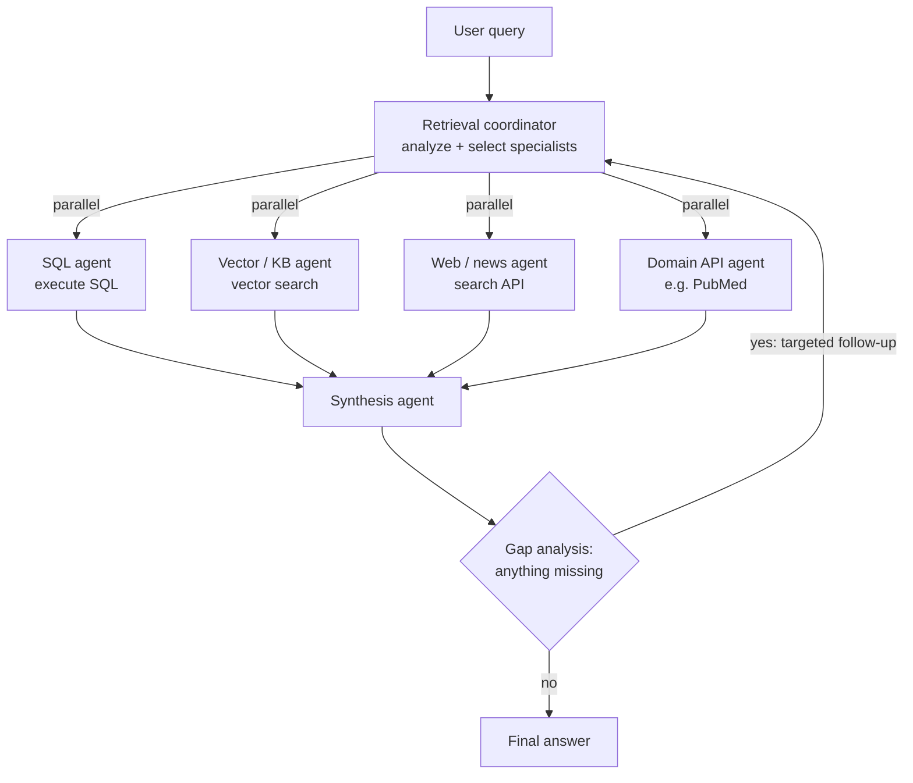

# Multi-Agent RAG

> [!abstract] TL;DR
> A single RAG chatbot answers from one source. Hard questions need many sources: papers, news, clinical-trial databases, internal SQL tables. **Multi-Agent RAG (MA-RAG)** replaces the lone generalist with a ==specialist research team==. **Specialized retrieval agents** each master one data source and its tools. A **retrieval coordinator** analyzes the query and delegates to the right specialists, often in parallel. A **synthesis agent** merges their varied results into one coherent answer. Optional **gap analysis** spots missing pieces and triggers follow-up queries. The payoffs: expert querying per source, structured and unstructured data together, and flexibility to call only the specialists a query needs.

**Prerequisites:** [[Retrieval-Augmented Generation]] · [[Agentic RAG]] · [[Orchestrating Agent Activities]]
**Related:** [[Agent Based RAG]] · [[Agents and Databases]] · [[Vector Databases]] · [[Web Search and Browsing for AI Agents]] · [[Orchestrator-Workers Workflow]] · [[Parallelization Workflow]]

> [!note] Source scope
> Based on the Udacity lesson "Introduction to Multi-Agent RAG" (Agentic AI Nanodegree, Course 4, Lesson 7): the introduction text, the summary page, and the video transcript. Material marked *beyond the lecture* is my own addition. The lesson's demo and exercises are in `python notebooks/agentic-ai-c4-exercises-demos/lesson-7-multi-agent-retrieval-augmented-generation/`.
> Transcript fixes: "date source" = *data source*, "publish medical API" = *PubMed API*, and "potentially buried results" is most likely *varied* results.

> [!todo]- Contents
> - [[#1. Core Concepts]]
> - [[#2. Architecture – The Four Roles]]
> - [[#3. Why Specialize – Three Advantages]]
> - [[#4. Where MA-RAG Sits Among the RAG Notes]]
> - [[#5. Worked Example – CRISPR for Cystic Fibrosis]]
> - [[#6. Pitfalls and Failure Modes]]
> - [[#7. Key Takeaways]]
> - [[#8. Critical Analysis]]
> - [[#9. Self-Test]]
> - [[#10. Glossary]]
> - [[#Further Reading]]

## 1. Core Concepts

The lesson's mental model: instead of one generalist researcher, a **specialist research team**. One member navigates PubMed, another digs through financial news, and a third writes SQL against internal databases. A team lead assigns the tasks, and a writer turns the findings into one report. The approach is ==divide and conquer across knowledge sources==.

> [!info]+ Definition – Retrieval-Augmented Generation (RAG)
> Providing an LLM with external knowledge from a data source before it generates a response. See [[Retrieval-Augmented Generation#^def-rag]].

^def-rag

> [!info]+ Definition – Specialized retrieval agent
> An agent designed and equipped with tools to retrieve information from one specific data source, such as a SQL database, a vector store, or a web search API. It doesn't just fetch: it also ==interprets and adds context== (e.g. noting a study's methodology limitations).

^def-specialized-retrieval-agent

> [!info]+ Definition – Retrieval coordinator
> An orchestrator agent that analyzes the user query (possibly with its own LLM call), decides which specialists are needed, delegates retrieval tasks (often in parallel), and collects the results.

^def-retrieval-coordinator

> [!info]+ Definition – Synthesis agent
> An agent that takes the varied retrieved results (database rows, text snippets, article summaries) and combines them into a single coherent answer.

^def-synthesis-agent

> [!info]+ Definition – Knowledge gap
> A piece of information missing from the initial retrieval that is needed to fully answer the query. Example: "we have the order details, but not the customer support history".

^def-knowledge-gap

## 2. Architecture – The Four Roles

| Role | Input | Output | Tools | Lecture note |
|---|---|---|---|---|
| Specialized retrieval agent | A sub-query for its source | Results plus interpretation and context | Execute SQL, vector search, web search, news API, PubMed API… | One per data source |
| Retrieval coordinator | User query | Delegated tasks, collected results | Other agents (as workers) | May use an LLM to analyze the query |
| Synthesis agent | All specialists' results | One coherent answer | – | Must handle mixed data types |
| Gap analysis *(optional but valuable)* | Initial results | Targeted follow-up queries | – | Done by the coordinator or the synthesizer |

This is the [[Orchestrator-Workers Workflow]] applied to retrieval: the coordinator is the orchestrator, specialists are workers, and the synthesis agent is the synthesizer. The fan-out is the parallel pattern from [[Orchestrating Agent Activities#3.2 Parallel – market analysis report]]. ^maps-to-orchestrator-workers

**Gap analysis** is [[Agentic RAG#3. The Retrieve–Reflect–Retry Loop|retrieve → reflect → retry]] lifted to the team level. Instead of one agent reformulating its own query, the team inspects the *combined* evidence and sends a targeted follow-up to the **right specialist**. ^team-level-gap-analysis

## 3. Why Specialize – Three Advantages

| Advantage | What it means | Lecture example |
|---|---|---|
| **Expert querying** | Each agent's prompt and tools are tuned for one source. Making one agent good at everything is hard | A SQL agent built for efficient SQL; a KB agent using advanced vector search; a web agent handling search-API quirks |
| **Diverse data types** | Combine **structured** data (customer records, sales figures, inventory) with **unstructured** text (documents, web pages, news). A single RAG pipeline often struggles with structured data | "This is where multi-agent RAG truly shines" for real-world use |
| **Orchestration flexibility** | The coordinator calls only the specialists a query needs | "Stock level for Product X?" → database agent only. "Compare Competitor Y's launch specs to Product X" → news + web + database agents, in parallel |

On structured data: text-to-SQL is a different skill from semantic search. See [[Agents and Databases#4. text2SQL – Natural Language to Queries]] and [[Agents and Databases#7. Hybrid Retrieval – Structure Plus Meaning]]. A specialist per access method keeps each prompt focused on one skill.

The lecture's closing test for whether you need MA-RAG: ==does your RAG need to go beyond document retrieval, into databases, APIs, or several specialized web sources?== If so, the architecture fits. This is especially true in the enterprise, where internal databases meet external information. ^when-to-use

## 4. Where MA-RAG Sits Among the RAG Notes

| Note | Who retrieves | Who decides the source | Loop | Synthesis |
|---|---|---|---|---|
| [[Retrieval-Augmented Generation]] | Fixed pipeline | Nobody: one source | None | The same LLM call |
| [[Agentic RAG]] | One agent | That agent | Retrieve → reflect → retry | The same agent |
| [[Agent Based RAG]] | One agent, RAG pipelines as tools | The agent routes between collections | Not observed in the runs | The same agent |
| **Multi-Agent RAG** | Several specialist agents | The retrieval coordinator | Team-level gap analysis ([[#^team-level-gap-analysis]]) | A dedicated synthesis agent |

*Beyond the lecture:* the distinction from [[Agent Based RAG]] is real but narrower than it looks. Wrapping each source as a *tool* for one agent already gets you source routing. MA-RAG adds value when each source needs its own **multi-step reasoning**: writing and fixing SQL, reformulating searches, judging source quality. That work is too much to cram into one agent's context.

## 5. Worked Example – CRISPR for Cystic Fibrosis

Query: *"What are the latest developments in CRISPR for treating cystic fibrosis?"*

| Specialist | Source | Retrieves | Context it adds |
|---|---|---|---|
| Scientific literature agent | Academic databases (e.g. PubMed) | Peer-reviewed papers | **Methodology limitations** |
| Medical trials agent | Clinical-trial registry | Ongoing clinical studies | **Patient outcomes** |
| News agent | News API | Recent biotech announcements | Recency, company context |
| Regulatory agent | FDA data | Approvals | Regulatory status |

The synthesis agent combines these into a **research briefing** that gives "a much richer picture than any single retrieval source could provide".

*Beyond the lecture,* a plausible gap-analysis round: the synthesizer notices the trials agent found a Phase 1 trial but no results, and the news agent mentions a company press release claiming success. That's a contradiction and a gap. The coordinator sends a targeted follow-up to the literature agent ("published results for trial X?") and the regulatory agent. The final briefing should then mark the press-release claim as **unverified** until peer-reviewed data exists. See [[Web Search and Browsing for AI Agents#6. Guardrails – Defense in Depth]] on ranking sources.

## 6. Pitfalls and Failure Modes

| Failure | Symptom | Mitigation |
|---|---|---|
| Coordinator picks the wrong specialists | Missing evidence, or wasted calls | Clear agent descriptions; evaluate routing accuracy; let gap analysis catch omissions |
| Specialist over-interprets | Summaries drop caveats or add claims not in the source ("telephone game") | Specialists return raw evidence *plus* interpretation, with citations |
| Contradictory sources merged blandly | The answer averages a press release and a peer-reviewed paper | Source-trust tiers; the synthesizer must surface conflicts, not hide them ([[LLM Hallucinations]]) |
| Mixed data types badly combined | SQL rows pasted as text, numbers misread | Normalize results into a typed schema before synthesis ([[Structured Outputs]]) |
| Unbounded gap analysis | Follow-up rounds never end; costs climb | Cap the rounds; stop when no new evidence appears ([[Agentic RAG#7. Retry Strategies and Tool Pivots]]) |
| Context overflow at the synthesizer | Some results get truncated or ignored | Specialists summarize to a budget; pass only relevant slices ([[State Management in Multi-Agent Systems#3. Stateful Orchestration – Context Is King]]) |
| Lost provenance | The answer can't be traced to sources | Carry source IDs through every hop to the final citation |
| Injected text in web or news results | A specialist's output steers the synthesizer | Treat retrieved text as data; sanitize and isolate ([[Prompt Injection]]) |
| Over-privileged SQL agent | Accidental writes or data exposure | Read-only credentials, query allow-lists ([[Agents and Databases#5. Guardrails for Reading and Writing]]) |

## 7. Key Takeaways

- [ ] MA-RAG = specialist retrieval agents + a retrieval coordinator + a synthesis agent (+ optional gap analysis).
- [ ] Each specialist owns one data source and the tools for it, and adds interpretation, not just raw results.
- [ ] The coordinator analyzes the query, calls only the specialists it needs, often in parallel, and collects the results.
- [ ] The synthesis agent combines mixed data (rows, snippets, summaries) into one coherent answer.
- [ ] Gap analysis detects missing information and triggers targeted follow-up queries to the right specialist.
- [ ] Main advantages: expert querying per source, combining structured and unstructured data, and flexible orchestration.
- [ ] Use it when RAG must reach beyond documents, into databases, APIs or several specialized sources ([[#^when-to-use]]).

## 8. Critical Analysis

**Coverage math** *(beyond the lecture)*. If the needed fact is in source $i$ with probability $r_i$ (independently), querying $k$ sources finds it with

$$
P(\text{covered}) = 1 - \prod_{i=1}^{k} (1 - r_i)
$$

Three sources at $r = 0.6$ give $1 - 0.4^3 = 0.936$, against $0.6$ for one. That's the real argument for MA-RAG. But coverage isn't correctness: more sources also mean more chances to retrieve something **wrong** or **contradictory**, and the synthesis agent becomes the bottleneck for quality.

**Cost and latency.** Parallel fan-out keeps latency near the slowest specialist ($\max_i t_i$), but cost scales with the number of agents and each agent's internal loop. Every gap-analysis round adds another full trip. The coordinator's flexibility (calling only the specialists needed) is the main cost control, so routing accuracy matters financially, not just for quality ([[Orchestrating Agent Activities#8. Critical Analysis]]).

**Evidence quality is under-addressed.** The lecture says MA-RAG "dramatically improves the quality and reliability of information" but gives no evaluation. Specialization should improve *retrieval* per source. Whether the *final answer* improves depends on synthesis faithfulness, which the lecture doesn't measure. Published multi-agent RAG work reports gains on multi-hop QA benchmarks, but results vary with the task, and a well-built single agent with good tools is a strong baseline.

**Interpretation at the retrieval layer.** Having specialists "provide context" (methodology limitations, patient outcomes) adds value, but it's also a place for errors to enter before synthesis. Each hop is an LLM transformation, so faithfulness compounds roughly like $p^n$ across hops ([[AI Reliability#^error-compounding]]).

**Evaluation.** Evaluate per layer ([[Agent Evaluation]]):
1. **Routing:** did the coordinator pick the right specialists?
2. **Retrieval:** per-specialist precision and recall ([[Agentic RAG#^rag-metrics]]).
3. **Gap detection:** given deliberately incomplete results, does it ask for the missing piece?
4. **Synthesis:** is every claim supported by a cited source, and are conflicts surfaced?

**Security.** The web and news specialists bring untrusted content into the system, and the synthesis agent reads all of it. That makes MA-RAG a prime target for indirect prompt injection ([[Prompt Injection]]). Keep tools minimal (e.g. the synthesis agent shouldn't have write tools), and give the SQL agent read-only access.

> [!question] Open discussion questions
> - When is "one agent with many retrieval tools" ([[Agent Based RAG]]) enough, and what observable signal tells you to split into specialists?
> - Should specialists return raw evidence, interpreted summaries, or both? What is the trade-off in tokens versus faithfulness?
> - How should a synthesis agent weigh a peer-reviewed paper against a same-week press release that contradicts it?

## 9. Self-Test

> [!question]- Q1. Name the four roles in a Multi-Agent RAG system and what each does.
> Specialized retrieval agents (each masters one data source and its tools), the retrieval coordinator (analyzes the query, delegates to the specialists it needs, often in parallel, and collects results), the synthesis agent (combines mixed results into one answer), and optional gap analysis (identifies missing information and triggers targeted follow-ups).

> [!question]- Q2. What three advantages does specialization bring, according to the lecture?
> Expert querying (prompts and tools tuned per source), handling diverse data types (structured database data together with unstructured text), and orchestration flexibility (only the needed specialists are called).

> [!question]- Q3. "What's the stock level for Product X?" versus "Summarize Competitor Y's launch and compare specs to Product X." Which specialists does the coordinator call for each?
> The first needs only the database agent. The second calls the news agent, the web search agent and the database agent (for Product X's specs), in parallel.

> [!question]- Q4. What is a knowledge gap, and how does MA-RAG handle it?
> Information missing from the first retrieval round that's needed for a full answer, e.g. order details found but no support history. Gap-analysis logic (in the coordinator or synthesizer) spots it and sends a targeted follow-up query to the specialist that owns that data.

> [!question]- Q5. How does MA-RAG differ from the single agent in [[Agent Based RAG]]?
> In Agent Based RAG, one agent routes between RAG pipelines exposed as tools, and synthesizes itself. In MA-RAG, each source has its own agent with its own reasoning (e.g. writing SQL, reformulating searches), a coordinator delegates and often runs them in parallel, a separate agent synthesizes, and gap analysis can trigger more rounds.

> [!question]- Q6. Design: an enterprise assistant must answer "Why did churn rise last quarter in the Midwest, and what are customers saying?" Design the MA-RAG system.
> Coordinator splits the question into churn figures by region and quarter (SQL agent, read-only warehouse), support ticket themes (vector agent over tickets), and public sentiment (web/social agent). Run them in parallel. The synthesizer joins the numbers to themes, with citations, and flags conflicts. Gap analysis: if churn rose in one product line, follow up with the SQL agent on that product's outages. Cap at 2 follow-up rounds. Guardrails: the SQL agent is read-only, and web content is treated as untrusted.

> [!question]- Q7. Quantitative: a needed fact appears in each of 4 independent sources with probability 0.5. What is the chance at least one specialist finds it, versus a single source?
> $1 - 0.5^4 = 0.9375$, versus $0.5$ for a single source.

### Flashcards

> [!tip] Flashcards
> Review this lesson with [[Multi-Agent RAG - Flashcards]].

## 10. Glossary

| Term | Definition |
|---|---|
| RAG | Giving an LLM external knowledge before it generates ([[#^def-rag]]) |
| Multi-Agent RAG (MA-RAG) | RAG split across specialist retrieval agents, a coordinator and a synthesizer |
| Specialized retrieval agent | An agent expert in one data source and its tools ([[#^def-specialized-retrieval-agent]]) |
| Retrieval coordinator | An orchestrator that analyzes the query and delegates retrieval ([[#^def-retrieval-coordinator]]) |
| Synthesis agent | Combines multi-source results into one answer ([[#^def-synthesis-agent]]) |
| Knowledge gap | Missing information needed for a full answer ([[#^def-knowledge-gap]]) |
| Gap analysis / re-querying | Detecting gaps and sending targeted follow-up queries |
| Structured data | Tabular or record data, e.g. customer records, sales figures |
| Unstructured data | Free text, e.g. documents, web pages, news |
| Provenance | The trace from each claim back to its source *(beyond the lecture)* |

## Further Reading

- [Retrieval-Augmented Generation for Knowledge-Intensive NLP Tasks (Lewis et al., 2020)](https://arxiv.org/abs/2005.11401)
- [Agentic Retrieval-Augmented Generation: A Survey on Agentic RAG (Singh et al., 2025)](https://arxiv.org/abs/2501.09136)
- [How we built our multi-agent research system – Anthropic](https://www.anthropic.com/engineering/multi-agent-research-system)
- [Building Effective Agents – Anthropic](https://www.anthropic.com/engineering/building-effective-agents)

%% Study hint: think "research team". Specialists = researchers, coordinator = team lead, synthesizer = report writer, gap analysis = "what are we still missing?". %%
