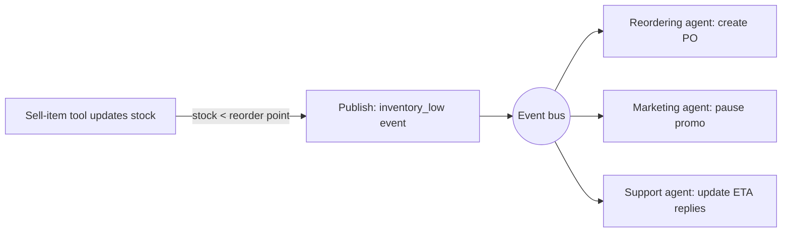
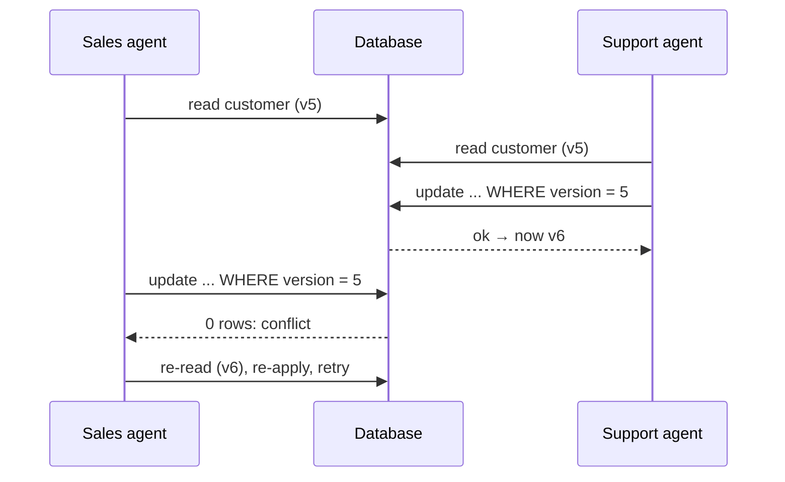

# Multi-Agent State Coordination

> [!abstract] TL;DR
> State management is knowing where the planes are. **State coordination** is making sure two of them don't land on the same runway at once. When agents act **concurrently** on shared state, you need **synchronization** to keep everyone's view consistent, and **conflict detection and resolution** for when views or writes collide. The lecture's toolkit: ==lean on the database (locks, transactions) as the source of truth, broadcast state-change events, and use optimistic concurrency control with version numbers==. When conflicts happen, resolve them with **predefined rules**, **negotiation**, **rollback and retry**, or **human escalation**.

**Prerequisites:** [[State Management in Multi-Agent Systems]] · [[Orchestrating Agent Activities]]
**Related:** [[Agents and Databases]] · [[Multi-Agent Architecture Design]] · [[Parallelization Workflow]] · [[AI Reliability]] · [[Gate Checks]]
**Hands-on:** [[Penguin and Scientist Agents]] · [[Skate Park Orchestration]]

> [!note] Source scope
> Based on the Udacity lesson "Multi-Agent State Coordination" (Agentic AI Nanodegree, Course 4, Lesson 6): the introduction text, the summary page, and the video transcript. Material marked *beyond the lecture* is my own addition. The lesson's demo and exercises are in `python notebooks/agentic-ai-c4-exercises-demos/lesson-6-multi-agent-state-coordination-and-orchestration/`.

> [!todo]- Contents
> - [[#1. Core Concepts]]
> - [[#2. The Five Design Questions]]
> - [[#3. Synchronization Strategies]]
> - [[#4. Conflict Resolution Strategies]]
> - [[#5. Stale Data Even in Sequential Flows]]
> - [[#6. Worked Example – Two Agents, One Customer Record]]
> - [[#7. Pitfalls and Failure Modes]]
> - [[#8. Key Takeaways]]
> - [[#9. Critical Analysis]]
> - [[#10. Self-Test]]
> - [[#11. Glossary]]
> - [[#Further Reading]]

## 1. Core Concepts

The lecture uses two analogies:

- **Surgical team.** The surgeon, anesthesiologist and scrub nurse must share a real-time, synchronized view of the patient. If blood pressure drops, *everyone* must know and react at once. That's **synchronization**.
- **Air traffic control.** Knowing where the planes are is state *management*. Stopping two planes from using the same runway at the same time is state *coordination*: ==detecting and resolving conflicts over a shared resource==.

The lecture's goal is to turn a group of talented individual agents into a cohesive, resilient team.

> [!info]+ Definition – State coordination
> The set of mechanisms that ensure multiple agents have a consistent and synchronized view of shared state, especially during concurrent operations.

^def-state-coordination

> [!info]+ Definition – Synchronization
> The process of keeping data consistent across multiple agents or systems.

^def-synchronization

> [!info]+ Definition – Concurrency
> When multiple agents or processes try to access or modify the same shared resource at the same time.

^def-concurrency

> [!info]+ Definition – Conflict detection
> Identifying when two or more agents have performed actions that result in an inconsistent or invalid state, or when one agent's knowledge contradicts another's.

^def-conflict-detection

> [!info]+ Definition – Conflict resolution
> The strategy or logic used to resolve a detected conflict and return the system to a consistent state.

^def-conflict-resolution

**Where this fits.** [[State Management in Multi-Agent Systems]] asked *what* to remember and *where the truth lives*. This lesson asks what happens when ==several agents touch that truth at the same time==. Concurrency usually comes from the parallel pattern in [[Orchestrating Agent Activities#3.2 Parallel – market analysis report]], or from peer-to-peer topologies, where "reconciling conflicting information" was already listed as a core difficulty ([[Multi-Agent Architecture Design#3. Peer-to-Peer Pattern – Direct Routing]]).

## 2. The Five Design Questions

The lecture says to ask these about any agent team:

1. **Where** is the shared state?
2. **How** do agents access it?
3. What happens if **two agents change it at once**?
4. What happens if **external systems** change it?
5. How do we **ensure consistency**?

Question 4 is easy to forget. Agents aren't the only writers: users, other services and staff change the same data. ^five-questions

## 3. Synchronization Strategies

| Strategy | Idea | Mechanism | Best when |
|---|---|---|---|
| **Lean on your database** | The DB is the primary source of truth | Tools use locks and transactions | State already lives in a proper DB |
| **State broadcasting / eventing** | Push changes to agents instead of making them poll | A tool publishes an event; interested agents subscribe and react | Agents must react promptly to changes |
| **Optimistic concurrency control (OCC)** | Assume conflicts are rare, but check before committing | Version number or timestamp checked at write time | Reads are frequent, writes to the same record are rare |

> [!warning] Transcript wording
> The closing summary lists "locking, MBCC or event broadcasting". "MBCC" is almost certainly a transcription of **MVCC** (multi-version concurrency control, how databases such as PostgreSQL implement concurrency internally) or shorthand for the lesson's OCC. The concept taught in the body is OCC with version numbers. Also, "rights" in the use-case sentence means **writes**.

### 3.1 Lean on your database

The lecture's advice is blunt: for application state in a proper database, ==the database is your primary source of truth==. Don't build your own consistency layer in agent memory. Have the agent's **tools** use what the database already provides:

- **Transactions:** several changes commit together or not at all (atomicity).
- **Locking:** an agent takes a lock on a row before changing it, and others wait.

*Beyond the lecture:* locking is **pessimistic** concurrency control. It assumes conflicts are likely and prevents them up front, at the cost of waiting and possible deadlocks. Keep locks short, and never hold a lock across an LLM call that takes seconds. See [[Agents and Databases#5. Guardrails for Reading and Writing]] for which writes agents should be allowed to make at all.

### 3.2 State broadcasting and eventing

Sometimes agents need **proactive notification** rather than repeatedly pulling state through tools.



The lecture's example: when inventory drops below the reorder point, the tool (or a related service) publishes an **inventory-low event**, and subscribed agents react. That is the publish/subscribe pattern, and it's what the [[Skate Park Orchestration]] README hinted at ("inventory status affects both shop operations and park events") without implementing it. ^eventing

*Beyond the lecture:* events decouple the publisher from its consumers, so a new agent can subscribe without changes to the publisher. That serves the "add agents without redesigning" goal from [[Orchestrating Agent Activities#^def-orchestration-layer]]. The cost is that delivery is usually asynchronous, so subscribers can briefly see stale state, and events may arrive twice or out of order. Subscribers should be idempotent.

### 3.3 Optimistic concurrency control

The problem it solves is the **lost update**: two agents read the same record, both modify it, and the second write silently overwrites the first.



How it works:
1. When an agent reads data, it **remembers the version** (e.g. customer record v5).
2. Its tool updates **only if the version is still 5**.
3. If another agent got in first (now v6), the update **fails** instead of overwriting.
4. The agent or orchestrator then **re-reads and retries**.

```sql
-- Beyond the lecture: OCC as a single conditional write
UPDATE customers
SET email = :new_email, version = version + 1
WHERE id = :id AND version = :expected_version;
-- 0 rows affected  →  conflict detected
```

The lecture's use case: ==works well when reads are frequent and writes to the same data are relatively infrequent==. If conflicts are common, the retries pile up and pessimistic locking is better. ^occ

## 4. Conflict Resolution Strategies

Despite the best synchronization, conflicts still happen. Here are the four strategies, roughly from most automated to least:

| Strategy | How | Lecture example | Watch out for |
|---|---|---|---|
| **Predefined rules / policies** | Resolution logic embedded in code | Traffic: emergency vehicles first, then the main road, then first-come-first-served. Data: "support agent updates always win", or "latest timestamp wins" | Rules silently discard the losing update |
| **Negotiation / consensus** | Agents communicate to reach a resolution: voting, proposing alternatives | More common in academic or highly complex coordination | Slow, costly, and LLM agents may agree on something wrong |
| **Rollback and retry** | Undo the failed operation, re-read the latest state, retry the *entire* operation | Pairs naturally with OCC version mismatches ([[#^occ]]) | Livelock under heavy contention; needs a retry cap |
| **Human escalation** | Pause and flag for a person | Critical, ambiguous, or unresolvable conflicts | Needs full context attached ([[State Management in Multi-Agent Systems#4. Failure Handling at the Orchestration Level]]) |

**Predefined rules** are the default for good reason: they are deterministic, fast, auditable and testable. The traffic example is a **priority ordering**: a lexicographic rule list, with each rule only breaking ties left by the one above it. ^priority-rules

**Rollback and retry** must redo the *whole* operation, not just the final write, because the agent's decision may change once it sees the new state. If the record changed from v5 to v6, the original edit may no longer make sense.

**Negotiation** relates to the voting in [[Parallelization Workflow#5.2 Majority voting]]. Voting there aggregates independent answers; here, it resolves competing claims on shared state.

> [!tip] Relation to the previous lesson's failure ladder
> Conflict resolution is a specialized case of the failure ladder in [[State Management in Multi-Agent Systems#4. Failure Handling at the Orchestration Level]]. Rollback and retry corresponds to retry with re-read, predefined rules act as a deterministic fallback, and human escalation is the same last resort.

## 5. Stale Data Even in Sequential Flows

The lecture's closing point: even **sequential** workflows, which only need basic database consistency, require **re-verification**. External systems can change data between when an agent reads it and when it acts. ==Acting on stale data is a coordination failure even with one agent==. ^re-verification

*Beyond the lecture:* this is the classic **time-of-check to time-of-use (TOCTOU)** gap. Agent workflows widen it, because an LLM step between "check" and "act" can take seconds.

> [!example] Seen in the exercises
> - **[[Skate Park Orchestration]]:** the orchestrator checks availability, then adds the booking. That's a check-then-act sequence. It's safe only because the booking tool *re-checks* availability inside the same operation, which is re-verification in miniature. With concurrent requests and a real database, you'd want a unique constraint or a transaction.
> - **[[Penguin and Scientist Agents]]:** the Scientist reads history and supply, the LLM deliberates, and then Python applies the decision. Python's re-check of `food_supply` and `tool_available` at apply time is exactly the re-verification this lesson calls for. Writing the log from *intent* rather than outcome is the matching anti-pattern.

## 6. Worked Example – Two Agents, One Customer Record

The lecture's data example: a **sales agent** and a **support agent** update the same customer's contact info at the same time.

| Approach | What happens |
|---|---|
| No coordination | Last write wins *by accident*. One update is silently lost |
| Pessimistic lock | The second agent waits for the first to finish, then sees the new data |
| OCC + rollback and retry | The second write fails on the version mismatch; that agent re-reads v6 and redoes its change (or decides it's no longer needed) |
| Predefined rule: "support always wins" | The support agent's value is kept regardless of order. Sales' change is rejected and logged |
| Predefined rule: "latest timestamp wins" | Deterministic, but relies on synchronized clocks *(beyond the lecture)* |
| Human escalation | If the values are contradictory and high-stakes (e.g. a billing address in a fraud case), flag it for review |

A reasonable default *(my recommendation, beyond the lecture)*: OCC for detection, a field-level predefined rule for routine conflicts, and escalation when the rule can't decide or the field is sensitive.

## 7. Pitfalls and Failure Modes

| Failure | Symptom | Mitigation |
|---|---|---|
| Lost update | One agent's change silently disappears | OCC version checks or locks ([[#^occ]]) |
| Agent memory treated as truth | Agents act on stale copies of state | Treat the DB as the source of truth; re-read before acting ([[#^re-verification]]) |
| Lock held across an LLM call | Other agents block for seconds; deadlocks | Read, release, reason, then write with an OCC check |
| Unbounded rollback and retry | Agents keep colliding and nothing progresses (livelock) | Retry cap with backoff and jitter, then escalate |
| Polling instead of events | Slow reactions, wasted tool calls | Publish/subscribe for critical changes ([[#^eventing]]) |
| Duplicate or out-of-order events | Double reorders, reacting to old state | Idempotent subscribers, versioned events |
| Ignoring external writers | Conflicts with users or other services | Answer the five design questions ([[#^five-questions]]) |
| Rules that drop data silently | The losing update vanishes without trace | Log every rule-based resolution |
| LLM "negotiation" with no ground truth | Agents convince each other of something false | Prefer deterministic rules; reserve negotiation for genuine trade-offs |

## 8. Key Takeaways

- [ ] State coordination keeps concurrent agents' view of shared state consistent; state management alone isn't enough.
- [ ] Let the database be the source of truth, and use its locks and transactions through agent tools.
- [ ] Publish events for critical state changes so agents react without polling.
- [ ] Optimistic concurrency control: remember the version you read, write only if it's unchanged, and re-read and retry on conflict.
- [ ] OCC suits many reads and few conflicting writes. Heavy contention favours locks.
- [ ] Resolve conflicts with predefined rules, negotiation, rollback and retry, or human escalation.
- [ ] Even sequential flows must re-verify before acting, because external systems change data too.

## 9. Critical Analysis

**What's new versus classic distributed systems.** Almost nothing in this lesson is agent-specific. Locks, transactions, OCC, pub/sub and last-writer-wins are decades-old database and distributed-systems techniques. The agent-specific part is **latency and non-determinism**: an LLM step between read and write stretches the conflict window from milliseconds to seconds, and a retried decision may differ from the original. Both make OCC and re-verification *more* important for agents than for ordinary services.

**Quantifying OCC** *(beyond the lecture)*. If other writes to a record arrive at rate $\lambda$ and an agent's read-modify-write window lasts $w$ seconds, the chance of a conflict is about

$$
P(\text{conflict}) \approx 1 - e^{-\lambda w}
$$

For a record written once a minute ($\lambda = 1/60$ per second), a 0.1 s database transaction has $P \approx 0.17\%$, but a 10 s LLM-mediated update has $P \approx 15\%$. The same OCC design that's "rare conflicts" for code becomes frequent for agents. That's an argument for keeping the LLM *out* of the critical section: decide first, then do a fast conditional write.

**Negotiation is under-motivated.** The lecture says it's mostly academic. With LLM agents it's also risky: agents can be persuaded, and persuasion isn't correctness. If you use it, give it a deterministic arbiter and a timeout.

**Eventual consistency.** Event broadcasting makes the system **eventually consistent**: different agents can briefly hold different views. That's fine for a reorder trigger, but not for "is this seat still free". Choose per decision which consistency level you need.

**Security.** A shared event bus or shared state is a channel between agents, so a compromised or prompt-injected agent can publish misleading events or win conflicts it shouldn't ([[Prompt Injection]]). Authorize which agents may publish which events, and make "who wins" rules depend on role, not on what an agent claims.

**Evaluation.** Concurrency bugs rarely appear in sequential tests. Run agents truly in parallel against the same records, inject interleavings (delay one agent between read and write), and assert no lost updates and correct resolution. Measure conflict and retry rates in production as health metrics ([[AI Reliability]]).

> [!question] Open discussion questions
> - Should an LLM ever sit inside a database transaction or lock, or should it always decide first and commit separately?
> - For which kinds of shared state is eventual consistency acceptable for agents, and where is it dangerous?
> - Is negotiation between LLM agents ever more reliable than a deterministic rule plus human escalation?

## 10. Self-Test

> [!question]- Q1. What is the difference between state management and state coordination, using the air-traffic analogy?
> Management is knowing where every plane is, i.e. tracking state. Coordination is making sure two planes don't use the same runway at once, i.e. keeping concurrent actors consistent and detecting and resolving conflicts over shared resources.

> [!question]- Q2. Name the three synchronization strategies from the lecture.
> Lean on your database (it's the source of truth; tools use locks and transactions), state broadcasting or eventing (publish events on critical changes that subscribed agents react to), and optimistic concurrency control (version or timestamp checks before committing).

> [!question]- Q3. Walk through optimistic concurrency control when two agents edit customer record v5.
> Both read v5. The first writes "update if version = 5", which succeeds, making it v6. The second writes "update if version = 5", which fails because it's now v6, preventing a lost update. The second agent re-reads v6, re-evaluates, and retries.

> [!question]- Q4. When does OCC work well, and when should you prefer locking?
> OCC works when reads are frequent and conflicting writes to the same data are rare. Under heavy write contention, repeated rollbacks and retries become costly, so pessimistic locking (beyond the lecture) is better.

> [!question]- Q5. List the four conflict-resolution strategies and give the lecture's example of a predefined rule.
> Predefined rules or policies, negotiation or consensus, rollback and retry, and human escalation. Rule examples: in traffic coordination, emergency vehicles first, then the main road, then first-come-first-served; for data, "support agent updates always win" or "latest timestamp wins".

> [!question]- Q6. Why does even a purely sequential agent workflow need re-verification?
> External systems (users, other services) can change the data between when the agent reads it and when it acts on it. The agent would otherwise act on stale data.

> [!question]- Q7. Design: a ticket-booking system has several agents selling seats for the same concert. How do you prevent double-selling?
> Keep seat state in the database as the source of truth. Make the final reservation an atomic conditional write: a unique constraint on (event, seat), or "update where status = 'free'". Agents may browse optimistically, but the commit re-verifies. On conflict, roll back, re-read availability, and offer alternatives. Publish a "seat_sold" event so other agents stop offering it. Escalate payment-versus-reservation mismatches to staff.

> [!question]- Q8. Quantitative: a record gets about 2 writes per minute from other actors. Compare the conflict probability for a 0.5 s tool update and a 15 s LLM-mediated update.
> $\lambda = 2/60 \approx 0.0333$ per second. 0.5 s: $1 - e^{-0.0167} \approx 1.7\%$. 15 s: $1 - e^{-0.5} \approx 39\%$. Moving the LLM out of the read-modify-write window cuts conflicts more than 20-fold.

### Flashcards

> [!tip] Flashcards
> Review this lesson with [[Multi-Agent State Coordination - Flashcards]].

## 11. Glossary

| Term | Definition |
|---|---|
| State coordination | Mechanisms keeping agents' view of shared state consistent under concurrency ([[#^def-state-coordination]]) |
| Synchronization | Keeping data consistent across agents or systems ([[#^def-synchronization]]) |
| Concurrency | Several agents accessing or modifying the same resource at once ([[#^def-concurrency]]) |
| Conflict detection | Spotting actions or knowledge that produce inconsistent state ([[#^def-conflict-detection]]) |
| Conflict resolution | Logic that restores a consistent state ([[#^def-conflict-resolution]]) |
| Transaction | A group of changes that commit together or not at all |
| Lock | Exclusive access to data while one agent changes it |
| State broadcasting / eventing | Publishing state-change events to subscribed agents ([[#^eventing]]) |
| Optimistic concurrency control | Version- or timestamp-checked writes that fail on conflict ([[#^occ]]) |
| Lost update | A write silently overwritten by a concurrent write |
| Rollback and retry | Undo the failed operation, re-read, redo it |
| Pessimistic locking | Preventing conflicts by locking up front *(beyond the lecture)* |
| TOCTOU | Time-of-check to time-of-use gap ([[#^re-verification]]) *(beyond the lecture)* |
| Eventual consistency | Replicas or views converge over time, not instantly *(beyond the lecture)* |

## Further Reading

- [Optimistic Offline Lock – Martin Fowler, *Patterns of Enterprise Application Architecture*](https://martinfowler.com/eaaCatalog/optimisticOfflineLock.html)
- [Pessimistic Offline Lock – Martin Fowler](https://martinfowler.com/eaaCatalog/pessimisticOfflineLock.html)
- [Publisher-Subscriber pattern – Microsoft Azure Architecture Center](https://learn.microsoft.com/en-us/azure/architecture/patterns/publisher-subscriber)
- [PostgreSQL – Concurrency Control](https://www.postgresql.org/docs/current/mvcc.html)
- [Kung & Robinson (1981), On Optimistic Methods for Concurrency Control](https://dl.acm.org/doi/10.1145/319566.319567)

%% Study hint: surgeons = synchronization, air traffic = conflict resolution, customer record v5 → v6 = OCC, intersection priority = predefined rules. %%
