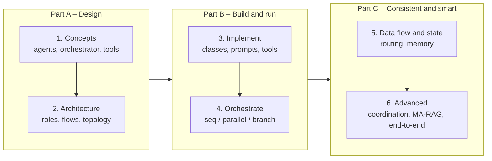

# Multi-Agent Systems Skills Scorecard

> [!abstract] TL;DR
> This is the end-of-course review for Course 4 (Multi-Agent Systems). It groups the scorecard's six skills into three stages: ==**design** the team, **build and run** it, then **keep it consistent and smart** as it scales==. Each skill gets a short recap and links to the notes and exercises that cover it in depth. The common thread is that a multi-agent system is only as good as the parts around the agents: the architecture, the orchestrator, and the state.

**Prerequisites:** [[Multi-Agent Systems]] · [[Agentic AI Skills Scorecard - Study Guide]] (the Course 1 review this builds on)
**Related:** [[Multi-Agent Architecture Design]] · [[Orchestrating Agent Activities]] · [[State Management in Multi-Agent Systems]] · [[Multi-Agent State Coordination]] · [[Multi-Agent RAG]]

> [!note] Source scope
> The skill list is the course's own scorecard. The explanations summarize existing vault notes, linked in each section. The grouping, the worked example and the critical analysis are *beyond the course* (my synthesis). No flashcards: each linked note has its own deck.

> [!todo]- Contents
> - [[#1. The Scorecard at a Glance]]
> - [[#2. Part A – Design the Team]]
> - [[#3. Part B – Build and Run It]]
> - [[#4. Part C – Keep It Consistent and Smart]]
> - [[#5. Worked Example – One System Using Every Skill]]
> - [[#6. Pitfalls Across the Course]]
> - [[#7. Self-Assessment]]
> - [[#8. Critical Analysis]]
> - [[#9. Self-Test]]
> - [[#Further Reading]]

---

## 1. The Scorecard at a Glance

| Part | Skill | Core notes | Hands-on |
|---|---|---|---|
| **A. Design** | 1. Explain the core concepts | [[Multi-Agent Systems]] · [[Agent Components and Agent Types]] | – |
| | 2. Design multi-agent architecture | [[Multi-Agent Architecture Design]] | – |
| **B. Build and run** | 3. Implement agents in Python | [[Smolagents Framework]] · [[Building Agents with Tools in Python]] · [[Tool Descriptions in Agentic Systems]] | [[Penguin and Scientist Agents]] |
| | 4. Orchestrate complex workflows | [[Orchestrating Agent Activities]] · [[Orchestrator-Workers Workflow]] | [[Skate Park Orchestration]] |
| **C. Consistent and smart** | 5. Manage data flow and state | [[Routing and Data Flow in Agentic Systems]] · [[Routing Workflow]] · [[State Management in Multi-Agent Systems]] · [[Long-Term Agent Memory]] | [[Skate Park Orchestration]] |
| | 6. Build advanced agentic systems | [[Multi-Agent State Coordination]] · [[Multi-Agent RAG]] | Course project |

### How the skills stack

Each part answers a different question. Part A asks *who does what and who talks to whom?* Part B asks *how does work actually get done, and in what order?* Part C asks *how does the team stay correct as it remembers, shares and scales?* ^three-parts

---

## 2. Part A – Design the Team

### 2.1 Explain the core concepts

A multi-agent system is a team of specialized LLM agents that collaborate on a goal no single agent handles well. The scorecard's analogies make the roles concrete:

| Analogy | Specialists (agents) | Coordinator (orchestrator) | Shared tools and state |
|---|---|---|---|
| **Restaurant** | Chefs by station, servers, a host | Head chef or expediter calling orders | The ticket rail, the pantry |
| **Hospital** | Surgeon, anesthesiologist, nurse, lab | Attending physician or charge nurse | Patient chart, monitors |

| Component | Role | Deep dive |
|---|---|---|
| **Agent** | LLM + role prompt + tools + memory, owning one responsibility | [[AI Agents]] · [[Agent Components and Agent Types]] |
| **Orchestrator** | Delegates, passes context, tracks state, handles errors | [[Orchestrating Agent Activities#^def-orchestrator]] |
| **Tools** | Functions that let agents act on data and APIs | [[Tool Use]] · [[Smolagents Framework#^def-tool]] |

The hospital analogy comes back in [[Multi-Agent State Coordination#1. Core Concepts]] as the surgical team that needs a synchronized view of the patient.

### 2.2 Design multi-agent architecture

Draw boxes and arrows *before* writing code. That forces three questions: who talks to whom, what each agent needs to know, and how the job gets done ([[Multi-Agent Architecture Design#1. Core Concepts]]).

| Choice | Pick it when | Note |
|---|---|---|
| **Orchestrator (hub and spoke)** | The flow is structured, predictable, and needs auditing | [[Multi-Agent Architecture Design#2. Orchestrator Pattern – Hub and Spoke]] |
| **Peer-to-peer** | The sequence isn't known upfront, or you must avoid a central bottleneck | [[Multi-Agent Architecture Design#3. Peer-to-Peer Pattern – Direct Routing]] |

The four decisions to make every time are **roles, communication protocol, state management, and data flow** ([[Multi-Agent Architecture Design#5. The Four Design Decisions]]). Parts B and C are those decisions turned into code.

---

## 3. Part B – Build and Run It

### 3.1 Implement agents in Python

| Scorecard bullet | How the course did it | Lessons learned in the exercises |
|---|---|---|
| Turn the design into agent classes | Subclass or instantiate a tool-calling agent per role ([[Smolagents Framework#3. The ToolCallingAgent Loop]]) | Keep agent state (food, bookings) in Python objects, not in the model ([[Penguin and Scientist Agents#2. The Two Agents]]) |
| Write effective system prompts (role, personality, limitations) | A role description per agent, plus task prompts that state inputs, rules and output format | Limits stated only in prompts are soft. Enforce them in code ([[Penguin and Scientist Agents#3. Patterns Worth Connecting]]). Persona craft: [[Agentic AI Skills Scorecard - Study Guide#3.1 Craft Specialized Personas]] |
| Equip agents with tools for data and APIs | Decorated Python functions with typed arguments and docstrings | The docstring *is* the prompt for that tool ([[Tool Descriptions in Agentic Systems]]). Return clear "not found" results ([[Skate Park Orchestration#4. Issues and Improvements]]) |

The recurring pattern: ==the LLM proposes, code disposes==. Read decisions from structured tool-call arguments, then validate and apply them in Python. ^llm-proposes

### 3.2 Orchestrate complex workflows

| Pattern | Rule | Lecture example | Workflow note |
|---|---|---|---|
| Sequential | Each step builds on the last | Wi-Fi support: diagnose → solve → verify | [[Prompt Chaining Workflow]] |
| Parallel | Independent tasks at once, then merge | Market report: news + stocks + competitors | [[Parallelization Workflow]] |
| Conditional | Branch on an agent's output | Returns: eligible → refund, else → denial | [[Routing Workflow]] |

Real workflows combine all three ([[Orchestrating Agent Activities#4. Combining Patterns]]). "Intelligent delegation" means the orchestrator picks the right specialist for each sub-task. That can be done by code (deterministic, cheap) or by an LLM (flexible, but soft); see [[Skate Park Orchestration#^soft-routing]] for the trade-off in practice and [[Orchestrator-Workers Workflow]] for LLM-planned delegation.

---

## 4. Part C – Keep It Consistent and Smart

### 4.1 Manage data flow and state

| Scorecard bullet | Key idea | Notes |
|---|---|---|
| Route information by content and priority | Content-based, round-robin and priority routing; enhance, filter and transform payloads between agents | [[Routing and Data Flow in Agentic Systems]] · [[Routing Workflow]] · [[Skate Park Orchestration#3. What the Run Log Shows]] (the safety report that wasn't prioritized) |
| Short-term (ephemeral) vs long-term (persistent) memory | Decide what can be discarded and what must be preserved | [[State Management in Multi-Agent Systems#2. Two Levels and Two Lifetimes of State]] · [[Agent State Management]] · [[Long-Term Agent Memory]] |
| Stateful, context-aware agents | The orchestrator owns shared state and passes each agent only its slice | [[State Management in Multi-Agent Systems#3. Stateful Orchestration – Context Is King]] |
| (implicit) Failure handling | Retry → fallback → report; compensate side effects; escalate to humans | [[State Management in Multi-Agent Systems#4. Failure Handling at the Orchestration Level]] |

> [!tip] Lesson 4 deep dive
> Content-based, round-robin and priority routing, and data-flow enhancement, filtering and transformation, are covered in [[Routing and Data Flow in Agentic Systems]].

### 4.2 Build advanced agentic systems

| Scorecard bullet | Key idea | Note |
|---|---|---|
| State coordination for shared resources | Use the database as the source of truth, publish events on changes, and use optimistic concurrency (version checks). Resolve conflicts with rules, rollback and retry, or a human | [[Multi-Agent State Coordination]] |
| Multi-agent RAG | Specialist retrieval agents + a coordinator + a synthesis agent + gap analysis | [[Multi-Agent RAG]] · [[Agentic RAG]] · [[Agent Based RAG]] |
| Design, build, test and document an end-to-end solution | Everything above, applied to a real business problem | Course project (`python notebooks/agentic-ai-c4-exercises-demos/project/`) |

---

## 5. Worked Example – One System Using Every Skill

*Beyond the course.* The paper-supplier quoting scenario from [[State Management in Multi-Agent Systems#3.1 The order-processing example]], built end to end:

| Skill | Applied |
|---|---|
| 1. Concepts | Agents: intake, inventory, pricing, fulfillment, customer-reply. Orchestrator: quote manager. Tools: inventory DB, price list, shipping API |
| 2. Architecture | Hub and spoke, because the flow is auditable and money is involved. Typed messages, and state owned by the hub |
| 3. Implement | One tool-calling agent per role. The pricing agent's prompt states the discount rules and that it may only *propose* prices. Tools have typed, documented arguments |
| 4. Orchestrate | Sequential intake → **parallel** inventory check + customer history lookup → **branch**: in stock → quote; partial → split-shipment quote; none → back-order reply |
| 5. Data flow and state | Urgent requests ("needed by Friday") are routed ahead. Ephemeral: the current quote. Persistent: customer and order history. Each agent gets only its slice |
| 6. Advanced | The final stock reservation is a version-checked write ([[Multi-Agent State Coordination#^occ]]). An MA-RAG lookup combines price lists (SQL) and contract terms (vector store) for customer-specific discounts. Failure path: shipping API timeout → retry with backoff → fallback flat rate → escalate if the order is above a threshold |

The pricing agent proposes and code enforces the discount ceiling ([[#^llm-proposes]]). The reservation re-verifies stock right before committing ([[Multi-Agent State Coordination#^re-verification]]).

---

## 6. Pitfalls Across the Course

| Pitfall | Seen in | Fix | Part |
|---|---|---|---|
| Multi-agent where one agent or plain code would do | Weather example ([[Smolagents Framework#8. Critical Analysis]]) | Start simple; split only when roles or sources truly differ | A |
| Mesh topology with no owner of the overall state | – | Hub and spoke unless there's a clear reason not to | A |
| Limits stated only in prompts | Penguin rules, skate park permissions | Validate and enforce in code ([[#^llm-proposes]]) | B |
| Parallelizing dependent steps | Edit/publish in the content demo | Draw the dependency graph first | B |
| Agent loops that never stop | Skate park classifier: 62% of tokens wasted ([[Skate Park Orchestration#^diagnoser-loop]]) | Step caps; single structured calls for classification | B |
| State that records intent, not outcome | Penguin distribution history | Write state after the action is confirmed | C |
| Lost updates and stale reads | – | Version checks, re-verification | C |
| Parsing LLM run logs for results | Lesson 7 course solution | Call deterministic steps directly; use the LLM for judgement | C |
| Untrusted text flowing between agents | Web and news results in MA-RAG | Treat retrieved and inter-agent text as data ([[Prompt Injection]]) | C |

---

## 7. Self-Assessment

Tick each skill when you can do it without notes:

**Part A – Design**
- [ ] Explain a multi-agent system with the restaurant and hospital analogies, and name agents, orchestrator and tools.
- [ ] Draw an architecture diagram with roles, message flows and state ownership.
- [ ] Justify orchestrator versus peer-to-peer for a given problem.

**Part B – Build and run**
- [ ] Turn a design into agent classes with tools in Python.
- [ ] Write a system prompt that states role, personality and limitations, and enforce the limits in code.
- [ ] Build a workflow that combines sequential, parallel and conditional steps.
- [ ] Implement delegation to the right specialist, and explain code versus LLM routing.

**Part C – Consistent and smart**
- [ ] Route requests by content and priority.
- [ ] Separate ephemeral from persistent state, and pass each agent only its context slice.
- [ ] Implement retry with backoff, fallbacks, compensating actions and human escalation.
- [ ] Prevent lost updates with version checks, and resolve conflicts with a clear policy.
- [ ] Build an MA-RAG pipeline with a coordinator, specialists, synthesis and gap analysis.
- [ ] Design, test and document an end-to-end multi-agent solution.

---

## 8. Critical Analysis

**When not to go multi-agent.** Every agent adds latency, cost and a failure point. End-to-end reliability falls roughly as $p^n$ across dependent steps ([[AI Reliability#^error-compounding]]), and token cost grows with every hop and every retry. The course teaches *how* to build teams, but the most important design skill is knowing when one well-tooled agent, or a fixed workflow, is enough ([[Agent Based RAG]] versus [[Multi-Agent RAG]]).

**The course's real lesson is classic engineering.** Hub-and-spoke topologies, sagas, optimistic locking, pub/sub, retries with backoff: most of Part C is distributed-systems practice. What agents change is **latency** (seconds-long LLM steps widen every race window) and **non-determinism** (a retry may make a different decision). That makes the classic techniques *more* necessary, not less.

**Evaluation is the thinnest part of the course.** The scorecard says "test", but the exercises mostly print outputs. Multi-agent systems need evaluation at every layer: routing accuracy, per-agent trajectory checks, state assertions, fault injection, and cost and step budgets ([[Agent Evaluation]]). The skate-park run looked fine in its answers and was wasteful in its logs.

**Security grows with team size.** Each agent boundary is a place where untrusted text is passed on, and each write tool is a capability. Least-privilege tools, role-based permissions, and gates before side effects ([[Gate Checks]]) matter more as agents multiply.

> [!question] Open discussion questions
> - What concrete signal in your own work (sources, roles, latency, audit needs) would justify moving from one agent to a team?
> - Should orchestration logic live in code, in an LLM, or in a framework graph, and how would you test each?
> - Which part of this course would you use first in a production system at work, and what would you leave out?

---

## 9. Self-Test

> [!question]- Q1. Group the six scorecard skills into the three parts and say what question each part answers.
> A. Design (concepts, architecture): who does what and who talks to whom? B. Build and run (implement, orchestrate): how does work get done, and in what order? C. Consistent and smart (data flow and state, advanced): how does the team stay correct as it remembers, shares and scales?

> [!question]- Q2. What four design decisions does every multi-agent architecture require?
> Roles, communication protocol, state management, and data flow.

> [!question]- Q3. Name the three orchestration patterns and one example of each.
> Sequential (Wi-Fi diagnose → solve → verify), parallel (news + stock + competitor agents for a market report), conditional (return eligible → refund, else → denial).

> [!question]- Q4. What does "the LLM proposes, code disposes" mean, and where did the exercises show it?
> The model states a decision through structured tool-call arguments, and Python validates and applies it. Shown in the penguin exercise (food clamped to supply, a single tool) and in the lesson 7 comparison (direct deterministic calls instead of parsing agent logs).

> [!question]- Q5. Two agents update the same customer record at once. What mechanisms prevent a lost update, and how is the conflict resolved?
> Optimistic concurrency (write only if the version is unchanged) or a database lock. On a version mismatch, roll back, re-read and retry, or apply a predefined rule (e.g. role priority), and escalate to a human if it's critical or ambiguous.

> [!question]- Q6. Design: sketch an MA-RAG system for "Which of our enterprise customers are affected by today's fiber cut, and what have we told them?"
> Coordinator → in parallel: network-inventory SQL agent (circuits on the cut span → affected accounts), ticketing/CRM agent (open tickets and messages sent), and outage-status agent (NOC updates). The synthesis agent joins accounts to communications and flags customers with no outreach yet (a gap). Gap analysis triggers a follow-up for missing contact records. All agents are read-only, and escalation goes to the NOC duty manager.

> [!question]- Q7. Quantitative: a hub dispatches to 4 sequential specialists, each 95% reliable, with a final synthesis step that's 98% reliable. What is end-to-end success, and what does running the 4 specialists in parallel change?
> $0.95^4 \times 0.98 \approx 0.798$. Parallel execution cuts latency to the slowest specialist but leaves reliability at $\approx 0.80$ if all must succeed. Improving reliability needs retries, fallbacks, or tolerating partial results.

---

## Further Reading

- [Building Effective Agents – Anthropic](https://www.anthropic.com/engineering/building-effective-agents)
- [How we built our multi-agent research system – Anthropic](https://www.anthropic.com/engineering/multi-agent-research-system)
- [Why Do Multi-Agent LLM Systems Fail? (Cemri et al., 2025)](https://arxiv.org/abs/2503.13657)
- [smolagents documentation – Hugging Face](https://huggingface.co/docs/smolagents/index)

%% Study hint: review in the three-part order. For each part, re-read one theory note and one exercise note: A = Architecture Design; B = Orchestrating + Skate Park; C = State Management + Coordination + MA-RAG. %%
