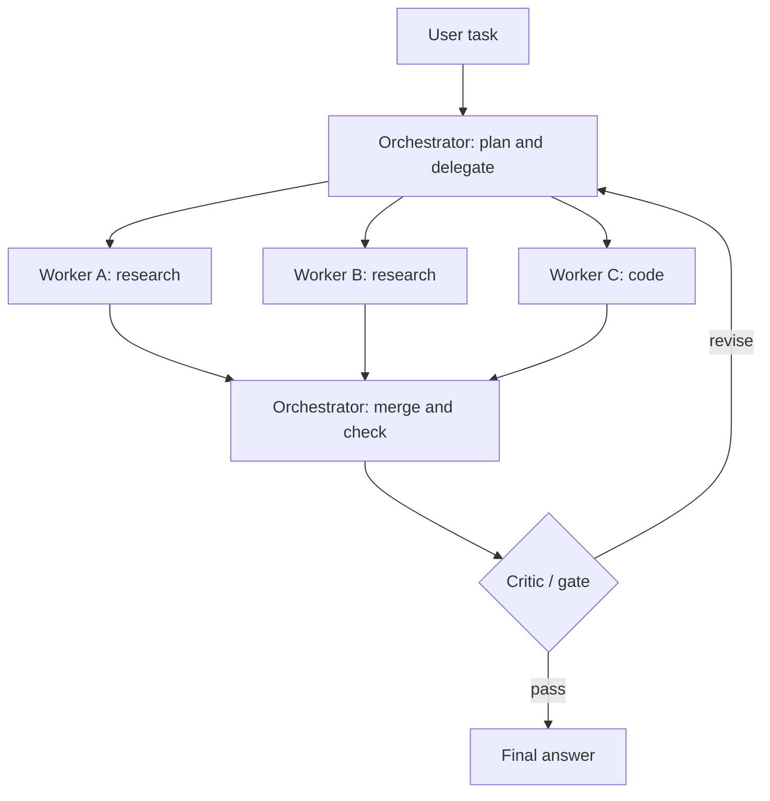

# Multi-Agent Systems

> [!abstract] TL;DR
> A multi-agent system splits work across several LLM agents, each with its own role, prompt, tools and context, coordinated by an orchestrator or by message passing. It helps when a task has ==separable subtasks that benefit from separate contexts, specialization or parallelism==. It costs more tokens, adds coordination failures, and multiplies attack surface. Start with one agent and add agents only when an eval shows it helps.

**Prerequisites:** [[AI Agents]] · [[Tool Use]]
**Related:** [[Agentic AI]] · [[Planning Agents]] · [[Task Decomposition]] · [[Model Context Protocol]] · [[AI Memory]] · [[AI Reliability]]

> [!note] Source scope
> Concept hub. All content is *beyond the lecture*; based on the sources in [[#Further Reading]].

> [!todo]- Contents
> - [[#1. Core Concepts]]
> - [[#2. Coordination Patterns]]
> - [[#3. When Multi-Agent Helps]]
> - [[#4. Worked Example – Incident Research Team]]
> - [[#5. Pitfalls and Failure Modes]]
> - [[#6. Key Takeaways]]
> - [[#7. Critical Analysis]]
> - [[#8. Self-Test]]
> - [[#9. Glossary]]
> - [[#Further Reading]]

## 1. Core Concepts

> [!info]+ Definition – Multi-agent system
> A system in which two or more autonomous LLM-driven agents, each with its own instructions, tools and state, cooperate (or compete) through defined communication to complete a task.

^def-mas

| Term | Meaning |
|---|---|
| Orchestrator / supervisor | Agent that plans, delegates and merges results |
| Worker / subagent | Specialized agent that handles one subtask |
| Handoff | Passing control (and context) from one agent to another |
| Shared state / blackboard | A common store all agents read and write |
| Protocol | The message format between agents (e.g. A2A, or tools exposed via [[Model Context Protocol|MCP]]) |

## 2. Coordination Patterns

| Pattern | How it works | Good for | Watch out for |
|---|---|---|---|
| Orchestrator–worker | One lead delegates to subagents | Broad research, parallel subtasks | Lead becomes a bottleneck |
| Pipeline / sequential | Agent A → B → C | Fixed workflows (like [[Sequential Prompting]]) | Error compounding ([[AI Reliability#^error-compounding]]) |
| Router / handoff | Triage agent sends to a specialist | Customer support by domain | Misrouting |
| Debate / critic | Agents argue or one reviews another | Reasoning, fact-checking | Agreement on a wrong answer |
| Peer / swarm | Agents message each other freely | Open-ended exploration | Hard to control and debug |

## 3. When Multi-Agent Helps

- **Context isolation.** Each subagent gets a clean, focused context instead of one overloaded window.
- **Parallelism.** Independent searches run at the same time → lower wall-clock time.
- **Specialization.** Different prompts, tools, models or permissions per role (least privilege per agent).
- **Separation of duties.** A reviewer agent that didn't write the output is a better [[Gate Checks|gate]].

When it doesn't: tightly coupled tasks where every step needs the full context (e.g. editing one piece of code). Then the agents spend tokens re-explaining shared context and make conflicting decisions.

Cost: if each of $m$ agents uses about $T$ tokens, total cost is about $m \cdot T$ plus orchestration overhead — multi-agent runs are often several times more expensive than a single agent.

## 4. Worked Example – Incident Research Team

Task: "Write a post-incident summary for last night's checkout outage."

1. **Orchestrator** breaks it down ([[Task Decomposition]]): timeline, root cause evidence, customer impact.
2. **Log agent** (read-only log tools) builds the timeline.
3. **Metrics agent** (read-only metrics API) quantifies error rates.
4. **Ticket agent** reads support tickets for customer impact (like [[Sonar Ticket and Outage Classification - How-To]]).
5. Workers return short, structured summaries (Pydantic schema) — not raw logs — to the orchestrator.
6. **Critic agent** checks every claim cites evidence from a worker; unsupported claims go back.
7. Orchestrator writes the final summary. No agent has write permissions to production.

## 5. Pitfalls and Failure Modes

| Failure | Symptom | Mitigation |
|---|---|---|
| Vague delegation | Workers duplicate work or miss parts | Orchestrator gives each worker an objective, output format, scope and stop condition |
| Context loss at handoff | Worker lacks key facts | Pass structured briefs; shared state |
| Conflicting outputs | Workers disagree, merge picks one arbitrarily | Explicit conflict resolution; critic step |
| Runaway cost / loops | Agents keep messaging | Budget and step limits; termination rules |
| Echo chamber | Critic agrees with a wrong answer | Use a different model or grounded checks for the critic |
| Injection spreads | One poisoned document drives others | Treat inter-agent messages as untrusted; least privilege per agent |
| Hard to debug | No one knows which agent failed | Trace every message and tool call |

## 6. Key Takeaways

- [ ] I can name five coordination patterns and when each fits.
- [ ] I can argue when multi-agent beats single-agent (context isolation, parallelism, specialization) and when it doesn't.
- [ ] I write delegations with objective, format, scope and stop condition.
- [ ] I budget for multiplied token cost.
- [ ] I treat inter-agent messages as untrusted input.

## 7. Critical Analysis

- **Evidence is mixed.** Some reports show large gains on broad research tasks; failure analyses (e.g. Cemri et al., 2025) find many multi-agent failures come from poor specification and inter-agent misalignment, not model capability. Compare against a strong single-agent baseline at equal token budget.
- **Debate isn't verification.** Agents from the same model share blind spots; agreement isn't evidence.
- **At scale.** Tracing, cost control and nondeterminism get harder with every agent. Observability is a prerequisite, not an extra.
- **Security.** Each agent is a new injection entry point, and a compromised agent can instruct others. Apply per-agent permissions and validate messages as you would tool outputs ([[Prompt Injection]]).
- **Open questions:** Is "multiple agents" just a way to manage context that better single-agent context management would replace? How should accountability work when a team of agents makes a decision?

## 8. Self-Test

> [!question]- Q1. Give three reasons multi-agent can outperform a single agent.
> Context isolation (focused windows), parallel execution, and specialization of prompts/tools/permissions. Also separation of duties for review.

> [!question]- Q2. Quantitative – a single agent uses 40k tokens. An orchestrator uses 10k plus 4 workers at 25k each. Cost ratio?
> $10 + 4 \times 25 = 110$k vs 40k → about 2.75× the tokens.

> [!question]- Q3. Design – a support bot must handle billing, tech and account questions. Which pattern?
> Router/handoff: a triage agent classifies and hands off to specialists with their own tools and permissions. Add a fallback to a human for low-confidence routing.

> [!question]- Q4. Why can a critic agent fail to catch errors?
> If it uses the same model and context, it shares the same blind spots. Grounded checks (citations, tests) or a different model make it more effective.

> [!question]- Q5. What must an orchestrator include when delegating?
> Objective, expected output format, scope/boundaries (tools, sources), and a stop condition or budget.

> [!tip] Flashcards
> Review this topic with [[Multi-Agent Systems - Flashcards]].

## 9. Glossary

| Term | Meaning |
|---|---|
| Orchestrator | Agent that plans and delegates |
| Subagent | Specialist that handles a delegated task |
| Handoff | Transfer of control between agents |
| Blackboard | Shared state all agents access |
| Debate | Agents argue to improve an answer |
| A2A | Agent-to-agent communication protocol |

## Further Reading

- [Wu et al. (2023) – AutoGen: Enabling Next-Gen LLM Applications via Multi-Agent Conversation](https://arxiv.org/abs/2308.08155)
- [Du et al. (2023) – Improving Factuality and Reasoning through Multiagent Debate](https://arxiv.org/abs/2305.14325)
- [Cemri et al. (2025) – Why Do Multi-Agent LLM Systems Fail?](https://arxiv.org/abs/2503.13657)
- [Anthropic – Building Effective Agents](https://www.anthropic.com/research/building-effective-agents)
