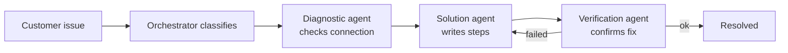
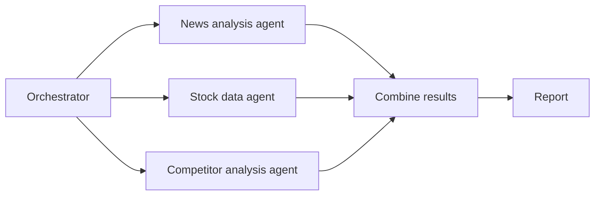
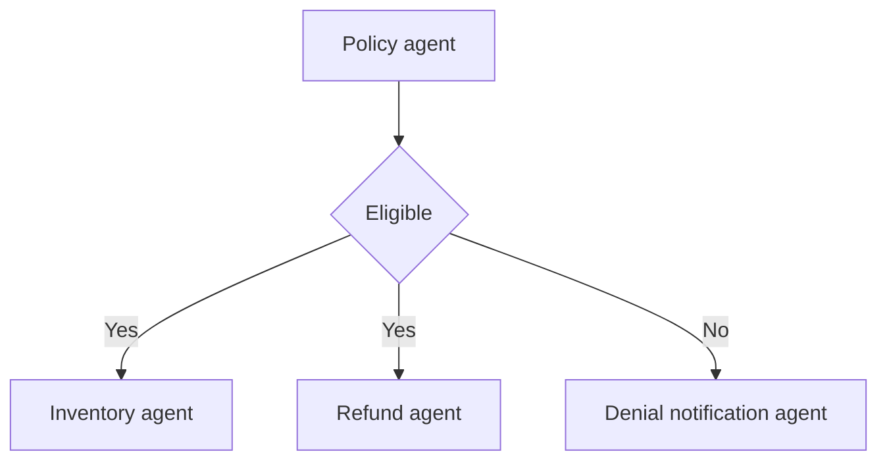

# Orchestrating Agent Activities

> [!abstract] TL;DR
> Once several agents exist, someone has to conduct them. Orchestration is ==directing and managing agent interactions so they achieve a complex goal together==. The orchestrator tells the right agent to do the right task at the right time, with the right context. It tracks shared state, and it has a plan for when an agent fails. It does this using three execution patterns, **sequential**, **parallel** and **conditional branching**, which real workflows almost always combine.

**Prerequisites:** [[Multi-Agent Architecture Design]] · [[Multi-Agent Systems]] · [[Runtime or Orchestration Layer]]
**Related:** [[Orchestrator-Workers Workflow]] · [[Agentic Workflow Patterns]] · [[Agent State Management]] · [[AI Reliability]] · [[Penguin and Scientist Agents]]
**Hands-on:** [[Skate Park Orchestration]], this lesson's exercise: classify → branch → sequence with smolagents, plus a run-log review

> [!note] Source scope
> Based on the Udacity lesson "Orchestrating Agent Activities" (Agentic AI Nanodegree, Course 4, Lesson 3): the lesson text, the `ContentCreationOrchestrator` snippet, and the video transcript. The demo code is in `python notebooks/agentic-ai-c4-exercises-demos/lesson-3-orchestrating-agent-activities/demo/`. Material marked *beyond the lecture* is my own addition.

> [!todo]- Contents
> - [[#1. Core Concepts]]
> - [[#2. The Orchestrator's Responsibilities]]
> - [[#3. The Three Execution Patterns]]
> - [[#4. Combining Patterns]]
> - [[#5. Worked Example – Content Creation Orchestrator]]
> - [[#6. Pitfalls and Failure Modes]]
> - [[#7. Key Takeaways]]
> - [[#8. Critical Analysis]]
> - [[#9. Self-Test]]
> - [[#10. Glossary]]
> - [[#Further Reading]]

## 1. Core Concepts

The lecture's metaphor: the orchestrator is the **conductor** of an orchestra. Each agent plays its part, and they must stay in sync. The workflow definition is the **script** the conductor follows, and shared state is the **sheet music** or project status board everyone reads from.

> [!info]+ Definition – Orchestration
> Applying techniques that direct and manage agent interactions to achieve complex goals, including sequential and parallel execution patterns for different kinds of tasks.

^def-orchestration

> [!info]+ Definition – Orchestrator
> The single point of control for a multi-agent workflow. It ==delegates tasks, passes context, collects results and errors, tracks state, and decides what runs next==. It can be an LLM agent or plain code.

^def-orchestrator

> [!info]+ Definition – Orchestration layer
> The part of the system that holds the orchestration logic. The lecture stresses that it should be **designed for flexibility**: you should be able to add new agents and capabilities without redesigning the whole system. See [[Runtime or Orchestration Layer]] for the single-agent version of the same idea.

^def-orchestration-layer

This note is the multi-agent sibling of the hub-and-spoke topology in [[Multi-Agent Architecture Design#2. Orchestrator Pattern – Hub and Spoke]]. That note decides *who talks to whom*. This one decides *in what order and under what conditions* they act.

## 2. The Orchestrator's Responsibilities

| Responsibility | What it means | Lecture framing |
|---|---|---|
| Delegation | Pick the right agent for each sub-task | "the right agent … the right task … the right time" |
| Context passing | Give each agent everything it needs to succeed | "providing all the necessary information or context" |
| Result collection | Listen for outputs *and* errors coming back | "listening for the results or errors" |
| State management | Track overall progress and data shared between agents | "the shared sheet music or the project status board" |
| Error handling | Have a plan when an agent fails | "The orchestrator needs a plan" |
| Extensibility | Add agents without a redesign | "incorporate new capabilities without redesigning" |

==State management is the responsibility the lecture calls "huge"==. Without it, the orchestrator can't know what's done, what's pending, or what data the next agent needs. See [[Agent State Management]]. ^state-is-huge

## 3. The Three Execution Patterns

| Pattern | Rule | Lecture example | When to use | Workflow-pattern note |
|---|---|---|---|---|
| **Sequential** | Each step builds on the previous result | Wi-Fi support: diagnostic → solution → verification | Real data dependencies between steps | [[Prompt Chaining Workflow]] |
| **Parallel** | Independent tasks run at once, then results are combined | Market report: news + stock data + competitor filings | No dependencies between tasks; latency matters | [[Parallelization Workflow]] |
| **Conditional branching** | If X then Y, else Z, based on an agent's output | Returns: policy "Eligible" → inventory + refund; else → denial notification | The path depends on what an agent finds | [[Routing Workflow]] |

### 3.1 Sequential – customer support troubleshooting

The orchestrator first classifies the issue. For Wi-Fi connectivity, it builds a sequential workflow:



The lecture adds that the orchestrator tracks the interaction's state and handles a failed step by ==exploring alternative solutions==. That is the loop back from verification to solution in the diagram. Compare [[LLM Feedback Loops]].

### 3.2 Parallel – market analysis report



The three agents don't need each other's output, so they can run at the same time. This is scatter-gather; see [[Parallelization Workflow#2. The Golden Rule – Independence]].

### 3.3 Conditional branching – e-commerce returns



Note that the "Yes" branch fans out to two agents. That alone is already a combination of branching and (potentially) parallel execution.

## 4. Combining Patterns

The lecture's closing point is that real workflows mix the patterns: run some steps sequentially, kick off others in parallel, wait for them all to finish, then branch on one agent's result. ^combine-patterns

> [!warning] Transcript wording
> The transcript reads "Most real workflows are purely one pattern", but the next sentence says "You'll often see combinations". The intended line is almost certainly "*rarely* purely one pattern".

*Beyond the lecture:* any combination of these patterns is a **directed graph** of agent calls. Sequential steps are edges, parallel steps are fan-out and fan-in, and branches are conditional edges. That is why graph-based frameworks model orchestration this way; see [[Directed Acyclic Graph (DAG)]] and the state machine in [[Implementing Agent State Management with Python]].

## 5. Worked Example – Content Creation Orchestrator

The lesson's demo automates writing a blog post ("write a blog post about multi-agent systems") with four specialist agents: research, writing, editing and publishing.

```python
class ContentCreationOrchestrator:
    def run(self, topic):
        research_notes = self.research_agent.research(topic)            # sequential
        draft = self.writing_agent.write_draft(topic, research_notes)   # sequential
        # "Parallel" in the demo, simulated sequentially
        final_text = self.editing_agent.edit(draft)
        publish_status = self.publishing_agent.publish(final_text)
        return publish_status
```

What the lesson highlights:

- **Sequential execution.** You can't write without research or edit before writing. The code order mirrors these data dependencies.
- **Workflow management.** The orchestrator is the single point of control. Data flows `research_notes → draft → final_text`, and the orchestrator calls each specialist in order.
- **Parallelism.** The lesson labels step 3 as parallel, then corrects itself: publishing *depends on* the edited text, so it must come after editing. The truly independent tasks would be things like image or video generation and SEO analysis, which run in parallel and are merged before publishing.

> [!example]- A corrected version with real parallelism *(beyond the lecture)*
> ```python
> import asyncio
>
> class ContentCreationOrchestrator:
>     async def run(self, topic):
>         state = {"topic": topic}
>         state["notes"] = await self.research_agent.research(topic)
>         state["draft"] = await self.writing_agent.write_draft(topic, state["notes"])
>
>         # Independent of each other: fan out, then fan in
>         state["final_text"], state["images"], state["seo"] = await asyncio.gather(
>             self.editing_agent.edit(state["draft"]),
>             self.image_agent.generate(state["draft"]),
>             self.seo_agent.analyze(state["draft"]),
>         )
>
>         # Conditional branch on a quality check
>         if not await self.review_agent.approve(state["final_text"]):
>             return {"status": "needs_human_review", **state}
>
>         state["published"] = await self.publishing_agent.publish(
>             state["final_text"], state["images"], state["seo"])
>         return state
> ```
> Changes: an explicit `state` dict (the "project status board"), genuinely independent tasks run with `gather`, a conditional branch before the irreversible publish step, and all three patterns in one workflow.

## 6. Pitfalls and Failure Modes

| Failure | Symptom | Mitigation |
|---|---|---|
| Parallelising dependent steps | Agents work on stale or missing input (e.g. publishing an unedited draft) | Draw the dependency graph first, and parallelise only independent nodes |
| No error plan | One agent failure kills the whole workflow, or fails silently | Retries, fallback agents, alternative paths, escalation to a human |
| Missing or implicit state | Agents get partial context; you can't tell how far a run got | One explicit state object owned by the orchestrator |
| Branch on unvalidated output | "Eligible" vs "eligible." vs "Yes" sends the request down the wrong path | Constrain the deciding agent to an enum ([[Structured Outputs]]) |
| Hard-coded agent wiring | Every new agent means rewriting the orchestrator | An agent registry with declared capabilities, plus config-driven workflows |
| Orchestrator as bottleneck | Every message goes through one component, which limits throughput and becomes a single point of failure | Async execution, stateless orchestrator with persisted state ([[Multi-Agent Architecture Design#3. Peer-to-Peer Pattern – Direct Routing]] for the alternative) |
| Irreversible action at the end of an unchecked chain | Bad content gets published or refunds get issued wrongly | A gate before side effects ([[Gate Checks]]) |

## 7. Key Takeaways

- [ ] Orchestration = directing and managing agent interactions to achieve a complex goal.
- [ ] The orchestrator delegates, passes context, collects results and errors, tracks state, and handles failures.
- [ ] Sequential when steps depend on each other, parallel when they don't, branching when the path depends on an output.
- [ ] Real workflows combine the three patterns ([[#^combine-patterns]]).
- [ ] State management is the orchestrator's biggest job ([[#^state-is-huge]]).
- [ ] Design the orchestration layer so new agents can be added without a redesign.
- [ ] Only parallelise tasks that are truly independent. The demo's "parallel" edit and publish steps aren't.

## 8. Critical Analysis

**Latency and reliability arithmetic** *(beyond the lecture)*. For steps with latencies $t_i$ and success probabilities $p_i$:

$$
T_{\text{seq}} = \sum_i t_i \qquad T_{\text{par}} = \max_i t_i \qquad P_{\text{all succeed}} = \prod_i p_i
$$

Parallelism cuts latency but **not** the failure risk: if all branches must succeed, reliability is still the product. Parallel execution also doesn't reduce cost, since every agent still runs. See [[AI Reliability#2. The Compounding Problem]] and [[Parallelization Workflow#5.1 Latency and cost]].

**Who decides – code or LLM.** The lecture says you'll "likely need an orchestrator agent", but its demo orchestrator is plain Python with a fixed order. That is the right default when the flow is known: deterministic, cheap, testable. An LLM orchestrator earns its place only when the decomposition itself varies per request, which is the [[Orchestrator-Workers Workflow]] case. [[Penguin and Scientist Agents]] is another example of a code hub.

**Error handling is underspecified.** The lecture names error handling as essential but gives no mechanism. In practice you need to decide, per agent: retry (and how many times), use a fallback agent, take an alternative path, degrade gracefully (e.g. a market report without competitor data), or escalate to a human. Also distinguish **hard failures** (exceptions) from **soft failures** (plausible but wrong output), which are harder to catch; see [[AI Reliability#^silent-failure]]. Lesson 5 fills this gap: see [[State Management in Multi-Agent Systems#4. Failure Handling at the Orchestration Level]].

**At scale.** A central orchestrator makes the system easy to reason about and audit, but it's a single point of failure and a throughput limit. Long workflows also need **durable state**, so a crash mid-run can resume rather than restart; see [[Runtime or Orchestration Layer#5. Durability, Budgets and Observability]].

**Evaluation.** Test the orchestrator separately from the agents: with stubbed agents, check that each branch is taken correctly, that parallel results merge correctly, and that each failure triggers the intended recovery path. Then evaluate end-to-end quality ([[Agent Evaluation]]).

**Security.** The orchestrator passes one agent's output into the next agent's context, so injected text in, say, scraped news can propagate down the chain ([[Prompt Injection]]). Branch decisions driven by agent output are a control-flow attack surface.

> [!question] Open discussion questions
> - When should the orchestrator be an LLM rather than code, and how would you measure that it's worth the cost?
> - If one of three parallel agents fails, should the workflow fail, retry, or continue with partial results? Who decides?
> - How do you keep "add agents without redesigning" from turning into an unmaintainable web of conditions?

## 9. Self-Test

> [!question]- Q1. What are the orchestrator's main responsibilities, according to the lecture?
> Delegate the right task to the right agent at the right time, provide each agent with the context it needs, listen for results and errors, manage the shared state and overall progress, and handle errors when agents fail. The layer should also be flexible enough to add new agents without a redesign.

> [!question]- Q2. Name the three execution patterns and give the lecture's example for each.
> Sequential: Wi-Fi support (diagnostic → solution → verification). Parallel: market report (news, stock data and competitor agents at once). Conditional branching: returns (eligible → inventory + refund; ineligible → denial notification).

> [!question]- Q3. In the content creation demo, why can't editing and publishing truly run in parallel?
> Publishing needs the edited text, so it depends on editing. Only independent tasks, like generating images or running SEO analysis on the draft, can run in parallel.

> [!question]- Q4. Design: a travel booking request needs flight search, hotel search, and visa requirements, then payment only if the total is under budget. Lay out the orchestration.
> Sequential: parse the request into structured trip details. Parallel: flight agent, hotel agent and visa agent (independent). Fan in: combine options and total the price. Branch: under budget → payment agent (behind a confirmation gate); over budget → an agent proposing cheaper alternatives. State: one trip object holding request, options, chosen itinerary and status.

> [!question]- Q5. Quantitative: research takes 8 s, then news, stock and competitor agents take 5 s, 3 s and 9 s, then a writer takes 6 s. What is the latency sequentially and with the middle three in parallel?
> Sequential: $8 + 5 + 3 + 9 + 6 = 31$ s. With parallelism: $8 + \max(5, 3, 9) + 6 = 23$ s. The slowest parallel branch (9 s) sets the pace.

> [!question]- Q6. Quantitative: the three parallel agents in Q5 each succeed 95% of the time, and all must succeed. What is the probability the parallel stage succeeds, and does parallelism change it?
> $0.95^3 \approx 0.857$. No. Parallelism changes latency, not reliability, because all three must still succeed.

### Flashcards

> [!tip] Flashcards
> Review this lesson with [[Orchestrating Agent Activities - Flashcards]].

## 10. Glossary

| Term | Definition |
|---|---|
| Orchestration | Directing and managing agent interactions toward a complex goal ([[#^def-orchestration]]) |
| Orchestrator | Single point of control that delegates, tracks state and handles errors ([[#^def-orchestrator]]) |
| Orchestration layer | The flexible, extensible home of orchestration logic ([[#^def-orchestration-layer]]) |
| Sequential processing | Steps run in order, each building on the previous result |
| Parallel execution | Independent tasks run simultaneously, then results are combined |
| Conditional branching | The orchestrator picks the next agent based on an agent's output |
| Fan-out / fan-in | Splitting work across parallel agents and then merging results *(beyond the lecture)* |
| Durable state | Workflow state persisted so a run can resume after a crash *(beyond the lecture)* |

## Further Reading

- [Building Effective Agents – Anthropic](https://www.anthropic.com/engineering/building-effective-agents)
- [How we built our multi-agent research system – Anthropic](https://www.anthropic.com/engineering/multi-agent-research-system)
- [LangGraph – Multi-agent concepts](https://langchain-ai.github.io/langgraph/concepts/multi_agent/)
- [Python asyncio – Coroutines and Tasks](https://docs.python.org/3/library/asyncio-task.html)

%% Study hint: one example per pattern. Wi-Fi = sequential, market report = parallel, returns = branching, blog post = combination. %%
