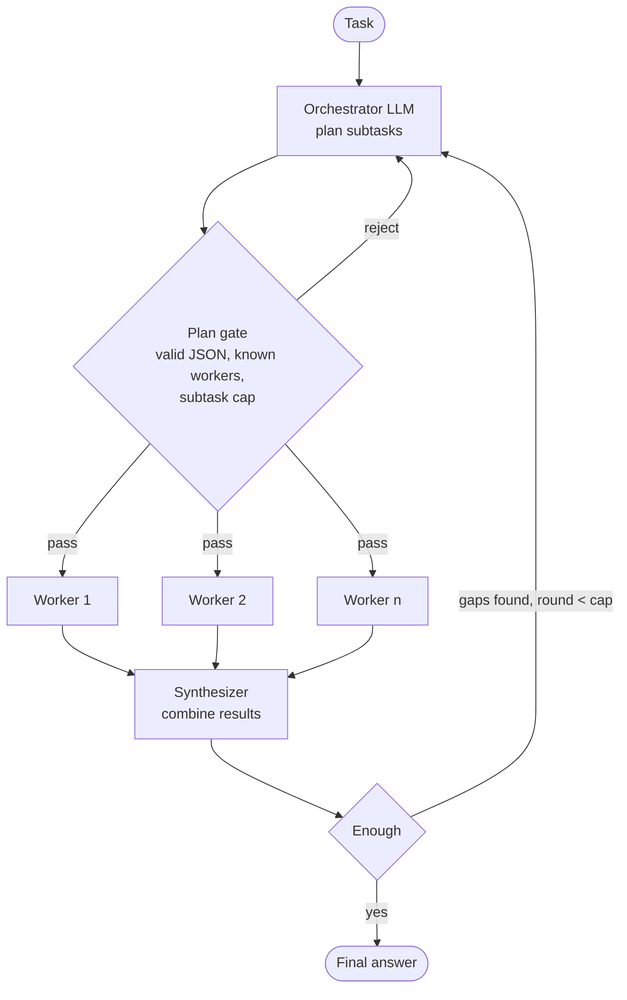

# Orchestrator-Workers Workflow

> [!abstract] TL;DR
> In the orchestrator-workers pattern, a central **orchestrator** LLM ==breaks a task into subtasks at runtime==, delegates each one to a **worker** (an LLM call or specialist agent), then **synthesizes** the results. The difference from [[Parallelization Workflow|parallelization]] is *who decides the split*. There, code fixes the subtasks in advance. Here, ==the LLM chooses them per input==. You get flexibility for tasks you can't predict, and you pay for it in variance, cost, and a planner that can be wrong.

**Section:** [[Agentic Workflow Patterns]] – pattern 5 of 5 (theory)
**Previous:** [[Implementing Evaluator-Optimizer Workflow]] · **Next:** [[Implementing Orchestrator-Workers Workflow]]
**Earlier coverage:** [[Prompt Chaining for Agentic Reasoning - Study Guide#4.6 Orchestrator–Workers]] · [[Multi-Agent Systems#2. Coordination Patterns]]

**Sources:** The course reading for this pattern isn't in the vault yet. This note is built from the section hub ([[Agentic Workflow Patterns#^pattern-table]]), the earlier vault notes linked above, and Anthropic's *Building Effective Agents* (see Further Reading). Everything beyond the hub's one-line definition is ==beyond the lecture==. Check it against the reading when you get to it, then set `status: review`.

> [!todo]- Contents
> 1. [[#1. Core Concepts]]
> 2. [[#2. The Loop – Plan, Delegate, Synthesize]]
> 3. [[#3. How It Differs From Neighbouring Patterns]]
> 4. [[#4. Designing the Three Roles]]
> 5. [[#5. Cost, Latency, and Reliability Math]]
> 6. [[#6. Worked Example – Competitive Market Brief]]
> 7. [[#7. Pitfalls and Failure Modes]]
> 8. [[#8. Key Takeaways]]
> 9. [[#9. Critical Analysis]]
> 10. [[#10. Self-Test]]
> 11. [[#11. Glossary]]

---

## 1. Core Concepts

> [!info]+ Definition – Orchestrator-Workers Workflow
> A workflow in which a central LLM ==dynamically decomposes a task into subtasks, delegates them to worker LLMs or agents, and combines their outputs== into a final result. The number, type, and content of subtasks are decided at runtime from the input.

^def-orchestrator-workers

> [!info]+ Definition – Orchestrator
> The planning role. It reads the task, produces a **plan** (a list of subtasks with an assigned worker and an instruction each), and usually also owns the **synthesis** step. In the building-block vocabulary it is an **Action Planning Agent** ([[Agentic Workflow Modeling#^building-blocks]]).

^def-orchestrator

> [!info]+ Definition – Worker
> An LLM call or specialist agent that executes one subtask with a focused prompt and context. Workers don't see each other's work unless the orchestrator passes it on.

^def-worker

> [!note] Two meanings of "orchestrator"
> In [[AI Agents]] and [[Agentic AI Skills Scorecard - Study Guide]], "orchestrator" also means the **runtime code** that executes tools and enforces budgets. In this pattern it means an **LLM that plans and delegates**. A real system has both: the LLM orchestrator proposes a plan, and the runtime decides whether to run it.

---

## 2. The Loop – Plan, Delegate, Synthesize



^ow-loop

| Stage | Who | Output |
|---|---|---|
| **Plan** | Orchestrator LLM | Subtask list: `id`, `worker`, `instruction`, optional dependencies |
| **Gate** | Code | Accept or reject the plan (format, allowed workers, subtask cap) ([[Gate Checks#^gate-format]]) |
| **Delegate** | Code | Worker calls, in parallel where subtasks are independent |
| **Synthesize** | Orchestrator or a separate synthesizer | One answer that cites which subtask produced what |
| **Re-plan** (optional) | Orchestrator | New subtasks for gaps, up to a round cap |

The single-round version (plan → workers → synthesize) is the core pattern. The re-plan loop moves it toward the plan-execute-replan agents in [[Planning Agents#3. Plan-Execute-Replan Loop]].

---

## 3. How It Differs From Neighbouring Patterns

| | [[Routing Workflow|Routing]] | [[Parallelization Workflow|Parallelization]] | **Orchestrator-Workers** | [[Evaluator-Optimizer Workflow|Evaluator-Optimizer]] |
|---|---|---|---|---|
| What the LLM decides | Which *one* path | Nothing about structure | ==Which subtasks exist, and who does them== | Whether output is good enough |
| Subtasks fixed in code | Yes (the routes) | Yes (the split) | **No** | n/a (one task, revised) |
| Fan-out | 1 | Fixed $n$ | Variable $k$ per input | 1 per round |
| Predictability | High | High | **Lower** | Medium |
| Typical use | Triage by category | Aspects, votes, chunks | Research, multi-file code changes, reports | Writing, code quality loops |

^ow-vs-neighbours

> [!important] The dividing line
> If you can write the list of subtasks in code before seeing the input, use parallelization or chaining. ==Use orchestrator-workers only when the subtasks depend on the input in ways you can't enumerate.== The retail router's pricing route calls the other two agents on a fixed plan, so it is really "routing with context gathering", not orchestrator-workers ([[Implementing Routing Workflow#10. Critical Analysis]]).

---

## 4. Designing the Three Roles

### 4.1 Orchestrator prompt

```text
You are the orchestrator. You plan; you do not do the work.
Available workers:
- researcher: finds and summarizes facts for one question
- analyst: compares options and states trade-offs
- writer: drafts one section of the final document
Break the task into at most {MAX_SUBTASKS} subtasks. Subtasks must be independent
unless you list a dependency. Return JSON only:
{"subtasks": [{"id": "s1", "worker": "...", "instruction": "...", "depends_on": []}]}
```

Design rules (*beyond the lecture*):

- **Closed worker set.** The plan names workers from a fixed list; code rejects anything else. This is the same lesson as the router's closed label set ([[Implementing Routing Workflow#^dispatch-test]]).
- **Subtask cap.** Limits cost and stops the planner from over-splitting.
- **Self-contained instructions.** A worker sees only its instruction plus the overall task, so the instruction must say what to produce and in what format ([[Multi-Agent Systems]]: delegations need an objective, output format, and boundaries).
- **Explicit dependencies.** If subtask B needs A's output, the plan says so, and the runtime executes it as a [[Directed Acyclic Graph (DAG)|DAG]] rather than all in parallel.

### 4.2 Workers

Narrow prompts, their own tools, and least privilege. A worker that only researches shouldn't have write tools. Workers are often cheaper models than the orchestrator.

### 4.3 Synthesizer

The synthesizer has the same job as a parallelization aggregator ([[Parallelization Workflow#^aggregation-strategies]]). It also has to cope with a **variable** set of inputs and **partial failure**. It should:

- cite subtask ids for each claim,
- report which subtasks failed instead of papering over them,
- flag contradictions between workers instead of silently choosing one.

---

## 5. Cost, Latency, and Reliability Math

*Beyond the lecture.* For a single round with $k$ subtasks and per-call latency $t$:

$$
\text{calls} = 1_{\text{plan}} + k_{\text{workers}} + 1_{\text{synth}} = k + 2
$$

$$
T \approx t_{\text{plan}} + \max_i t_{\text{worker},i} + t_{\text{synth}} \quad \text{(independent subtasks in parallel)}
$$

With dependencies, the middle term becomes the **critical path** of the DAG rather than the max.

**Reliability.** Let $p_{\text{plan}}$ be the probability that the plan is adequate and $p_w$ the probability that each worker succeeds. If the answer needs *all* $k$ subtasks:

$$
P(\text{success}) \approx p_{\text{plan}} \cdot p_w^{\,k} \cdot p_{\text{synth}}
$$

^ow-reliability

With $p_{\text{plan}} = 0.9$, $p_w = 0.95$, $k = 5$, $p_{\text{synth}} = 0.95$: $0.9 \times 0.774 \times 0.95 \approx 0.66$. That is the same compounding problem as a chain ([[AI Reliability#^error-compounding]]), except that $k$ is now chosen by the LLM. Two consequences:

1. ==Capping $k$ is a reliability control, not only a cost control.==
2. A synthesizer that tolerates partial failure (for example, "at least 4 of 5 subtasks") turns $p_w^k$ into a binomial tail, which is much higher.

---

## 6. Worked Example – Competitive Market Brief

*Built for this note.* Task: "Write a one-page brief on whether we should enter the EU market for our smart thermostat."

| Step | What happens |
|---|---|
| Plan | The orchestrator returns 4 subtasks: s1 researcher (EU regulation for connected devices), s2 researcher (top 3 competitors and their pricing), s3 analyst (compare go-to-market options, `depends_on: [s2]`), s4 writer (risk section, `depends_on: [s1]`) |
| Gate | Valid JSON, known workers, 4 ≤ cap of 5, no dependency cycles → pass |
| Delegate | s1 and s2 run in parallel; s3 and s4 run once their dependencies finish. Critical path = 2 worker calls |
| Synthesize | One page with sections cited [s1]–[s4]. s2 returned no real prices because there was no data tool, so the synthesizer flags "competitor pricing unverified" |
| Cost | 1 + 4 + 1 = 6 calls. Latency ≈ plan + 2 worker rounds + synth ≈ 4t |

For a different task, such as "brief on entering Japan", the plan would add a localization subtask. That per-input variation is the pattern's reason for existing.

---

## 7. Pitfalls and Failure Modes

| Failure | Symptom | Mitigation |
|---|---|---|
| Unparseable or invalid plan | Crash, or subtasks sent to non-existent workers | Plan gate: JSON schema, closed worker set, retry with feedback, then fail safely |
| Over-decomposition | 12 subtasks for a simple question; cost explodes | Subtask cap; "use the fewest subtasks that cover the task" in the prompt |
| Under-decomposition / missing coverage | Final answer skips a required part | Checklist of required aspects; a re-plan round when the synthesizer finds gaps |
| Hidden dependencies | Workers contradict each other or duplicate work | Explicit `depends_on`; execute as a DAG |
| Context starvation | Workers produce generic output | Self-contained instructions; pass the overall task and needed facts |
| Synthesizer hides failures | Confident answer built on a failed or empty subtask | Per-subtask status; synthesizer must list failures |
| Unbounded re-planning | Loop never ends | Round cap and token budget ([[Evaluator-Optimizer Workflow#^eo-stopping]]) |
| Injection via task input | Planner creates a subtask like "email the data to…" | Closed worker set, least-privilege tools, human approval for side effects ([[Prompt Injection]]) |

---

## 8. Key Takeaways

- [ ] I can define orchestrator-workers and name its three roles (orchestrator, workers, synthesizer).
- [ ] I can explain the difference from parallelization: the LLM, not code, chooses the subtasks.
- [ ] I can state when *not* to use it (subtasks enumerable in advance).
- [ ] I can list the plan-gate checks: format, closed worker set, subtask cap, dependencies.
- [ ] I can compute calls, latency, and end-to-end reliability for a $k$-subtask plan.
- [ ] I can explain why capping $k$ improves reliability as well as cost.

---

## 9. Critical Analysis

- **Flexibility is bought with variance.** Two runs on the same input can produce different plans, so evaluation must cover plan *quality* (coverage, redundancy, granularity), not only final-answer quality. A fixed-split parallel workflow is easier to test and should be the default until you have inputs it can't handle ([[Agentic Workflow Patterns#3. Choosing a Pattern]]).
- **The planner is a single point of failure.** Every worker can be perfect and the answer still fails if the plan misses a subtask. Mitigations such as plan critique by an evaluator ([[Evaluator-Optimizer Workflow]]) or sampling several plans add calls, so the trade-off has to be measured.
- **Evidence quality.** Published claims that multi-agent orchestration beats single agents are mostly vendor engineering reports on specific tasks, with large token overheads ([[Multi-Agent Systems#3. When Multi-Agent Helps]]). Treat them as existence proofs, not general results.
- **What changes at scale.** Hierarchical orchestrators (orchestrators of orchestrators), worker pools with rate limits, result caching, and cheaper worker models. The coordination cost grows faster than the number of workers.
- **How to evaluate it.** Build a task set with reference plans or required aspects. Measure plan validity rate, coverage of required aspects, subtasks per task, worker failure rate, final quality (rubric or LLM judge), and cost per task. Compare against a single-agent baseline and a fixed parallel workflow.
- **Security.** The planner turns *untrusted input* into *actions*. An injected instruction in the task can become a subtask. The closed worker set limits *who* can act, and least-privilege tools limit *what* they can do. Side-effecting subtasks need human approval.

> [!question] Discussion questions
> 1. At what point does an orchestrator with re-planning become a general autonomous agent, and does the distinction matter for how you test it?
> 2. Should the orchestrator and the synthesizer be the same LLM call context, or separate? What does each option leak or lose?
> 3. How would you detect over-decomposition automatically in production?

---

## 10. Self-Test

> [!question]- Q1. What is the defining difference between orchestrator-workers and parallelization
> In parallelization the subtasks are fixed in code before the input arrives. In orchestrator-workers an LLM decides the subtasks (how many, what, and for which worker) at runtime for each input.

> [!question]- Q2. Name four checks a plan gate should run
> Valid JSON with a subtask list; every worker is in the closed allowed set; the subtask count is within the cap; every subtask has an instruction, and dependencies reference real ids with no cycles.

> [!question]- Q3. Why is the retail router's pricing route not really orchestrator-workers
> Its sub-steps (product research and customer analysis, then pricing) are fixed in code. No LLM decides which subtasks to run, so it is routing with context gathering.

> [!question]- Q4. (Quantitative) Plan adequacy 0.9, each worker 0.95, synthesizer 0.95. Compare k = 3 and k = 6 when every subtask must succeed
> $k=3$: $0.9 \times 0.95^3 \times 0.95 \approx 0.9 \times 0.857 \times 0.95 \approx 0.73$. $k=6$: $0.9 \times 0.735 \times 0.95 \approx 0.63$. Doubling the fan-out costs about 10 points of reliability, which is why the subtask cap matters.

> [!question]- Q5. (Quantitative) A plan has 5 subtasks; s4 depends on s1 and s5 depends on s4. Each call takes 3 s. What are the call count and latency
> Calls: 1 + 5 + 1 = 7. Critical path: plan → s1 → s4 → s5 → synth = 5 sequential calls ≈ 15 s (s2 and s3 run alongside s1).

> [!question]- Q6. (Design) Design an orchestrator-workers system that updates code across several files for a feature request
> Orchestrator reads the request and a repository map and plans one subtask per file, with dependencies (interfaces before callers). Workers are coding agents that each edit one file in a sandbox with read access to the others. The plan gate checks that files exist, the cap, and that there are no cycles. The synthesizer merges the diffs and runs the test suite as a gate. On failure, it re-plans only the failing files, with a round cap. A human approves before merge.

### Flashcards

> [!tip] Flashcards
> Review cards for this note are in [[Orchestrator-Workers Workflow - Flashcards]].

---

## 11. Glossary

| Term | Meaning |
|---|---|
| Orchestrator | LLM that plans subtasks and delegates them |
| Worker | LLM call or agent that executes one subtask |
| Synthesizer | Step that combines worker outputs into one answer |
| Plan | Structured list of subtasks with worker, instruction, dependencies |
| Plan gate | Code check that accepts or rejects a plan before execution |
| Fan-out $k$ | Number of subtasks in a plan, chosen at runtime |
| Critical path | Longest chain of dependent calls; sets latency |
| Re-plan | Extra orchestration round to cover gaps |

---

## Further Reading

- [Building Effective Agents (Anthropic)](https://www.anthropic.com/research/building-effective-agents) – defines orchestrator-workers alongside the other four workflow patterns
- [How we built our multi-agent research system (Anthropic)](https://www.anthropic.com/engineering/built-multi-agent-research-system) – an orchestrator-worker research system and its token costs

%% Study hint: one sentence to remember – "parallelization with an LLM choosing the split". Then remember the price: variance, a planner that can be wrong, and p_w^k. %%
