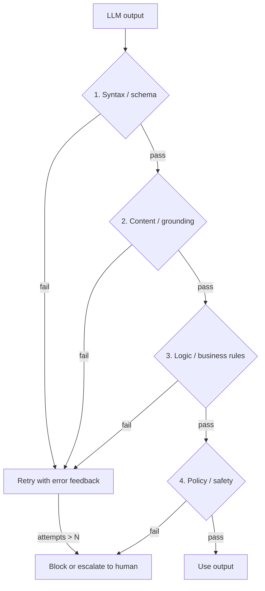

# Output Validation

> [!abstract] TL;DR
> Output validation is the **runtime** check that decides whether one specific LLM output can be trusted enough to use. It is a different job from [[LLM Evaluation]], which measures a system *offline* across a dataset. ==Treat every model output as untrusted input: check its shape, then its content against the source, then its logic, then whether it is safe to act on.== Every failed check needs somewhere to go: a retry, a fallback, or a human.

**Prerequisites:** [[Large Language Models]] · [[Gate Checks]]
**Related:** [[Implementing Gate Checks]] · [[Pydantic for Structured LLM Output - Study Guide]] · [[LLM Hallucinations]] · [[AI Reliability]] · [[Prompt Injection]]

> [!note] Source scope
> No single lecture covers this. It pulls together material from [[Gate Checks]], [[Pydantic for Structured LLM Output - Study Guide]] and [[AI Reliability]], plus common industry practice (*beyond the lecture*).

> [!todo]- Contents
> - [[#1. Core Concepts]]
> - [[#2. The Validation Layers]]
> - [[#3. Validation vs Evaluation]]
> - [[#4. Worked Example – Ticket Classifier]]
> - [[#5. Pitfalls and Failure Modes]]
> - [[#6. Key Takeaways]]
> - [[#7. Critical Analysis]]
> - [[#8. Self-Test]]
> - [[#9. Glossary]]
> - [[#Further Reading]]

---

## 1. Core Concepts

> [!info]+ Definition – Output validation
> Deterministic or model-based checks that run on **each** LLM output at runtime. They accept it, repair it, or reject it before it reaches a user, another chain step, or a tool.

^def-output-validation

> [!info]+ Definition – Untrusted output principle
> LLM output is treated like user input from the internet. It can be malformed, made up, or controlled by an attacker through [[Prompt Injection]], so it is never passed to `eval`, SQL, a shell or an API without checking it first.

^untrusted-output

A [[Gate Checks|gate check]] is output validation placed *between* chain steps. Output validation is the wider idea: it also covers the final answer and every tool call.

---

## 2. The Validation Layers

Order the layers from cheapest to most expensive, so that cheap checks reject bad output before you pay for the expensive ones.



| Layer | Question | Techniques | Cost |
|---|---|---|---|
| **Syntax / schema** | Is it well-formed? | JSON parse, [[Pydantic for Structured LLM Output - Study Guide\|Pydantic]], JSON Schema, regex, enums | ~0 |
| **Content / grounding** | Is it true to the source? | Quote matching, entity checks against the input, NLI entailment, citation checks | Low to medium |
| **Logic / rules** | Does it make sense? | Totals add up, dates in order, IDs exist in the DB, code compiles or tests pass | Low |
| **Policy / safety** | Is it allowed? | PII scan, allow-lists of tools and actions, moderation model, permission checks | Low to medium |
| **Judgment** | Is it *good*? | LLM-as-judge, self-consistency voting, human review | High |

^validation-layers

> [!tip] Compute, don't ask
> If a rule can be written in code, write it in code. Save LLM-as-judge for checks that genuinely need judgment. See [[Sonar Ticket and Outage Classification - How-To]].

### How much validation helps

If a step is correct with probability $p$, and a validator catches a fraction $r$ of the errors (its recall), and each failure gets one retry, then roughly:

$$
P(\text{bad output escapes}) \approx (1-p)(1-r) + (1-p)\,r\,(1-p)(1-r)
$$

With $p=0.9$ and $r=0.8$, the escape rate falls from $0.10$ to about $0.02$. **Recall is what matters.** A validator that only checks format has high recall for malformed output and close to zero recall for [[LLM Hallucinations|hallucinations]] that are formatted correctly.

---

## 3. Validation vs Evaluation

| | Output validation | [[LLM Evaluation]] / [[Model Evaluation]] |
|---|---|---|
| When | Runtime, on every call | Offline, or sampled from production |
| Unit | One output | A dataset or distribution |
| Result | Accept, retry or block | Metrics, regressions |
| Needs ground truth | No (uses rules, the source, the schema) | Usually |
| Goal | Stop bad outputs | Measure and improve the system |

The two feed each other: validation failure logs become evaluation cases, and evaluation shows which validators are missing.

---

## 4. Worked Example – Ticket Classifier

Task: an LLM classifies a support ticket and pulls out the affected account.

```python
class Triage(BaseModel):
    category: Literal["outage", "billing", "config", "other"]   # schema layer
    account_id: str
    evidence_quote: str

    @field_validator("evidence_quote")
    def quote_in_source(cls, v, info):                          # grounding layer
        if v not in info.context["ticket_text"]:
            raise ValueError("evidence_quote not found verbatim in ticket")
        return v

def validate(t: Triage):
    if not accounts.exists(t.account_id):                        # logic layer
        raise ValueError("unknown account")
    if t.category == "outage" and not t.evidence_quote:          # rule
        raise ValueError("outage requires evidence")
```

Failures are fed back to the model through a retry loop ([[Implementing Gate Checks]]). After 2 failed retries, the ticket goes to the human queue.

---

## 5. Pitfalls and Failure Modes

| Failure | Symptom | Mitigation |
|---|---|---|
| Schema-only validation | Valid JSON, wrong facts | Add grounding and logic layers |
| Validator shares the generator's blind spots | LLM judge agrees with its own mistake | Use a different model, deterministic checks, or ground truth |
| Unbounded retries | Cost and latency spikes | Cap the number of attempts, then escalate |
| Silent fallback | Defaults hide failures | Log every rejection and count it on a dashboard |
| Over-strict validators | High false-reject rate, users frustrated | Track the false-positive rate, loosen rules or repair output |
| Executing output unchecked | Injection leads to tool misuse | [[#^untrusted-output]]: allow-lists, sandboxing, least privilege |

---

## 6. Key Takeaways

- [ ] Output validation runs at runtime on every output. Evaluation runs offline on datasets.
- [ ] Order the layers syntax → content → logic → policy → judgment, cheapest first.
- [ ] Format checks do not catch hallucinations. You need grounding checks.
- [ ] Every rejection needs a destination: retry, fallback, or human.
- [ ] Treat model output as untrusted input before running tools on it.

---

## 7. Critical Analysis

- **Limits.** Many valuable properties can't be checked by rules: tone, completeness, subtle reasoning errors. Falling back to LLM-as-judge brings in correlated errors and extra cost.
- **Evidence quality.** Most of the claimed reliability gains come from engineering practice rather than controlled studies. The numbers above are illustrative, not measured.
- **At scale.** Validation latency adds up at every step of a chain. Streaming outputs make validation harder because you can't validate what you haven't received yet. Validator drift, where rules no longer match product changes, becomes a maintenance cost.
- **How to evaluate a validator.** Treat it as a classifier. Label a set of good and bad outputs, then measure precision and recall ([[Model Evaluation]]).
- **Security.** Validation is a key defence for the "improper output handling" risk class in OWASP's LLM Top 10. It is not a complete defence against [[Prompt Injection]], because an attacker can make output that passes validation and still does harm.

> [!question] Discussion
> 1. When is it better to *repair* an output (e.g. fix the JSON) than to regenerate it?
> 2. How would you validate a free-text summary without a reference answer?

---

## 8. Self-Test

> [!question]- Q1. What is the difference between output validation and LLM evaluation?
> Validation is a runtime accept/reject decision on a single output. Evaluation measures system quality offline over a dataset, usually against ground truth.

> [!question]- Q2. Why doesn't a Pydantic schema stop hallucinations?
> It only checks structure and types. A made-up value of the right type still passes. You need grounding checks such as quote matching or entity lookups.

> [!question]- Q3. Quantitative – with p = 0.8 and validator recall r = 0.5, and no retries, what fraction of outputs are bad and get through?
> $(1-p)(1-r) = 0.2 \times 0.5 = 0.10$, so 10%.

> [!question]- Q4. Design – validate an agent that writes SQL against a production database.
> Parse the SQL, allow only `SELECT` (or use a read-only role), allow-list tables and columns, check with `EXPLAIN` and apply cost limits, enforce a row limit, check that the results fit the question, and log everything. Anything that writes goes to human approval.

> [!tip] Flashcards
> Review with [[Output Validation - Flashcards]].

---

## 9. Glossary

| Term | Meaning |
|---|---|
| Grounding check | Checks that a claim is supported by the source text |
| Validator recall | Fraction of bad outputs the validator catches |
| Repair | Fixing an output in code instead of regenerating it |
| LLM-as-judge | Using a model to score or accept another model's output |

---

## Further Reading

- [Pydantic documentation](https://docs.pydantic.dev/)
- [JSON Schema](https://json-schema.org/)
- [OWASP Top 10 for LLM Applications](https://owasp.org/www-project-top-10-for-large-language-model-applications/)
