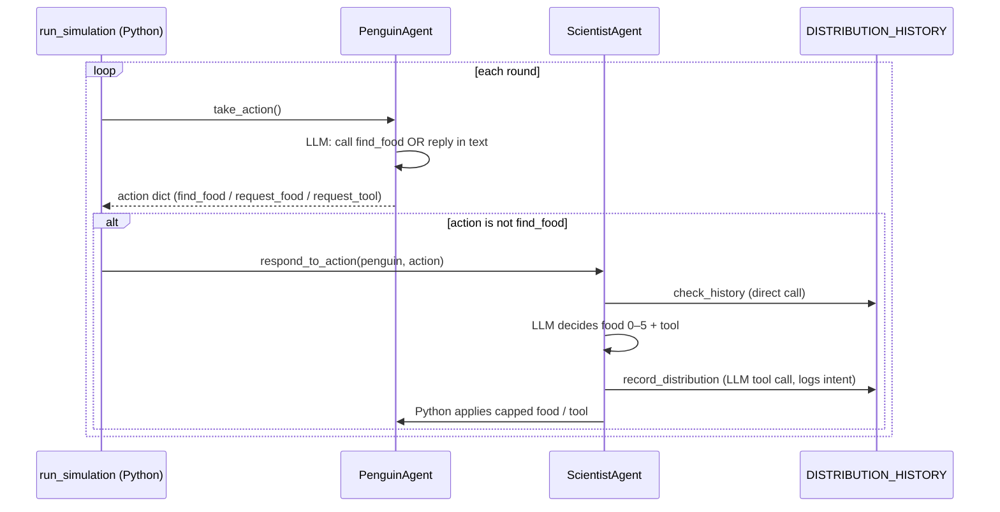

# Penguin and Scientist Agents

> [!abstract] TL;DR
> A two-role multi-agent simulation built on [[Smolagents Framework|smolagents]]. **Penguin** agents each turn either forage for food with a tool or ask for help in plain text. A single **Scientist** agent answers those requests by deciding how much food and whether to hand over a tool. The core lesson: ==the LLM proposes and Python disposes==. Each agent's LLM only states an *intent* through a tool call. Plain Python code then reads that intent from the agent's step log, enforces resource limits, and applies the real state changes.

**Source:** `python notebooks/agentic-ai-c4-exercises-demos/lesson-2-multi-agent-architecture-implementation/exercises/starter/starter.py` (Agentic AI Nanodegree, Course 4, Lesson 2 – Multi-Agent Architecture Implementation exercise, starter version with the penguin prompt filled in).
**Builds on:** [[Smolagents Framework]] · [[Multi-Agent Architecture Design]] · [[Agent State Management]]
**Next exercise:** [[Skate Park Orchestration]] (Lesson 3), which moves routing from a code hub into an LLM orchestrator

> [!warning] README vs code mismatch
> The exercise README describes **four** agents: PenguinColony, Scientist, ResearchStation and WeatherService, with weather effects and a messaging system. The starter code implements only **two** (Penguin and Scientist), with no weather and no message bus. Treat the README as the stretch goal.

## 1. Architecture at a Glance

| Component | Kind | Tools | Owns |
|---|---|---|---|
| `PenguinAgent` (×N) | LLM agent | `find_food` | Its own `food`, `has_tool` |
| `ScientistAgent` | LLM agent | `record_distribution`, `check_history` | `food_supply`, `tool_available`, refresh timer |
| `run_simulation()` | Plain Python loop | – | Round order, routing of requests |
| `DISTRIBUTION_HISTORY` | Global dict | – | Log of the Scientist's decisions |

The coordinator is **not an LLM**. `run_simulation()` is a deterministic hub that collects every penguin's action and decides which ones the Scientist must answer. That is the hub-and-spoke shape from [[Multi-Agent Architecture Design#2. Orchestrator Pattern – Hub and Spoke]], with code in the hub instead of a model. Compare the code-driven orchestration in [[Runtime or Orchestration Layer]]. ^code-hub

## 2. The Two Agents

**Penguin.** The prompt is effectively a rule table on current food: 0–1 → fish, 2–4 → forage, 5+ → ask the Scientist in text. After `run()`, the code walks `memory.steps` to find the `find_food` call and its observation, then adds the food to the penguin itself. If no tool was called, it **keyword-matches** the final text ("tool" + "need/want/like" → `request_tool`, "food" + … → `request_food`), and anything unclear defaults to `request_food`.

**Scientist.** It gets a prompt with the penguin's request, its actual state, its history, and the Scientist's own remaining resources. It is told to call `record_distribution` **exactly once**. The code reads that call's arguments from the step log, clamps food to 0–5 and to the remaining supply, hands over the single tool only if one is available, and mutates both objects. Resources reset every `refresh_interval` responses.

## 3. Patterns Worth Connecting

| Pattern in the code | Why it matters | See |
|---|---|---|
| Intent extracted from tool-call arguments, not prose | Tool arguments are structured and typed; the final text isn't | [[Structured Outputs]] · [[Tool Use]] |
| Python clamps and checks the LLM's decision before applying it | The model can never overspend the supply or double-issue the tool | [[Output Validation]] · [[Gate Checks]] |
| `memory.steps` cleared every turn | Each run starts fresh; continuity comes from state injected into the prompt, not from chat history | [[Agent State Management]] · [[AI Memory]] |
| Agent state held as Python attributes (`food`, `has_tool`) | The source of truth lives outside the LLM | [[Smolagents Framework#4. Worked Example – Weather Agent]] |
| Shared global history the Scientist reads and writes | A simple blackboard; the same global-state caveats as the weather example | [[Smolagents Framework#5. Reviewing the Lesson Code]] |
| Request routing by action type | A tiny [[Routing Workflow]]: only non-self-sufficient penguins reach the Scientist | [[Routing Workflow]] |

## 4. Issues in the Starter

*My own review, not part of the exercise text.*

| Issue | Effect | Fix |
|---|---|---|
| History records the LLM's **intent**, not what was actually given | If the Scientist asks for 5 food but only 2 remain, history says 5. Future `check_history` calls are then wrong | Record after the clamp step, or log both intended and actual |
| Free-text keyword parsing for penguin requests | Brittle, and the fallback silently becomes `request_food` | Give penguins `request_food` / `request_tool` tools so every intent is a structured call |
| Penguin rule table is inverted | Hungry penguins (0–4) fend for themselves, while well-fed ones (5+) ask for help | Ask the Scientist at low food, forage when comfortable |
| `find_food` docstring says 0–5, fishing returns 2–7 | The tool description misleads the model ([[Tool Descriptions in Agentic Systems]]) | Align the docstring with the code |
| `method.lower()` validates, but the branch compares the raw string | `"Fishing"` passes validation and then returns 0 | Normalise once, then branch |
| `check_history` is both a Scientist tool and called directly | The model may call it redundantly, adding a wasted step | Expose it as a tool *or* inject it into the prompt, not both |
| Refresh counts Scientist responses, not rounds | Resupply timing depends on how many penguins ask for help | Drive the refresh from the round counter in `run_simulation` |
| Only the first `record_distribution` call is parsed | Extra calls still write to history, so the log can show decisions that were never applied | Reject or flag a second call |

## 5. Takeaways

- [ ] Multi-agent doesn't require an LLM orchestrator. A plain Python loop can be the hub ([[#^code-hub]]).
- [ ] Use the LLM to *decide*, and code to *enforce*. Never let the model mutate shared resources directly.
- [ ] Read decisions from structured tool-call arguments, not from free text.
- [ ] Log what actually happened, not just what the model intended.
- [ ] Resetting agent memory each turn keeps runs independent, so all context must come from the prompt.
