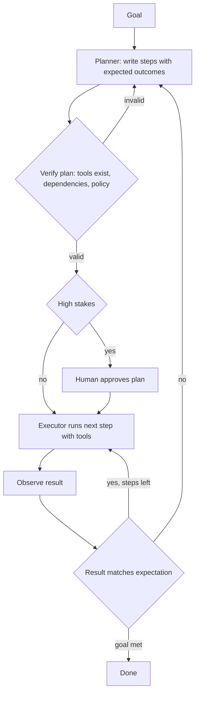

# Planning Agents

> [!abstract] TL;DR
> A planning agent ==creates an explicit plan (a list or graph of steps) before acting, then executes, monitors and revises it==, instead of choosing one action at a time as plain [[Chain-of-Thought and ReAct|ReAct]] does. Plans make long tasks more coherent, cheaper (a big model plans, small models execute) and inspectable (a human can approve the plan). But LLM plans are often invalid, so good systems verify plans and re-plan when observations don't match expectations.

**Prerequisites:** [[AI Agents]] · [[Chain-of-Thought and ReAct]]
**Related:** [[Task Decomposition]] · [[Tree-of-Thought]] · [[Model Predictive Control (MPC)]] · [[Multi-Agent Systems]] · [[Tool Use]] · [[Gate Checks]]

> [!note] Source scope
> Concept hub. *Beyond the lecture*; based on the papers in [[#Further Reading]] and connected to the vault's [[Model Predictive Control (MPC)]] note.

> [!todo]- Contents
> - [[#1. Core Concepts]]
> - [[#2. Planning Architectures]]
> - [[#3. Plan-Execute-Replan Loop]]
> - [[#4. Worked Example – Quarterly Report Agent]]
> - [[#5. Pitfalls and Failure Modes]]
> - [[#6. Key Takeaways]]
> - [[#7. Critical Analysis]]
> - [[#8. Self-Test]]
> - [[#9. Glossary]]
> - [[#Further Reading]]

## 1. Core Concepts

> [!info]+ Definition – Planning agent
> An agent that generates an explicit sequence or graph of sub-goals/actions toward a goal, executes it (usually with tools), monitors outcomes, and revises the plan when needed.

^def-planning-agent

| Term | Meaning |
|---|---|
| Plan | Ordered steps or a DAG of dependent tasks |
| Planner | Model/component that writes the plan |
| Executor | Component that carries out each step (often a ReAct agent with tools) |
| Re-planning | Updating the remaining plan after new observations |
| Plan verification | Checking a plan is valid before executing (preconditions, dependencies, policy) |

## 2. Planning Architectures

| Architecture | How | Strength | Weakness |
|---|---|---|---|
| ReAct (no explicit plan) | Think → act → observe, one step at a time | Adapts quickly | Loses track on long tasks; no upfront review |
| Plan-and-Solve / Plan-and-Execute | Write the full plan, then execute steps | Coherent, cheaper, reviewable | Brittle if the world changes |
| Plan-Execute-Replan | Execute, then re-plan with observations | Balance of both | More calls |
| Hierarchical | High-level plan → sub-plans → actions | Scales to long tasks | Error in the top level spreads |
| DAG / parallel planning (e.g. LLMCompiler) | Plan as dependency graph; run independent steps in parallel | Lower latency | Needs a correct dependency graph |
| Search-based ([[Tree-of-Thought]]) | Explore alternative plans with an evaluator | Finds better plans | Expensive |
| LLM-Modulo | LLM proposes; external verifier/solver checks | Sound plans | Needs a formal model of the domain |

## 3. Plan-Execute-Replan Loop



This is **receding-horizon control** in language: like [[Model Predictive Control (MPC)]], plan several steps ahead, execute the first, observe, and re-plan. Re-planning costs extra calls but corrects errors before they compound ([[AI Reliability#^error-compounding]]).

## 4. Worked Example – Quarterly Report Agent

Goal: "Produce the Q3 sales summary and email it to the leadership list."

Planner output (structured, e.g. Pydantic):

```json
[
  {"id": 1, "step": "Query Q3 sales by region", "tool": "sql_query", "depends_on": []},
  {"id": 2, "step": "Query Q2 sales for comparison", "tool": "sql_query", "depends_on": []},
  {"id": 3, "step": "Compute QoQ change and top regions", "tool": "python", "depends_on": [1, 2]},
  {"id": 4, "step": "Draft 1-page summary", "tool": null, "depends_on": [3]},
  {"id": 5, "step": "Email to leadership list", "tool": "send_email", "depends_on": [4], "requires_approval": true}
]
```

- **Verify:** all tools exist; no cycles; step 5 is a write → approval flag set.
- **Execute:** steps 1 and 2 run in parallel (no dependencies).
- **Observe:** step 1 returns zero rows for EMEA → mismatch → **re-plan**: add "check EMEA table name / data freshness" before step 3.
- **Gate:** step 4's numbers must match step 3's output ([[Gate Checks|logic gate]]); step 5 waits for human approval.

## 5. Pitfalls and Failure Modes

| Failure | Symptom | Mitigation |
|---|---|---|
| Invalid plan | Steps use missing tools or wrong order | Verify against tool list and dependencies before executing |
| Over-planning | Long rigid plan breaks at step 2 | Short horizon; re-plan on mismatch |
| Plan drift | Executor does something else | Executor gets one step at a time + expected outcome |
| Never re-plans | Keeps going after a failed step | Compare observation to expected outcome; re-plan trigger |
| Re-plan loop | Plans forever, never finishes | Budget and max re-plans; escalate to a human |
| Goal misread | Perfect plan for the wrong goal | Restate goal and success criteria; confirm with user |
| Unsafe steps | Destructive action in the plan | Policy check on the plan; approval for write steps |

## 6. Key Takeaways

- [ ] I can contrast ReAct with plan-and-execute and say when each fits.
- [ ] I can describe the plan → verify → execute → observe → re-plan loop.
- [ ] I can write a plan as a structured DAG with dependencies and approval flags.
- [ ] I can connect re-planning to MPC's receding horizon.
- [ ] I know LLM plans need external verification.

## 7. Critical Analysis

- **Can LLMs plan.** Studies such as PlanBench (Valmeekam et al.) found LLMs produce many invalid plans on formal planning tasks, especially when surface names are obfuscated. Kambhampati et al. argue LLMs are better as plan *proposers* inside a loop with sound verifiers (LLM-Modulo). Reasoning models have improved results, but verification is still the safe default.
- **Planning vs reacting.** Explicit plans help most when steps are known in advance and the environment is stable. In highly dynamic environments, short horizons and frequent re-planning win.
- **At scale.** Plan-and-execute cuts cost (a strong model plans once; cheaper models execute), and DAG plans cut latency through parallelism. Plans also create an audit trail.
- **Security.** Plans are a natural point for policy enforcement and human approval. But injected content can change the plan during re-planning — re-verify every revised plan.
- **Open questions:** How far ahead should an LLM plan before acting? Can learned value functions ([[Reinforcement Learning (RL)]]) make re-planning decisions better than fixed rules?

## 8. Self-Test

> [!question]- Q1. What's the key difference between ReAct and plan-and-execute?
> ReAct chooses one action at a time from the latest observation. Plan-and-execute writes the full plan first, then executes it, re-planning only when needed.

> [!question]- Q2. How is re-planning like Model Predictive Control?
> Both plan over a horizon, execute only the next step(s), observe the real result, and re-plan from the new state (receding horizon).

> [!question]- Q3. Quantitative – a 6-step plan, each step 95% successful without re-planning. End-to-end? If re-planning recovers half the failures?
> $0.95^6 \approx 0.735$. With recovery, per-step $\approx 0.95 + 0.05 \times 0.5 = 0.975$ → $0.975^6 \approx 0.859$.

> [!question]- Q4. Design – which checks belong in plan verification for an IT-automation agent?
> Every tool exists and args are valid; dependencies form a DAG; no forbidden actions (e.g. delete in prod); write steps flagged for approval; plan is within budget.

> [!question]- Q5. What is the LLM-Modulo idea?
> The LLM generates candidate plans, and external sound verifiers or solvers check and critique them. Only verified plans are executed.

> [!tip] Flashcards
> Review this topic with [[Planning Agents - Flashcards]].

## 9. Glossary

| Term | Meaning |
|---|---|
| Plan-and-execute | Write the plan first, then execute steps |
| Re-planning | Revise remaining steps after observations |
| DAG | Directed acyclic graph of step dependencies |
| Receding horizon | Plan ahead, act one step, re-plan (MPC) |
| LLM-Modulo | LLM proposes, external verifiers check |
| Hierarchical planning | Plans decomposed into sub-plans |

## Further Reading

- [Wang et al. (2023) – Plan-and-Solve Prompting](https://arxiv.org/abs/2305.04091)
- [Huang et al. (2022) – Language Models as Zero-Shot Planners](https://arxiv.org/abs/2201.07207)
- [Valmeekam et al. (2023) – PlanBench](https://arxiv.org/abs/2206.10498)
- [Kambhampati et al. (2024) – LLMs Can't Plan, But Can Help Planning in LLM-Modulo Frameworks](https://arxiv.org/abs/2402.01817)
- [Kim et al. (2023) – An LLM Compiler for Parallel Function Calling](https://arxiv.org/abs/2312.04511)
