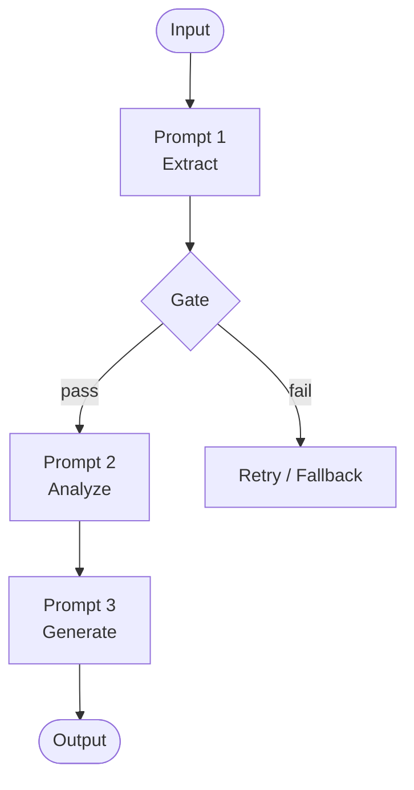
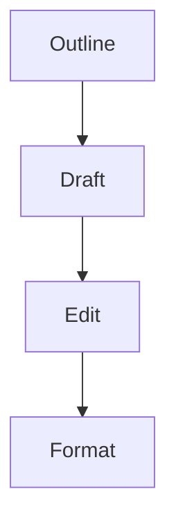
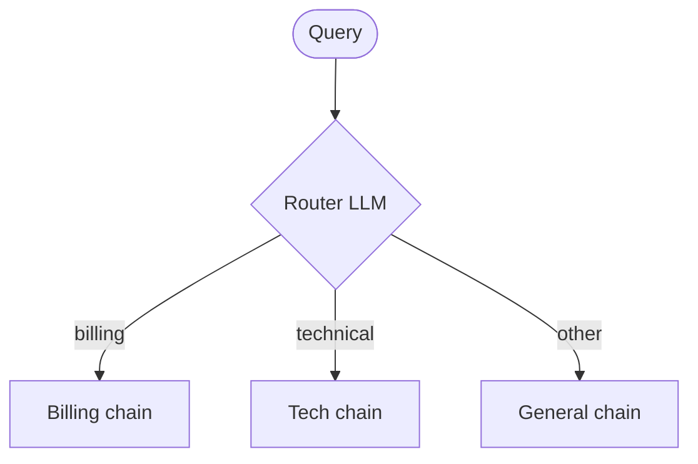
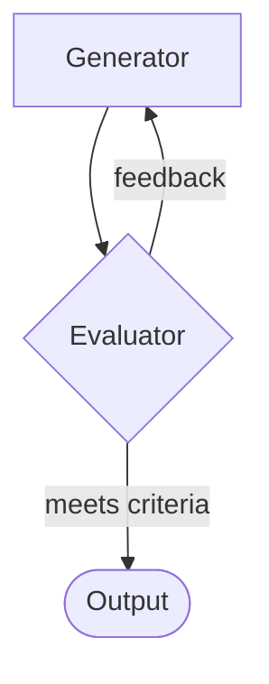

# Prompt Chaining for Agentic Reasoning

> [!abstract] TL;DR
> **Prompt chaining** breaks a complex task into a sequence (or graph) of smaller LLM calls. The ==output of one step becomes the input to the next==. Each step has one job, a defined input/output contract, and optionally a **gate** that checks the result before it moves on. Chaining is the foundation of agentic reasoning. Every agent pattern (routing, parallelization, orchestrator-workers, evaluator-optimizer, ReAct) is a chain in which ==more of the control flow is handed to the model==.

**Prerequisite:** [[Prompt Instruction Refinement]] (prompt components, iterative refinement)
**Related:** [[Chain-of-Thought and ReAct|CoT vs ReAct]] · [[Few-Shot Prompting]] · [[Tool Descriptions in Agentic Systems]] · [[Prompt Injection]] · [[LLM Evaluation]]

> [!todo]- Contents
> 1. [[#1. Core Concepts]]
> 2. [[#2. Why Chain – Trade-offs]]
> 3. [[#3. The Spectrum – Chain to Agent]]
> 4. [[#4. Chaining Patterns]]
> 5. [[#5. Designing a Good Chain]]
> 6. [[#6. Worked Example]]
> 7. [[#7. Failure Modes and Mitigations]]
> 8. [[#8. Evaluating Chains]]
> 9. [[#9. Self-Test]]
> 10. [[#10. Glossary]]

---

## 1. Core Concepts

> [!info]+ Definition – Prompt chaining
> A technique in which a task is split into **ordered subtasks**. Each subtask is handled by its own prompt, and the output of step *n* is passed (often transformed) into the prompt for step *n+1*.

^def-chaining

> [!info]+ Definition – Agentic reasoning
> An LLM system that **plans, acts, observes, and adapts** toward a goal across several steps. It often uses tools, and the model itself decides some of the control flow.

^def-agentic

> [!info]+ Definition – Chain-of-Thought (CoT)
> Reasoning in steps *inside a single call*. Chaining moves those steps *out* into separate calls that you can inspect. See [[Chain-of-Thought and ReAct]].

**Mental model:** a chain is an assembly line. Each station (prompt) has:
- one **responsibility**
- a defined **input contract** (what it receives)
- a defined **output contract** (what it must produce, ideally structured)
- an optional **quality check** before the work moves to the next station



> [!tip] Chaining vs. CoT in one line
> CoT = *"think step by step"* inside one prompt. Chaining = *you* write the steps as separate prompts with code in between.

---

## 2. Why Chain – Trade-offs

| ✅ Benefits | ❌ Costs |
|---|---|
| **Accuracy:** each call gets the model's full attention on one subtask | **Latency:** N sequential calls ≈ N× the wait |
| **Debuggability:** you can inspect every intermediate output | **Cost:** more tokens, repeated context |
| **Control:** deterministic code can validate, branch, or stop between steps | **Error propagation:** a bad early output poisons later steps |
| **Modularity:** you can swap, test, or cache individual steps | **Engineering overhead:** contracts, parsing, state |
| **Right-sizing:** a cheap or fast model for easy steps, a strong one for hard steps | **Context loss:** information not passed forward is gone |

> [!warning] Error compounding
> If each step succeeds independently with probability $p$, an $n$-step chain succeeds with
> $$P(\text{chain}) = p^{\,n}$$
> Example: $0.95^5 \approx 0.77$. Five "95% reliable" steps give a ==77% reliable system==. **Gates and retries** are what break this compounding.

^error-compounding

> [!question] When should you *not* chain?
> - The task fits comfortably in one prompt and a single call already scores well.
> - Latency is critical (real-time chat).
> - The steps are so tightly coupled that splitting them loses essential context.
>
> Start with the simplest thing that works, then add steps only when evaluation shows a need.

---

## 3. The Spectrum – Chain to Agent

The key variable is **who decides the next step**: your code or the model.

| Level | Who controls flow | Example | Predictability |
|---|---|---|---|
| **Single prompt** | n/a | Summarize this doc | ⭐⭐⭐⭐⭐ |
| **Fixed chain** | Code (hard-coded sequence) | Extract → Translate → Format | ⭐⭐⭐⭐ |
| **Workflow** | Code, with LLM-assisted branching | Router sends a ticket to one of 3 chains | ⭐⭐⭐ |
| **Agent** | The LLM decides steps and tools in a loop | ReAct research agent | ⭐⭐ |
| **Multi-agent** | Several LLMs coordinate | Orchestrator + specialist workers | ⭐ |

> [!note] Design principle
> Move ==right on this spectrum only when the task requires it==. Autonomy buys flexibility for open-ended problems. You pay for it with cost, latency, and unpredictability.

^design-principle

---

## 4. Chaining Patterns

### 4.1 Sequential (Pipeline)
Linear steps, each transforming the previous output.



**Use when:** the task breaks down cleanly into fixed stages.

### 4.2 Gated / Validated Chain
Insert **programmatic or LLM checks** between steps.
- Programmatic: JSON schema valid? Word count within bounds? Required fields present?
- LLM-as-judge: "Does this outline cover all 5 requirements? Answer PASS/FAIL with a reason."

**Use when:** later steps are expensive, or a bad input would waste them.

### 4.3 Routing
A classifier step picks which downstream chain to run.



**Use when:** inputs fall into distinct categories that need specialized prompts, or cheaper models for easy categories.

### 4.4 Parallelization
Independent subtasks run concurrently and are then aggregated.
- **Sectioning:** split the work (e.g., review a contract clause by clause).
- **Voting:** run the same prompt *k* times and take the majority or a consensus. This increases confidence.

**Use when:** subtasks are independent and speed matters, or when you want several perspectives.

### 4.5 Map-Reduce
**Map** one prompt over N chunks, then **reduce** the results with a synthesis prompt.

**Use when:** the input is too long for one context window (long documents, many files).

### 4.6 Orchestrator–Workers
An orchestrator LLM ==dynamically decides== the subtasks, delegates them to worker calls, and synthesizes the results. It differs from parallelization in that the subtasks are *not known in advance*.

**Use when:** the task structure depends on the input (e.g., a code change that touches an unknown number of files).

### 4.7 Evaluator–Optimizer (Reflection)



**Use when:** clear evaluation criteria exist and iteration measurably improves quality (translation, code, writing).

> [!warning] Always cap the loop
> Set a **max iteration count**. Evaluators can be too lenient (they rubber-stamp) or too strict (they never pass).

### 4.8 Plan-and-Execute
1. **Planner** call → produces an explicit step list (structured).
2. **Executor**: code or LLM runs each step.
3. Optional **re-planner** after observing the results.

**Use when:** you want agent-like decomposition but with an inspectable plan (human approval is possible).

### 4.9 ReAct Loop (the fully agentic end)
`Thought → Action (tool) → Observation → repeat` until done. It is effectively a chain whose ==length and steps are chosen at runtime by the model==. See [[Chain-of-Thought and ReAct]].

> [!summary]- Pattern cheat sheet
> | Pattern | Flow decided by | Key strength | Key risk |
> |---|---|---|---|
> | Sequential | Code | Simple, debuggable | Error propagation |
> | Gated | Code | Catches errors early | Gate design effort |
> | Routing | LLM classifier | Specialization | Misroutes |
> | Parallel | Code | Speed / confidence | Aggregation conflicts |
> | Map-Reduce | Code | Scales past context limit | Loses cross-chunk links |
> | Orchestrator-Workers | LLM | Handles unknown structure | Cost, unpredictability |
> | Evaluator-Optimizer | LLM + criteria | Quality via iteration | Infinite / useless loops |
> | Plan-and-Execute | LLM plan, code exec | Inspectable plans | Stale plans |
> | ReAct | LLM | Max flexibility | Loops, drift, cost |

^pattern-cheatsheet

---

## 5. Designing a Good Chain

### 5.1 Design checklist
- [ ] **Decompose by responsibility.** One step = one clear job.
- [ ] **Define I/O contracts.** Use structured outputs (JSON schema, XML tags) so code can parse and validate them.
- [ ] **Pass forward only what's needed.** Extra context adds noise. Missing context causes hallucination (see [[Prompt Instruction Refinement#4. Common Pitfalls (A06)|common pitfalls]]).
- [ ] **Add gates** at high-risk handoffs.
- [ ] **Handle failure:** retry with the error message, fall back to a simpler path, or escalate to a human.
- [ ] **Right-size models** per step.
- [ ] **Log every intermediate** for debugging and evaluation.
- [ ] **Cap loops** and set timeouts and budgets.

### 5.2 Structured handoffs
Wrap passed data in tags so the next prompt can tell instructions apart from data:

```text
You are a technical editor.

<draft>
{{output_from_step_2}}
</draft>

<requirements>
{{original_requirements}}
</requirements>

Task: List every requirement the draft fails to meet.
Output JSON: {"missing": [string], "pass": boolean}
```

> [!tip] Re-inject the original goal
> Later steps should often receive the **original user request** as well as the previous output. Otherwise the chain can **drift**, and each step optimizes for the previous step instead of the real goal.

^reinject-goal

### 5.3 Orchestration skeleton (pseudocode)

```python
def run_chain(user_request: str) -> str:
    # Step 1: plan (structured output)
    plan = llm(PLAN_PROMPT.format(request=user_request), schema=PlanSchema)

    # Gate: programmatic validation
    if not plan.steps or len(plan.steps) > 8:
        plan = llm(REPLAN_PROMPT.format(request=user_request, error="bad plan"))

    # Step 2: execute each step (could be parallel if independent)
    results = [llm(EXEC_PROMPT.format(step=s, goal=user_request)) for s in plan.steps]

    # Step 3: evaluator-optimizer loop, capped
    draft = llm(SYNTH_PROMPT.format(results=results, goal=user_request))
    for _ in range(3):
        review = llm(EVAL_PROMPT.format(draft=draft, goal=user_request), schema=Review)
        if review.passed:
            break
        draft = llm(REVISE_PROMPT.format(draft=draft, feedback=review.feedback))
    return draft
```

%% Note to self: map each block to a pattern: plan-and-execute → gate → evaluator-optimizer. %%

---

## 6. Worked Example

**Task:** *"Turn this 40-page customer-interview transcript into a prioritized product-feature roadmap."*

| Step | Pattern | Prompt's job | Output contract |
|---|---|---|---|
| 1 | Map | Per chunk: extract pain points and quotes | `[{pain, quote, speaker}]` |
| 2 | Reduce | Cluster the pain points into themes | `[{theme, count, quotes[]}]` |
| 3 | Gate (code) | Check that every theme has ≥ 2 supporting quotes | pass/fail |
| 4 | Sequential | Propose features per theme | `[{feature, theme, rationale}]` |
| 5 | Parallel voting | Score impact and effort 3× and average | `[{feature, impact, effort}]` |
| 6 | Sequential | Write the roadmap narrative (role: product manager) | Markdown |
| 7 | Evaluator | Check that the roadmap cites evidence for each item | PASS / feedback |

> [!example]- Why not one prompt?
> - 40 pages risks exceeding the context window or getting diluted attention ("lost in the middle").
> - Without step 3, a theme could be hallucinated with no evidence behind it.
> - Voting in step 5 reduces the variance of subjective scores.
> - Each intermediate output can be audited, which matters if leadership asks "where did this come from?"

---

## 7. Failure Modes and Mitigations

| Failure mode | Symptom | Mitigation |
|---|---|---|
| **Error propagation** | Garbage in step 1 → confident garbage at the end | Gates, schema validation, early human checkpoints |
| **Context loss** | Final output ignores an original constraint | Re-inject the original request and key constraints each step ([[#^reinject-goal]]) |
| **Goal drift** | Each step "improves" away from the intent | Anchor every prompt to the goal; evaluator checks against the *original* spec |
| **Format breakage** | Parser crash on malformed JSON | Structured-output features, retry with the parse error included |
| **Infinite / wasteful loops** | Evaluator never satisfied | Iteration caps, budgets, "good enough" thresholds |
| **Misrouting** | Query sent to the wrong branch | Include a "none/other" route; log and evaluate the router separately |
| **Cost / latency blowup** | Slow, expensive runs | Parallelize independent steps, cache, use smaller models for easy steps |
| **Injection propagation** | Untrusted text in step 1 hijacks later steps | Treat all passed content as **data**, delimit it, never let it override system instructions; see [[Prompt Injection]] |

> [!danger] Security: chains amplify injection
> In a chain, text from an untrusted source (a web page, an email, a user upload) gets ==re-fed into several prompts==, and some of them may have tool access. One injected instruction can travel downstream. Keep tool-using steps separate from steps that read untrusted content, and require confirmation before irreversible actions.

---

## 8. Evaluating Chains

1. **Evaluate end-to-end:** does the final output meet the task criteria? Use a fixed test set.
2. **Evaluate each step:** score every step against its own contract so you can **localize failures**.
3. **Ablate:** remove or merge steps and check whether quality actually drops. This justifies the chain's complexity.
4. **Track operational metrics:** latency, token cost, retry rate, gate failure rate.
5. **Account for stochasticity:** run multiple samples per test case and compare distributions, not single outputs.

> [!tip] Connect to refinement
> Everything from [[Prompt Instruction Refinement]] applies *per step*: refine one component at a time, but now also refine the ==chain structure== (add, split, merge, or reorder steps).

> [!quote]- Recap from the prerequisite note
> ![[Prompt Instruction Refinement#6. Key Takeaways]]

---

## 9. Self-Test

> [!question]- Q1. How does prompt chaining differ from chain-of-thought?
> CoT is step-by-step reasoning *inside one LLM call*. Chaining splits the steps into *separate calls* with code in between. That makes each step inspectable, lets you validate or branch between steps, and lets you use a different model per step.

> [!question]- Q2. Each of 6 steps is 90% reliable. What's the chain reliability, and how would you improve it?
> $0.9^6 \approx 0.53$ (see [[#^error-compounding]]). Improve it by adding gates with retries (a failed step gets another attempt), cutting unnecessary steps, raising per-step reliability through prompt refinement or a stronger model, and voting on high-variance steps.

> [!question]- Q3. Parallelization vs. orchestrator-workers: what's the key distinction?
> In parallelization the subtasks are **predefined by code**. In orchestrator-workers an LLM **decides the subtasks dynamically** based on the input.

> [!question]- Q4. Name two reasons to re-inject the original user request into later steps.
> (1) It prevents **context loss** of constraints that the intermediate outputs dropped. (2) It prevents **goal drift**, where steps optimize for the previous output instead of the real objective.

> [!question]- Q5. When is a fully agentic ReAct loop the wrong choice?
> When the steps are known in advance, when all the needed information can be supplied up front, or when latency, cost, and predictability matter. A fixed chain or a single CoT prompt is cheaper and easier to test in those cases.

> [!question]- Q6. Design prompt: sketch a chain for grading 200 student essays against a rubric.
> Possible answer:
> > [!example] Sample design
> > **Map** (per essay, score each rubric criterion with a justification, structured JSON) → **Gate** (schema valid, scores in range) → **Voting** on borderline scores (run 3×) → **Evaluator** spot-checks for consistency across essays → **Reduce** into a class-level summary. Add a human review for flagged outliers.

> [!question]- Q7. Why does chaining increase prompt-injection risk?
> Untrusted content gets passed into several downstream prompts, some of which may have tool access, so one injected instruction can spread and trigger actions. Mitigate by delimiting data, separating privileges, and adding confirmation gates.

### Flashcards
> [!tip] Spaced repetition deck
> The flashcards for this guide are in [[Prompt Chaining for Agentic Reasoning - Flashcards]]. Review them with the **Review flashcards** ribbon icon (or the command palette → *Spaced Repetition: Review flashcards*).

---

## 10. Glossary

| Term | Definition |
|---|---|
| **Handoff** | Data passed from one step to the next |
| **I/O contract** | The expected input and output shape of a step (often a JSON schema) |
| **Structured output** | Model output constrained to a schema so code can parse it |
| **LLM-as-judge** | Using an LLM with a rubric to evaluate another LLM's output |
| **Ablation** | Removing a component to measure its contribution |
| **Human-in-the-loop (HITL)** | A human approval checkpoint within a chain |
| **Context window** | The maximum number of tokens a model can attend to in one call |

---

## Further Reading
- [Building Effective Agents](https://www.anthropic.com/engineering/building-effective-agents), Anthropic: workflows vs. agents; the source for most of the patterns in [[#4. Chaining Patterns]]
- [ReAct: Synergizing Reasoning and Acting in Language Models](https://arxiv.org/abs/2210.03629), Yao et al., 2022
- [Chain-of-Thought Prompting Elicits Reasoning in Large Language Models](https://arxiv.org/abs/2201.11903), Wei et al., 2022
- [Plan-and-Solve Prompting](https://arxiv.org/abs/2305.04091), Wang et al., 2023
