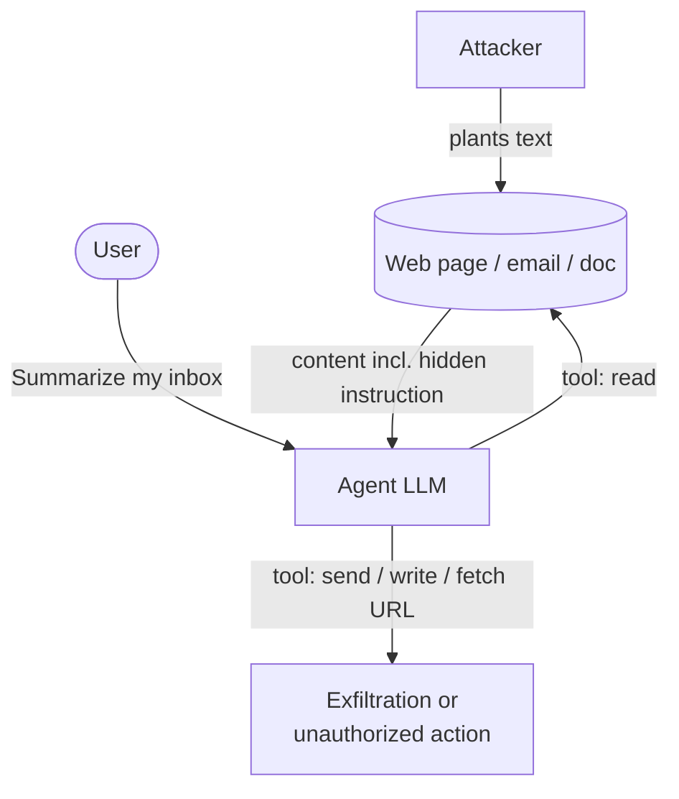
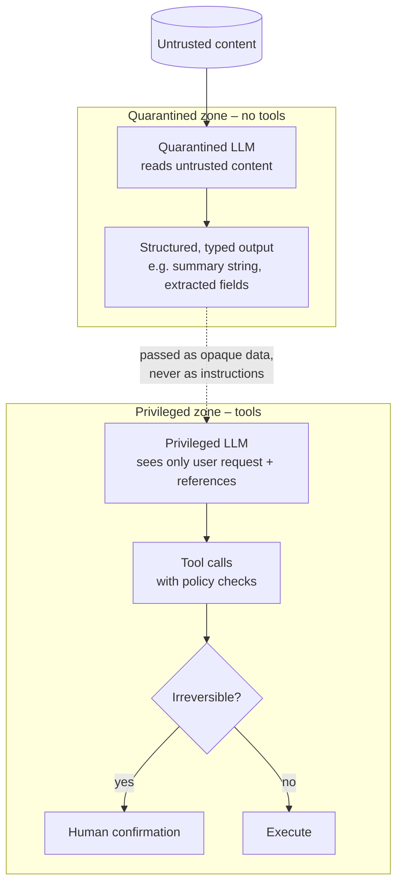

# Prompt Injection

> [!abstract] TL;DR
> Prompt injection happens when **untrusted text is interpreted by an LLM as instructions** and overrides what the developer or user intended. It exists because ==an LLM reads instructions and data as a single token stream with no hard boundary between them==. In a chatbot, a successful injection produces bad text. In an agent with tools, it produces **bad actions**: data exfiltration, unauthorized emails, destructive commands. No prompt-level defense is complete, so secure systems ==limit the blast radius by architecture==: least privilege, separating untrusted content from privileged tools, and human confirmation for irreversible actions.

**Prerequisite:** [[Prompt Instruction Refinement]] (A06 lists adversarial prompting as a pitfall) · [[Large Language Models]]
**Related:** [[Prompt Chaining for Agentic Reasoning - Study Guide#7. Failure Modes and Mitigations|Injection propagation in chains]] · [[Tool Descriptions in Agentic Systems]] · [[AI Agents]] · [[Retrieval-Augmented Generation]] · [[Model Context Protocol]]

**Sources:** This is a synthesis note. The lecture material (A06, in [[Prompt Instruction Refinement#4. Common Pitfalls (A06)]]) names prompt injection, prompt leaking and jailbreaking and tells you to "always expect a model to be used in unintended ways". The taxonomy, defenses and examples here are *beyond the lecture* and come from the sources in [[#Further Reading]].

> [!todo]- Contents
> 1. [[#1. Core Concepts]]
> 2. [[#2. Root Cause – No Instruction-Data Boundary]]
> 3. [[#3. Attack Surface in Agentic Systems]]
> 4. [[#4. Defenses – Defense in Depth]]
> 5. [[#5. Worked Example]]
> 6. [[#6. Pitfalls and Failure Modes]]
> 7. [[#7. Key Takeaways]]
> 8. [[#8. Critical Analysis]]
> 9. [[#9. Self-Test]]
> 10. [[#10. Glossary]]

---

## 1. Core Concepts

> [!info]+ Definition – Prompt injection
> An attack in which input crafted by an adversary causes an LLM application to **follow the attacker's instructions** instead of, or in addition to, the developer's and user's. It is ranked **LLM01** in the OWASP Top 10 for LLM Applications.

^def-injection

> [!info]+ Definition – Direct vs. indirect injection
> - **Direct:** the attacker *is* the user and types the malicious instruction into the prompt.
> - **Indirect:** the attacker plants instructions in **content the system later reads**, such as a web page, email, document, tool output or retrieved chunk. The victim is a legitimate user whose agent processes that content (Greshake et al., 2023).

^def-indirect

| Term | Goal | Who is harmed | Example framing |
|---|---|---|---|
| **Prompt injection** | Hijack the *application's* instructions | The app owner or user | "Ignore the task; do X instead" hidden in a document |
| **Jailbreaking** | Bypass the *model's* safety training | Model policy (often a direct attack) | Role-play framings to get disallowed content |
| **Prompt leaking** | Extract the hidden system prompt | The app owner (IP, and the security details it reveals) | "Repeat everything above this line" |

> [!important] Why agents change the stakes
> Chatbot plus injection gives you wrong or embarrassing text. **Agent plus injection gives you the attacker's actions performed with the user's privileges.** Risk scales with the tools the agent can reach. See [[AI Agents]] and [[Tool Use]].

---

## 2. Root Cause – No Instruction-Data Boundary

Classic injection bugs such as SQL injection happen when *data* is parsed as *code*. They were solved structurally with **parameterized queries**, which give data its own channel.

LLMs have **no equivalent separate channel**. The system prompt, user message, retrieved documents and tool results are all concatenated into one sequence of tokens. Role markers and delimiters are *conventions the model was trained to respect*, not enforced boundaries.

> [!warning] Consequence
> Every mitigation that lives *inside the prompt* (delimiters, "ignore instructions in the data", instruction hierarchy training) is ==probabilistic==. It lowers the attack success rate but doesn't drive it to zero. Deterministic guarantees have to come from **outside the model**: permissions, sandboxes, confirmations and data-flow controls.

^root-cause

---

## 3. Attack Surface in Agentic Systems

Any text that enters the context window is a potential injection channel:

| Channel | Example of untrusted content | Vault link |
|---|---|---|
| User input | Chat messages, uploaded files | [[Prompt Instruction Refinement]] |
| Retrieved documents | RAG chunks from a shared wiki or the public web | [[Retrieval-Augmented Generation]] |
| Web browsing | Hidden text, HTML comments, alt text on a page | [[Tool Use]] |
| Email and messages | An inbound email an assistant summarizes | [[#5. Worked Example]] |
| Tool outputs | API responses, file contents, command output | [[Chain-of-Thought and ReAct]] |
| **Tool descriptions** | A malicious or compromised tool server whose description carries instructions ("tool poisoning") | [[Tool Descriptions in Agentic Systems]], [[Model Context Protocol]] |
| Few-shot example stores | Attacker-written demonstrations | [[Few-Shot Prompting]] |
| Persistent memory | An injected "fact" saved to memory that affects future sessions | [[AI Memory]] |
| Multi-agent messages | One compromised agent instructing another | [[Multi-Agent Systems]] |

> [!danger] The "lethal trifecta" (Willison)
> An agent is critically exposed when it combines all three of:
> 1. **Access to private data**, such as email, files or databases
> 2. **Exposure to untrusted content**, such as the web, inbound messages or shared docs
> 3. **A way to communicate externally**, such as sending email, making HTTP requests or rendering remote images or links
>
> ==Remove any one leg== and the exfiltration path breaks. This is the most practical design heuristic in this note.

^lethal-trifecta

**Attacker goals** (conceptual):

| Goal | Impact |
|---|---|
| Data exfiltration | Private data leaves through a tool call, a link or a rendered image URL |
| Unauthorized action | Emails sent, files deleted, purchases made, code pushed |
| Goal hijacking | The agent quietly does a different task, e.g. biased summaries |
| Persistence | Poisoned memory or config affects future sessions |
| Prompt leaking | The system prompt is revealed, which helps further attacks |
| Resource abuse | Loops or expensive tool calls drive up cost |

---

## 4. Defenses – Defense in Depth

No single layer is enough. Stack them, with the **deterministic, architectural** controls doing the heavy lifting.

| Layer | Control | Type | Notes |
|---|---|---|---|
| **1. Prompt hygiene** | Delimit untrusted content (`<document>…</document>`), label it as data, restate the task after it | Probabilistic | Cheap and helpful, but bypassable ([[#^root-cause]]) |
| **2. Model-level** | Models trained on an *instruction hierarchy* (system > developer > user > tool output) | Probabilistic | Raises the bar; not a guarantee |
| **3. Detection** | Classifier or LLM screen for injection-like content on inputs and tool outputs | Probabilistic | Adds latency; false positives and negatives |
| **4. Least privilege** | Minimal tool set, scoped credentials, read-only by default, allow-listed destinations | **Deterministic** | Limits what a hijacked agent *can* do |
| **5. Privilege separation** | Keep untrusted-content reading apart from privileged actions: the dual-LLM / quarantined-LLM pattern, CaMeL-style data-flow control | **Deterministic** (by design) | A quarantined model reads untrusted text but can't call tools |
| **6. Human-in-the-loop** | Confirmation before irreversible or external actions (send, delete, pay, publish) | **Deterministic** | Watch for approval fatigue; show the *actual* action and arguments |
| **7. Output controls** | Don't auto-render remote images or links; sanitize markdown; restrict outbound URLs | **Deterministic** | Closes silent exfiltration channels |
| **8. Monitoring** | Log prompts, tool calls and arguments; alert on anomalies | Detective | Needed for incident response |

^defense-layers

> [!example] Why layering helps – and its limit
> If three layers each independently miss an attack 10% of the time, the combined miss rate is $0.1^3 = 0.001$. **But the layers aren't independent**: an attack crafted to fool one LLM-based layer often fools another. Real-world combined miss rates are much worse than the product. That's why at least one layer should be deterministic (4–7).

^layering-math

---

## 5. Worked Example

**System:** an email assistant agent. Tools: `read_inbox`, `search_files`, `send_email`. The user asks: *"Summarize today's unread emails."*

**Attack (indirect, conceptual):** one inbound email contains text, hidden or in plain sight, telling the assistant to gather the user's recent invoices and email them to an outside address. The user never sees the instruction. The agent reads it as part of the email content.

| Question | Analysis |
|---|---|
| Lethal trifecta ([[#^lethal-trifecta]]) | Private data (files), untrusted content (inbound email) and external communication (`send_email`): **all three present** |
| Where do prompt-level defenses help | Delimiting the email body and restating "summarize only" reduces the success rate, but doesn't eliminate it |
| Deterministic fix 1 – scope | The summarization task needs only `read_inbox`. **Don't expose `send_email` or `search_files` for this task** (least privilege per task) |
| Deterministic fix 2 – confirmation | If `send_email` must exist, require user confirmation that shows the recipient, subject and attachments |
| Deterministic fix 3 – allow-list | Restrict outbound recipients to the user's contacts or domain unless the user overrides it |
| Deterministic fix 4 – separation | Summarize with a quarantined call that has no tools, and return only the summary text |
| Detection and logging | Flag emails containing instruction-like text; log every tool call with its arguments |

> [!success] Outcome
> With per-task tool scoping, the injected instruction has **no tool to act through**. The worst case falls to a misleading summary, which is annoying but not a breach.

---

## 6. Pitfalls and Failure Modes

| Failure | Symptom | Mitigation |
|---|---|---|
| **"Just tell the model to ignore it"** | Single-line defense in the system prompt; bypassed by rephrasing | Treat it as layer 1 only; add deterministic controls |
| **Keyword blocklists** | Attackers paraphrase, translate or encode | Use architectural controls; classifiers only as a supplement |
| **Trusting tool output** | The agent follows instructions found in an API response | Treat *all* tool outputs as untrusted data |
| **Over-broad credentials** | The agent has admin tokens "for convenience" | Scoped, short-lived, per-task credentials |
| **Auto-rendering** | Markdown images or links leak data in URLs with no click | Disable remote rendering; allow-list domains |
| **Approval fatigue** | The user clicks "approve" on everything | Confirm only high-risk actions; show clear diffs and arguments |
| **Chains spread the injection** | Untrusted text from step 1 steers a tool-using step 4 | Keep tool-using steps apart from untrusted-reading steps ([[Prompt Chaining for Agentic Reasoning - Study Guide#7. Failure Modes and Mitigations]]) |
| **No audit trail** | You can't reconstruct what happened | Log the full context and tool calls |
| **Unvetted tool servers** | A third-party tool description carries instructions | Pin and review tool servers and descriptions ([[Tool Descriptions in Agentic Systems]]) |

---

## 7. Key Takeaways

- [ ] Root cause: **instructions and data share one token stream**. There's no parameterized-query equivalent.
- [ ] **Indirect** injection (through content the agent reads) is the main threat to agents.
- [ ] Prompt-level defenses are probabilistic. **Architectural defenses are what you rely on.**
- [ ] Check every agent design for the **lethal trifecta** and remove at least one leg.
- [ ] Least privilege per task, confirmation for irreversible actions, and no silent outbound channels.
- [ ] Tool outputs, retrieved docs, memory and tool *descriptions* are all attack surface.
- [ ] Layered defenses help, but correlated failures mean $p^n$ math overstates the protection ([[#^layering-math]]).

---

## 8. Critical Analysis

- **Is it solvable?** Many researchers regard prompt injection as unsolved in general. Model-level improvements (instruction hierarchy training) measurably lower attack success rates on benchmarks, but adaptive attackers routinely beat published defenses. Design as if the model *will* be compromised some of the time.
- **Evidence quality.** Defense papers usually report results against *fixed* attack sets, which overstates robustness. The right evaluation is **adaptive**: a red team that knows the defense. Report attack success rate (ASR) *and* utility loss, because a defense that blocks every attack by refusing everything is useless.
- **Utility–security trade-off.** Strict separation (quarantined LLMs, CaMeL-style capability tracking) limits what the agent can do with untrusted content. For example, the privileged model can't reason over the email text directly. That's a genuine design trade-off, not an implementation detail.
- **At scale.** Multi-agent systems and tool marketplaces ([[Model Context Protocol]]) multiply the trust boundaries. A single compromised tool description reaches every agent that installs it, which makes it a **supply-chain** problem.
- **Human-in-the-loop isn't free.** Confirmations shift risk to the user's attention. Clear action previews and risk-based gating matter more than confirmation count.
- **Link to reliability.** Injection is one special case of a general principle: an LLM's output is *untrusted* until validated. That's the same stance as [[LLM Hallucinations]] and [[AI Reliability]].

> [!question] Open questions
> 1. Could a model architecture ever provide a true separate "data channel"? What would it lose?
> 2. How would you build an adaptive red-team eval for your agent, and what ASR is acceptable for which actions?
> 3. Who is responsible when a third-party tool description injects instructions: the tool author, the platform or the agent developer?

---

## 9. Self-Test

> [!question]- Q1. What's the difference between direct and indirect prompt injection?
> Direct: the attacker types the instruction into the prompt themselves. Indirect: the attacker plants instructions in content (web, email, docs, tool output) that a legitimate user's agent later reads.

> [!question]- Q2. Why can't delimiters alone fully prevent injection?
> Delimiters are conventions the model was trained to respect, not an enforced boundary. All text is still one token stream, and the model can still follow instructions inside the delimited data. They lower the success rate but aren't a guarantee.

> [!question]- Q3. Name the three legs of the lethal trifecta and one way to break each.
> Private data (scope data access per task), untrusted content (don't let the privileged agent read it directly; quarantine it), external communication (remove outbound tools, allow-list destinations, disable remote rendering, require confirmation).

> [!question]- Q4. Quantitative: three defense layers each miss 20% of attacks. What's the combined miss rate if independent, and why is reality worse?
> $0.2^3 = 0.008$ (0.8%). In practice the layers are correlated: an attack designed to fool one LLM-based filter often fools the others. So the real miss rate is higher. At least one deterministic layer is needed.

> [!question]- Q5. Design: a coding agent can read GitHub issues and push to the repo. Propose three controls.
> (1) Treat issue text as untrusted and summarize it through a quarantined, tool-less call. (2) Least privilege: push only to feature branches, never to main; merges need human review. (3) Allow-list network egress and block outbound calls to arbitrary URLs. Also log all tool calls and flag instruction-like text in issues.

> [!question]- Q6. How is jailbreaking different from prompt injection?
> Jailbreaking targets the *model's* safety training to get disallowed output, usually directly. Prompt injection targets the *application*: it overrides the developer's or user's instructions, often indirectly, to make the system do something unintended.

### Flashcards
> [!tip] Spaced repetition deck
> The flashcards for this note are in [[Prompt Injection - Flashcards]]. Review them with the **Review flashcards** ribbon icon (or the command palette → *Spaced Repetition: Review flashcards*).

---

## 10. Glossary

| Term | Definition |
|---|---|
| **Direct injection** | Malicious instructions supplied by the user in the prompt |
| **Indirect injection** | Malicious instructions embedded in content the system ingests |
| **Prompt leaking** | Extracting the hidden system prompt |
| **Jailbreak** | Bypassing a model's safety training |
| **Instruction hierarchy** | Training models to prioritize system > developer > user > tool-output instructions |
| **Dual-LLM / quarantined LLM** | A pattern where a tool-less model processes untrusted text and a privileged model never sees it raw |
| **Tool poisoning** | Instructions hidden in a tool's description or metadata |
| **Attack success rate (ASR)** | Fraction of attack attempts that achieve the attacker's goal |
| **Lethal trifecta** | Private data + untrusted content + external communication |

---

## Further Reading
- [OWASP Top 10 for LLM Applications](https://owasp.org/www-project-top-10-for-large-language-model-applications/) (prompt injection is LLM01)
- [Not What You've Signed Up For: Compromising Real-World LLM-Integrated Applications with Indirect Prompt Injection](https://arxiv.org/abs/2302.12173), Greshake et al., 2023
- [Ignore Previous Prompt: Attack Techniques for Language Models](https://arxiv.org/abs/2211.09527), Perez & Ribeiro, 2022
- [The Instruction Hierarchy](https://arxiv.org/abs/2404.13208), Wallace et al., 2024
- [Defeating Prompt Injections by Design (CaMeL)](https://arxiv.org/abs/2503.18813), Debenedetti et al., 2025
- [The lethal trifecta for AI agents](https://simonwillison.net/2025/Jun/16/the-lethal-trifecta/), Simon Willison, 2025

%% Study hint: for any agent design question, first check it against the lethal trifecta, then list deterministic controls before prompt-level ones. %%
