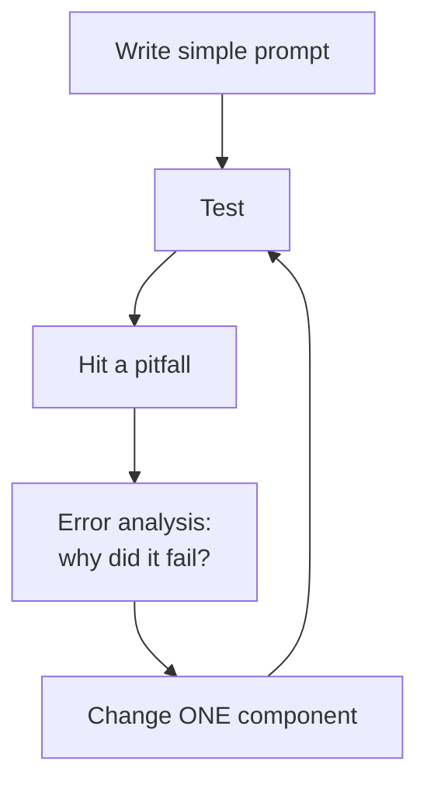

---

title: Prompt Instruction Refinement

course: Agentic AI (Cd14526) – Course 1

lessons: [A05a, A05b, A06]

type: lecture-notes

tags: [prompt-engineering, llm, agentic-ai, prompt-refinement, evaluation]

created: 2026-09-22

---

  

# Prompt Instruction Refinement

  

> [!abstract] Summary

> A prompt is made of five parts: **Role, Task, Output Format, Examples, Context**. You refine a prompt by changing **one or a few components at a time**, comparing the outputs, and working out *why* they differ. The lessons call this the scientific method applied to prompting. LLMs are probabilistic systems. They don't read minds, and they follow only what you write down.

  

**Sources:** 3 lecture videos: A05a *Prompt Instruction Refinement* (~4 min), A05b *Prompt Instruction Refinement* (~5 min), A06 *Prompt Refinement Best Practices* (~8 min). Subtitles came in EN/DE/ES/JA. The versions are straight translations of each other, and this note is based on the EN-US version.

  

Related: [[Chain-of-Thought and ReAct]] · [[Prompt Chaining for Agentic Reasoning - Study Guide]] · [[Few-Shot Prompting]] · [[Tool Descriptions in Agentic Systems]] · [[Prompt Injection]]

  

---

  

## 1. Anatomy of a Prompt (A05a)

  

| Component          | What it does                                                                     | Notes                                                                    |
| ------------------ | -------------------------------------------------------------------------------- | ------------------------------------------------------------------------ |
| **Role / Persona** | Shapes tone, style, perspective                                                  | It does more than make the output fun: it can *improve task performance* |
| **Task**           | The core intent: what the model must do                                          | Complex tasks need detailed goals and explicit constraints               |
| **Output Format**  | Structure of the response (JSON, CSV, Markdown, custom)                          | Critical when **code parses the output** downstream                      |
| **Examples**       | One-shot / few-shot input→output pairs                                           | The model imitates the patterns in them                                  |
| **Context**        | Background facts, data to process, references, **agent environment description** | Sets the factual basis the model works from                              |

  

> [!tip] Delimit your sections

> Label sections explicitly (`Output format:`, `Example:`) so the model can tell instructions, examples, and data apart.

  

### Demo: Pirate-ship agent

- Setup: an agent that only answers questions about a ship, speaking as a pirate.

- "What's the date?" → *"Me knows not."* (it stayed in scope)

- "Ship's name?" → *"Neptune's Fury."*

- "How old is the ship?" → an evasive, in-character non-answer.

- **Lesson:** the age was never in the **context**, so the model *couldn't* know it. It didn't hallucinate an age, which was good. But if you want facts, you have to supply them. **The fix is to refine the context, not to hope.**

  

---

  

## 2. How Changing Each Component Changes Output (A05b)

  

| Change the...     | Effect on output                                                                         |
| ----------------- | ---------------------------------------------------------------------------------------- |
| **Role**          | Persona, tone, style, the "lens" the information is shown through                        |
| **Task**          | The core action and its constraints. You get *fundamentally different kinds* of output   |
| **Output format** | Structure and presentation change. The **content doesn't necessarily change**            |
| **Examples**      | Style, structure, level of detail, quality. Helps the model pick up nuanced requirements |
| **Context**       | The background, data, and scope, which is to say the **factual basis**                   |

  

> [!quote] Analogy

> Prompting is like tuning a complex instrument. A small adjustment to one string or valve can change the whole sound a lot. Small wording changes, an added or removed constraint, or a new persona can reshape the response.

  

### Demo: New Orleans food recommendation

**Baseline prompt**

- Role: *cheerful food blogger*

- Task: recommend a unique local dish, **< 75 words**, focus on taste, **don't name restaurants**

- Format: single paragraph with a hook

- Context: first-time visitors to New Orleans looking for unique fusion flavors

- Output: recommends **Yakamein**, opening with "Ready for a taste adventure?" It matches the persona and meets every constraint.

  

**Single-variable experiments**

1. **Role →** high-dining food critic / connoisseur → the tone and register shift.

2. **Task →** ≤ 15 words → the response gets tighter.

3. **Format →** JSON `{dish_title, description}` → output is ready to parse.

4. **Examples →** example rewritten in ALL CAPS, *with no explicit instruction* → **only partly followed** (just the start was capitalized).

  

> [!important] Key insight: examples ≠ instructions

> Changing the examples alone was not enough to get all-caps output. The instructor's point: *we never said to use caps, and we never said not to use them.* The model wasn't failing. It was following the instructions it actually had. **If a requirement matters, state it explicitly.** Examples back up instructions. They don't replace them.

  

> [!warning] Components are not independent

> Task, Examples, and Output Format can **all** affect formatting. If two of them conflict, the result is unpredictable. That's another reason to change one thing at a time.

  

*Exercise left to the student:* run the same experiment by changing the **context**.

  

---

  

## 3. Best Practices (A06)

  

> [!quote] Analogy: the bakers

> A prompt is like a recipe handed to a group of bakers. Without a common recipe, you get many different breads. They may all be delicious, but they won't be the sourdough you needed for your party. The clearer the guidance, the less room for interpretation that is *not wrong, but not what you wanted*.

  

1. **Write clear, detailed instructions.** Don't assume the model can read your mind. Tell it everything.

2. **Use roles or personas** to set tone and style.

3. **Break down complex tasks.** Split them into stages (see [[Prompt Chaining for Agentic Reasoning - Study Guide]]). Even inside one prompt, avoid convoluted requests.

   - Ask the model to **think before answering**. Step-by-step reasoning is **Chain-of-Thought**, and you can even suggest the steps.

4. **Specify output format and constraints**: JSON or bullets, word count, required phrases.

5. **Include few-shot examples** to guide style, format, and how the task is carried out.

6. **Provide relevant context**, especially for factual or domain-specific tasks.

7. **Optimize tool descriptions** *(agentic systems)*. Spend real time on tool descriptions and I/O schemas. They go into the context and drive the model's decisions about **when and how to call tools**.

  

---

  

## 4. Common Pitfalls (A06)

  

| Pitfall                                       | Why it hurts                                                                                                                                                                                 |
| --------------------------------------------- | -------------------------------------------------------------------------------------------------------------------------------------------------------------------------------------------- |
| **Ambiguity** *(the most common)*             | Vague terms or missing constraints mean the model picks an interpretation you didn't intend. *Even better future models won't know instructions you never wrote down.*                       |
| **Insufficient context**                      | Expecting knowledge the model wasn't given is a "guaranteed" route to wrong or hallucinated output. It has no access to your private files or real-time data.                                |
| **Too much context / competing instructions** | Irrelevant information dilutes the prompt, and conflicting instructions degrade performance. Future models may filter noise better, but **conflicting instructions will stay unresolvable**. |
| **Poor tool descriptions**                    | The agent won't know how or when to use its tools.                                                                                                                                           |
| **Expecting magical understanding**           | "Don't trust the hype." These are **probabilistic** systems that depend on explicit instructions.                                                                                            |
| **Bias & factuality**                         | Output can be wrong or reflect biases in the training data. Validate it, especially for critical tasks.                                                                                      |
| **Adversarial prompting**                     | Prompt injection, prompt leaking, jailbreaking. *Always expect a model to be used in unintended ways.*                                                                                       |

  

> [!note] Model-specific behavior

> A prompt tuned for one vendor (e.g., Anthropic) may need different phrasing for another (e.g., OpenAI), or even for a different model from the same vendor. **Prompts are not portable by default.** Re-test when you switch models.

  

---

  

## 5. The Refinement Loop

  

  

This is iterative development in the same way software engineering is: **start simple → test → analyze the diff → refine**.

  

### Worked example: Marketing social post (A06)

| Iteration | Prompt change                                                                                     | Resulting output                                     | Remaining gap                  |
| --------- | ------------------------------------------------------------------------------------------------- | ---------------------------------------------------- | ------------------------------ |
| v1        | "Write a social media post about the new Evergreen reusable coffee cup."                          | Generic, brief                                       | No benefits, no call to action |
| v2        | + **Context** (product benefits, company values) + **Task refinement** (goal: highlight benefits) | Covers benefits and the audience's eco-consciousness | Tone is dry, weak CTA          |
| v3        | + **Role** (marketing persona) + **Constraint** (must include a CTA)                              | Much stronger                                        | —                              |

  

> [!tip] Evaluation method

> The reviewer judged each version *as a domain expert* (a social media marketer), using explicit criteria: engagement, benefits, CTA. Refinement is only as good as your **evaluation criteria**. Write them down before you iterate.

  

---

  

## 6. Key Takeaways

  

- [ ] A prompt = **Role + Task + Output Format + Examples + Context**.

- [ ] **Change one variable at a time** so you can attribute each effect to its cause.

- [ ] **Explicit beats implicit.** Examples reinforce instructions but don't replace them.

- [ ] Components **interact**: format can be set by the Task, the Examples, *and* the Format section.

- [ ] Missing context → the model can't know. Excess or conflicting context → performance drops.

- [ ] In agentic systems, **tool descriptions are prompt engineering**.

- [ ] Validate outputs. Plan for bias, hallucination, and adversarial use.

- [ ] Prompts are **model-specific**. Re-test when you switch models.

  

---

  

## 7. Critical Analysis (300-level reflection)

  

- **Controlled experimentation has limits.** "Change one variable" treats prompt components like independent variables, yet A05b itself shows they interact. LLM outputs are also **stochastic**: one run per variant can't separate a real effect from sampling noise. A stronger method runs *n* samples per variant (or temperature 0) and scores them against a rubric or eval set, in the spirit of A/B testing.

- **Evaluation is the bottleneck.** Every demo judged outputs by eye ("this is better"). At scale you need defined success criteria, test cases, and ideally automated checks: schema validation for JSON, and LLM-as-judge with a rubric for tone.

- **Role prompting has mixed evidence.** Personas reliably change *style*. Their effect on *accuracy* depends on the task and the model. Treat "improves performance" as something to test, not a guarantee.

- **Explicit negation vs. positive framing.** The all-caps demo argues for being explicit. In practice, stating what *to do* ("respond in all caps") tends to work better than stating what not to do.

- **Link to agentic design.** Tool descriptions, context curation, and task decomposition are the same levers you use when choosing between [[Chain-of-Thought and ReAct|CoT and a ReAct loop]]. Better context often removes the need for a tool loop at all.

- **Security is out of scope in these lessons, but not optional.** Any prompt that ingests untrusted input, such as a web page, email, or user text, can carry prompt injection. Keep instructions and data clearly separated with delimiters, and never let retrieved content override the system prompt.

  

> [!question] Open questions for discussion

> 1. How would you design an eval set to measure whether a prompt change actually improved the outputs?

> 2. When do few-shot examples *hurt*, for example by overfitting to one example's surface features?

> 3. How should refinement change when the "user" of the output is code, such as a parser, rather than a human?

  

> [!info] Gap in the sources

> A05a promises a final practical example "comparing multiple prompt versions on coding tasks." That segment is **not in these transcripts**. It may be in a separate video.