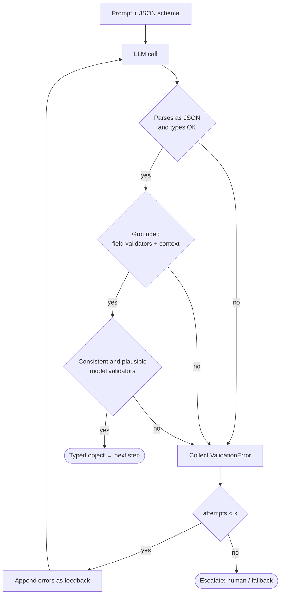

# Pydantic for Structured LLM Output

> [!abstract] TL;DR
> An LLM returns text. A chain needs **typed data** it can trust. Pydantic turns an LLM response into a validated Python object, or it raises a precise error you can send back to the model. The key design rule: ==every gate check must protect a specific fact the next step relies on==. Checking that the JSON parses is not enough. A schema-valid object can still be ungrounded, inconsistent or wrong. So the gates have to test **the information itself**: is it in the source, does it agree with the other fields, and does it make sense in the domain?

**Prerequisites:** [[Gate Checks]] · [[Prompt Chaining for Agentic Reasoning - Study Guide#4.2 Gated / Validated Chain|Gated chains]]
**Related:** [[Output Validation]] · [[Implementing Gate Checks]] · [[Tool Descriptions in Agentic Systems]] · [[LLM Hallucinations]] · [[Prompt Injection]]

> [!note] Source scope
> The three gate types (format / content / logic) come from the course material summarized in [[Gate Checks]], which names Pydantic as a format-check tool. Everything else is ==beyond the lecture==: the Pydantic v2 API, the "information-bound gate" framing, the worked example and the critical analysis.

> [!todo]- Contents
> - [[#1. Core Concepts]]
> - [[#2. Information-Bound Gates – The Design Rule]]
> - [[#3. Pydantic Mechanics – Mapping Gates to Features]]
> - [[#4. The Validate–Retry Loop]]
> - [[#5. Worked Example – Insurance Claim Extraction]]
> - [[#6. Pitfalls and Failure Modes]]
> - [[#7. Key Takeaways]]
> - [[#8. Critical Analysis]]
> - [[#9. Self-Test]]
> - [[#10. Glossary]]
> - [[#Further Reading]]

---

## 1. Core Concepts

> [!info]+ Definition – Structured output
> An LLM response that follows a machine-readable contract, usually JSON that matches a JSON Schema, so code can parse it rather than scrape it.

^def-structured-output

> [!info]+ Definition – Pydantic model
> A Python class (subclass of `BaseModel`) whose type-annotated fields define a schema. `Model.model_validate_json(raw)` parses the text, coerces the types, runs the validators, and returns either a typed instance or a `ValidationError` that lists every failure with its field path.

^def-pydantic-model

> [!info]+ Definition – Information-bound gate
> A validation rule that comes from a **downstream dependency on a fact**, not from the shape of the data. It answers the question "if this fact were wrong, which later step would break, and how would I detect it here?"

^def-info-bound-gate

**One model, three jobs.** One Pydantic class is used three ways:

| Role | How | Why it matters |
|---|---|---|
| **Prompt spec** | `Model.model_json_schema()` goes into the prompt or the provider's structured-output / tool parameter | Field `description`s act as instructions to the model (compare [[Tool Descriptions in Agentic Systems]]) |
| **Gate** | `model_validate_json(raw, context=...)` | Catches bad output **between** chain steps |
| **Handoff type** | The next step receives a typed object, not a string | The downstream code can rely on these facts without checking them again |

---

## 2. Information-Bound Gates – The Design Rule

Constrained decoding and provider "JSON mode" can guarantee the **format**. They can't guarantee that the information is **true**. The most dangerous LLM output is schema-valid: it parses, it type-checks, and it is wrong. It goes through every format gate and fails silently later in the chain (see [[Prompt Chaining for Agentic Reasoning - Study Guide#^error-compounding|error compounding]]).

> [!important] The derivation rule
> Don't start from the schema and ask "what can I validate?". Start from **the facts the next step uses** and ask "what would a wrong value look like, and what can I check cheaply here?"
>
> $$\text{gate set} = \bigcup_{f \,\in\, \text{facts consumed downstream}} \text{checks}(f)$$
>
> If a check doesn't protect a fact that a later step consumes, it adds friction without adding safety. If a consumed fact has no check, that is a gap.

^derivation-rule

Each fact the next step uses can be checked in four ways:

| Property of the information | Question                                                 | Gate type ([[Gate Checks]]) | Example                                                      |
| --------------------------- | -------------------------------------------------------- | --------------------------- | ------------------------------------------------------------ |
| **Well-formed**             | Is it the right type, pattern and range?                 | Format                      | `policy_number` matches `^POL-\d{6}$`                        |
| **Grounded**                | Does the source actually say this?                       | Content                     | The supporting quote appears verbatim in the input document  |
| **Consistent**              | Does it agree with the other fields?                     | Logic                       | Line items add up to `claimed_amount`                        |
| **Plausible**               | Does it make sense in the domain or against world state? | Logic                       | `incident_date` is not after the date the claim was received |

^four-properties

> [!warning] Format gates are necessary but not sufficient
> If the gates only check shape, your pipeline is =="type-safe hallucination"==: the data is guaranteed to parse and not guaranteed to be true.

---

## 3. Pydantic Mechanics – Mapping Gates to Features

| Need | Pydantic v2 feature | Gate type |
|---|---|---|
| Types, required fields | Type annotations, no default → required | Format |
| Closed vocabularies | `Literal["auto", "property", ...]` or `Enum` | Format (also blocks free-text injection into routing fields) |
| Ranges, lengths, regex | `Field(gt=0, le=..., min_length=..., pattern=...)` | Format / plausibility |
| Single-field semantics | `@field_validator("x")` | Content |
| Cross-field rules | `@model_validator(mode="after")` | Logic |
| Checks against the **source / world state** | `ValidationInfo.context`, passed through `model_validate_json(raw, context={...})` | Content (grounding), logic |
| Honest "not found" | `X \| None = None`, plus a rule: a non-null value must have evidence | Content (anti-hallucination) |
| Strict typing | `ConfigDict(strict=True)` or `strict=True` at validation | Format (stops `"12"` → `12` coercion hiding errors) |
| Machine-readable errors | `ValidationError.errors()` → list of `{loc, msg, type}` | Feeds the retry loop |

> [!tip] `context` is what lets a gate check the information
> Without `context`, a validator can only see the LLM output, so all it can check is internal shape. With `context`, a validator can compare the output against **the input document, the database record, or today's date**. That comparison is what grounds the check in real information.

---

## 4. The Validate–Retry Loop



If each attempt passes independently with probability $p$, then $k$ attempts pass with probability

$$P_{\text{pass}}(k) = 1 - (1-p)^k$$

For example, $p = 0.8$ and $k = 3$ give $1 - 0.2^3 = 0.992$. ==Treat this as an upper bound==. Failures are correlated: if the source doesn't contain the fact, no number of retries will produce a grounded value. For that reason the loop must end in **escalation**, not an endless retry.

^retry-math

---

## 5. Worked Example – Insurance Claim Extraction

**Scenario (constructed, beyond the lecture).** A claim-triage chain has three steps. Step 1 extracts claim facts from a customer email. Step 2 routes the claim by `category`. Step 3 approves payouts under $5,000 automatically. Step 3 relies on `claimed_amount`, `policy_number`, `incident_date` and `category`, so ==those four facts must each have an information-bound gate==.

### 5.1 Map the downstream dependencies first

| Fact consumed | Consumer | If wrong… | Gate |
|---|---|---|---|
| `claimed_amount` | Auto-approve threshold | Overpayment | > 0, appears in the evidence quote, equals the sum of line items |
| `policy_number` | Policy lookup | Wrong customer paid | Regex, appears verbatim in the source, exists in the policy DB (context) |
| `incident_date` | Coverage window | Claim paid outside cover | Not after the received date; within the policy's active period (context) |
| `category` | Router | Misrouted claim | `Literal` vocabulary; `auto` requires a VIN |

### 5.2 The model

```python
from datetime import date
from decimal import Decimal
from typing import Literal
import re

from pydantic import (BaseModel, ConfigDict, Field, ValidationInfo,
                      field_validator, model_validator)

def norm(s: str) -> str:
    return re.sub(r"\s+", " ", s).strip().lower()

class Evidence(BaseModel):
    quote: str = Field(min_length=3,
                       description="Exact span copied verbatim from the email")

    @field_validator("quote")
    @classmethod
    def quote_is_in_source(cls, v: str, info: ValidationInfo) -> str:
        source = (info.context or {}).get("source", "")
        if norm(v) not in norm(source):          # GROUNDED
            raise ValueError("quote not found verbatim in the source email")
        return v

class LineItem(BaseModel):
    description: str
    amount: Decimal = Field(gt=0)

class ClaimExtraction(BaseModel):
    model_config = ConfigDict(extra="forbid")    # no invented fields

    policy_number: str = Field(pattern=r"^POL-\d{6}$")          # WELL-FORMED
    incident_date: date
    claimed_amount: Decimal = Field(gt=0, le=Decimal("1000000"))
    category: Literal["auto", "property", "health", "other"]
    vehicle_vin: str | None = Field(default=None,
                                    description="null unless stated in the email")
    line_items: list[LineItem] = Field(default_factory=list)
    evidence: dict[str, Evidence] = Field(
        description="Map from field name to the quote that supports it")

    @model_validator(mode="after")
    def information_checks(self, info: ValidationInfo) -> "ClaimExtraction":
        ctx = info.context or {}
        errors = []

        # GROUNDED: every consumed fact must cite evidence that contains it
        for name in ("policy_number", "incident_date", "claimed_amount"):
            if name not in self.evidence:
                errors.append(f"missing evidence for {name}")
        ev = self.evidence
        if "policy_number" in ev and self.policy_number not in ev["policy_number"].quote:
            errors.append("policy_number does not appear in its evidence quote")
        if "claimed_amount" in ev:
            digits = re.sub(r"[^\d.]", "", ev["claimed_amount"].quote)
            if str(self.claimed_amount.normalize()) not in digits:
                errors.append("claimed_amount not found in its evidence quote")

        # CONSISTENT: fields agree with each other
        if self.line_items and sum(i.amount for i in self.line_items) != self.claimed_amount:
            errors.append("line_items do not sum to claimed_amount")
        if self.category == "auto" and not self.vehicle_vin:
            errors.append("category 'auto' requires vehicle_vin from the email")

        # PLAUSIBLE: checked against world state passed in via context
        received: date | None = ctx.get("received")
        if received and self.incident_date > received:
            errors.append("incident_date is after the claim was received")
        policy = ctx.get("policies", {}).get(self.policy_number)
        if policy is None:
            errors.append("policy_number not found in policy system")
        elif not (policy["start"] <= self.incident_date <= policy["end"]):
            errors.append("incident_date outside policy coverage window")

        if errors:
            raise ValueError("; ".join(errors))
        return self
```

> [!example]- Why the amount check strips formatting
> The email might say "$1,250.00" while the model returns `1250`. Removing everything except digits and `.` turns the quote into `1250.00`, and `Decimal("1250").normalize()` gives `"1250"`, which is a substring. This is a deliberately **cheap, conservative** check. It can reject a correct value that was written in words ("twelve fifty"), and when that happens the item escalates. It never quietly accepts a number that appears nowhere in the quote.


### 5.3 The gate in the chain

```python
from pydantic import ValidationError

def extract_claim(email: str, received: date, policies: dict, k: int = 3):
    schema = ClaimExtraction.model_json_schema()
    messages = [system(EXTRACT_PROMPT), user(f"<email>\n{email}\n</email>\n\nSchema:\n{schema}")]
    last_err = None
    for _ in range(k):
        raw = llm(messages)                           # provider structured-output mode if available
        try:
            return ClaimExtraction.model_validate_json(
                raw, context={"source": email, "received": received, "policies": policies})
        except ValidationError as err:
            last_err = err
            messages += [assistant(raw),
                         user("Validation failed. Fix ONLY using facts in the email; "
                              "use null if the email does not state a value.\n"
                              f"{err.errors(include_url=False)}")]
    return escalate_to_human(email, last_err)         # retries exhausted → never pass forward
```

Trace for one input. The email says *"my car was hit on 3 Sept, repair quote $1,250, policy POL-004211"*, and the model returns `category: "auto"` with `vehicle_vin: "1HGCM82633A004352"`. The VIN is a plausible string, but the email never mentions a VIN. The format check passes. The consistency check passes, because `auto` has a VIN. Only a grounding rule on the VIN, **which this model does not yet have**, would catch it. ==That gap is the lesson==: `vehicle_vin` feeds step 2, so it needs evidence like the other consumed fields. One fix is to add `"vehicle_vin"` to the evidence loop whenever it is non-null. A correct model would then return `null`, the auto→VIN rule would fail, and the claim would escalate to ask the customer for the VIN.

^vin-gap

---

## 6. Pitfalls and Failure Modes

| Failure | Symptom | Mitigation |
|---|---|---|
| **Format-only gates** | Downstream errors on data that "validated" | Derive gates from consumed facts ([[#^derivation-rule]]) |
| **Forced fields invite fabrication** | Model invents a VIN or date to satisfy `required` | Make unknowns `Optional`; require evidence when non-null |
| **Silent coercion** | `"N/A"` → error, but `"12"` → `12` hides that the model returned text | `strict=True` on fields where the type is itself a signal |
| **Evidence quotes paraphrased** | Grounding check rejects correct extractions | Normalize whitespace and case; tell the model "copy verbatim" in the field description; allow a fuzzy match with a threshold only if the evaluation data supports it |
| **Validators with side effects / slow I/O** | Latency spikes, non-deterministic gates | Pre-load world state into `context`; keep validators pure; run expensive semantic checks (LLM-as-judge, embeddings) as a separate gate |
| **Unbounded retries** | Cost blow-up on unanswerable inputs | Cap `k`; escalate ([[#^retry-math]]) |
| **Error messages that leak or mislead** | Retry "fixes" by gaming the validator (e.g. copying a quote that contains a different number) | Keep messages factual; log retries; sample-audit items that passed after a retry |
| **Schema drift between prompt and code** | Prompt describes fields the model no longer has | Generate the prompt schema from `model_json_schema()`; never hand-write it |
| **`extra` fields ignored** | Model adds `"approved": true`, and a later step reads the raw dict | `extra="forbid"`; pass only the typed object downstream |

---

## 7. Key Takeaways

- [ ] One Pydantic model is the prompt spec, the gate, and the typed handoff at the same time.
- [ ] Structured-output modes guarantee **shape**, not **truth**.
- [ ] Derive every gate from a fact that a downstream step consumes. No consumer means no gate; a consumer with no gate is a gap.
- [ ] Check four properties of each fact: well-formed, grounded, consistent, plausible ([[#^four-properties]]).
- [ ] Use `ValidationInfo.context` to check output against the source document and world state.
- [ ] Prefer `None` plus evidence over required fields that force the model to guess.
- [ ] Feed `ValidationError.errors()` back into a **capped** retry loop, then escalate.

---

## 8. Critical Analysis

**Limits of the method.**
- Grounding by substring only proves that a *quote exists*. It doesn't prove that the quote *supports the value*. A model can cite a real sentence about a different amount. The amount-in-quote check helps with numbers. For qualitative fields ("cause of loss") you need a semantic gate such as NLI or an LLM judge, which is itself probabilistic.
- Pydantic validates **one object**. It can't see facts that span several outputs (for example, the same claim extracted twice with different amounts). Those checks belong in the orchestration layer.
- Information that is *implied* rather than *stated* ("my car" → auto) is exactly where strict grounding and usefulness pull against each other. You have to decide per field whether inference is allowed.

**Evidence quality.** The claim that retries with error feedback improve pass rates is widely reported by practitioners (for example, the Instructor library is built around it). Most of the evidence is anecdotal or vendor-published. There is little controlled data on **how often a retry turns a wrong answer into a schema-valid wrong answer**. That is the metric that matters, and most teams don't track it.

**At scale.**
- Gate failure rate by field is a free **drift detector**. A rising grounding-failure rate on `policy_number` points to a change in input format or a model regression.
- Retries multiply token cost roughly by $1 + (1-p) + (1-p)^2 + \dots$. At $p = 0.8$ and $k = 3$, that is about $1.24\times$ the calls. It's cheap per item and significant over millions of items.
- Pre-loading world state into `context` (a policy DB) doesn't scale to large lookups. Pass a lookup function or a narrow slice instead, and keep it deterministic.

**How to evaluate it.** Build a labeled set that includes **adversarial negatives**: facts missing from the source, distractor numbers, contradictory statements. Measure (1) gate recall, the fraction of truly wrong outputs blocked, (2) gate precision, the fraction of blocks that were truly wrong, (3) the post-retry error rate among accepted outputs, and (4) the escalation rate. A gate with high precision and low recall gives a false sense of safety. See [[LLM Evaluation]].

**Security.** A schema is not a defense against [[Prompt Injection]]. An injected instruction in the email can make the model output a schema-valid, *grounded* value, because the attacker wrote the quote into the source. `Literal` fields and `extra="forbid"` shrink the attack surface, and grounding stops the model inventing facts. Neither stops a malicious source from making claims. Consequential actions such as auto-approval still need checks against **trusted** world state (the policy DB), not just against the document.

> [!question] Discussion questions
> 1. When should a gate allow a model to *infer* a value that isn't stated verbatim, and how would you encode that permission in the schema?
> 2. Is an LLM-as-judge gate an "information-bound" check, or does it only move the hallucination risk one step down the chain?
> 3. How would you set $k$ when retries are correlated? What signal tells you a retry is futile?

---

## 9. Self-Test

> [!question]- Q1. Why is a response that passes JSON-schema validation still unsafe to hand to the next step?
> Schema validation checks **shape** (types, required fields, ranges). The values can still be ungrounded (not in the source), inconsistent (fields contradict each other) or implausible (a date in the future). Structured-output modes make this worse in one way: they remove the obvious parse failures that used to signal a confused model.

> [!question]- Q2. State the rule for deciding which gate checks to write.
> Start from the facts that downstream steps **consume**. For each one, ask what a wrong value would look like and add a check for being well-formed, grounded, consistent and plausible where it's cheap to do. A check that protects no consumed fact is friction. A consumed fact with no check is a gap. See [[#^derivation-rule]].

> [!question]- Q3. Which Pydantic feature lets a validator compare the LLM output against the input document, and how is it supplied?
> `ValidationInfo.context`, supplied as `Model.model_validate_json(raw, context={"source": doc, ...})`. Field and model validators read it through `info.context`.

> [!question]- Q4. (Quantitative) A step passes validation 70% of the time on each attempt. How many attempts do you need to reach ≥ 97% under independence, and why is the real figure worse?
> $1 - 0.3^k \ge 0.97 \Rightarrow 0.3^k \le 0.03 \Rightarrow k \ge \ln 0.03 / \ln 0.3 \approx 2.91$, so $k = 3$ ($1 - 0.027 = 0.973$). In practice failures are correlated: the same missing fact or ambiguous input fails every attempt. So the real pass rate is lower, and some inputs will never pass. That is why you need escalation.

> [!question]- Q5. (Design) A chain step extracts medication doses from clinical notes, and the next step computes the daily total. Design the gates.
> > [!example] Answer sketch
> > Consumed facts: drug, dose, unit, frequency.
> > - **Well-formed:** `unit: Literal["mg", "mcg", "g", "mL"]`, `dose > 0`, frequency from a closed vocabulary.
> > - **Grounded:** a verbatim evidence quote per medication that contains the dose number and unit.
> > - **Consistent:** the unit matches the drug's allowed units (from a formulary in `context`); no duplicate drug entries with conflicting doses.
> > - **Plausible:** dose × frequency is within the formulary's max daily dose; anything outside the range escalates to a pharmacist rather than retrying.
> > - `Optional` frequency with evidence, so the model never invents "twice daily".

> [!question]- Q6. In the worked example, what gap let a fabricated VIN through, and how do you close it?
> `vehicle_vin` is consumed downstream but had no grounding requirement. Only the consistency rule (auto ⇒ VIN present) touched it, and a fabricated VIN satisfies that rule. Close the gap by requiring evidence for any non-null `vehicle_vin`, so a correct model returns `null` and the claim escalates. See [[#^vin-gap]].

> [!question]- Q7. Why pre-load world state into `context` rather than query a database inside the validator?
> It keeps validators pure and deterministic, so the same input always gives the same verdict. That makes them fast, testable and replayable in evaluations, and it avoids slow or failing network calls in the middle of validation.

### Flashcards

> [!tip] Flashcards
> Review this topic in [[Pydantic for Structured LLM Output - Flashcards]] using the Spaced Repetition plugin.

---

## 10. Glossary

| Term | Meaning |
|---|---|
| `BaseModel` | Pydantic base class; annotated fields define the schema |
| `Field(...)` | Constraints and metadata (`gt`, `pattern`, `description`) for a field |
| `field_validator` | Custom check on one field |
| `model_validator(mode="after")` | Custom check on the whole validated object (cross-field rules) |
| `ValidationInfo.context` | Caller-supplied data (source text, world state) visible to validators |
| `ValidationError` | Exception listing all failures with location and message |
| `model_json_schema()` | Emits a JSON Schema for the model, used in prompts and provider APIs |
| Grounding | Showing that an extracted value is supported by the source |
| Information-bound gate | A check derived from a downstream step's dependency on a fact |
| Constrained decoding | Provider-side generation that is forced to match a schema (shape only) |

---

## Further Reading

- [Pydantic documentation – Validators](https://docs.pydantic.dev/latest/concepts/validators/)
- [Pydantic documentation – JSON Schema](https://docs.pydantic.dev/latest/concepts/json_schema/)
- [Instructor – structured outputs for LLMs built on Pydantic](https://github.com/567-labs/instructor)
- [JSON Schema specification](https://json-schema.org/)
- [Anthropic – Building effective agents (gates in prompt chaining)](https://www.anthropic.com/engineering/building-effective-agents)

%% Study hint: for any extraction task, first write the "fact consumed → consumer → if wrong → gate" table (§5.1) before writing any code. The schema falls out of that table. %%
