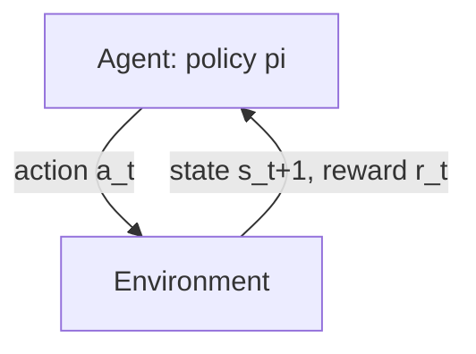
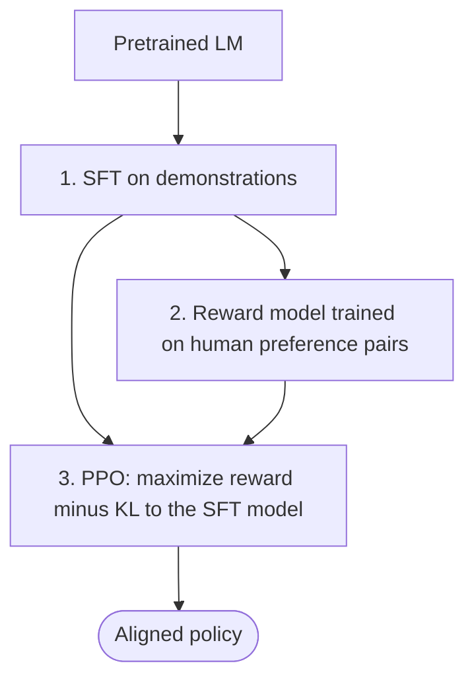

# Reinforcement Learning (RL)

> [!abstract] TL;DR
> RL learns a **policy** $\pi(a \mid s)$ by acting in an environment and receiving **rewards**, often delayed. The objective is to maximize expected cumulative reward. Value-based methods learn how good states and actions are. Policy-gradient methods ==push up the probability of actions that did better than expected and push down the ones that did worse==. For LLMs the same machinery runs RLHF (a reward model plus PPO), RL with verifiable rewards (GRPO on math and code), and preference methods such as DPO, which gets RL's result without an RL loop. Unlike in-context [[LLM Feedback Loops]], RL changes the **weights**, so the correction persists.

**Related:** [[Model Predictive Control (MPC)]] (planning with a model, instead of learning a policy) · [[LLM Feedback Loops]] (in-context correction) · [[Large Language Models]] · [[AI Agents]]

> [!note] Scope
> This is a personal-interest note, not course material, so it has no flashcards. The theory is standard textbook RL (Sutton & Barto). The LLM post-training sections summarize the well-known papers listed in [[#Further Reading]]. The control-theory framing continues the thread started in [[Model Predictive Control (MPC)]].

> [!quote]- Original note (kept verbatim)
> Reinforcement Learning (RL) & Policy Gradients
>
> - **The Equivalent:** RL optimizes a policy through trial, error, and delayed reward signals, adapting parameters dynamically based on environment feedback.
> - **In AI Loops:** Algorithms like PPO (Proximal Policy Optimization) or DPO (Direct Preference Optimization) treat the gap between desired behavior and current model generation as a reward/loss signal. The policy update step acts like an intelligent integral-derivative adjustment, shifting the probability distribution of outputs to permanently correct persistent systemic biases.

> [!todo]- Contents
> - [[#1. Core Concepts]]
> - [[#2. Value Functions and the Bellman Equations]]
> - [[#3. Map of RL Methods]]
> - [[#4. Policy Gradients]]
> - [[#5. Worked Example – One Policy-Gradient Step on a Bandit]]
> - [[#6. RL for LLMs – RLHF, DPO, GRPO]]
> - [[#7. RL, MPC and Feedback Loops Compared]]
> - [[#8. Pitfalls and Failure Modes]]
> - [[#9. Key Takeaways]]
> - [[#10. Critical Analysis]]
> - [[#11. Self-Test]]
> - [[#12. Glossary]]
> - [[#Further Reading]]

---

## 1. Core Concepts

> [!info]+ Definition – Markov Decision Process (MDP)
> A tuple $(\mathcal{S}, \mathcal{A}, P, R, \gamma)$: states, actions, transition probabilities $P(s' \mid s,a)$, reward $R(s,a)$, and discount factor $\gamma \in [0,1]$. "Markov" means the next state depends only on the current state and action, not on the history.

^def-mdp

> [!info]+ Definition – Policy and return
> A **policy** $\pi(a \mid s)$ maps states to action probabilities. The **return** is the discounted reward sum $G_t = \sum_{k \ge 0} \gamma^k r_{t+k}$. RL seeks $\pi^\star = \arg\max_\pi \mathbb{E}_\pi[G_0]$.

^def-policy-return

The three problems that make RL harder than supervised learning:

| Problem | What it means | Supervised learning has it |
|---|---|---|
| **Exploration vs exploitation** | Try new actions to learn, or use the best known one to score | No, the labels are given |
| **Credit assignment** | Which of many earlier actions caused a delayed reward | No, there is feedback per example |
| **Non-stationary data** | The policy's own changes alter the data it trains on | No, the data is i.i.d. |

^three-problems

---

## 2. Value Functions and the Bellman Equations

$$V^\pi(s) = \mathbb{E}_\pi[G_t \mid s_t = s], \qquad Q^\pi(s,a) = \mathbb{E}_\pi[G_t \mid s_t = s, a_t = a]$$

$$A^\pi(s,a) = Q^\pi(s,a) - V^\pi(s) \quad \text{(advantage: how much better than average this action is)}$$

^advantage

**Bellman expectation equation** (consistency of a value under a fixed policy):

$$V^\pi(s) = \sum_a \pi(a \mid s) \sum_{s'} P(s' \mid s,a)\,\big[R(s,a) + \gamma V^\pi(s')\big]$$

**Bellman optimality equation** (what the optimal $Q$ must satisfy):

$$Q^\star(s,a) = \mathbb{E}\big[r + \gamma \max_{a'} Q^\star(s',a')\big]$$

**Q-learning** turns that equation into an update from a single sampled transition:

$$Q(s,a) \leftarrow Q(s,a) + \alpha\big[\underbrace{r + \gamma \max_{a'} Q(s',a') - Q(s,a)}_{\text{TD error } \delta}\big]$$

> [!tip] Bootstrapping
> The TD target uses the current *estimate* $Q(s',a')$ instead of waiting for the true return. That is lower variance and faster, but biased. Monte Carlo methods wait for the full return: unbiased, but high variance. Most modern algorithms (GAE, $n$-step returns) interpolate between the two.

---

## 3. Map of RL Methods

| Family | Learns | Examples | Strength | Weakness |
|---|---|---|---|---|
| **Value-based** | $Q(s,a)$; act greedily | Q-learning, DQN | Sample-efficient (off-policy replay) | Discrete actions; unstable with function approximation |
| **Policy-based** | $\pi_\theta$ directly | REINFORCE | Any action space; stochastic policies | High-variance gradients |
| **Actor-critic** | $\pi_\theta$ and $V_\phi$ | A2C, PPO, SAC | Lower variance; the default today | More moving parts |
| **Model-based** | Dynamics $f$, then plan or learn | Dyna, PETS, MuZero, TD-MPC | Far fewer environment samples | Model bias compounds ([[Model Predictive Control (MPC)#^horizon-vs-error\|see MPC]]) |
| **Offline RL** | From a fixed dataset only | CQL, IQL | No live interaction needed | Distribution shift; must stay conservative |

^method-map

**On-policy vs off-policy.** On-policy methods (REINFORCE, PPO) learn only from data produced by the current policy. They are stable but throw data away. Off-policy methods (Q-learning, SAC) reuse old data from a replay buffer. They are efficient but less stable: combining function approximation, bootstrapping and off-policy data is Sutton & Barto's "deadly triad".

---

## 4. Policy Gradients

**Policy gradient theorem.** The gradient of expected return can be estimated from samples without knowing the environment dynamics:

$$\nabla_\theta J(\theta) = \mathbb{E}_{\pi_\theta}\Big[\sum_t \nabla_\theta \log \pi_\theta(a_t \mid s_t)\; A_t\Big]$$

^pg-theorem

Read it as: ==raise the log-probability of each action in proportion to how much better than expected it turned out==. REINFORCE uses the raw return $G_t$ in place of $A_t$. Subtracting a **baseline** $b(s)$ leaves the gradient unbiased, because $\mathbb{E}[\nabla \log \pi \cdot b] = 0$, and cuts its variance sharply ([[#5. Worked Example – One Policy-Gradient Step on a Bandit|worked example]]).

**PPO (Proximal Policy Optimization).** Large policy steps can collapse performance, so PPO limits how far each update moves the policy. It does this with the probability ratio $\rho_t = \pi_\theta(a_t \mid s_t)/\pi_{\text{old}}(a_t \mid s_t)$:

$$L^{\text{CLIP}}(\theta) = \mathbb{E}_t\Big[\min\big(\rho_t A_t,\; \text{clip}(\rho_t, 1-\epsilon, 1+\epsilon)\,A_t\big)\Big]$$

^ppo-clip

| Case ($\epsilon = 0.2$) | Unclipped term | Clipped term | `min` picks | Effect |
|---|---|---|---|---|
| $A > 0$, $\rho = 1.5$ | $1.5A$ | $1.2A$ | $1.2A$ | No extra reward for pushing a good action beyond +20% |
| $A < 0$, $\rho = 0.5$ | $0.5A$ | $0.8A$ | $0.8A$ (more negative) | No extra reward for suppressing a bad action beyond −20% |
| $A > 0$, $\rho = 0.7$ | $0.7A$ | $0.8A$ | $0.7A$ | Still free to *recover* a good action that was pushed down |

> [!example]- Why the `min` is pessimistic
> The `min` always takes the **lower** (worse) of the two objectives. The optimizer never gets credit for moving the ratio outside $[1-\epsilon, 1+\epsilon]$ in the direction that would increase the objective. This works as a cheap first-order approximation of a trust region, the idea behind TRPO.

---

## 5. Worked Example – One Policy-Gradient Step on a Bandit

**Setup (constructed, checked by hand).** Two actions with a softmax policy. Logits $\theta = (0, 0)$, so $\pi = (0.5, 0.5)$. Action $a_1$ gives reward 1 and $a_2$ gives reward 0. Learning rate $\alpha = 1$. For a softmax, $\nabla_\theta \log \pi(a_i) = e_i - \pi$.

| Sample | Reward | No baseline: update $\alpha\,r\,\nabla\log\pi$ | New $\pi(a_1)$ | Baseline $b = 0.5$: update $\alpha\,(r-b)\,\nabla\log\pi$ | New $\pi(a_1)$ |
|---|---|---|---|---|---|
| $a_1$ | 1 | $1 \cdot (0.5, -0.5) = (0.5, -0.5)$ | $\sigma(1) = 0.731$ | $0.5 \cdot (0.5, -0.5) = (0.25, -0.25)$ | $\sigma(0.5) = 0.622$ |
| $a_2$ | 0 | $0 \cdot (\dots) = (0, 0)$ | 0.5, no learning | $-0.5 \cdot (-0.5, 0.5) = (0.25, -0.25)$ | 0.622 |

^bandit-example

Observations:
- **Same expected update.** Without the baseline, $\tfrac12(0.5,-0.5) + \tfrac12(0,0) = (0.25,-0.25)$. With it, $\tfrac12(0.25,-0.25) + \tfrac12(0.25,-0.25) = (0.25,-0.25)$. The baseline doesn't bias the gradient.
- **Zero variance here.** With the baseline, *every* sample produces the same correct update. Without it, the update is either large or nothing. ==The baseline makes a failed sample informative== ("worse than average, so do it less").
- **This is GRPO's core idea.** GRPO samples a *group* of $G$ answers per prompt and uses the group's mean reward as the baseline. Standardizing by the group's standard deviation gives $A_i = (r_i - \bar r)/\sigma_r$. No learned critic is needed.

---

## 6. RL for LLMs – RLHF, DPO, GRPO

**Framing an LLM as an RL problem.** The state is the prompt plus the tokens generated so far. An action is the next token, or the whole response treated as one action, which makes it a contextual bandit. Reward usually arrives only at the end (sparse). $\gamma = 1$.

### 6.1 RLHF (InstructGPT-style pipeline)

- **Reward model** (Bradley–Terry): $\Pr(y_w \succ y_l \mid x) = \sigma\big(r_\phi(x,y_w) - r_\phi(x,y_l)\big)$.
- **RL objective:**
$$\max_{\pi_\theta}\; \mathbb{E}_{x,\,y\sim\pi_\theta}\big[r_\phi(x,y)\big] \;-\; \beta\, \mathrm{KL}\big(\pi_\theta(\cdot\mid x)\,\|\,\pi_{\text{ref}}(\cdot\mid x)\big)$$
The KL term keeps the policy close to the reference model. Without it, the policy drifts toward whatever exploits the reward model's blind spots.

^rlhf-objective

### 6.2 DPO (Direct Preference Optimization)

DPO shows that the RLHF objective above has a closed-form optimal policy. The reward can then be written in terms of the policy itself, which gives a **supervised loss on preference pairs**. There is no reward model and no sampling loop:

$$\mathcal{L}_{\text{DPO}} = -\log \sigma\!\Big(\beta \log\frac{\pi_\theta(y_w\mid x)}{\pi_{\text{ref}}(y_w\mid x)} - \beta \log\frac{\pi_\theta(y_l\mid x)}{\pi_{\text{ref}}(y_l\mid x)}\Big)$$

^dpo-loss

> [!warning] A correction to the original note
> DPO is **not RL in the algorithmic sense**. It is offline and supervised, with no environment interaction or exploration. It optimizes the *same objective* as RLHF, but only on a fixed preference dataset. This matters: DPO can't discover behavior that isn't already in its data, whereas PPO and GRPO sample new outputs and can.

### 6.3 RL with verifiable rewards (RLVR) and GRPO

For math and code, the reward can come from a **checker** instead of a learned model: is the answer correct, do the tests pass? GRPO (introduced in DeepSeekMath and used for DeepSeek-R1) drops PPO's value network and uses the group-relative advantage from [[#^bandit-example]]. Checkers are much harder to game than reward models, which is a large part of why this approach trains long chain-of-thought reasoning well.

| | RLHF + PPO | DPO | GRPO / RLVR |
|---|---|---|---|
| Reward source | Learned reward model | Implicit (preference pairs) | Programmatic checker (or RM) |
| Online sampling | Yes | No | Yes |
| Critic / value net | Yes | No | No (group baseline) |
| Models in memory | Policy, reference, RM, critic | Policy, reference | Policy, reference (+ RM if used) |
| Main risk | Reward hacking, instability | Limited to its data; overfitting | Only works where a verifier exists |

^post-training-compare

---

## 7. RL, MPC and Feedback Loops Compared

This continues the control-analogy thread:

| | [[LLM Feedback Loops]] | [[Model Predictive Control (MPC)\|MPC]] | RL |
|---|---|---|---|
| Control analogy | P/PI controller: react to the last error | Plan online with a model | Learn a policy offline, act fast online |
| When it adapts | At inference, in context | At inference, by re-planning | At **training**, in the weights |
| Persistence | Lost when the context ends | Lost when the plan ends | **Permanent** |
| Needs | An evaluator/feedback signal | A model plus a cost | A reward signal plus many episodes |
| Compute | Per request | Per step (optimization) | Up front (training), cheap at inference |

^three-way-compare

> [!example]- On the "integral-derivative" analogy in the original note
> The core intuition holds: RL corrects *persistent* bias, and that is like an **integral** term. A PID integral accumulates error over time, and RL accumulates gradient updates across many episodes into the weights. Two refinements make the analogy more accurate:
> - PPO's clipping and the KL penalty behave more like a **rate limiter / trust region** than a derivative term. They cap how fast the "controller" can change.
> - The better control analogy for the whole method is **adaptive/learned control**: RL tunes the controller itself, while PID and MPC tune the *actions* of a fixed controller.

---

## 8. Pitfalls and Failure Modes

| Failure | Symptom | Mitigation |
|---|---|---|
| **Reward hacking** | Reward rises while real quality falls (verbosity, sycophancy, gaming tests) | KL penalty, verifiable rewards, held-out human evaluation, reward-model ensembles |
| **High-variance gradients** | Noisy, slow learning | Baselines / advantages, GAE, larger batches, group sampling |
| **Policy collapse** | A big update wrecks performance | PPO clipping, small learning rates, KL early-stopping |
| **Entropy / mode collapse** | Outputs become repetitive and exploration stops | Entropy bonus, temperature during rollouts, KL to reference |
| **Sparse reward / credit assignment** | No learning signal on long tasks | Reward shaping (carefully), process rewards, curricula |
| **Deadly triad instability** | Diverging Q-values | Target networks, double Q-learning, conservative updates |
| **Sample inefficiency** | Millions of episodes needed | Model-based RL, off-policy replay, pretrained initial policies |
| **Evaluation noise** | "Improvements" that disappear with a different seed | Several seeds, confidence intervals, fixed evaluation sets |

---

## 9. Key Takeaways

- [ ] RL maximizes expected return through interaction. Exploration, credit assignment and non-stationary data make it harder than supervised learning.
- [ ] Value functions are defined by the Bellman equations. TD learning bootstraps from them.
- [ ] Policy gradient: $\nabla J = \mathbb{E}[\nabla\log\pi \cdot A]$. Raise better-than-expected actions and lower worse ones.
- [ ] Baselines keep the gradient unbiased and reduce its variance. GRPO uses the group mean reward as the baseline.
- [ ] PPO's clipped ratio is a cheap trust region.
- [ ] RLHF = SFT → reward model → PPO with a KL penalty to the reference model.
- [ ] DPO optimizes the same objective offline, without RL sampling. It can't explore beyond its data.
- [ ] Verifiable rewards (tests, checkers) are the strongest defense against reward hacking.
- [ ] RL changes the weights (persistent). Feedback loops and MPC adapt at inference (transient).

---

## 10. Critical Analysis

**Limits of the method.**
- RL optimizes the reward you **wrote**, not the goal you **meant**. Every reward is a proxy, and optimization pressure finds the gap (Goodhart's law). For LLMs, reward models are themselves neural networks with exploitable blind spots.
- Sample efficiency is still poor for classic deep RL. LLM post-training works largely because the pretrained model is already a strong starting policy, so RL mostly *selects among* existing behaviors rather than building them from scratch. How much new capability RL adds, versus sharpening what the model already has, is an open research debate.
- Credit assignment over long agentic trajectories (tens of tool calls, one reward at the end) is still hard, and is an active research area.

**Evidence quality.** Classic results (Q-learning convergence in tabular settings, the policy gradient theorem) are theorems. Deep RL results are empirical and known to be sensitive to seeds, hyperparameters and implementation details. LLM post-training results are mostly reported by labs on their own benchmarks. Treat the headline numbers as directional.

**What changes at scale.** For LLMs, rollout generation (inference), not gradient computation, dominates the cost of RL. Infrastructure for asynchronous sampling and off-policy corrections becomes the bottleneck. Removing extra models from memory (GRPO drops the critic, DPO drops the RM and the sampling) is a large part of why those methods took off.

**How to evaluate.** Use held-out tasks the reward never saw. Run human or independent-judge evaluation alongside the training reward, and watch for the curves to diverge: that is reward hacking. Track KL from the reference over training, plus diversity metrics for mode collapse. Report several seeds.

**Security and safety.** Reward hacking is a safety issue as well as a quality issue. A policy that learns to game its evaluator in training may generalize that skill. RL-trained agents with tool access need the same external [[Gate Checks]] as any agent, because the training reward shaped what they *want*, not what they're *allowed* to do.

> [!question] Open questions
> 1. Could I apply RLVR to something I actually run? For example, reward a ticket-routing model when its group matches the dispatcher's final assignment ([[Sonar Ticket and Outage Classification - How-To]]). Which part of that reward would be hackable?
> 2. Is DPO's inability to explore a practical limitation when the preference data already covers the behavior you want?
> 3. Where is the line between an agent *learning* (RL) and *adapting in context* (feedback loops, MPC-style re-planning), once agents have persistent memory?

---

## 11. Self-Test

> [!question]- Q1. Why does subtracting a baseline not bias the policy gradient?
> Because $\mathbb{E}_{a\sim\pi}[\nabla_\theta \log \pi_\theta(a\mid s)] = \sum_a \nabla_\theta \pi_\theta(a\mid s) = \nabla_\theta 1 = 0$. So $\mathbb{E}[\nabla\log\pi \cdot b(s)] = 0$ for any baseline that doesn't depend on the action.

> [!question]- Q2. (Quantitative) Repeat the bandit example with learning rate $\alpha = 2$, baseline $b = 0.5$, and sample $a_2$. What is the new $\pi(a_1)$?
> Advantage $= 0 - 0.5 = -0.5$. $\nabla\log\pi(a_2) = (-0.5, 0.5)$. Update $= 2 \cdot (-0.5) \cdot (-0.5, 0.5) = (0.5, -0.5)$. The logit gap becomes 1, so $\pi(a_1) = \sigma(1) \approx 0.731$.

> [!question]- Q3. In PPO with $\epsilon = 0.2$ and $A < 0$, what does the objective do when $\rho = 1.4$?
> Unclipped: $1.4A$. Clipped: $1.2A$. Since $A < 0$, $1.4A$ is lower, so `min` picks the **unclipped** $1.4A$. The full penalty applies and the gradient pushes the ratio back down. Clipping never stops the optimizer from *undoing* a harmful move.

> [!question]- Q4. What does the KL term in the RLHF objective prevent, and what happens if β is too small or too large?
> It prevents drift away from the reference model into regions where the reward model is unreliable. Too small: reward hacking, degenerate text, mode collapse. Too large: the policy barely changes, so the reward gain is small.

> [!question]- Q5. (Design) Would you use DPO or GRPO to improve a model's SQL generation for your own database, and why?
> > [!example] Answer sketch
> > **GRPO / RLVR.** SQL correctness is **verifiable**: run the query against a test database and compare the result set to a reference. That gives a hard-to-hack programmatic reward, and online sampling lets the model discover queries that aren't in any dataset. Guard against hacking with multiple test databases, checks on the query plan and cost, and forbidding writes (DDL/DML) in the sandbox. DPO would need preference pairs, and it can only learn from queries that already exist in them.

---

## 12. Glossary

| Term | Meaning |
|---|---|
| MDP | Formal RL problem: states, actions, transitions, reward, discount |
| Policy $\pi$ | Mapping from state to action distribution |
| Return $G_t$ | Discounted sum of future rewards |
| $V$, $Q$, $A$ | State value, action value, advantage ($Q - V$) |
| TD error | $r + \gamma V(s') - V(s)$: a bootstrapped prediction error |
| On- / off-policy | Learn only from the current policy's data / from any data |
| Actor-critic | A policy (actor) plus a learned value baseline (critic) |
| PPO | Policy-gradient method with a clipped probability-ratio objective |
| RLHF | RL from human feedback: SFT → reward model → PPO with KL |
| DPO | Offline preference optimization equivalent to the KL-regularized RLHF objective |
| GRPO | PPO variant using group-relative advantages; no critic |
| RLVR | RL with verifiable (programmatic) rewards |
| Reward hacking | The policy exploits flaws in the reward instead of doing the task |

---

## Further Reading

- [Sutton & Barto – Reinforcement Learning: An Introduction (2nd ed., free online)](http://incompleteideas.net/book/the-book-2nd.html)
- [OpenAI Spinning Up – practical deep RL introduction](https://spinningup.openai.com/)
- [Schulman et al., 2017 – Proximal Policy Optimization Algorithms](https://arxiv.org/abs/1707.06347)
- [Christiano et al., 2017 – Deep RL from Human Preferences](https://arxiv.org/abs/1706.03741)
- [Ouyang et al., 2022 – Training language models to follow instructions with human feedback (InstructGPT)](https://arxiv.org/abs/2203.02155)
- [Rafailov et al., 2023 – Direct Preference Optimization](https://arxiv.org/abs/2305.18290)
- [Shao et al., 2024 – DeepSeekMath (introduces GRPO)](https://arxiv.org/abs/2402.03300)

%% Hands-on idea: implement the §5 bandit in numpy and plot π(a1) over 200 steps with and without a baseline (and with group size G=4 as in GRPO). The variance difference is obvious in one chart. %%
