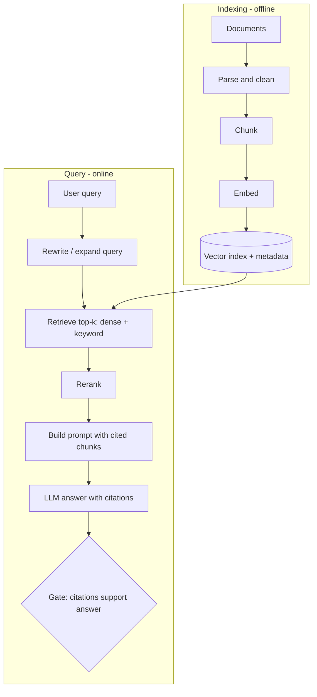

# Retrieval-Augmented Generation

> [!abstract] TL;DR
> RAG retrieves relevant documents at query time and puts them in the prompt, so the model answers from **evidence** instead of only its training data. It gives you fresh, private and citable knowledge without retraining. ==Most RAG failures are retrieval failures==: if the right chunk isn't in the context, the model can't use it and will often guess. Evaluate retrieval and generation separately.

**Prerequisites:** [[Large Language Models]] · [[Prompt Engineering]]
**Related:** [[Agentic RAG]] · [[Agent Based RAG]] · [[Agents and Databases]] · [[Web Search and Browsing for AI Agents]] · [[Vector Databases]] · [[LLM Hallucinations]] · [[LLM Evaluation]] · [[AI Memory]] · [[Tool Use]] · [[Knowledge Graphs]]

> [!note] Source scope
> Concept hub for the vault. All content is *beyond the lecture*; based on Lewis et al. (2020) and standard practice.

> [!todo]- Contents
> - [[#1. Core Concepts]]
> - [[#2. The Pipeline]]
> - [[#3. Design Choices]]
> - [[#4. Agentic RAG]]
> - [[#5. Worked Example – Runbook Assistant]]
> - [[#6. Pitfalls and Failure Modes]]
> - [[#7. Key Takeaways]]
> - [[#8. Critical Analysis]]
> - [[#9. Self-Test]]
> - [[#10. Glossary]]
> - [[#Further Reading]]

## 1. Core Concepts

> [!info]+ Definition – RAG
> A pattern where a retriever selects passages from an external corpus for each query, and a generator (LLM) conditions its answer on those passages.

^def-rag

| Option | Updates knowledge by | Good for | Weak at |
|---|---|---|---|
| Prompt only | — | General knowledge | Private or recent facts |
| RAG | Re-indexing documents | Private, changing, citable facts | Multi-hop reasoning over many docs |
| Fine-tuning | Retraining | Style, format, domain behavior | Adding facts reliably; freshness |
| Long context | Pasting everything | Small corpora | Cost, latency, "lost in the middle" |

> [!tip] Rule of thumb
> Use RAG for **knowledge**, fine-tuning for **behavior**.

## 2. The Pipeline



Similarity is usually cosine: $\text{sim}(q, d) = \dfrac{q \cdot d}{\lVert q \rVert\,\lVert d \rVert}$ between the query embedding $q$ and chunk embedding $d$. Storage and approximate nearest-neighbor search are covered in [[Vector Databases]].

## 3. Design Choices

| Choice | Options | Trade-off |
|---|---|---|
| Chunking | Fixed tokens, by heading, semantic | Small chunks = precise but lose context; large = context but noise |
| Overlap | 0–20% | Avoids cutting facts in half; duplicates content |
| Retrieval | Dense (embeddings), sparse (BM25), **hybrid** | Dense handles paraphrase; sparse handles IDs, codes, rare terms |
| Reranking | Cross-encoder or LLM reranker | Better precision; extra latency |
| $k$ | 3–20 chunks | Recall vs noise and cost |
| Metadata filters | Date, product, permission | Cuts irrelevant hits; **enforces access control** |
| Prompt | "Answer only from context; cite [id]; say not found" | Faithfulness vs helpfulness |

## 4. Agentic RAG

In [[AI Agents]], retrieval becomes a **tool** the agent chooses to call (see [[Tool Use]] and [[Chain-of-Thought and ReAct]]):
- The agent decides *whether* to retrieve and *what* to search for, and can search again after reading results (multi-hop).
- It can pick between sources: vector search, SQL ([[Agents and Databases]]), web ([[Web Search and Browsing for AI Agents]]), [[Knowledge Graphs]].
- RAG is a pattern, not a tool: retrieval doesn't have to use a vector database ([[Agents and Databases#^rag-is-a-pattern]]).
- The same mechanism powers long-term [[AI Memory]]: past interactions stored and retrieved like documents.
- Risk: more autonomy means more ways to loop, over-fetch, or read poisoned content.

> [!tip] Full lecture note
> The retrieve → reflect → retry loop, the Zillow case study, reflection heuristics, retry strategies and stop conditions are covered in [[Agentic RAG]] (see [[Agentic RAG#3. The Retrieve–Reflect–Retry Loop|the loop]] and [[Agentic RAG#9. The Autonomy Spectrum – Router to Planner|the router-to-planner spectrum]]).
> A working implementation from the course (RAG pipelines wrapped as tools, plus a routing agent over Chroma collections) is broken down in [[Agent Based RAG]].

## 5. Worked Example – Runbook Assistant

Corpus: 400 on-call runbooks (Markdown). Query: "How do I fail over the orders DB?"

1. Chunk by heading (each procedure stays whole), ~400 tokens, metadata `service`, `updated`.
2. Hybrid retrieval: BM25 catches `orders-db-prod`; dense catches "switch to replica".
3. Rerank top 20 → keep 4.
4. Prompt:
```text
Answer using ONLY the runbook excerpts below. Cite as [R#].
If the steps are not in the excerpts, reply "No runbook found" and stop.
Do not add commands that are not in the excerpts.
```
5. Gate: every command in the answer must appear verbatim in a cited chunk — otherwise reject. Commands that are made up are the most dangerous [[LLM Hallucinations|hallucination]] here.

## 6. Pitfalls and Failure Modes

| Failure | Symptom | Mitigation |
|---|---|---|
| Retrieval miss | Plausible but unsupported answer | Hybrid search, query rewriting, eval recall@k |
| Bad chunking | Half a procedure retrieved | Structure-aware chunking; overlap; parent-document retrieval |
| Stale index | Old policy quoted | Incremental re-indexing; date metadata; show "last updated" |
| Context ignored | Answer contradicts the chunks | Faithfulness gate; stronger instructions; put chunks near the question |
| Lost in the middle | Relevant chunk present but unused | Rerank; fewer, better chunks |
| Permission leak | User sees docs they can't access | Filter by ACL *at retrieval time*, not in the prompt |
| Indirect prompt injection | A document contains "ignore previous instructions" | Treat retrieved text as data; see [[Prompt Injection]] |

## 7. Key Takeaways

- [ ] I can draw the indexing and query pipelines.
- [ ] I know when to use RAG vs fine-tuning vs long context.
- [ ] I can justify chunking, hybrid retrieval, reranking and $k$.
- [ ] I evaluate retrieval (recall@k) separately from generation (faithfulness).
- [ ] I enforce access control and treat retrieved text as untrusted.

## 8. Critical Analysis

- **RAG reduces but doesn't remove hallucination.** It shifts the failure point to retrieval and to how well the model follows the context.
- **Evaluation.** End-to-end answer accuracy hides *where* failures happen. Measure retrieval recall@k, context precision, faithfulness and answer correctness separately (e.g. RAGAS-style metrics, validated as in [[LLM Evaluation#^validate-judge]]).
- **At scale.** Index freshness, embedding-model upgrades (which require re-embedding everything), and per-query cost/latency dominate. Hybrid search and reranking are usually worth more than a bigger LLM.
- **Security.** The corpus becomes part of your attack surface: anyone who can write a document can inject instructions or false facts. Access control must happen before the LLM sees data.
- **Open questions:** Will long-context models make RAG unnecessary, or will cost and precision keep retrieval relevant? When are [[Knowledge Graphs]] better than vector search?

## 9. Self-Test

> [!question]- Q1. Why is "most RAG failure is retrieval failure" a useful debugging rule?
> If the right chunk isn't retrieved, no prompt fixes the answer. Check recall@k first, then faithfulness.

> [!question]- Q2. When should you prefer fine-tuning to RAG?
> When you need to change behavior, style or output format, not add or update facts. Facts that change belong in RAG.

> [!question]- Q3. Quantitative – embeddings $q = (1, 0)$ and $d = (0.6, 0.8)$. Cosine similarity?
> $\frac{1\cdot0.6 + 0\cdot0.8}{1 \cdot 1} = 0.6$.

> [!question]- Q4. Design – users search for error codes like `ERR-4471` and dense retrieval misses them. Fix?
> Add sparse / keyword retrieval (BM25) and use hybrid scoring; possibly exact-match metadata on codes.

> [!question]- Q5. Where must access control be enforced, and why?
> At retrieval time via metadata filters, before text enters the prompt. An LLM instruction "don't reveal X" can be bypassed.

> [!tip] Flashcards
> Review this topic with [[Retrieval-Augmented Generation - Flashcards]].

## 10. Glossary

| Term | Meaning |
|---|---|
| Chunk | A passage of a document indexed as one unit |
| Embedding | Dense vector representing meaning |
| BM25 | Classic keyword relevance score |
| Hybrid search | Combines dense and sparse scores |
| Reranker | Model that re-orders candidates by relevance |
| recall@k | Share of relevant items found in the top $k$ |
| Faithfulness | Answer is supported by the retrieved context |

## Further Reading

- [Lewis et al. (2020) – Retrieval-Augmented Generation for Knowledge-Intensive NLP Tasks](https://arxiv.org/abs/2005.11401)
- [Karpukhin et al. (2020) – Dense Passage Retrieval](https://arxiv.org/abs/2004.04906)
- [Liu et al. (2023) – Lost in the Middle](https://arxiv.org/abs/2307.03172)
- [Es et al. (2023) – RAGAS](https://arxiv.org/abs/2309.15217)
