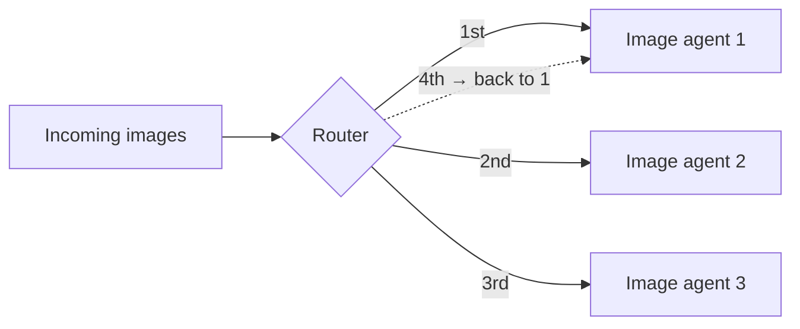
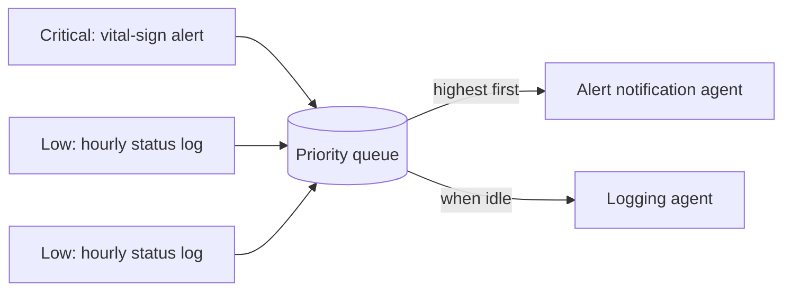
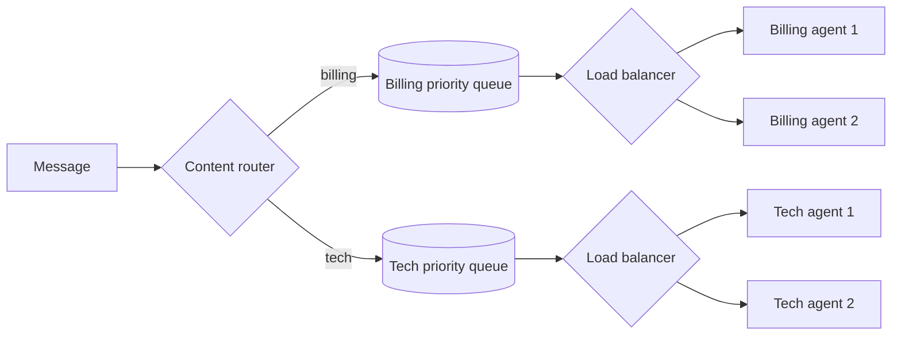

# Routing and Data Flow in Agentic Systems

> [!abstract] TL;DR
> Orchestration decides *what* happens. This lesson zooms in on the **communication lines**: how a message gets from agent A to agent B, and whether it arrives in a usable shape. **Routing** decides the path. It can be **content-based** (inspect the message), **round-robin** (spread load across identical agents), or **priority-based** (urgent first). **Data flow management** shapes the payload in transit through **enhancement**, **filtering** and **transformation**, so ==the right information reaches the right agent, in the right format, at the right time==.

**Prerequisites:** [[Orchestrating Agent Activities]] · [[Multi-Agent Architecture Design]]
**Related:** [[Routing Workflow]] · [[State Management in Multi-Agent Systems]] · [[Structured Outputs]] · [[Output Validation]] · [[Skate Park Orchestration]]
**Course review:** [[Multi-Agent Systems Skills Scorecard - Study Guide]]

> [!note] Source scope
> Based on the Udacity lesson "Routing and Data Flow in Agentic Systems" (Agentic AI Nanodegree, Course 4, Lesson 4): the introduction text, the summary page, and the video transcript. Material marked *beyond the lecture* is my own addition. The lesson's demo and exercises are in `python notebooks/agentic-ai-c4-exercises-demos/lesson-4-routing-and-data-flow-in-agentic-systems/`.

> [!todo]- Contents
> - [[#1. Core Concepts]]
> - [[#2. Direct Delegation vs Dynamic Routing]]
> - [[#3. The Three Routing Patterns]]
> - [[#4. Data Flow Management]]
> - [[#5. Worked Example – Support Intake Mailroom]]
> - [[#6. Pitfalls and Failure Modes]]
> - [[#7. Key Takeaways]]
> - [[#8. Critical Analysis]]
> - [[#9. Self-Test]]
> - [[#10. Glossary]]
> - [[#Further Reading]]

## 1. Core Concepts

The lesson's two analogies:
- **Orchestra.** The conductor (orchestrator) has the plan, but how does the sheet music reach the right musician, and what if the trumpet player reads music differently from the violinist?
- **Company mailroom.** The clerk routes memos: financial report → Accounting, complaint → Customer Service, urgent security alert → straight to the top. That's **routing**. Translating the memo from legal jargon into plain English for the recipient is **data flow management**.

> [!info]+ Definition – Routing
> Directing messages or tasks to the appropriate agent, or group of agents, within a system. Routing ==decides the path==.

^def-routing

> [!info]+ Definition – Content-based routing
> Directing a message based on its content or metadata, such as keywords, sentiment, data type, metadata tags, or source.

^def-content-based

> [!info]+ Definition – Round-robin routing
> Distributing tasks evenly across a pool of similar agents, one after another (1, 2, 3, 1, 2, 3…).

^def-round-robin

> [!info]+ Definition – Priority-based routing
> Processing messages according to a predefined priority level, so higher-priority messages are handled before lower-priority ones.

^def-priority

> [!info]+ Definition – Data flow
> Managing the data **payload** as it moves between agents. This is distinct from routing. It may involve ==transforming its structure, filtering out irrelevant information, or enhancing it with additional context== so it's in the right format for the receiving agent.

^def-data-flow

## 2. Direct Delegation vs Dynamic Routing

| | Direct delegation | Dynamic routing |
|---|---|---|
| Who routes | The orchestrator, following a predetermined script | A dedicated routing mechanism that looks at message characteristics |
| Typical setting | Business processes: run A, then B, then branch on the result | Unscripted input floods: external users, events, batches |
| Note | [[Orchestrating Agent Activities]] | This lesson |

The lecture is clear that direct delegation is "simple, effective, and often exactly what you need". Dynamic routing is for three situations a fixed plan can't handle: ^when-dynamic

1. **Sorting unscripted input** *before* it reaches any workflow → content-based routing.
2. **A pool of identical agents** where any one can take the next job → round-robin.
3. **Mixed urgency**: a critical system alert next to a weekly report → priority-based routing.

## 3. The Three Routing Patterns

| Pattern | Decides by | Purpose | Lecture example | Vault deep dive |
|---|---|---|---|---|
| **Content-based** | The message's content and metadata | Sorting diverse requests to the right specialist | Central customer-service intake | [[Routing Workflow]] |
| **Round-robin** | Rotation, or current load | Scaling, by balancing load across identical agents | A large batch of images sent to a pool of image-analysis agents | – |
| **Priority-based** | A priority tag | Responsiveness for urgent tasks | Hospital monitoring: a critical vital-sign alert jumps ahead of hourly status logs | – |

### 3.1 Content-based routing

The router inspects the message and applies rules about its properties:

| Signal | Example rule |
|---|---|
| Keyword spotting | "refund" → billing agent; "password reset" → account agent |
| Sentiment analysis | Negative → retention or escalation agent |
| Data type checking | Image → vision agent; text → NLP agent |
| Metadata tags | `type = order` → order agent |
| Source | Messages from the monitoring system → ops agent |

This is the **classify → dispatch** pattern covered in depth in [[Routing Workflow#3. Stage 1 – Classification]] and [[Routing Workflow#4. Stage 2 – Task Dispatch]]. The classifier can be rules, a small model, or an LLM, and the whole route is only as good as the classifier ([[Routing Workflow#^classification-critical]]). In practice: [[Skate Park Orchestration]] routes by an LLM-assigned category.

*Beyond the lecture:* run **cheap signals first** (metadata, data type, keywords) and fall back to an LLM classifier only when they're inconclusive. That's faster and cheaper, and deterministic for the common cases.

### 3.2 Round-robin and load balancing



- **Basic round-robin:** cycle through agents in order.
- **Smarter load balancing:** pick the agent with the **smallest current workload**, or the one **idle longest**.
- **Why:** scaling. If one agent isn't enough, spin up five and let the balancer spread the tasks.

Round-robin only makes sense when the agents are **interchangeable**: same prompt, same tools, same capabilities. ^interchangeable

*Beyond the lecture:* plain round-robin assumes every task costs about the same. LLM tasks vary wildly in length, so a few long tasks can pile up on one agent while others sit idle. Least-loaded routing fixes that, at the cost of tracking each agent's queue.

### 3.3 Priority-based routing

Messages carry a **priority tag**, and higher priorities are processed first. It's used where responsiveness matters for some tasks: financial trading, real-time system monitoring, emergency response.



The hospital example: a critical vital-sign alert must reach the alert-notification agent **immediately**, even while the system is busy with routine hourly status messages. ^priority-example

*Beyond the lecture:*
- **Starvation.** Under constant high-priority load, low-priority work never runs. Fix it with *aging*: priority rises the longer a message waits.
- **Who sets the priority?** If the sender assigns it, everyone will mark their messages "urgent". Derive priority from trusted signals (source, type) or a classifier, not from the message's own claim.
- **Preemption.** A priority queue orders *waiting* work. An already-running low-priority job still finishes unless you reserve capacity or preempt it.

### 3.4 Combining patterns

The patterns stack naturally *(beyond the lecture)*: **content-based** picks the specialist type, **priority** orders that type's queue, and **round-robin** or least-loaded picks the instance.



## 4. Data Flow Management

Routing gets the message to the right place. Data flow makes sure it's **usable on arrival**, like a clean baton handoff in a relay race.

| Operation | What it does | Example |
|---|---|---|
| **Enhancement** | Adds related information | Attach the customer's tier and open tickets before passing a complaint to the resolution agent |
| **Filtering** | Removes unnecessary data | Strip customer PII before passing a stock question to the inventory agent |
| **Reformatting / transformation** | Changes structure or data types | Turn an agent's free-text summary into a typed JSON object; convert `"$1,200"` into `1200.0` |

Without these steps, a receiving agent may **crash trying to parse** another agent's incompatible output. The lecture calls this an ==impedance mismatch== between agents. ^impedance-mismatch

The lecture's practical advice: "It's often tempting to just pass everything along, but cleaning and structuring data between steps usually pays off", in reliability and in maintainability. ^clean-between-steps

**How this ties to other notes:**
- **Filtering** is the "pass only what's needed" rule from [[State Management in Multi-Agent Systems#3.2 Pass only what's needed]], applied to each message.
- **Transformation** works best when every handoff has a **schema contract**: the sender emits a validated structure and the receiver declares what it accepts ([[Structured Outputs]] · [[Pydantic for Structured LLM Output - Study Guide]] · [[Output Validation]]).
- **Enhancement** is a small retrieval step, a lightweight cousin of [[Multi-Agent RAG]].

```python
# Beyond the lecture – a typed handoff with all three operations
from pydantic import BaseModel

class ResolutionInput(BaseModel):          # the receiver's contract
    ticket_id: str
    category: str
    summary: str
    customer_tier: str                     # enhancement
    open_ticket_count: int                 # enhancement

def to_resolution_input(triage_out: dict, crm) -> ResolutionInput:
    customer = crm.lookup(triage_out["customer_id"])
    return ResolutionInput(                # transformation + validation
        ticket_id=triage_out["ticket_id"],
        category=triage_out["category"].lower(),
        summary=triage_out["summary"][:2000],   # trim
        customer_tier=customer.tier,
        open_ticket_count=customer.open_tickets,
    )                                       # raw email, phone, card: filtered out
```

## 5. Worked Example – Support Intake Mailroom

*Built from the lecture's patterns, beyond its examples.* An ISP's intake receives emails, monitoring alerts and batch speed-test uploads.

| Incoming message | Routing | Data flow on the way |
|---|---|---|
| "My internet's been down since 6am, I want a refund!" | **Content:** keywords "down" + "refund" and negative sentiment → outage-billing agent | **Enhance:** account status, area outage flag. **Filter:** card details |
| Monitoring: "OLT-12 offline, 340 subscribers" | **Priority:** critical (trusted source) → NOC alert agent, ahead of queued emails | **Transform:** raw SNMP fields → `{device, site, subscribers_affected, since}` |
| 10,000 speed-test results | **Round-robin / least-loaded** across 4 analysis agents | **Filter:** keep only the fields analysis needs. **Transform:** units to Mbps |
| "Please send my invoice copy" | **Content:** `type = billing_request` → billing agent, low priority | **Enhance:** invoice ID from the account system |

The outage alert jumping the queue is the lecture's hospital example ([[#^priority-example]]) in a different domain. It's also what [[Skate Park Orchestration#3. What the Run Log Shows]] lacked: "someone could get hurt" got no priority.

## 6. Pitfalls and Failure Modes

| Failure | Symptom | Mitigation |
|---|---|---|
| Dynamic routing where a script would do | Extra complexity and nondeterminism | Use direct delegation for known flows ([[#^when-dynamic]]) |
| Misclassification in content routing | Messages reach the wrong specialist | Cheap signals first; fallback route; measure routing accuracy ([[Routing Workflow#5. Routing Accuracy and Cost]]) |
| Round-robin over non-identical agents | Tasks land on agents that can't handle them | Only pool interchangeable agents ([[#^interchangeable]]) |
| Round-robin with uneven task sizes | Hot spots, long waits | Least-loaded or idle-longest balancing |
| Priority starvation | Routine work never completes | Aging, reserved capacity for low priority |
| Self-declared priority | Everything is "urgent" | Derive priority from trusted signals |
| Passing everything along | Token bloat, data leaks, confused receivers | Filter at every handoff ([[#^clean-between-steps]]) |
| Impedance mismatch | Parse errors, crashes, silent misreads | Schema contracts and validation at boundaries ([[#^impedance-mismatch]]) |
| Over-aggressive filtering | The receiver lacks context it needed | Define each receiver's input contract explicitly |
| Lossy LLM transformations | Summaries drop facts or invent them | Prefer deterministic transforms; validate LLM-made ones |

## 7. Key Takeaways

- [ ] Routing decides the path; data flow shapes the payload. They are separate but work together.
- [ ] Direct delegation (the orchestrator as router) is often enough. Use dynamic routing for unscripted, high-volume or mixed-urgency input.
- [ ] Content-based routing inspects content or metadata (keywords, sentiment, data type, tags, source) to pick a specialist.
- [ ] Round-robin spreads load across *identical* agents. Least-loaded balancing handles uneven tasks.
- [ ] Priority-based routing processes urgent messages first. Watch for starvation.
- [ ] Data flow: enhance (add context), filter (remove what's unneeded), transform (restructure or retype).
- [ ] Cleaning and structuring data between steps prevents impedance mismatches and keeps the system maintainable.

## 8. Critical Analysis

**Old patterns, new costs.** Content-based routing, round-robin and priority queues come straight from message-oriented middleware and enterprise integration patterns. What's new with LLM agents is that the **router itself may be an LLM** (slow, costly, probabilistic) and the **transformations may be LLM summaries** (lossy). Both bring model error into what used to be deterministic plumbing. Default to deterministic routing and transforms, and use the LLM where judgement is truly needed.

**Queueing math for priority** *(beyond the lecture)*. With a single agent of utilization $\rho$, waiting times grow roughly as $\frac{1}{1-\rho}$. At $\rho = 0.9$, queues are about 10× longer than at an idle system. Priority routing protects *high*-priority latency, but only by pushing that waiting time onto low-priority work. At high load, low-priority latency explodes. Priority is a way to share out delay, not a capacity fix.

**Round-robin and scaling.** Adding $k$ identical agents divides throughput time by about $k$ only if the agents don't share a bottleneck. In practice they often share one LLM endpoint with rate limits, or one database. Scaling agents without scaling the shared dependency just moves the queue.

**Evaluation.** Measure each layer separately:
- Routing: accuracy per class, and the confusion between neighbouring classes.
- Priority: latency percentiles (p50/p99) per priority level under load.
- Load balancing: per-agent utilization and queue depth.
- Data flow: schema-validation failure rate at each handoff, and fact retention after transformations.

**Security.** Content-based routing can be gamed: a user who writes "URGENT security alert" may jump the queue or reach a privileged agent. Route on trusted metadata where possible, and treat message content as untrusted input ([[Prompt Injection]]). Filtering at handoffs doubles as data minimization for privacy.

> [!question] Open discussion questions
> - When should the router be an LLM rather than rules, and how would you measure the accuracy gain against the added latency and cost?
> - Who should be allowed to set a message's priority in a multi-tenant system?
> - Should data-flow transformations be done by deterministic code, by an LLM, or by the receiving agent itself?

## 9. Self-Test

> [!question]- Q1. What is the difference between routing and data flow management?
> Routing decides *where* a message goes. Data flow management changes the *payload* as it moves (enhancing, filtering, transforming) so it's in the right format for the receiver.

> [!question]- Q2. When is direct delegation enough, and when do you need dynamic routing?
> Direct delegation is enough when the orchestrator follows a known script (run A, then B, then branch). Dynamic routing is needed for unscripted incoming messages that must be sorted, for pools of identical agents that need load balancing, and for mixed-urgency traffic.

> [!question]- Q3. Name four signals content-based routing can use.
> Keywords (e.g. "refund"), sentiment, data type (image vs text), metadata tags (e.g. `type = order`), and source.

> [!question]- Q4. What is the difference between basic round-robin and smarter load balancing, and when is round-robin appropriate at all?
> Basic round-robin cycles through agents in a fixed order. Smarter balancing picks the least-loaded or longest-idle agent. Either is appropriate only for interchangeable agents with the same capabilities.

> [!question]- Q5. Give the lecture's priority-routing example and one risk of priority routing.
> Hospital monitoring: a critical vital-sign alert goes to the alert-notification agent immediately, even while hourly status logs are queued. Risk (beyond the lecture): starvation of low-priority work, or senders labelling everything urgent.

> [!question]- Q6. Name the three data-flow operations, with one example each.
> Enhancement (attach customer tier to a complaint), filtering (strip PII before an inventory query), transformation (free text → typed JSON; "$1,200" → 1200.0).

> [!question]- Q7. Design: a document-processing system receives scanned invoices, contracts and urgent legal notices. Design routing and data flow.
> Content routing by data type and classifier: invoices → extraction pool, contracts → contract-review agent, legal notices → legal agent. Priority: legal notices are critical and jump the queue. Round-robin or least-loaded across 3 identical invoice-extraction agents. Data flow: OCR text → typed invoice schema (transform); attach vendor record (enhance); strip bank details before analytics (filter); validate each handoff with a schema.

> [!question]- Q8. Quantitative: 900 images, 3 identical agents, 2 s per image. How long does it take with 1 agent versus round-robin across 3? What if one agent's images take 6 s instead?
> One agent: $900 \times 2 = 1800$ s. Round-robin across 3: 300 images each, $300 \times 2 = 600$ s. If one agent gets 6 s images, it takes $300 \times 6 = 1800$ s, so the batch is no faster than a single agent. Least-loaded balancing would move work away from the slow agent.

### Flashcards

> [!tip] Flashcards
> Review this lesson with [[Routing and Data Flow in Agentic Systems - Flashcards]].

## 10. Glossary

| Term | Definition |
|---|---|
| Routing | Directing messages or tasks to the right agent(s) ([[#^def-routing]]) |
| Direct delegation | The orchestrator routes by following a fixed plan |
| Content-based routing | Routing by message content or metadata ([[#^def-content-based]]) |
| Round-robin routing | Rotating tasks evenly across similar agents ([[#^def-round-robin]]) |
| Load balancing | Choosing the least-loaded or longest-idle agent |
| Priority-based routing | Processing by priority level ([[#^def-priority]]) |
| Data flow | Managing and shaping the payload between agents ([[#^def-data-flow]]) |
| Enhancement | Adding related information to a payload |
| Filtering | Removing unnecessary data from a payload |
| Transformation | Changing a payload's structure or data types |
| Impedance mismatch | Incompatible output and input formats between agents ([[#^impedance-mismatch]]) |
| Starvation | Low-priority work never getting processed *(beyond the lecture)* |
| Aging | Raising a waiting message's priority over time *(beyond the lecture)* |

## Further Reading

- [Enterprise Integration Patterns – Content-Based Router](https://www.enterpriseintegrationpatterns.com/patterns/messaging/ContentBasedRouter.html)
- [Enterprise Integration Patterns – Message Translator](https://www.enterpriseintegrationpatterns.com/patterns/messaging/MessageTranslator.html)
- [Priority Queue pattern – Microsoft Azure Architecture Center](https://learn.microsoft.com/en-us/azure/architecture/patterns/priority-queue)
- [Building Effective Agents – Anthropic (routing workflow)](https://www.anthropic.com/engineering/building-effective-agents)

%% Study hint: the mailroom. The clerk reading the memo = content-based; spreading memos evenly across identical clerks = round-robin; the security alert to the top = priority; translating legal jargon = data flow. %%
