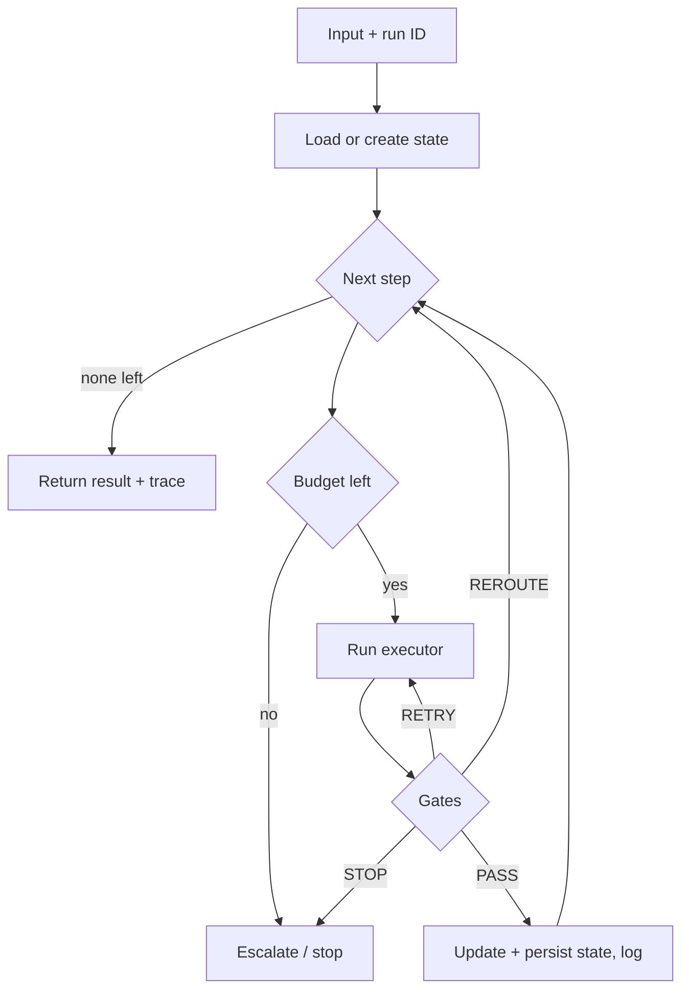

# Runtime or Orchestration Layer

> [!abstract] TL;DR
> The orchestration layer is the **code that runs a chain**. Prompts say *what* each step does. ==The orchestration layer decides *when and how* steps run: control flow, state, gates, retries, budgets, logging and permissions.== In a chain, the orchestrator picks the next step. In an agent, the LLM picks and the orchestrator only enforces limits. Reliability and security are enforced here, not in prompt text.

**Prerequisites:** [[Chaining prompts for Agentic Reasoning]] · [[Task Chaining]]
**Related:** [[Implementing Gate Checks]] · [[Gate Checks]] · [[Prompt Chaining for Agentic Reasoning - Study Guide#5.3 Orchestration skeleton (pseudocode)|orchestration skeleton]] · [[LLM Feedback Loops]] · [[Planning Agents]] · [[Prompt Injection]]

> [!note] Source scope
> This note splits out and expands [[Chaining prompts for Agentic Reasoning#7. Runtime or Orchestration Layer – What Runs the Chain]]. The lecture shows orchestration only as the plain Python functions in the Lesson 4 notebook. The run loop, durability, the control spectrum and framework comparison are *beyond the lecture* (engineering practice).

> [!todo]- Contents
> - [[#1. Core Concepts]]
> - [[#2. Responsibilities]]
> - [[#3. Where Control Lives – Chain to Agent]]
> - [[#4. A Minimal Runtime]]
> - [[#5. Durability, Budgets and Observability]]
> - [[#6. Implementation Options]]
> - [[#7. Worked Example – Lesson 4 Claim Triage]]
> - [[#8. Pitfalls and Failure Modes]]
> - [[#9. Key Takeaways]]
> - [[#10. Critical Analysis]]
> - [[#11. Self-Test]]
> - [[#12. Glossary]]
> - [[#Further Reading]]

---

## 1. Core Concepts

> [!info]+ Definition – Orchestration layer
> ![[Chaining prompts for Agentic Reasoning#^def-orchestration]]

> [!info]+ Definition – Run (trace)
> One execution of a chain on one input. Each run has an ID, a state object, and an ordered log of steps and gate verdicts.

^def-run

> [!info]+ Definition – Durable execution
> Saving state after each step so a run that crashes or waits (e.g. for human approval) can **resume** from the last completed step instead of starting over.

^def-durable

How the pieces split:

| Layer | Decides | Lives in |
|---|---|---|
| Prompt | What one step should produce | Prompt templates |
| Gate | Whether a step's output is acceptable | Validators ([[Implementing Gate Checks]]) |
| Executor | How one link does its work | LLM / code / API / human ([[Task Chaining#2. Choosing an Executor per Link]]) |
| **Orchestrator** | Which step runs next, with what data, under what limits | Runtime code or framework |

---

## 2. Responsibilities

![[Chaining prompts for Agentic Reasoning#^orchestration-duties]]



^runtime-loop

---

## 3. Where Control Lives – Chain to Agent

The main design choice is **who picks the next step**.

| Level | Next step chosen by | Example pattern | Orchestrator's job |
|---|---|---|---|
| Fixed chain | Code (hard-wired order) | Sequential pipeline | Run steps in order, gate each one |
| Routed chain | Code, using an LLM classification | Routing | Map a label to a branch |
| Planned | LLM writes a plan once, code runs it | Plan-and-execute | Validate the plan, then run it |
| Agent loop | LLM, at every step | ReAct, orchestrator–workers | Enforce tool allow-list, budgets, stop conditions |

^control-spectrum

> [!important] Design principle
> Move control to the LLM only where the inputs really vary. Every step of autonomy you add costs predictability, testability and auditability. See [[Prompt Chaining for Agentic Reasoning - Study Guide#3. The Spectrum – Chain to Agent|chain-to-agent spectrum]] and [[Planning Agents]].

Even at the agent end, the orchestrator stays **authoritative**. The LLM *proposes* an action. The runtime checks it against permissions and budgets before anything executes.

---

## 4. A Minimal Runtime

Plain Python that ties [[Task Chaining#3. Handoff Contracts and State|typed state]] to [[Implementing Gate Checks#3. Composing Gates in a Chain|gated steps]]:

```python
def run_chain(steps, state, store, budget):
    for step in steps:
        if store.is_done(state.run_id, step.name):          # resume: skip finished steps
            continue
        if budget.exhausted():
            return escalate(state, reason="budget")
        with trace(state.run_id, step.name):                # observability
            result = gated_step(step, step.gates, state)    # executor + gates + retries
        if result.escalated:
            return escalate(state, reason=result.reason)    # never fail silently
        state = step.apply(state, result.output)            # typed handoff
        store.save(state.run_id, step.name, state)          # durable checkpoint
        budget.charge(result.cost)
    return state
```

Things to note:
- **Resume check** uses the run ID and step name, so a retry of the whole run doesn't repeat side effects. Side-effecting links still need idempotency keys ([[Task Chaining#5. Pitfalls and Failure Modes]]).
- **The budget** is checked *before* each step, not after.
- **Escalation** is a real destination (a queue or alert), not `None`.

---

## 5. Durability, Budgets and Observability

### 5.1 Budgets

Set hard caps on tokens, cost, wall-clock time and iterations for each run. For an agent loop with a per-iteration stop probability $s$ (the chance the task finishes on that turn), the expected number of iterations is roughly $1/s$. A cap $N$ bounds the worst case. The chance of reaching the cap is $(1-s)^N$.

$$
P(\text{hit cap}) = (1-s)^N \qquad \text{e.g. } s=0.25,\ N=10 \Rightarrow 0.75^{10} \approx 0.056
$$

So about 1 in 18 runs would end at the cap. Those runs need an escalation path, not a silent truncation. *(Simplifying assumption: independent turns. Real agents get stuck in loops, which makes it worse.)*

^budget-math

### 5.2 Observability

Log every step as a span: `(run_id, step, attempt, executor, input_hash, output, gate_verdicts, tokens, latency)`. This lets you:
- replay a failed run step by step,
- compute per-step pass rates and per-gate metrics ([[Implementing Gate Checks#5. Observability and Tuning]]),
- evaluate the chain end to end ([[Prompt Chaining for Agentic Reasoning - Study Guide#8. Evaluating Chains]]).

### 5.3 Human-in-the-loop pauses

A human approval step is just a step whose executor may take days. Without durable state, the process has to stay alive while it waits. With durable state, the run is saved, the approver is notified, and the run resumes when they answer. Add an SLA timer that escalates if nobody responds.

---

## 6. Implementation Options

| Option | Good for | Cost |
|---|---|---|
| Plain functions (Lesson 4 notebook) | Learning, short linear chains | You build retries, state and logs yourself |
| Graph-based agent frameworks (e.g. LangGraph) | Branching, loops, agent-style control, checkpoints | Framework abstractions, learning curve |
| Durable workflow engines (e.g. Temporal) | Long-running, side-effecting, human-wait workflows | Operational overhead |
| Batch schedulers (e.g. Airflow) | Scheduled, offline pipelines | Not built for interactive agents |

> [!tip] Rule of thumb
> Start with plain code. Adopt a framework when you need **persistence, parallelism, or human pauses**. Those are the three things that are hard to get right by hand.

---

## 7. Worked Example – Lesson 4 Claim Triage

| Orchestration duty | What the notebook does | Production version |
|---|---|---|
| Control flow | Calls Stage I → II → III in order | Same, with routing on severity |
| State | Passes Pydantic objects and JSON | A persisted `ClaimRunState` per claim |
| Gate execution | `gate1_…`, `gate2_…`, `gate3_…` return `None` on failure | `gated_step` with RETRY / REROUTE / STOP |
| Error handling | Skips `None` results in a list comprehension | Failed claims go to a human queue with the reason |
| Budgets | None | Retry cap per step, token cap per claim |
| Observability | `print` statements | Per-step trace with gate verdicts |
| Security | None | Read-only tools for extraction; write-back needs a validated routing decision |

The notebook's `None`-skipping is the main gap: failed claims **disappear**. See [[Sonar Ticket and Outage Classification - How-To#^notebook-gaps|notebook gaps]].

---

## 8. Pitfalls and Failure Modes

| Failure | Symptom | Mitigation |
|---|---|---|
| Control logic in prompts | "Only call the refund tool if…" gets ignored | Enforce in code; prompts suggest, code enforces |
| No persisted state | A crash at step 5 reruns steps 1–4 and their side effects | Checkpoint after each step; idempotency keys |
| No budgets | Runaway agent loops, cost spikes | Token, cost, time and iteration caps checked before each step |
| Silent drops | Items vanish from output | Every failure path ends in a queue or alert |
| Missing trace | Can't tell which step or gate failed | Structured span per step |
| Framework too early | Debugging the framework instead of the chain | Plain code until persistence, parallelism or pauses are needed |
| Unversioned prompts and code | Can't reproduce old runs | Record prompt, model and code versions in each trace |

---

## 9. Key Takeaways

- [ ] The orchestrator decides which step runs next, with what data, under what limits.
- [ ] Prompts suggest and code enforces. Permissions, budgets and approvals belong in the runtime.
- [ ] Moving next-step control from code to the LLM turns a chain into an agent; the runtime still enforces limits.
- [ ] Persist state after each step so runs can resume and wait for humans.
- [ ] Check budgets before each step, and give every failure a visible destination.
- [ ] Log a span per step so runs can be replayed and evaluated.

---

## 10. Critical Analysis

- **Where the real engineering is.** Most production failures in LLM systems are orchestration failures: lost state, duplicate writes, unbounded loops. They are not bad prompts. Coursework focuses on prompts because they are easier to demo.
- **Evidence.** Guidance here comes from industry practice and vendor documentation (e.g. Anthropic's "Building effective agents"), not controlled studies. Framework claims are mostly anecdotal. Compare options on your own workload.
- **At scale.** Concurrency, rate limits and queueing dominate. Prompt, model and code versions change independently, so each trace must record all three to be reproducible.
- **Evaluation.** Test the orchestrator separately from the model: replace LLM calls with fixtures and check that retries, reroutes, budget stops and resumes behave correctly. That makes control flow deterministic to test.
- **Security.** The orchestrator is the trust boundary. Injected text can change what the model *proposes*, but only the runtime decides what *executes*. Apply least privilege per step, keep secrets out of prompts, and require approval for irreversible actions ([[Prompt Injection]]).

> [!question] Discussion
> 1. Which of your current workflows would break if the process restarted mid-run?
> 2. If an agent loop and a fixed chain reach the same accuracy, what non-accuracy metrics should decide between them?
> 3. Should a gate verdict ever let the LLM change the chain's structure, or only its outputs?

---

## 11. Self-Test

> [!question]- Q1. What does the orchestration layer control that prompts don't?
> Step order and branching, state passed between steps, running the gates, retries and errors, budgets, logging, and permissions. Prompts only define what a single step produces.

> [!question]- Q2. What separates a chain from an agent in terms of orchestration?
> Who picks the next step. In a chain, code does. In an agent, the LLM does, and the orchestrator only checks permissions and enforces budgets and stop conditions.

> [!question]- Q3. Quantitative – an agent finishes on any given turn with probability 0.2. With a 10-turn cap, what fraction of runs hit the cap? What cap keeps that under 1%?
> $0.8^{10} \approx 0.107$, so about 11%. For under 1%: $0.8^N < 0.01 \Rightarrow N > \ln 0.01 / \ln 0.8 \approx 20.6$, so **N = 21**. (This assumes independent turns.)

> [!question]- Q4. Why persist state after every step?
> So a crashed or paused run can resume without re-running earlier steps and repeating their side effects. It also makes long human-approval waits possible.

> [!question]- Q5. Design – orchestration for an agent that issues account credits
> > [!example] Answer sketch
> > Fixed chain, not a free agent: LLM extracts the claim → code checks the account and policy cap → LLM drafts the justification → human approval above a threshold → API writes the credit with an idempotency key. The runtime persists state per ticket, caps retries at 2 per step and cost per ticket, gives only the write step credit permissions, logs every span, and sends failures to a review queue.

### Flashcards

> [!tip] Flashcards
> Review with [[Runtime or Orchestration Layer - Flashcards]].

---

## 12. Glossary

| Term | Meaning |
|---|---|
| Orchestrator / runtime | Code or framework that executes a chain |
| Run | One execution of a chain on one input |
| Checkpoint | Saved state after a step |
| Durable execution | Resuming from checkpoints after crashes or waits |
| Budget | Hard cap on tokens, cost, time or iterations |
| Span / trace | Log record of one step / one whole run |
| Trust boundary | Where proposed actions are checked before they execute |

---

## Further Reading

- [Building Effective Agents – Anthropic](https://www.anthropic.com/engineering/building-effective-agents)
- [LangGraph documentation](https://langchain-ai.github.io/langgraph/)
- [Temporal documentation](https://docs.temporal.io/)
- [ReAct (Yao et al., 2022)](https://arxiv.org/abs/2210.03629)

%% Study hint: be able to redraw the runtime loop diagram from memory and point to where each responsibility lives. %%
