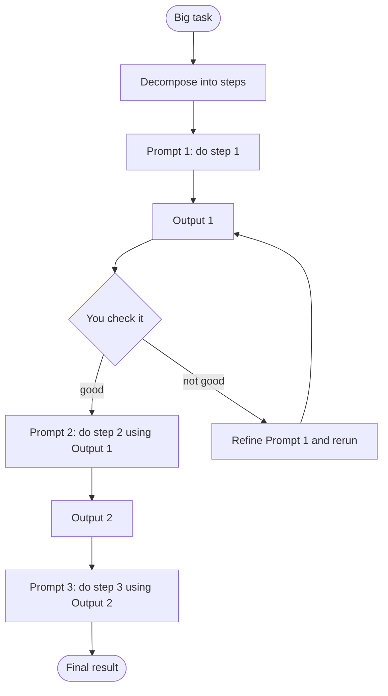
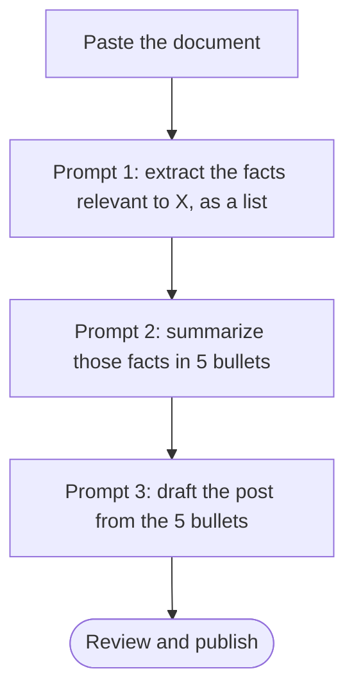

# Sequential Prompting

> [!info]+ Definition – Sequential prompting
> Sequential Prompting is useful when a single large prompt will over complicate the output and smaller subtasks must happen in between. This is like CoT except with different links in the chain.

^def-sequential-prompting

> [!abstract] TL;DR
> Sequential prompting breaks a task into steps and runs them as **separate prompts**. ==Each prompt takes the previous output and does one new thing with it==. It mirrors how people work, one goal at a time, so each step is simpler, more accurate, and easy to fix on its own. When a **human** carries the output from step to step (for example in a single chat), it's sequential prompting. When **code** carries it, it becomes [[Prompt Chaining for Agentic Reasoning - Study Guide|prompt chaining]]. Checking each output before moving on is the manual version of a [[Gate Checks|gate check]].

**Hub:** [[Chaining prompts for Agentic Reasoning]]
**Related:** [[Chain-of-Thought and ReAct]] · [[Gate Checks]] · [[Task Decomposition]] · [[Prompt Instruction Refinement]]

> [!note] Source scope
> The definition, the research → summarize → LinkedIn example, the chat-based workflow, and the benefits (mirrors human reasoning, one goal at a time, better accuracy, each prompt can be improved on its own) are from the reading. Your original wording is kept in [[#Original Notes]]. The prompt templates, the comparison tables, the pitfalls and the critical analysis are *my additions*.

> [!todo]- Contents
> - [[#1. Core Idea]]
> - [[#2. When to Use It]]
> - [[#3. How to Do It – Step by Step]]
> - [[#4. Sequential Prompting vs CoT vs Prompt Chaining]]
> - [[#5. Worked Example 1 – Research to LinkedIn Post]]
> - [[#6. Worked Example 2 – Large Document in One Chat]]
> - [[#7. Pitfalls and Failure Modes]]
> - [[#8. Key Takeaways]]
> - [[#9. Critical Analysis]]
> - [[#10. Self-Test]]
> - [[#11. Glossary]]
> - [[#Further Reading]]
> - [[#Original Notes]]

---

## 1. Core Idea

Sequential prompting takes the output from one prompt and directs the model to do something else with that output.



^core-flow

**Why it works (from the reading):**

| Benefit | Why |
|---|---|
| **Mirrors human reasoning** | People solve problems one goal at a time, not all at once |
| **Focus** | Each prompt has one job, so instructions don't compete for attention |
| **Accuracy** | Simpler steps mean fewer errors per step |
| **Improve one prompt at a time** | If step 2 is weak, fix *only* step 2. Steps 1 and 3 stay as they are |
| **Works well for agents** | An agent can concentrate on one part of the task at a time |

^benefits

---

## 2. When to Use It

Use sequential prompting when:
- ==A single large prompt would overcomplicate the output==, e.g. it asks for research, analysis *and* polished writing at once.
- **Intermediate results matter.** You want to see or check the extracted facts before anything is written from them.
- **The steps need different "modes":** extraction (precise), summarizing (condensing), writing (creative, with a set tone).
- **You're prototyping a chain.** Doing it by hand in a chat is the fastest way to discover the right steps before automating them.

Skip it when the task is simple enough for one clear prompt. Extra steps add time and give errors more places to spread.

---

## 3. How to Do It – Step by Step

1. **Decompose.** Write the steps as verbs: *research → summarize → draft*. One output per step. See [[Task Decomposition]].
2. **Write a focused prompt per step.** State the step's single job, its input, and its output format.
3. **Pass the output forward explicitly.** Paste it in, or in a chat say "using the summary above". Wrap it in tags so the model can tell data from instructions.
4. **Check each output before moving on.** This is your manual gate: is it correct, complete, on-topic?
5. **Re-state the original goal** in later steps so the chain doesn't drift.
6. **Fix the weakest step, not the whole thing.** Refine that one prompt and rerun from there ([[Prompt Instruction Refinement]]).
7. **Save the prompts** that worked. They are the draft of an automated chain.

**Reusable step template:**

```text
GOAL (overall): {original task, one sentence}
THIS STEP: {one job, e.g. "Summarize the research into 5 key points"}

INPUT (from previous step):
<input>
{previous output}
</input>

OUTPUT: {format, e.g. "5 bullet points, each ≤ 20 words"}
Use only the information in <input>. Do not add new facts.
```

^step-template

---

## 4. Sequential Prompting vs CoT vs Prompt Chaining

Your definition says it's "like CoT except with different links in the chain". This is what that means in practice:

| | [[Chain-of-Thought and ReAct\|Chain-of-Thought]] | **Sequential prompting** | [[Prompt Chaining for Agentic Reasoning - Study Guide\|Prompt chaining]] |
|---|---|---|---|
| Steps live in | **One** response | **Separate** prompts | **Separate** LLM calls |
| Who connects the steps | The model, inside its reasoning | **A human**, usually in a chat | **Code** |
| Can you inspect or check each step | Only by reading the reasoning | Yes, before continuing | Yes, with automated gates |
| Each step's prompt can differ | No, one prompt | Yes | Yes (and a different model per step) |
| Repeatable / scalable | Per call | Low, since it's manual | High |
| Best for | Reasoning within one answer | Exploration, prototyping, one-off tasks | Production workflows |

^comparison

> [!tip] The progression
> CoT gives you **thinking steps** in one answer. Sequential prompting gives you **task steps** you can see and control. Prompt chaining **automates** those task steps, and [[Gate Checks]] automate the "check each output" part. The three are combined, not competing: each step in a chain can itself use CoT.

---

## 5. Worked Example 1 – Research to LinkedIn Post

The example from the reading, with the prompts written out. The prompts are my illustration.

| Step | Prompt | Output | What to check |
|---|---|---|---|
| **1. Research** | "List the 6 most important concepts of AI agents (e.g. tools, memory, planning). For each give a 2-sentence explanation and a source I can verify." | 6 concepts with explanations | Are these real concepts? Are the sources real? (See the warning below) |
| **2. Summarize** | "Using only the research above, summarize the 3 ideas most interesting to a non-technical business audience. 3 bullets, ≤ 25 words each." | 3 bullets | Nothing new added; audience-appropriate |
| **3. Draft** | "Goal: a LinkedIn post that gets managers curious about AI agents. Using the 3 bullets above, write a post of ≤ 200 words with a hook in the first line, one concrete example, and a question at the end." | Draft post | Length, hook, tone, accurate to step 2 |

^linkedin-example

> [!warning] The research step is the riskiest
> Without web search or documents you provide, "research" is the model **recalling from memory**. It can produce confident but wrong facts and invented sources ([[LLM Hallucinations]]). Every later step builds on that output, so errors spread downstream. Give step 1 real sources (paste articles, or use a search tool), or check its output before continuing.

---

## 6. Worked Example 2 – Large Document in One Chat

From the reading: you can do this in a chatbot by including a large document, then extracting, summarizing and drafting, **all in the same chat history**.



**One chat vs a new chat per step:**

| | Same chat | New chat per step |
|---|---|---|
| Carrying context | Automatic: "use the list above" | You paste the previous output in |
| Risk | The long history distracts; the model may pull in content from the original document that step 2 filtered out | Nothing leaks between steps |
| Control | Lower | Higher; each step sees only its input |
| Best for | Quick, casual tasks | When a step must use *only* the previous output |

---

## 7. Pitfalls and Failure Modes

| Failure | Symptom | Mitigation |
|---|---|---|
| **Error propagation** | A mistake in step 1 shows up confidently in the final result | Check each output before continuing (a manual gate) |
| **Goal drift** | The final output answers the previous step, not your original goal | Re-state the goal in every prompt ([[#^step-template]]) |
| **Hallucinated research** | Invented facts or sources flow into the post | Provide sources or use search; verify step 1 |
| **Context bloat in long chats** | The model mixes in old content or forgets instructions | Start a new chat per step and paste only the needed output |
| **Over-splitting** | Many steps, little gain, more time | Merge steps that don't need a separate check |
| **Vague step prompts** | Outputs vary a lot between runs | One job, explicit input, explicit output format per step |
| **Not repeatable** | Different results each time you do it by hand | Save the prompts; automate as a chain when it's recurring |

---

## 8. Key Takeaways

- [ ] Sequential prompting = separate prompts, where each uses the previous output and does one new thing.
- [ ] Use it when one big prompt would overcomplicate the output or when intermediate results need checking.
- [ ] Benefits: mirrors human reasoning, one goal at a time, better accuracy, each prompt can be improved on its own.
- [ ] It differs from CoT because the steps are separate prompts you can inspect, not reasoning inside one answer.
- [ ] Done by hand, it's sequential prompting. Automated in code, it's prompt chaining. Automated checks are gate checks.
- [ ] Check each output before continuing, and re-state the original goal in later steps.
- [ ] The first step's quality caps everything after it, so ground research in real sources.

---

## 9. Critical Analysis

- **Where the accuracy gain comes from.** Splitting a task helps when the sub-steps really are different kinds of work, or when checking intermediate results catches errors. If the steps are trivial or tightly coupled, splitting only adds hand-offs where information can be lost. Compare against one good prompt before assuming the sequence is better.
- **The human is the gate.** Much of the benefit comes from *you* reviewing each output. That doesn't scale. Automating the chain without automating the checks ([[Gate Checks]]) keeps the error spread and loses the safeguard.
- **Reliability compounds.** $n$ steps that are each right with probability $p$ are all right with probability about $p^n$. Three steps at 90% give about 73%. Sequential prompting makes each $p$ higher, but only checks between steps stop the product from shrinking.
- **Security.** Pasting untrusted documents into step 1 means any instructions hidden in them ride along through every later step. Delimit pasted content as data, and be careful when a later step can take actions ([[Prompt Injection]]).

> [!question] Discussion questions
> 1. For a report you write regularly, what are the natural steps, and which step's output would you most want to check?
> 2. At what point is a sequence you run by hand worth automating as a chain?

---

## 10. Self-Test

> [!question]- Q1. What is sequential prompting, and when is it useful?
> Running a task as separate prompts, where each takes the previous output and does one new thing with it. It's useful when one large prompt would overcomplicate the output, or when intermediate results need to be seen or checked.

> [!question]- Q2. How does sequential prompting differ from Chain-of-Thought?
> CoT puts reasoning steps inside **one** response. Sequential prompting puts task steps in **separate** prompts, so each can have its own instructions and format and can be checked before continuing.

> [!question]- Q3. How does sequential prompting become prompt chaining?
> When **code**, not a human, passes each output into the next prompt. Adding automated validation between steps adds gate checks.

> [!question]- Q4. (Quantitative) Research is 80% reliable without sources, and summarize and draft are 95% each. What's the chance the whole post is correct? What if providing sources raises research to 95%?
> $0.8 \times 0.95 \times 0.95 \approx 0.72$. With sources: $0.95^3 \approx 0.86$. The weakest, **first** step dominates, which is why grounding the research step matters most.

> [!question]- Q5. (Design) Break "turn this 30-page vendor contract into a one-page risk brief for my manager" into sequential prompts.
> > [!example] Answer sketch
> > (1) **Extract:** "List every clause about term, renewal, termination, liability, SLA, data and price increases, quoting each clause and its section number." Check: the quotes exist in the document. (2) **Assess:** "For each clause, rate the risk as low, medium or high and give a one-line reason, using only the quotes." (3) **Prioritize:** "Choose the top 5 risks by impact." (4) **Draft:** "Goal: a one-page brief for a non-legal manager. Write it from the top 5 risks, with a recommended action for each." Check: every claim traces to a quoted clause. Consider a new chat for steps 2–4 so the full contract doesn't leak back in.

### Flashcards

> [!tip] Flashcards
> Review this topic in [[Sequential Prompting - Flashcards]] using the Spaced Repetition plugin.

---

## 11. Glossary

| Term | Meaning |
|---|---|
| Sequential prompting | A task done as separate prompts, each building on the previous output |
| Step / link | One prompt with one job in the sequence |
| Handoff | The output passed from one step to the next |
| Manual gate | A human checking an output before the next step |
| Goal drift | Later steps losing sight of the original objective |
| Prompt chaining | The automated, code-driven version |
| Chain-of-Thought | Step-by-step reasoning inside a single response |

---

## Further Reading

- [Anthropic – Chain complex prompts (prompt engineering docs)](https://docs.anthropic.com/en/docs/build-with-claude/prompt-engineering/chain-prompts)
- [Anthropic – Building effective agents (prompt chaining workflow)](https://www.anthropic.com/engineering/building-effective-agents)
- In this vault: [[Chaining prompts for Agentic Reasoning]] · [[Prompt Chaining for Agentic Reasoning - Study Guide]] · [[Gate Checks]]

---

## Original Notes

> [!quote]- Original notes (kept verbatim)
> Sequential prompting takes output from 1 prompt and directs it to do something else with that output.
> an example from the reading is the following:
> 1. research key concepts of AI agents
> 2. summarize the output from the previous step
> 3. draft a LinkedIn post base don the summary from the previous step
>
> This mimics human reasoning and processes and works well with AI agents as well so they can focus on a single part at a time.
>
> You can do this with chatbots like ChatGPT by including a large document, extracting information, then summarizing, then drafting a post, all in the same chat history. This mirrors human problem-solving, allowing focus on one goal at a time, improving accuracy. It also allows individual prompt iteration and improvement.
>
> [[Chain-of-Thought and ReAct]]
