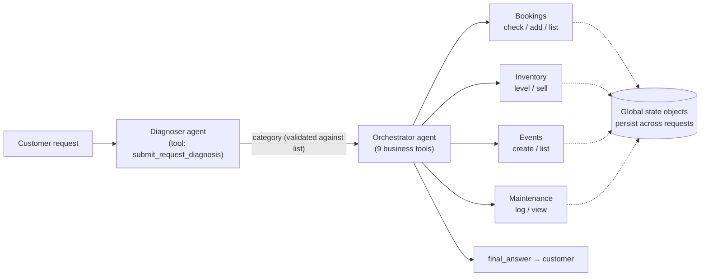

# Skate Park Orchestration

> [!abstract] TL;DR
> A two-stage [[Smolagents Framework|smolagents]] system for a skate park and shop in Nairobi. A **diagnoser** agent sorts each customer request into one of seven categories. An **orchestrator** agent then uses that category to pick and sequence tools for bookings, inventory, events and maintenance. It is the [[Orchestrating Agent Activities|orchestration patterns]] in miniature: ==classify, branch on the category, then run tools in sequence==. The run log shows all 10 test requests handled sensibly. It also shows that **the diagnoser called its tool 4–6 times per request, which accounts for about 62% of all input tokens**.

**Sources:**
- `python notebooks/agentic-ai-c4-exercises-demos/lesson-3-orchestrating-agent-activities/exercises/starter/starter.py`, the completed starter with the event and maintenance categories and tools added.
- `…/lesson-3-orchestrating-agent-activities/output.txt`, a run log of the 10 test requests.

**Builds on:** [[Orchestrating Agent Activities]] · [[Routing Workflow]] · [[Penguin and Scientist Agents]] (previous exercise)

> [!warning] README vs code mismatch
> The exercise README describes three agents: Customer Support, Inventory, and Park Management. The code has **two** agents (diagnoser and orchestrator). Inventory and park management are plain **tools** on the orchestrator, not separate agents. The README's "reordering processes" and inventory-affects-events hints aren't implemented.

## 1. Architecture

| Component | Kind | Role |
|---|---|---|
| `CustomerSupportAgent` | LLM agent, 1 tool | Classifies intent into a fixed list of 7 categories |
| `Orchestrator` | LLM agent, 9 tools | Reads request + category, picks tools, calls them in order, writes the reply |
| `BookingSystem`, `Inventory`, `EventSystem`, `MaintenanceLog` | Plain Python | The real state, shared by all requests |
| `handle_customer_request()` | Python glue | Runs the two stages in sequence for each request |

**How this maps to the lecture patterns** ([[Orchestrating Agent Activities#3. The Three Execution Patterns]]):

| Pattern | Where it appears |
|---|---|
| Sequential | Diagnose → orchestrate. Inside a booking: check availability → add booking |
| Conditional branching | The category picks the tool family. Gear repair and Unknown branch to a fixed reply or a clarification |
| Parallel | None. Every step depends on the one before |

The classify-then-dispatch front half is the [[Routing Workflow]]. Unlike the code hub in [[Penguin and Scientist Agents]], here ==the branching lives in the orchestrator's prompt, not in code==. The LLM reads a rule list ("For Session Booking, use check then add") and decides. That's flexible, but it's a soft route that the model can ignore. ^soft-routing

## 2. Patterns Carried Over From Earlier Notes

| In the code | Why it's there | See |
|---|---|---|
| Diagnosis returned through a tool call and read from the step log | Structured arguments are easier to trust than free text | [[Penguin and Scientist Agents#3. Patterns Worth Connecting]] · [[Structured Outputs]] |
| Category checked against `possible_categories`, defaulting to Unknown | Guards against an invented or misspelled label | [[Output Validation]] |
| `memory.steps` cleared per request | Each request is independent; the business state lives in Python objects | [[Agent State Management]] |
| Tool docstrings with `Args:` and examples (e.g. `"ramp section A"`) | The docstring is the tool's prompt | [[Tool Descriptions in Agentic Systems]] · [[Smolagents Framework#5. Reviewing the Lesson Code]] |
| Fixed reply for gear repair | A deterministic branch where no tool exists | [[Routing Workflow]] |

## 3. What the Run Log Shows

| # | Request | Category | Tools called | Outcome |
|---|---|---|---|---|
| 1 | Book 2024-09-01 15:00 for Carlos | Session Booking | check → add | ✅ Booked |
| 2 | Any "pro_model_deck" skateboards | Skateboard | inventory level | ⚠️ "None in stock". The item isn't in the catalogue, but the tool returns 0 either way |
| 3 | Cracked helmet, can you fix it | Gear repair | – | ✅ Fixed reply. Missed chance to offer a new helmet (30 in stock) |
| 4 | Events next month | Event | list events | ✅ "None scheduled", but "next month" was never resolved to dates |
| 5 | Loose ramp panel, someone could get hurt | Maintenance | log request | ⚠️ Logged with `reported_by: "customer"`, an invented value; no urgency flag |
| 6 | Schedule a Beginner Skate Workshop | Event | create event | ⚠️ A customer created a public event with no permission check |
| 7 | Book same slot for Jimmy | Session Booking | check | ✅ Correctly refused; no alternative slot offered |
| 8 | Broken rail, please log it | Maintenance | log request | ✅ Logged as ID 2 |
| 9 | Status of the broken rail request | Maintenance | view log | ✅ "Reported", found by scanning the whole log |
| 10 | Show me the maintenance log | Maintenance | view log | ⚠️ Raw internal JSON dumped to the customer |

Requests 7, 9 and 10 depend on state written by earlier requests. That shows the business state persisting outside the agents even though their memory resets every time.

### 3.1 The cost finding – a diagnoser that won't stop

On every request the diagnoser called `submit_request_diagnosis` **4–6 times with identical arguments** before calling `final_answer` (5–7 steps in total). Using the cumulative input-token count at the end of each run:

| Stage | Input tokens (10 requests) | Share |
|---|---|---|
| Diagnoser | ≈ 79,200 | ≈ 62% |
| Orchestrator (does the real work) | ≈ 47,500 | ≈ 38% |

One step would have been enough, so roughly 80% of the diagnoser's tokens were waste. The cause is likely that the tool simply echoes the category back. The model gets no signal that the job is done, so it keeps "submitting". Because each step re-sends the history, the cost grows faster than the number of repeats ([[Smolagents Framework#8. Critical Analysis]]). ^diagnoser-loop

**Fixes, cheapest first:**
1. Cap the diagnoser at 1–2 steps.
2. Have the tool return an explicit "Recorded. Now call final_answer." message.
3. Better: classification doesn't need an agent loop at all. Make **one** model call with a constrained enum output ([[Structured Outputs]]).

## 4. Issues and Improvements

*My own review, not part of the exercise text.*

| Issue | Effect | Improvement | See |
|---|---|---|---|
| Diagnoser loops ([[#^diagnoser-loop]]) | About 62% of the token spend is wasted | One structured classification call | [[Structured Outputs]] |
| Routing lives in the prompt ([[#^soft-routing]]) | The orchestrator can ignore the category; all 9 tools are visible to every request | Dispatch in code: category → a sub-agent or tool subset with only that category's tools | [[Routing Workflow]] · [[Orchestrating Agent Activities#8. Critical Analysis]] |
| Single orchestrator holds every tool | Contradicts the README's separate Inventory and Park agents; a larger tool menu means more wrong picks | Specialist sub-agents (managed agents) per domain | [[Orchestrator-Workers Workflow]] · [[Multi-Agent Architecture Design]] |
| Unknown item returns stock 0 | "Out of stock" and "we don't sell that" look the same | Return an explicit "not carried" result | [[Tool Descriptions in Agentic Systems]] |
| Model invents required arguments (`reported_by: "customer"`) | Plausible but made-up data enters the log | Make the field optional, or ask the customer for it | [[LLM Hallucinations]] |
| Customers can create events and see the internal log | No authorization model | Role-based tool access, and a gate before write actions | [[Gate Checks]] · [[Prompt Injection]] |
| Safety-critical maintenance has no priority | "Someone could get hurt" is treated like any other report | Add a severity field, and branch urgent reports to staff alerts | [[Orchestrating Agent Activities#3.3 Conditional branching – e-commerce returns]] |
| No cross-domain coordination | Helmet repair doesn't check helmet stock; booking conflicts don't suggest alternatives | Multi-step plans across tool families, as the README hints | [[Orchestrating Agent Activities#4. Combining Patterns]] |
| Relative dates ("next month") aren't resolved | The answer is correct only by luck, because there were no events at all | Inject today's date and filter by date range | – |
| Raw JSON in customer replies | Leaks internal fields | Format replies, and filter fields per audience | [[Output Validation]] |

## 5. How I Would Evaluate It

*Beyond the exercise.* Following [[Agent Evaluation]]:

- **Routing accuracy.** Build a labelled set of requests (including ambiguous and adversarial ones) and measure category accuracy for the diagnoser on its own.
- **Trajectory checks.** For each category, assert the expected tool sequence (e.g. booking = check → add) and that no out-of-category tools are called.
- **State assertions.** After the run, check the booking, inventory, event and maintenance objects directly, not the model's reply.
- **Cost and step budgets.** Alert when a stage exceeds its expected step count. That would have caught [[#^diagnoser-loop]] immediately.

## 6. Takeaways

- [ ] Classify → branch → sequence is the lecture's orchestration patterns in their simplest working form.
- [ ] Putting branching in a prompt is flexible but soft. Routing in code is deterministic and limits the tools each request can reach.
- [ ] Read the run log, not just the final answers. Every reply here looked fine, but the log showed most of the spend was wasted.
- [ ] A single classification doesn't need an agent loop. Use a constrained single call.
- [ ] Write tools exposed to customers need permissions and gates.
