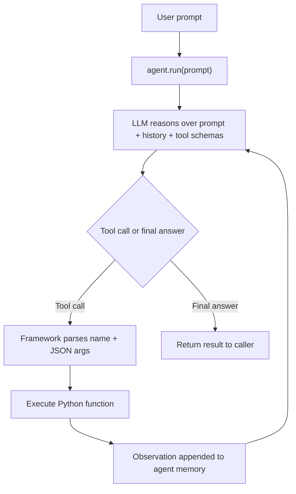

# Smolagents Framework

> [!abstract] TL;DR
> Smolagents is a Python framework for building LLM-powered agents and multi-agent systems. You turn ordinary Python functions into **tools** with a decorator, hand them and a **model** to an agent, and call it with a prompt. The framework then ==runs the reason → tool call → observe loop for you==: it parses the LLM's output, detects tool calls, executes the matching Python functions, and feeds the results back until the agent produces a final answer. The lesson's core class is `ToolCallingAgent`.

**Prerequisites:** [[AI Agents]] · [[Tool Use]] · [[Building Agents with Tools in Python]]
**Related:** [[Multi-Agent Systems]] · [[Multi-Agent Architecture Design]] · [[Chain-of-Thought and ReAct]] · [[Tool Descriptions in Agentic Systems]] · [[Agent State Management]] · [[Runtime or Orchestration Layer]]

> [!note] Source scope
> Based on the lesson text "What is Smolagents framework?" and its `WeatherAgent` code sample. Material marked *beyond the lecture* is my own addition from the smolagents documentation and general practice. Check API details against the version you have installed.

> [!todo]- Contents
> - [[#1. Core Concepts]]
> - [[#2. How It Works – The Four Steps]]
> - [[#3. The ToolCallingAgent Loop]]
> - [[#4. Worked Example – Weather Agent]]
> - [[#5. Reviewing the Lesson Code]]
> - [[#6. Pitfalls and Failure Modes]]
> - [[#7. Key Takeaways]]
> - [[#8. Critical Analysis]]
> - [[#9. Self-Test]]
> - [[#10. Glossary]]
> - [[#Further Reading]]

## 1. Core Concepts

The lesson describes Smolagents as a way to ==combine language understanding with real-world actions and stateful workflows==. An agent can use tools (Python functions), maintain state, and collaborate with other agents to solve complex tasks.

> [!info]+ Definition – Smolagents
> A Python framework for creating, orchestrating and managing LLM-powered agents. The framework owns the agent loop: prompting the model, parsing its output for tool calls, executing them, and returning results to the model.

^def-smolagents

> [!info]+ Definition – Tool
> A Python function made available to an agent by decorating it with `@tool`. The framework reads the function's name, type hints and docstring to build a schema the LLM sees, so ==the docstring is part of the prompt==. See [[Tool Descriptions in Agentic Systems]].

^def-tool

> [!info]+ Definition – ToolCallingAgent
> The lesson's core agent class. It is powered by an LLM and can (1) interpret prompts and user input, (2) decide when to call a tool, and (3) execute the tool and use its result in its reasoning.

^def-toolcallingagent

> [!info]+ Definition – Model wrapper
> An object that connects the agent to an LLM backend. The lesson uses an OpenAI-compatible server model with `gpt-4o-mini`. Swapping the wrapper changes the backend without changing tools or agent logic.

^def-model-wrapper

| Component | Role | Lesson example |
|---|---|---|
| Model | The reasoning engine that decides what to do next | `OpenAIServerModel("gpt-4o-mini")` |
| Tools | Actions the agent can take in the world | `get_weather`, `save_data` |
| Agent | Binds model and tools, and runs the loop | `WeatherAgent(ToolCallingAgent)` |
| State | Data that persists across tool calls | Global `memory` dict |
| Orchestration | Your application code that invokes agents | `agent.ask_weather("New York")` |

> [!tip] What "smol" means *(beyond the lecture)*
> The name refers to the library being deliberately **minimal**: a small core with few abstractions, from Hugging Face. It doesn't mean you have to use a small model. Any capable LLM backend works. The lesson pairs it with a small, cheap model, which is a cost choice rather than a requirement.

## 2. How It Works – The Four Steps

The lesson gives the framework-level workflow:

1. **Define tools.** Decorate Python functions with `@tool` to make them available to agents.
2. **Create agents.** Subclass (or instantiate) `ToolCallingAgent` and specify which tools and which model the agent uses.
3. **Orchestrate.** Use agents in your application, passing prompts and letting them call tools as needed.
4. **LLM-powered reasoning.** The framework parses the LLM's output, detects tool calls, and executes the corresponding Python functions.

Compare this with the hand-written loop in [[Building Agents with Tools in Python#6. Generalizing – The Agent Loop]]. Smolagents automates exactly the bookkeeping that note does by hand: appending the assistant message, matching tool-call IDs, appending tool results, and re-invoking the model. ^framework-value

## 3. The ToolCallingAgent Loop

When you call `.run(prompt)`, the agent:

- uses the LLM to interpret the prompt,
- decides whether a tool should be called,
- calls the tool if needed, and uses its result in the response.



This is a [[Chain-of-Thought and ReAct|ReAct]]-style loop: reason, act, observe, repeat. *Beyond the lecture:* the loop is capped by a maximum step count, so a confused agent fails rather than looping forever. The agent finishes by calling a built-in final-answer tool, which is how the framework knows to stop. ^react-loop

> [!example]- Tool-calling agent vs code agent *(beyond the lecture)*
> Smolagents ships two agent styles:
>
> | | Tool-calling agent | Code agent |
> |---|---|---|
> | Action format | JSON tool call (name + arguments) | A Python snippet that calls tools as functions |
> | Strength | Predictable, matches the native function-calling APIs of most providers | Can compose several tool calls, loops and variables in one step, so it often needs fewer steps |
> | Risk | Limited expressiveness per step | Executes model-written code, so it needs a sandbox |
>
> The lesson covers only the tool-calling style. The library's own docs promote the code agent as its default, citing research that code actions outperform JSON actions on some benchmarks (see Further Reading).

## 4. Worked Example – Weather Agent

The lesson's example builds a single agent with two tools: one reads data (weather), one writes state (save to memory).

```python
from smolagents import ToolCallingAgent, OpenAIServerModel, tool

model = OpenAIServerModel(model_id="gpt-4o-mini", api_key="your-api-key")

@tool
def get_weather(city: str) -> str:
    """Get weather information for a city."""
    return f"Weather in {city}: Sunny, 75°F"

@tool
def save_data(key: str, value: str) -> str:
    """Save data to memory."""
    memory[key] = value
    return f"Saved: {key} = {value}"

memory = {}   # global shared state

class WeatherAgent(ToolCallingAgent):
    def __init__(self):
        super().__init__(tools=[get_weather, save_data], model=model,
                         name="weather_assistant")

    def ask_weather(self, city: str):
        return self.run(
            f"Get weather for {city} and save it. "
            f"Respond with JSON: {{'weather': 'description', 'saved': true/false}}"
        )

agent = WeatherAgent()
print(agent.ask_weather("New York"))
```

**Expected trace** for `ask_weather("New York")`:

| Step | LLM decides | Framework does | Observation |
|---|---|---|---|
| 1 | Call `get_weather(city="New York")` | Executes the function | `Weather in New York: Sunny, 75°F` |
| 2 | Call `save_data(key="New York", value="Sunny, 75°F")` | Executes, mutates `memory` | `Saved: New York = Sunny, 75°F` |
| 3 | Final answer | Returns to caller | `{"weather": "Sunny, 75°F", "saved": true}` |

The key point: ==your code never chooses which tool to call or in what order==. The prompt states a goal, and the LLM plans the tool sequence. The `memory` dict demonstrates **state outside the LLM**: it survives after the run, unlike the model's context. See [[Agent State Management]].

## 5. Reviewing the Lesson Code

*Beyond the lecture.* The sample shows the concepts, but several details would bite in real use.

| Issue | Why it matters | Better practice |
|---|---|---|
| Docstrings lack an `Args:` section | Smolagents builds the tool schema from the docstring and expects each argument to be described. Depending on version, missing descriptions raise an error at decoration time. Even when they don't, the LLM gets no guidance on argument format | Add `Args:` with a line per parameter, e.g. `city: City name, e.g. "Paris"` ([[Tool Descriptions in Agentic Systems]]) |
| Hard-coded API key | Leaks into source control | Read it from an environment variable |
| "Respond with JSON" in the prompt | A prompt request, not a guarantee. `run()` returns whatever the final answer is, which may be a string, a dict, or slightly malformed JSON | Validate the result (e.g. with Pydantic), see [[Structured Outputs]] and [[Output Validation]] |
| Global `memory` dict | Shared mutable state with no isolation between users or concurrent runs, and lost on restart | Inject a state store into the tool (closure or class), and persist it if needed |
| Subclassing for one method | Works, but isn't required. You can instantiate the agent directly | Subclass only when you're adding real behaviour |
| `memory` defined after `save_data` | Works, because Python resolves the global at call time, but reads as a bug | Define state before the tools that use it |
| Name `memory` | Agents in smolagents also keep their own step history as "memory". Two different things share a name | Call the store something like `kv_store` |

> [!warning] "Multi-agent" in the description, single agent in the code
> The lesson describes Smolagents as a multi-agent framework, but the example uses one agent. *Beyond the lecture:* in smolagents, multi-agent setups are built by giving an agent a `name` and `description` and passing it as a **managed agent** to a manager agent. The manager then calls it much like a tool. This is the [[Orchestrator-Workers Workflow|orchestrator-workers]] topology from [[Multi-Agent Architecture Design#2. Orchestrator Pattern – Hub and Spoke]]. The `name="weather_assistant"` argument in the lesson only becomes meaningful in that setting.

## 6. Pitfalls and Failure Modes

| Failure | Symptom | Mitigation |
|---|---|---|
| Vague tool descriptions | Wrong tool chosen, or malformed arguments | Precise docstrings with argument formats and examples |
| Hallucinated tool or arguments | Framework error, the agent retries and burns steps | Fewer, well-named tools, typed parameters |
| Agent loops without converging | Hits the step limit, high cost | Lower step cap, clearer goal, tools that return actionable errors |
| Free-text output where JSON was expected | Downstream parse failure | Schema validation, retry on failure ([[LLM Feedback Loops]]) |
| Tool raises an exception | Run aborts, or the agent sees a stack trace | Catch errors in tools and return a helpful message |
| Shared global state | Cross-user data leaks, race conditions | Per-session state, see [[Agent State Management]] |
| Injected text in tool output | Agent follows instructions from data | Treat observations as untrusted, restrict write tools ([[Prompt Injection]]) |

## 7. Key Takeaways

- [ ] Smolagents automates the agent loop: parse LLM output → detect tool call → execute → feed result back → repeat.
- [ ] A tool is a decorated Python function. Its name, type hints and docstring become the schema the LLM reads.
- [ ] A tool-calling agent = model + tools. You give it a goal, and it decides which tools to call and in what order.
- [ ] State that must outlive a run (like the `memory` dict) lives outside the LLM, in your code.
- [ ] Asking for JSON in a prompt doesn't guarantee JSON. Validate outputs.
- [ ] Multi-agent systems in smolagents come from a manager agent delegating to named, described sub-agents.

## 8. Critical Analysis

**What the framework buys you.** The value is mostly removing boilerplate ([[#^framework-value]]): message bookkeeping, tool-call parsing, retries, and step limits. That matters, because hand-written loops are easy to get subtly wrong (see the fixes in [[Building Agents with Tools in Python#4. Fixing the Course Snippets]]). The cost is less visibility into the control flow. When the agent misbehaves, you debug through the framework's logs rather than your own code.

**Autonomy vs control.** A tool-calling agent decides its own sequence. For the weather task, that's overkill: the sequence is always "get weather, then save". A fixed [[Prompt Chaining Workflow|prompt chain]] or even plain Python would be cheaper and deterministic. Per Anthropic's "Building Effective Agents" guidance, reach for an agent only when the path genuinely can't be fixed in advance.

**Reliability at scale.** If each step succeeds with probability $p$ and a task needs $n$ steps, end-to-end success is roughly $p^n$ (see [[AI Reliability]]). At $p = 0.95$, a 3-step task succeeds about 86% of the time, and a 10-step task about 60%. Agent autonomy adds steps, so it compounds this.

**Cost growth.** Each step re-sends the full history. With a fixed prompt of $P$ tokens and about $s$ tokens added per step, total input tokens over $n$ steps are

$$
T(n) = \sum_{k=1}^{n} (P + k\,s) = nP + s\,\frac{n(n+1)}{2}
$$

which grows quadratically in $n$. Step caps are a cost control, not just a safety net.

**Evaluation.** Test at two levels ([[Agent Evaluation]]): (1) **trajectory**, meaning did the agent call the right tools with the right arguments in a sensible order, and (2) **outcome**, meaning is the final answer correct and well-formed. Smolagents keeps a step log you can assert against.

**Security.** A tool-calling agent can only invoke the tools you give it, which limits the blast radius. But a write tool like `save_data` driven by untrusted input is an injection target ([[Prompt Injection]]). The code-agent variant is riskier, because it executes model-written Python and needs a sandbox.

> [!question] Open discussion questions
> - When does framework convenience become a liability for debugging and auditing in production?
> - Should a tool-calling agent ever hold write tools without a human approval gate ([[Gate Checks]])?
> - Is the code-agent style's step efficiency worth the extra sandboxing burden in your environment?

## 9. Self-Test

> [!question]- Q1. What four steps does the lesson give for using Smolagents?
> Define tools with `@tool`, create agents with the tools and a model, orchestrate them from your application by passing prompts, and let the framework handle LLM-powered reasoning: parsing output, detecting tool calls, and executing them.

> [!question]- Q2. What three capabilities define a ToolCallingAgent?
> It interprets prompts and user input, decides when to call a tool, and executes the tool and uses its result in its reasoning.

> [!question]- Q3. Why does the tool's docstring matter so much?
> The framework turns the docstring and type hints into the schema the LLM reads. It is effectively part of the prompt, so a vague docstring leads to wrong tool choices and malformed arguments.

> [!question]- Q4. The lesson's agent is asked to "respond with JSON". Is that safe to rely on, and why not?
> No. It's an instruction to the model, not an enforced constraint. The result may be a string, a dict, or malformed JSON. Validate it against a schema and retry on failure.

> [!question]- Q5. Design: extend the weather example into a multi-agent travel assistant. What agents, and how do they connect?
> A manager agent with no direct tools, plus managed agents: Weather (weather tools), Flights (search tool), and Notes (save/load tools on a per-user store). Each sub-agent gets a clear name and description so the manager can route to it. The manager decomposes "plan my Paris trip", delegates, and assembles the answer. Write tools sit behind an approval gate, and the final output is validated against a schema.

> [!question]- Q6. Quantitative: each step is 92% reliable. How many steps can a task have before end-to-end success drops below 70%?
> $0.92^n < 0.70 \Rightarrow n > \ln 0.70 / \ln 0.92 \approx 4.3$. So 5 steps is already below 70% ($0.92^5 \approx 0.66$), while 4 steps gives $\approx 0.72$.

> [!question]- Q7. Quantitative: with $P = 1000$ prompt tokens and $s = 200$ tokens added per step, how many input tokens does a 10-step run use?
> $T = 10 \cdot 1000 + 200 \cdot \frac{10 \cdot 11}{2} = 10{,}000 + 11{,}000 = 21{,}000$ tokens.

### Flashcards

> [!tip] Flashcards
> Review this lesson with [[Smolagents Framework - Flashcards]].

## 10. Glossary

| Term | Definition |
|---|---|
| Smolagents | Minimal Python agent framework from Hugging Face ([[#^def-smolagents]]) |
| Tool | Decorated Python function exposed to an agent with a generated schema ([[#^def-tool]]) |
| ToolCallingAgent | LLM agent that acts through JSON tool calls ([[#^def-toolcallingagent]]) |
| Code agent | Agent that acts by writing Python that calls tools *(beyond the lecture)* |
| Model wrapper | Adapter between the agent and an LLM backend ([[#^def-model-wrapper]]) |
| Managed agent | Sub-agent a manager agent can delegate to *(beyond the lecture)* |
| Observation | A tool's result, fed back into the LLM's context |
| Step limit | Maximum loop iterations before the run is stopped |

## Further Reading

- [smolagents documentation – Hugging Face](https://huggingface.co/docs/smolagents/index)
- [smolagents on GitHub](https://github.com/huggingface/smolagents)
- [Introducing smolagents – Hugging Face blog](https://huggingface.co/blog/smolagents)
- [Executable Code Actions Elicit Better LLM Agents (Wang et al., 2024)](https://arxiv.org/abs/2402.01030)
- [ReAct: Synergizing Reasoning and Acting in Language Models (Yao et al., 2022)](https://arxiv.org/abs/2210.03629)
- [Building Effective Agents – Anthropic](https://www.anthropic.com/engineering/building-effective-agents)

%% Study hint: the whole framework is the hand-written tool loop from "Building Agents with Tools in Python", packaged. If you can draw that loop, you can explain smolagents. %%
