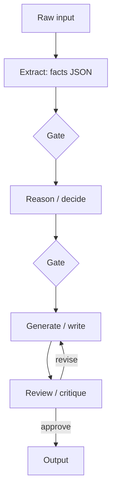

# Stage-Specific Prompting

> [!abstract] TL;DR
> In a chain, each stage gets its **own prompt, tuned to one job**. That covers its own role, instructions, examples, output format, and often its own model and temperature. ==A stage prompt should contain only what that stage needs. Extra context is noise, costs money, and gives [[Prompt Injection|injected text]] more places to act.== This is the prompt-level side of [[Task Decomposition]]: decomposition decides *what* the stages are, and stage-specific prompting decides *how* each one is instructed.

**Prerequisites:** [[Sequential Prompting]] · [[Prompt Engineering]]
**Related:** [[Prompt Chaining for Agentic Reasoning - Study Guide]] · [[Task Decomposition]] · [[Task Chaining]] · [[Few-Shot Prompting]] · [[Prompt Instruction Refinement]] · [[Gate Checks]]

> [!note] Source scope
> Linked from [[Sequential Prompting]] and the prompt-chaining study guide. The stage-parameter table, the templates and the analysis are *beyond the lecture*.

> [!todo]- Contents
> - [[#1. Core Concepts]]
> - [[#2. What to Tune per Stage]]
> - [[#3. Stage Archetypes and Templates]]
> - [[#4. Worked Example – Research to Draft to Review]]
> - [[#5. Pitfalls and Failure Modes]]
> - [[#6. Key Takeaways]]
> - [[#7. Critical Analysis]]
> - [[#8. Self-Test]]
> - [[#9. Glossary]]
> - [[#Further Reading]]

---

## 1. Core Concepts

> [!info]+ Definition – Stage-specific prompting
> Designing a separate prompt (and settings) for each stage of a multi-step chain. Each is tuned to that stage's single objective, its input contract and its output contract.

^def-stage-specific

> [!info]+ Definition – Minimal sufficient context
> A stage receives only the inputs it needs from earlier stages. It does not receive the full conversation or every intermediate output.

^minimal-context

Compare this with a **monolithic prompt**, which carries every instruction for every sub-job at once. Instructions compete with each other, and the model has to switch roles partway through its output.

---

## 2. What to Tune per Stage

| Parameter | Extraction stage | Reasoning stage | Generation stage | Review stage |
|---|---|---|---|---|
| Role | Precise data clerk | Analyst | Writer for audience X | Strict reviewer |
| Instructions | "Quote exactly, don't infer" | "Think step by step" ([[CoT prompt Samples]]) | Tone, length, structure | Checklist, pass/fail |
| Examples | Input → JSON pairs | Worked reasoning | Style exemplars | Good and bad labelled cases |
| Output format | Strict JSON schema | Structured reasoning + answer | Markdown / prose | Verdict JSON |
| Temperature | 0 | 0–0.3 | 0.5–0.8 | 0 |
| Model | Small / cheap | Strongest | Mid | Different from the generator |
| Gate | Schema + grounding | Logic | Required sections, PII | — (the review *is* a gate) |

^stage-params

---

## 3. Stage Archetypes and Templates



**Extraction stage**

```text
ROLE: You extract data. You never infer or add information.
INPUT: <ticket>{ticket_text}</ticket>
OUTPUT: JSON matching this schema: {schema}
RULE: Every string value must appear verbatim in the input, or be null.
```

**Generation stage** (does *not* see the raw ticket, only the checked facts)

```text
ROLE: You write customer updates for a regional ISP. Friendly, plain English, ≤120 words.
FACTS (verified): {facts_json}
MUST INCLUDE: what happened, current status, next update time.
MUST NOT: speculate on cause, promise credits.
```

**Review stage**

```text
ROLE: Strict QA reviewer.
Check the DRAFT against FACTS and RULES. Return JSON:
{"pass": bool, "violations": [{"rule": str, "evidence": str}]}
```

---

## 4. Worked Example – Research to Draft to Review

Task: write an internal briefing on a vendor firmware bug.

| Stage | Prompt focus | Input it gets | Output |
|---|---|---|---|
| 1 Research | "List facts with source IDs, no opinions" | Retrieved docs | `facts[]` with citations |
| 2 Analyze | "Assess the impact on our fleet, step by step" | `facts[]` + device inventory | Impact assessment |
| 3 Draft | "Write for NOC leads, 1 page, action-first" | Impact + key facts | Markdown briefing |
| 4 Review | "Every claim traceable to a fact ID" | Draft + `facts[]` | Pass/violations |

Stage 3 never sees the raw vendor documents. This limits hallucination and the chance of injected text in those documents reaching the draft.

---

## 5. Pitfalls and Failure Modes

| Failure | Symptom | Mitigation |
|---|---|---|
| Copy-pasted mega-prompt in every stage | Stages drift off-task, high token cost | [[#^minimal-context]] |
| Context starvation | Later stage lacks a needed detail | Define the input contract explicitly, and test with edge cases |
| Inconsistent terminology across stages | Stage 3 renames stage 1's fields | Shared glossary / schema |
| Reviewer = generator model and prompt | Rubber-stamp reviews | Different model or a stricter rubric, deterministic checks |
| Tuning one stage breaks another | Regression downstream | Run end-to-end evals after every prompt change ([[LLM Evaluation]]) |

---

## 6. Key Takeaways

- [ ] One stage, one job, one prompt, with its own role, examples, format, temperature and model.
- [ ] Give each stage only the minimal context it needs.
- [ ] Extraction and review run cold (temperature 0) with strict schemas. Generation can run warmer.
- [ ] Use a different model or rubric for review than for generation.
- [ ] Version stage prompts and evaluate end to end.

---

## 7. Critical Analysis

- **Benefit versus overhead.** Separate prompts mean more to maintain. For short tasks, one well-structured prompt with sections may do just as well. Measure before splitting.
- **Evidence.** Studies such as AI Chains report better quality and controllability from modular prompts, but the evidence is largely from user studies and small samples.
- **At scale.** Stage prompts become versioned artifacts that need owners, tests and rollback. Per-stage model routing can cut costs a lot (small models for extraction).
- **Security.** Minimal context works as a security boundary. Stages that handle untrusted text should have no tool privileges, and stages with privileges should see only facts that have passed validation.

> [!question] Discussion
> 1. How would you automatically detect that a stage is getting too little context?
> 2. Should stage prompts be optimized independently or jointly?

---

## 8. Self-Test

> [!question]- Q1. What is stage-specific prompting?
> Designing a separate, tuned prompt (and settings) for each stage of a chain, matched to that stage's single job and its input and output contracts.

> [!question]- Q2. Why shouldn't the generation stage see the raw source text?
> It should work from facts that have passed validation. This reduces hallucination, token cost, and exposure to injected instructions in the source.

> [!question]- Q3. Quantitative – a 3,000-token monolithic prompt runs 3 times (once per sub-job) versus stage prompts of 800, 600 and 700 tokens. What are the input-token savings?
> $9{,}000 - 2{,}100 = 6{,}900$ tokens, about 77% less.

> [!question]- Q4. Design – stage prompts for classifying and replying to support emails
> Extract (temp 0, JSON of customer/issue/quotes), classify (temp 0, enum + rationale), reply (temp 0.6, tone guide, uses only facts), review (temp 0, different model, checklist verdict).

> [!tip] Flashcards
> Review with [[Stage-Specific Prompting - Flashcards]].

---

## 9. Glossary

| Term | Meaning |
|---|---|
| Stage | One step of a chain with a single objective |
| Input/output contract | The schema a stage consumes and produces |
| Minimal sufficient context | Only the inputs the stage needs |
| Model routing | Using different models for different stages |

---

## Further Reading

- [AI Chains (Wu et al., 2022)](https://arxiv.org/abs/2110.01691)
- [Chain complex prompts – Anthropic docs](https://docs.anthropic.com/en/docs/build-with-claude/prompt-engineering/chain-prompts)
- [Building Effective Agents – Anthropic](https://www.anthropic.com/engineering/building-effective-agents)
