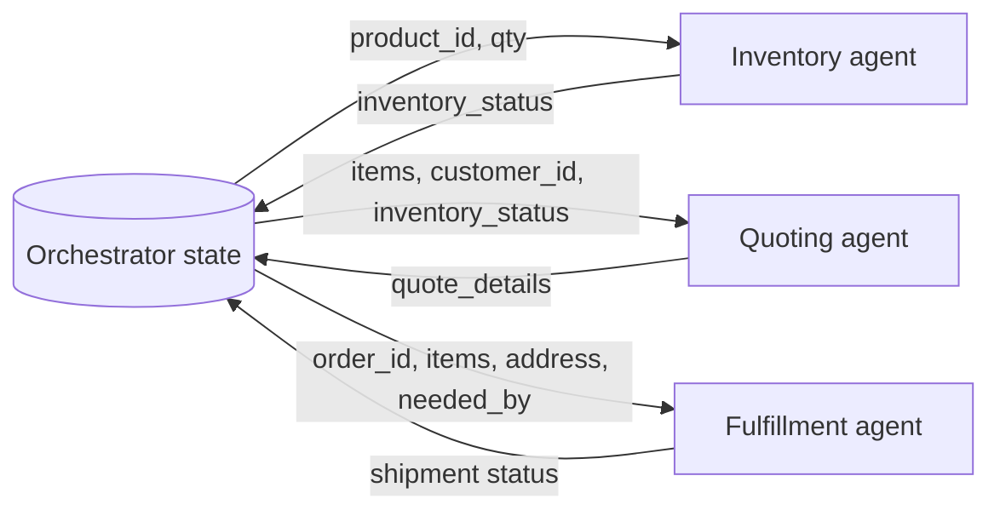
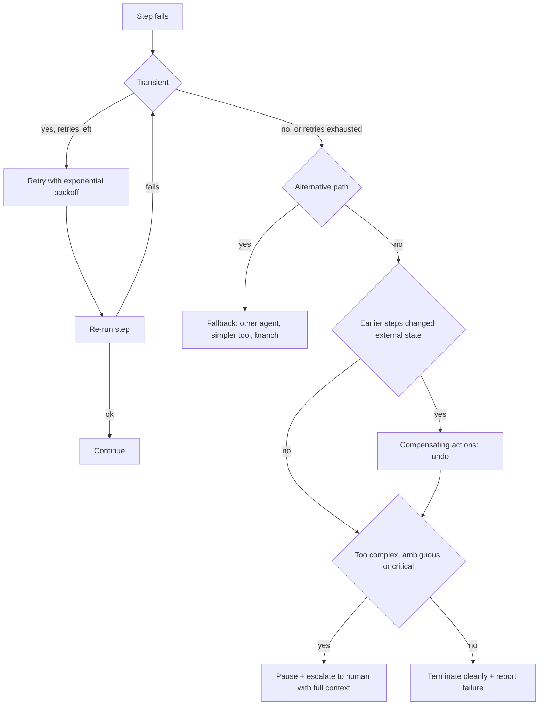
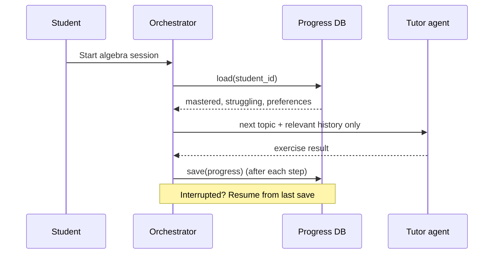

# State Management in Multi-Agent Systems

> [!abstract] TL;DR
> A team of agents needs a **collective memory**: a shared project dashboard that records what has happened, the current status, and what has been gathered, so any agent can get up to speed. The orchestrator owns that state and ==passes each agent only the slice of context it needs==. State comes in two lifetimes: **ephemeral** (one conversation) and **persistent** (stored across sessions). Because real-world steps *will* fail, the orchestrator also needs a failure ladder: **retry → fallback → graceful failure report**, plus **compensating actions** to undo side effects and **human escalation** for cases too risky to automate.

**Prerequisites:** [[Agent State Management]] · [[Orchestrating Agent Activities]]
**Related:** [[Long-Term Agent Memory]] · [[AI Memory]] · [[Agents and Databases]] · [[AI Reliability]] · [[Runtime or Orchestration Layer]] · [[Gate Checks]]
**Hands-on:** [[Penguin and Scientist Agents]] · [[Skate Park Orchestration]]

> [!note] Source scope
> Based on the Udacity lesson "State Management in Multi-Agent Systems" (Agentic AI Nanodegree, Course 4, Lesson 5): the introduction text, the "Advanced State Management Techniques" page, and the video transcript. Material marked *beyond the lecture* is my own addition. The lesson's demo and exercises are in `python notebooks/agentic-ai-c4-exercises-demos/lesson-5-state-management-in-multi-agent-systems/`.

> [!todo]- Contents
> - [[#1. Core Concepts]]
> - [[#2. Two Levels and Two Lifetimes of State]]
> - [[#3. Stateful Orchestration – Context Is King]]
> - [[#4. Failure Handling at the Orchestration Level]]
> - [[#5. Worked Example – Persistent Tutoring System]]
> - [[#6. Pitfalls and Failure Modes]]
> - [[#7. Key Takeaways]]
> - [[#8. Critical Analysis]]
> - [[#9. Self-Test]]
> - [[#10. Glossary]]
> - [[#Further Reading]]

## 1. Core Concepts

The lesson's hook is a customer service agent with **amnesia**: every time you talk to them, you start from scratch. A single-turn agent without memory is that amnesiac. To handle complex, multi-step tasks, agents need memory, and that memory is **state**. The mental model is a ==shared project dashboard or centralized logbook==.

> [!info]+ Definition – State
> The information a system stores and maintains about the status of a process or interaction at a given time.

^def-state

> [!info]+ Definition – State management
> The techniques and processes for tracking, updating and persisting state within a system: recording what has happened, the current status, and what information has been gathered, so any agent on the team can get up to speed.

^def-state-management

> [!info]+ Definition – Ephemeral state
> Temporary state that exists only for the duration of a single session or conversation, such as chat history. It can be discarded afterwards.

^def-ephemeral-state

> [!info]+ Definition – Persistent state
> State saved to a database or file that lasts across multiple sessions. It is the critical data that must be preserved.

^def-persistent-state

> [!info]+ Definition – Failure handling
> Strategies for gracefully managing errors in a workflow: retry logic, fallbacks, graceful failure reporting, compensating actions, and human-in-the-loop escalation.

^def-failure-handling

**Relationship to earlier notes.** [[Agent State Management]] covered state *inside one agent* (a typed state object moving through a state machine within one run). This lesson moves up a level, to state *shared across a team of agents and across sessions*, owned by the orchestrator. The lecture frames it as the same challenge as orchestration ([[Orchestrating Agent Activities]]) "but with a focus on data persistence rather than just workflow".

## 2. Two Levels and Two Lifetimes of State

| | Conversation-level state | System-level state |
|---|---|---|
| Lecture phrasing | "What's happening right now" | "What should be remembered for the future" |
| Typical lifetime | Ephemeral | Persistent |
| Examples | Chat history, the current order being quoted, intermediate agent results | Customer records, order history, a student's mastered concepts |
| Lives in | Orchestrator memory, the agent's message list | Database or file ([[Agents and Databases]]) |
| Lost on crash | Yes, unless checkpointed | No |
| Deeper note | [[Agent State Management#^def-ephemeral]] | [[Long-Term Agent Memory]] · [[AI Memory]] |

The design question the lecture keeps returning to is ==which information is temporary and can be discarded, and which is critical and must be preserved==. ^temp-vs-critical

> [!example]- Seen in the exercises
> - **[[Skate Park Orchestration]]:** each agent's step memory is wiped per request (ephemeral), while bookings, inventory and the maintenance log persist across requests in Python objects. That's why request 7 sees Carlos's booking from request 1. Those objects are only *process*-persistent, though: they vanish on restart, so they aren't truly persistent state.
> - **[[Penguin and Scientist Agents]]:** the distribution history is shared system-level state, but it records the model's *intent* rather than what actually happened. That's an example of the inconsistent state this lesson warns about.

## 3. Stateful Orchestration – Context Is King

The lecturer calls this "arguably the most critical aspect of effective orchestration" and the place where many multi-agent projects stumble. ==Agents almost never operate in isolation: they need information gathered earlier in the process==. The orchestrator must (1) **manage the shared state** and (2) **intelligently pass the relevant pieces** to each agent. ^context-is-king

### 3.1 The order-processing example

Request: *"Quote 10 reams of PROD_A paper for customer ACME_CORP, needed by next Friday."*

The orchestrator's state grows as the workflow proceeds:

```json
{
  "customer_id": "ACME_CORP",
  "order_id": "ORD-12345",
  "order_items": [{"product_id": "PROD_A", "quantity": 10}],
  "request_timestamp": "2025-04-30",
  "needed_by_date": "2025-05-09",
  "inventory_status": null,
  "quote_details": null,
  "shipping_address": null,
  "payment_status": null
}
```

### 3.2 Pass only what's needed

The orchestrator **does not dump the entire state** onto each worker:

| Worker | Receives | Deliberately omitted | Why |
|---|---|---|---|
| Inventory agent | `product_id`, `quantity` | `customer_id`, `needed_by_date` | A stock check doesn't need them |
| Quoting agent | `order_items`, `customer_id` (for discounts), maybe `inventory_status` | Shipping details | Pricing may depend on customer and availability |
| Fulfillment agent | `order_id`, `order_items`, `shipping_address` (fetched via `customer_id`), `needed_by_date` | Quote internals | It needs to know where and when to ship |



*Beyond the lecture,* minimal context pays off three ways: **fewer tokens** (cheaper, and less distraction for the model), **less data exposure** (least privilege: the inventory agent never sees customer data), and **easier testing** (each worker has a narrow, explicit input contract).

The lecture's warning about the opposite failure: without proper state, agents are "flying blind". The quoting agent can't apply discounts without knowing the customer, and fulfillment can't ship without the address.

### 3.3 Implementation mechanisms

The lecture lists four ways context actually reaches a worker, depending on the framework:

| Mechanism | How | Example in the vault |
|---|---|---|
| Direct arguments | Pass context as function or method parameters | `scientist.respond_to_action(penguin, details)` in [[Penguin and Scientist Agents]] |
| Message object | Bundle context in a typed message | A message passed in a peer-to-peer system ([[Multi-Agent Architecture Design#3. Peer-to-Peer Pattern – Direct Routing]]) |
| Shared state dict or object | A framework-managed state that every node reads and writes, as in graph-based systems | The state machine in [[Implementing Agent State Management with Python]] |
| Tool-call arguments | The orchestrator invokes tools through an agent and fills their arguments | The orchestrator's tool calls in [[Skate Park Orchestration]] |

## 4. Failure Handling at the Orchestration Level

"Workflows are great until something breaks". With databases, APIs and unpredictable users, things *will* break. The lecture places this **one layer above tool-level error handling**: tools catch and report their own errors ([[Tool Use]]), and the orchestrator decides what the *workflow* does next. ^orchestration-layer-errors



| Strategy | When | Lecture example | Connects to |
|---|---|---|---|
| **Retry logic** | Temporary issues: a network blip, a rate limit | A shipping-rate API times out → wait and retry | [[AI Reliability#3. Reliability Patterns]] |
| **Fallbacks / alternative paths** | Retries fail, or the error is clearly permanent | Route to a different agent, a simpler backup tool, or branch, e.g. failed validation → another agent | [[Orchestrating Agent Activities#3.3 Conditional branching – e-commerce returns]] |
| **Graceful failure reporting** | The workflow truly can't proceed | Terminate cleanly and report back to the requester with clear context. Never crash silently | [[AI Reliability#^silent-failure]] |
| **Compensating actions** | A later step fails after an earlier step made persistent changes | Card charged, then provisioning fails → refund the charge | *Beyond the lecture:* the saga pattern |
| **Human-in-the-loop escalation** | Errors too complex, ambiguous or critical to automate | Financial analysis fails several sanity checks → pause and open a high-priority ticket with inputs, intermediate results and logs | [[Gate Checks]] |

### 4.1 Retry with exponential backoff

Delays grow between attempts. The lecture's version is 1 s, then 2 s, then 4 s:

$$
\text{delay}_k = b \cdot 2^{k} \quad (k = 0, 1, 2, \dots)
$$

> [!warning] Lecture inconsistency
> The narrated example uses "wait 2 s, then 5 s", which isn't a doubling sequence. Treat it as illustrative. The principle is *increasing* delays and a *bounded* number of attempts.

*Beyond the lecture:*
- Add random **jitter** to the delay so many clients that failed at the same moment don't retry in lockstep (thundering herd).
- Retry only **transient** errors (timeouts, 429, 5xx), never permanent ones (400 bad request, auth failure). Retrying those just wastes time.
- If each attempt independently succeeds with probability $p$, then $k$ attempts succeed with $1-(1-p)^k$. At $p = 0.9$, three attempts give $0.999$. This only holds when failures are independent, which is true of network blips but not of a bug.
- Retrying a step with side effects is only safe if it's **idempotent**: charging a card twice because the first response timed out is a real failure mode. Use idempotency keys.

### 4.2 Compensating actions and atomicity

A multi-agent workflow touching several external systems can't use a single database transaction. If step 1 (charge card) succeeds and step 2 (provision service) fails, the system is in an **inconsistent state**. The orchestrator must run the **compensating action** for each completed step, in reverse order. The lecture's instruction: think carefully about ==atomicity and compensation in any workflow that modifies external state==. ^compensation

*Beyond the lecture:* this is the **saga pattern** from distributed systems. Each step $T_i$ is paired with a compensation $C_i$. On failure at step $n$, run $C_{n-1}, \dots, C_1$. That requires the state to record *which steps completed*, which is another reason state management and failure handling are inseparable. Compensations aren't always perfect undos: an email can't be unsent, only followed by a correction.

## 5. Worked Example – Persistent Tutoring System

From the lecture: an educational tutoring system that keeps student progress across sessions.

| Element | In the tutoring system |
|---|---|
| Persistent state | Concepts mastered, concepts the student is struggling with, learning preferences |
| Load | At the start of a new algebra session, the state is loaded from a database |
| Use | The tutor agent continues "exactly where they left off", e.g. skipping mastered topics and practising weak ones |
| Save | The persistence layer saves progress continuously, so an interrupted session can resume |
| Result | Personalized, continuous experiences "even across disconnected interactions" |



This is the lesson's version of [[Long-Term Agent Memory#3. The Three Types of Long-Term Memory]]. The student model spans all three types. Mastered and struggling concepts are semantic memory (facts about the student), past session outcomes are episodic memory, and learning preferences shape *how* the tutor teaches, which is procedural memory ([[Long-Term Agent Memory#^memory-types]]).

## 6. Pitfalls and Failure Modes

| Failure | Symptom | Mitigation |
|---|---|---|
| Dumping the full state on every agent | Token bloat, distracted models, data leaks to agents that shouldn't see it | Per-agent context contracts ([[#^context-is-king]]) |
| Missing context | Agents "fly blind": no discount, wrong address | Explicit input contracts per worker; validate required fields before delegating |
| Critical data held only in ephemeral state | Crash or restart loses progress | Persist at checkpoints; decide temporary vs critical up front ([[#^temp-vs-critical]]) |
| Retrying permanent errors | Wasted time and cost, delayed failure | Classify errors as transient or permanent before retrying |
| Retrying non-idempotent steps | Duplicate charges or bookings | Idempotency keys; check-then-act on the external system |
| No compensation | Customer charged for a service never delivered | Pair each side-effecting step with an undo ([[#^compensation]]) |
| Silent failure | The user waits forever, or gets a wrong answer | Clean termination with a clear failure report |
| Escalation without context | The human has to reconstruct everything | Attach inputs, intermediate results and error logs to the ticket |
| State records intent, not outcome | History diverges from reality ([[Penguin and Scientist Agents#4. Issues in the Starter]]) | Write state after the action is confirmed |
| Several writers to the same state | Lost updates and race conditions | One owner (the orchestrator), or versioned or locked writes. Covered in depth in [[Multi-Agent State Coordination]] (Lesson 6) |

## 7. Key Takeaways

- [ ] State is the team's collective memory: what happened, current status, and what has been gathered.
- [ ] Separate conversation-level (ephemeral) state from system-level (persistent) state, and decide what is critical.
- [ ] The orchestrator owns the shared state and passes each agent only the slice it needs.
- [ ] Context reaches agents through direct arguments, message objects, a shared state object, or tool-call arguments.
- [ ] Failure ladder: retry (transient errors, with backoff) → fallback → graceful failure report.
- [ ] Any workflow that changes external state needs compensating actions to stay consistent.
- [ ] Escalate complex, ambiguous or critical failures to a human, with full context attached.
- [ ] Design questions to keep asking: what must be remembered, where does the truth live, how do we stay consistent on failure, and how do we answer historical queries?

## 8. Critical Analysis

**"Where does the real truth live?"** This is the lecture's sharpest question. The orchestrator's state is a *copy* of facts that really live elsewhere: the inventory database, the payment provider. Copies go stale. *Beyond the lecture:* treat orchestrator state as a cache of references and decisions, and re-read volatile facts (stock levels, payment status) from the system of record just before acting on them. The penguin exercise shows what happens otherwise.

**Historical queries.** The lecture asks how to handle historical queries but doesn't answer. If state is overwritten in place, the history is gone. An **append-only event log** (event sourcing), with current state derived from it, supports auditing, debugging ("why did the agent do that?") and replay after a crash. This matters for agent systems because LLM decisions are hard to reproduce after the fact.

**Durability.** Persistence of *business* data (the tutoring example) is different from persistence of *workflow progress*. To "pick up where it left off" after an orchestrator crash, the run itself needs checkpointing. See [[Runtime or Orchestration Layer#5. Durability, Budgets and Observability]].

**Retries and LLMs.** For model calls, a retry isn't a pure replay: sampling may produce a different (sometimes better) answer. That makes retry-with-feedback ([[LLM Feedback Loops]]) useful. But it also means a "transient" failure might really be a systematic prompt problem that no amount of retrying fixes.

**Security and privacy.** Persistent state accumulates personal data (customer IDs, addresses, student weaknesses), so it needs retention limits, access control and deletion paths. Shared state is also an injection vector: text one agent writes ("ignore prior instructions…") is later read by another agent as context ([[Prompt Injection]]). The minimal-context rule ([[#^context-is-king]]) reduces this exposure as a side effect.

**Evaluation.** Test failure handling deliberately. Inject faults (timeouts, permanent errors, a failure after a side effect) and assert that the right strategy fires: retries are bounded, compensation runs, and escalation tickets contain full context. Happy-path tests will never exercise this code.

> [!question] Open discussion questions
> - Should the orchestrator's state be the source of truth, or only a cache over the systems of record?
> - When an LLM step fails validation, is a retry, a fallback model, or human escalation the right default, and how would you decide using data?
> - Which compensating actions in your domain are impossible (e.g. a sent notification), and how does that change step ordering?

## 9. Self-Test

> [!question]- Q1. Distinguish ephemeral from persistent state, with an example of each.
> Ephemeral state lasts only for one session or conversation, e.g. the chat history of a support call. Persistent state is saved to a database or file and lasts across sessions, e.g. a student's mastered concepts in the tutoring system.

> [!question]- Q2. Why doesn't the orchestrator pass its full state to every worker? Give the lecture's inventory example.
> Workers need only the context for their task. The inventory agent gets `product_id` and `quantity`, not `customer_id` or `needed_by_date`, which a stock check doesn't need. Beyond the lecture, this also saves tokens, reduces data exposure, and makes each worker's inputs explicit.

> [!question]- Q3. List the five orchestration-level failure strategies in the order you would typically apply them.
> Retry (transient errors, with backoff) → fallback or alternative path → graceful failure reporting. Alongside these: compensating actions whenever earlier steps changed external state, and human-in-the-loop escalation for complex, ambiguous or critical errors.

> [!question]- Q4. Step 1 charges a credit card and succeeds. Step 2 provisions the service and fails permanently. What must the orchestrator do, and what is this called?
> Run a compensating action to refund the charge, so the customer isn't billed for a service they never received. Then report the failure. This is a compensating action (beyond the lecture: the saga pattern), needed because the workflow isn't atomic.

> [!question]- Q5. Design: a hotel-booking multi-agent system books a flight, then a hotel, then sends a confirmation email. Design the state and the failure handling.
> State: `trip_id`, traveller ID, dates, `flight_booking_ref`, `hotel_booking_ref`, `email_sent`, and a per-step status. Pass the flight agent dates and destination only, the hotel agent dates and city, and the email agent references and the address. Failures: retry API timeouts with backoff, using idempotency keys so a retry doesn't double-book. If the hotel fails permanently, try an alternative hotel (fallback); if none, cancel the flight (compensation) and report. Send the email last, because it can't be undone. Escalate to a human if cancelling the flight itself fails.

> [!question]- Q6. Quantitative: a step has a base delay of 1 s and exponential backoff with 4 retries. What is the total waiting time, and with per-attempt success 0.8 (independent), what is the overall success probability over 5 attempts?
> Delays: 1 + 2 + 4 + 8 = 15 s. Success: $1 - 0.2^5 = 1 - 0.00032 = 0.99968$.

> [!question]- Q7. Name the four mechanisms the lecture gives for passing context to a worker.
> Direct function or method arguments, a bundled message object, a shared state dictionary or object managed by the framework (as in graph-based systems), and arguments to a tool call when the orchestrator invokes tools through the agent.

### Flashcards

> [!tip] Flashcards
> Review this lesson with [[State Management in Multi-Agent Systems - Flashcards]].

## 10. Glossary

| Term | Definition |
|---|---|
| State | Information about the status of a process or interaction at a given time ([[#^def-state]]) |
| State management | Tracking, updating and persisting state ([[#^def-state-management]]) |
| Ephemeral state | Lasts one session or conversation ([[#^def-ephemeral-state]]) |
| Persistent state | Stored in a database or file across sessions ([[#^def-persistent-state]]) |
| Conversation-level state | What's happening right now |
| System-level state | What should be remembered for the future |
| Retry logic | Re-running a failed step, usually with increasing delays |
| Exponential backoff | Delays that double between retries (1 s, 2 s, 4 s…) |
| Fallback | Plan B: a different agent, a simpler tool, or another branch |
| Compensating action | An action that undoes an earlier step's side effect ([[#^compensation]]) |
| Human-in-the-loop escalation | Pausing and handing a failure to a person with full context |
| Saga pattern | A sequence of steps each paired with a compensation *(beyond the lecture)* |
| Idempotency | Running an operation twice has the same effect as once *(beyond the lecture)* |
| Event sourcing | Storing state as an append-only log of events *(beyond the lecture)* |

## Further Reading

- [Saga distributed transactions pattern – Microsoft Azure Architecture Center](https://learn.microsoft.com/en-us/azure/architecture/reference-architectures/saga/saga)
- [Retry pattern – Microsoft Azure Architecture Center](https://learn.microsoft.com/en-us/azure/architecture/patterns/retry)
- [Exponential Backoff and Jitter – AWS Architecture Blog](https://aws.amazon.com/blogs/architecture/exponential-backoff-and-jitter/)
- [Event Sourcing – Martin Fowler](https://martinfowler.com/eaaDev/EventSourcing.html)
- [LangGraph – Persistence](https://langchain-ai.github.io/langgraph/concepts/persistence/)

%% Study hint: anchor each idea to its example. Amnesiac agent = why state; ACME paper order = context passing; charge-then-provision = compensation; financial sanity checks = human escalation; algebra tutor = persistent state. %%
