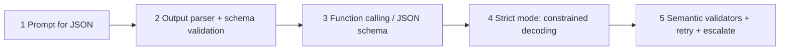

# Structured Outputs

> [!abstract] TL;DR
> Agents become useful to *software* when they return **machine-readable data** (typed JSON) instead of prose. Then ticketing systems, dashboards and workflows can act on the result directly. Asking for JSON in the prompt is unreliable, so you move up a ladder: **prompt → output parser + validation → function calling / schema-constrained decoding → semantic validation with retries**. ==A schema can guarantee the *shape* of an answer, never its *truth*==. `"customer_email": "none found"` is a perfectly valid string. So structured output is a contract you enforce in code, not a property the model has.

**Prerequisites:** [[Large Language Models]] · [[Tool Use]]
**Related:** [[Pydantic for Structured LLM Output - Study Guide]] (validators, retry loop) · [[Output Validation]] · [[Gate Checks]] · [[Building Agents with Tools in Python]] · [[Tool Descriptions in Agentic Systems]] · [[LLM Hallucinations]]

**Sources:** Course reading "Structured Outputs: Making AI Responses Actionable". This note doesn't repeat the Pydantic validator mechanics and the validate–retry loop, which are covered in depth in [[Pydantic for Structured LLM Output - Study Guide]]. The OpenAI SDK code (checked against `openai==1.78.1`, the version in your `python notebooks` venv), the correction to the reading's "guarantees" claim, the schema-design guidance and the critical analysis are *beyond the lecture*.

> [!todo]- Contents
> - [[#1. Core Concepts]]
> - [[#2. Why Prompting Is Not Enough]]
> - [[#3. The Reliability Ladder]]
> - [[#4. What Function Calling Does and Does Not Guarantee]]
> - [[#5. Modeling Complex Data with Pydantic]]
> - [[#6. Code – Four Ways to Get Structured Output]]
> - [[#7. Designing Schemas for Honest Output]]
> - [[#8. Worked Example – Call Summary to Ticket]]
> - [[#9. Pitfalls and Failure Modes]]
> - [[#10. Key Takeaways]]
> - [[#11. Critical Analysis]]
> - [[#12. Self-Test]]
> - [[#13. Glossary]]
> - [[#Further Reading]]

---

## 1. Core Concepts

> [!info]+ Definition – Structured output
> A model response that follows a **machine-readable contract**, usually JSON matching a JSON Schema, so downstream code can parse it rather than scrape it.

^def-structured-output

> [!info]+ Definition – Output parser
> Code that takes the model's raw text, extracts and parses it (e.g. `json.loads`), and **validates it against a schema**. If it's valid you get a typed object; if not, a fallback strategy runs (retry, repair, default, escalate).

^def-output-parser

> [!info]+ Definition – Constrained decoding
> A decoding mode where, at each token, the provider ==masks out tokens that would break the schema==, so the output is syntactically valid and schema-conformant by construction. OpenAI exposes this as `strict: true` / "Structured Outputs". Open-source equivalents include Outlines and grammar-constrained sampling. *(Beyond the lecture.)*

^def-constrained-decoding

| Output style | Readable by | Can trigger actions | Example consumer |
|---|---|---|---|
| Free-form text | Humans | Only via fragile scraping | Chat UI, email draft |
| Structured JSON | Code (and humans) | Directly | Ticketing system, dashboard, alerting, the next agent in a [[Prompt Chaining Workflow|chain]] |

The reading's example: instead of summarizing a customer call in prose, extract

```json
{ "issue_type": "login_problem", "urgency": "high", "customer_email": "jane@mail.com" }
```

That record can open a ticket, set a priority and notify the customer with no human re-typing anything.

---

## 2. Why Prompting Is Not Enough

"Return the answer as JSON with fields: issue_type, urgency, customer_email" sometimes works. When it fails, it fails in ways that break code:

| Failure | Example | What breaks |
|---|---|---|
| Value outside the vocabulary | `"urgency": "very"` | Routing `match` falls through |
| Placeholder instead of null | `"customer_email": "none found"` | Email sender bounces, or worse, it passes a naive `str` check |
| Wrong type | `"urgency": 3`, `"due_date": "next Friday"` | Sorting and date math crash |
| Wrapped JSON | ```` ```json { … } ``` ```` or "Sure! Here's the JSON: …" | `json.loads` fails |
| Missing or extra keys | `"email"` instead of `"customer_email"` | `KeyError` |
| Truncation | Output cut off at `max_tokens` | Invalid JSON |

The reading's explanation: ==LLMs are trained on natural language, not strict type rules==. The prompt is a *request*, not an *enforcement mechanism*.

---

## 3. The Reliability Ladder



| Rung | Mechanism | Guarantees | Still possible |
|---|---|---|---|
| 1 | Instructions in the prompt | Nothing | Anything in [[#2. Why Prompting Is Not Enough]] |
| 2 | Parser + Pydantic validation | Invalid output is **detected** | It still happens. You pay for retries |
| 3 | Function calling (schema passed as a tool) | Output arrives in a structured `tool_calls` slot. Mostly well-formed | Schema violations when not strict (wrong enum, missing field) |
| 4 | Strict / constrained decoding | Valid JSON that **matches the schema** (within the supported subset) | Refusals, truncation, **wrong-but-valid values** |
| 5 | Field/model validators, grounding checks, retries | Values checked against the source and domain rules | Errors the validators don't test for |

Rungs 2 and 5 are the [[Gate Checks|format, content and logic gates]]. Rungs 3 and 4 shrink how often the format gate fires, but ==they don't replace the content and logic gates==.

^reliability-ladder

---

## 4. What Function Calling Does and Does Not Guarantee

> [!warning] Correction to the reading
> The reading says function calling "guarantees correct format and types". That's **only true with strict / constrained decoding** (rung 4). Plain function calling (rung 3) gives the schema to the model as a strong hint, and the model usually complies, but it can still produce a wrong enum value or omit a field. Even strict mode guarantees only **conformance to the schema**, not correctness.

| Guaranteed by strict mode | Not guaranteed |
|---|---|
| Parses as JSON | The values are **true** (a hallucinated email is still a valid string) |
| Required keys present, no extra keys | The values are **grounded** in the input |
| Types and enum values match | Cross-field consistency (`status="closed"` with no resolution) |
| | Completion when `max_tokens` is hit or the model **refuses** |
| | Support for every JSON Schema feature. Providers accept a **subset**, so check the docs |

Function calling is also how the agents in [[Building Agents with Tools in Python]] work. A **tool's argument object is a structured output**. The same `@tool` schema machinery (name, docstring, type hints → JSON Schema) can be used purely for extraction by *forcing* the model to call a "record" function and never actually executing anything.

---

## 5. Modeling Complex Data with Pydantic

For nested and list-shaped outputs, define the schema as Python classes:

```python
from datetime import datetime
from typing import Literal
from pydantic import BaseModel

class ActionItem(BaseModel):
    title: str
    due_date: datetime
    owner: str
    status: Literal["open", "closed"]

class MeetingNotes(BaseModel):
    summary: str
    action_items: list[ActionItem]
```

One class gives you three things:

1. **A JSON Schema for the model.** `datetime` becomes `{"type": "string", "format": "date-time"}` and `Literal` becomes `enum`.
2. **A parser/validator for the response.** `MeetingNotes.model_validate_json(raw)`.
3. **A typed Python object for your code** (`notes.action_items[0].due_date.weekday()`).

What validation catches (tested locally with Pydantic 2.13):

```text
ActionItem.model_validate_json('{"title":"x","due_date":"next Friday","owner":"Bo","status":"pending"}')
→ due_date  datetime_from_date_parsing  Input should be a valid datetime or date...
→ status    literal_error               Input should be 'open' or 'closed'
```

Those `e.errors()` entries (`loc`, `type`, `msg`) are exactly what you send back to the model on a retry. The full validate–retry loop, `field_validator` / `model_validator`, and grounding checks via `context` are in [[Pydantic for Structured LLM Output - Study Guide#3. Pydantic Mechanics – Mapping Gates to Features]] and [[Pydantic for Structured LLM Output - Study Guide#4. The Validate–Retry Loop]].

---

## 6. Code – Four Ways to Get Structured Output

*Beyond the lecture.* All four use the same schema:

```python
from typing import Literal, Optional
from pydantic import BaseModel, Field

class Ticket(BaseModel):
    issue_type: Literal["login_problem", "billing", "bug", "other"]
    urgency: Literal["low", "medium", "high"]
    customer_email: Optional[str] = Field(description="Email stated in the call, or null if none was given")
```

### 6.1 Prompt + parse + validate (rungs 1–2)

```python
raw = llm(f"Return ONLY JSON matching this schema:\n{Ticket.model_json_schema()}\n\nCall:\n{transcript}")
try:
    ticket = Ticket.model_validate_json(raw)
except ValidationError as e:
    ...  # retry with e.errors() as feedback, or escalate
```

### 6.2 JSON mode + validate

`response_format={"type": "json_object"}` guarantees **valid JSON**, but **not your schema**. You still need the Pydantic step. (OpenAI requires the word "JSON" to appear in the messages when using this mode.)

### 6.3 Strict structured outputs with `parse` (rung 4)

```python
from openai import OpenAI
client = OpenAI()

completion = client.beta.chat.completions.parse(   # in 1.78.1 this lives under .beta
    model="gpt-4o-mini",
    messages=[
        {"role": "system", "content": "Extract a support ticket from the call transcript."},
        {"role": "user", "content": transcript},
    ],
    response_format=Ticket,                         # Pydantic class → strict JSON Schema
)
msg = completion.choices[0].message
if msg.refusal:
    handle_refusal(msg.refusal)
else:
    ticket: Ticket = msg.parsed                     # already a validated Ticket instance
```

### 6.4 Forced function call (rung 4, via tools)

```python
import openai, json

tools = [openai.pydantic_function_tool(Ticket, name="record_ticket")]   # adds "strict": true
resp = client.chat.completions.create(
    model="gpt-4o-mini",
    messages=messages,
    tools=tools,
    tool_choice={"type": "function", "function": {"name": "record_ticket"}},  # must call it
)
args = resp.choices[0].message.tool_calls[0].function.arguments
ticket = Ticket.model_validate_json(args)
```

> [!note] What strict mode did to the schema
> Printing `openai.pydantic_function_tool(Ticket)` shows `"strict": true`, `"additionalProperties": false`, and **all three fields listed as `required`**. `customer_email` became `anyOf: [string, null]`. In strict mode "optional" means "**required but nullable**". The model must always emit the key and can only set it to `null`.

| Approach | Schema enforced by | Extra code | When to use |
|---|---|---|---|
| 6.1 Prompt + validate | Your validator only | Retry loop | Any model or provider; local models without constrained decoding |
| 6.2 JSON mode | JSON syntax only | Validator + retry | Older models without strict support |
| 6.3 `parse` | Provider (constrained) + SDK parsing | Refusal handling | Default for pure extraction on OpenAI |
| 6.4 Forced tool | Provider (constrained) | Validate args | When the agent already uses tools, or on providers whose structured output is tool-based |

The course's `lib/tooling.py` (see [[Building an AI Agent with Tools - Exercise#2. The Helper Library – What lib Does for You]]) sets `additionalProperties: false` but **not** `strict: true`, so its tools are on rung 3, not rung 4.

---

## 7. Designing Schemas for Honest Output

*Beyond the lecture.* The schema is also a prompt. Its shape steers what the model writes.

| Principle | Bad | Good | Why |
|---|---|---|---|
| Make "not found" representable | `customer_email: str` | `customer_email: Optional[str]` + description "null if not stated" | Otherwise the model *must* invent a string ("none found", a guess) |
| Close vocabularies | `urgency: str` | `Literal["low","medium","high"]` | Blocks `"very"`. Routing fields can't carry free text (also limits [[Prompt Injection]]) |
| Include an escape value | `Literal["login_problem","billing","bug"]` | `+ "other"` | Forces honest classification instead of a wrong bucket |
| Describe fields | Bare names | `Field(description=...)` | Descriptions go into the schema the model sees ([[Tool Descriptions in Agentic Systems]]) |
| Order fields for reasoning | `answer` first | `evidence` / `reasoning` field **before** the answer field | Generation follows key order, so the model "thinks" before committing |
| Supply context for relative values | "due next Friday" with no date | Put today's date in the prompt | Otherwise `due_date` is a guess, even if it's a valid `date-time` |
| Keep it flat where possible | Deep nesting | Shallow objects, small lists | Fewer tokens, fewer errors, fits provider schema limits |

^schema-design

---

## 8. Worked Example – Call Summary to Ticket

**Input (constructed):** *"Hi, it's Jane. I've been locked out since this morning and I've got a client demo in an hour. Reach me at jane@mail.com."*

| Step | Output | Gate |
|---|---|---|
| 1. Strict extraction (6.3) | `{"issue_type":"login_problem","urgency":"high","customer_email":"jane@mail.com"}` | Schema guaranteed by the provider |
| 2. Grounding validator | Check that `customer_email` appears verbatim in the transcript ✅ | Content gate ([[Pydantic for Structured LLM Output - Study Guide#2. Information-Bound Gates – The Design Rule]]) |
| 3. Logic validator | `urgency == "high"` needs a time-pressure cue ("demo in an hour") ✅ | Logic gate |
| 4. Action | Create a P1 ticket, page on-call, email Jane | Downstream system |

**Same pipeline, harder input:** *"Can't log in, please help."*
- With `customer_email: str`, the model must output *some* string. You'd likely get a guess or `"none found"`, which passes the schema and then bounces.
- With `Optional[str]`, it outputs `null`, and the workflow branches to "ask the customer for contact details". ==The schema design, not the model, decided whether the system behaved honestly.==

---

## 9. Pitfalls and Failure Modes

| Failure | Symptom | Mitigation |
|---|---|---|
| Relying on the prompt alone | Intermittent `JSONDecodeError`, `KeyError` | Move up the ladder ([[#^reliability-ladder]]) |
| Treating JSON mode as schema mode | Valid JSON, wrong keys | Validate with Pydantic, or use strict mode |
| Believing "strict = correct" | Valid but hallucinated values flow downstream | Grounding and logic validators ([[Output Validation]]) |
| Non-nullable fields for optional facts | Placeholders like `"none found"`, `"N/A"`, fake emails | `Optional[...]` with a "null if absent" description |
| Ignoring refusals | `parsed is None` → `AttributeError` | Check `message.refusal` |
| Truncated output | Invalid or partial JSON | Raise `max_tokens`, shrink the schema, check `finish_reason` |
| Unsupported schema features | API rejects the schema, or it's silently loosened | Stick to the provider's supported subset. Validate locally anyway |
| Unbounded retries | Cost spikes; same error repeated | Cap at $k$ attempts, then escalate ([[Pydantic for Structured LLM Output - Study Guide#^retry-math]]) |
| Free-text fields carrying injection | `notes` field contains "ignore previous instructions…" for the next agent | Treat string fields as untrusted data in later prompts ([[Prompt Injection]]) |

---

## 10. Key Takeaways

- [ ] I can explain why structured output is what lets an agent *act* (integration, automation), not just talk.
- [ ] I can list how prompt-only JSON fails (bad enums, placeholders, wrong types, wrapping, truncation).
- [ ] I can place prompt, parser, function calling, strict mode and validators on the reliability ladder.
- [ ] I know strict mode guarantees **shape**, not **truth**, and still needs refusal and truncation handling.
- [ ] I can write a Pydantic model with `Literal`, `Optional`, nested lists and descriptions, and use it with `parse` or a forced tool.
- [ ] I design schemas so "unknown" is representable and vocabularies are closed.

---

## 11. Critical Analysis

- **"Guarantee" is doing heavy lifting.** Vendor statements about schema adherence measure *syntactic conformance*, which is exactly the part that's easy to check. The expensive errors are semantic: a valid-looking `urgency` that's wrong, an email that was never said. Evaluate structured extraction with **field-level accuracy against labeled data** (precision/recall per field, exact match for enums), not "% valid JSON" ([[LLM Evaluation]]).
- **Format constraints may cost reasoning quality.** Some studies (e.g. Tam et al., 2024) report that strict format restrictions can hurt performance on reasoning tasks, while others find little effect. The evidence is mixed and task-dependent. A common hedge is to let the model reason first (a free-text `reasoning` field placed earlier in the schema, or a separate unconstrained step) and constrain only the final fields.
- **Quantitative view.** If prompt-only JSON is valid 97% of the time and a workflow processes 10,000 calls a day, that's ~300 failures a day to retry or hand-fix. Retries help, at $1-(1-p)^k$ in the ideal independent case, but strict decoding removes the *format* failures at the source. That leaves the validator budget for semantic checks.
- **Portability.** Strict decoding is provider-specific (OpenAI strict mode, tool-based extraction on other providers, grammar sampling for local models), and each supports a different JSON Schema subset. Keeping Pydantic as the **single source of truth** and validating locally makes the system portable and stops you depending on any one provider's guarantee.
- **Security.** Enums and booleans are safe channels because they can't carry instructions. Free-text fields are not. In a multi-agent pipeline, structured output from agent A becomes *input* to agent B, so string fields are an injection path ([[Prompt Injection]]).
- **Open questions:** Where should the line sit between constraining the model and validating after the fact? Is a "reasoning" field honest reasoning or a post-hoc rationalization? How do you version schemas when downstream systems depend on them?

---

## 12. Self-Test

> [!question]- Q1. Why is structured output more useful than a text summary for an agent?
> Downstream systems (ticketing, dashboards, alerts, other agents) can consume typed fields directly and trigger actions. Text needs a human or fragile scraping.

> [!question]- Q2. Give three ways prompt-only JSON breaks code.
> Out-of-vocabulary values (`"urgency": "very"`), placeholders in typed fields (`"email": "none found"`), and wrapped or malformed JSON (Markdown fences, preamble text, truncation). Wrong types and missing keys also count.

> [!question]- Q3. What's the difference between JSON mode and strict structured outputs?
> JSON mode guarantees only syntactically valid JSON. Strict mode (constrained decoding) guarantees the JSON matches **your schema**: the required keys, types and enum values.

> [!question]- Q4. Strict mode is on. Can the output still be wrong? How?
> Yes. Values can be valid but false or ungrounded (a hallucinated email), inconsistent across fields, refused (`message.refusal`) or truncated. Use grounding and logic validators and check `finish_reason` and `refusal`.

> [!question]- Q5. Why does `pydantic_function_tool` list an `Optional` field as required?
> In strict mode every property must be required. Optionality is expressed as **nullable** (`anyOf: [type, null]`), so the model always emits the key and uses `null` for "absent".

> [!question]- Q6. Design – meeting notes produce action items with relative dates ("by next Friday"). How do you get reliable `due_date` values?
> Model `due_date: datetime` (or `date`) in Pydantic, put **today's date** in the system prompt so relative dates can be resolved, and add a validator that the date isn't in the past and falls within a plausible window. Allow `Optional` if no date was given rather than forcing a guess.

> [!question]- Q7. Quantitative – prompt-only validity is $p = 0.9$ per attempt. With up to 3 attempts (independent), what is the pass rate? Why might reality be worse?
> $1 - 0.1^3 = 0.999$. Failures are correlated: the same confusing input tends to fail the same way each time, so real retry gains are smaller. That's another reason to fix format at the decoding level.

> [!question]- Q8. Why include `"other"` in an `issue_type` enum?
> Without an escape value, the model has to force an out-of-scope case into a wrong category. `"other"` keeps classification honest and gives you a measurable bucket for missing categories.

### Flashcards

> [!tip] Flashcards
> Review this topic with [[Structured Outputs - Flashcards]].

---

## 13. Glossary

| Term | Meaning |
|---|---|
| Structured output | Model response in a machine-readable format matching a schema |
| JSON Schema | Standard vocabulary for describing JSON structure, types and constraints |
| Output parser | Code that parses and validates raw model text against a schema |
| JSON mode | Provider setting guaranteeing valid JSON syntax, not a specific schema |
| Strict mode / Structured Outputs | Constrained decoding guaranteeing conformance to a supplied schema |
| Constrained decoding | Masking tokens at generation time so output can't violate a grammar or schema |
| Forced tool call | `tool_choice` set to a specific function so the model must emit its arguments |
| Refusal | Model declines. In OpenAI's parse API it is returned in `message.refusal` instead of `parsed` |
| Nullable field | A required key that may be `null`. Strict mode's version of "optional" |

---

## Further Reading

- [OpenAI docs – Structured Outputs](https://platform.openai.com/docs/guides/structured-outputs)
- [OpenAI docs – Function calling](https://platform.openai.com/docs/guides/function-calling)
- [Pydantic documentation](https://docs.pydantic.dev/latest/)
- [Willard & Louf (2023) – Efficient Guided Generation for Large Language Models (Outlines)](https://arxiv.org/abs/2307.09702)
- [Tam et al. (2024) – Let Me Speak Freely? A Study on the Impact of Format Restrictions on Performance of LLMs](https://arxiv.org/abs/2408.02442)

%%
Study hint: memorize the ladder (prompt → parser → function calling → strict → semantic validators) and the one-liner "schemas guarantee shape, not truth". Most exam-style questions on this topic are one of those two.
%%
